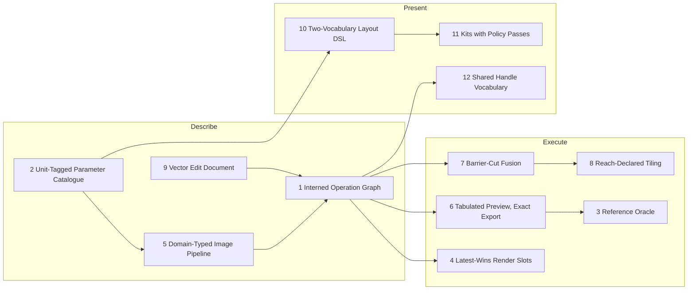

# A pattern language for interactive image engines and their editors

## The kit and the quality

These twelve patterns describe how to build an interactive image system: something that turns a description of an
edit into pixels, fast enough to follow a hand on a slider, correctly enough to print, and with an interface that
people and agents can both drive. They come from three implementations of the same problem, built separately, which
arrived at the same shapes more than once. The quality they aim for is a system made of small parts with honest
seams, where every fast path has a slow twin that proves it right, and where the interface is a program you can read.

The language answers questions like these:

- How do I name an intermediate result so that caching, undo and cross-process work agree on it?
- How do I declare an operation once so validation, controls, documentation and scripting all follow?
- How do I know a GPU kernel is right, and that my test would notice if it were wrong?
- How does a viewer stay responsive when renders take longer than a frame?
- How do I keep physical units straight through a long pipeline?
- How do I fuse, tile and approximate without changing the answer?
- How do I store an edit so it can be re-rendered at any resolution?
- How do I let users rearrange the editor, enforce its rules, and let an agent use it?

## The running example

The running example is **chromobench**, a browser darkroom: it decodes digital camera RAWs and scans of colour
negatives and prints them through a physical model of film and paper, with a WebGPU engine for interaction, an f64
CPU engine as the reference, and a studio interface written in a JavaScript UI DSL. Two other implementations appear
where they reached the same pattern independently: **Editor lab**, a one-page browser photo editor with a layer
stack, a tiled content-cached engine and a textbook on its design; and **goja-cv**, a lazy image-analysis engine in
Go that agents drive through JavaScript. Nothing in the patterns depends on any of them. Each chapter names the
originating project's own mistakes in its implementation notes; those are the most useful lines in the book.

## How each pattern is written

Every chapter has the same sections: Intent, Also known as, Motivation, Problem, Forces, Solution, Applicability,
Structure, Collaborations, Sketch, Implementation notes, Variations, Consequences, Known uses, Related chapters.
The **Solution** paragraph begins "Therefore:" and stands on its own. Each pattern carries a rating:

- ★★ — close to invariant: if you build this kind of system at all, you will build something with this shape.
- ★ — a good form among several; the chapter's Variations name the others.

## Pseudocode conventions

| Notation | Means |
| --- | --- |
| `value T:` | an immutable record type; its methods return new values |
| `copy(x, f: v)` | x with field f replaced by v |
| `a ⊕ b` | map a with b's entries laid over it |
| `xs ++ ys` | list concatenation |
| `f(a) → B` | a signature: f returns a B |
| `x → expr` | an anonymous function |
| `match x:` | case analysis over the forms x can take |
| `refuse(kind, …)` | return a structured refusal: kind, message, hints, fix, where |
| `-- text` | a comment |

## The pattern map



Read an arrow as "is completed by": the catalogue (2) is completed by typed domains (5); the edit document (9) and
the domains are completed by the interned graph (1), which the executors (7, 8, 6) and the render slots (4) consume;
the oracle (3) completes every fast path. On the interface side, the catalogue completes the layout DSL (10), kits
(11) complete layouts, and the shared handles (12) complete the graph for agents and viewers alike.

## The chapters

| # | Pattern | Rating | One line |
|---|---|---|---|
| 1 | [Interned Operation Graph](01-interned-operation-graph.md) | ★★ | equal operations on equal inputs are one node, named by its content |
| 2 | [Unit-Tagged Parameter Catalogue](02-unit-tagged-parameter-catalogue.md) | ★★ | declare each parameter once, with its unit, and generate everything else |
| 3 | [Reference Oracle with Negative Controls](03-reference-oracle.md) | ★★ | a slow exact twin, stated tolerances, and broken variants that must fail |
| 4 | [Latest-Wins Render Slots](04-latest-wins-render-slots.md) | ★★ | one generation counter per view; stale work is dropped, never shown |
| 5 | [Domain-Typed Image Pipeline](05-domain-typed-pipeline.md) | ★ | every image between steps carries the meaning and unit of its numbers |
| 6 | [Tabulated Preview, Exact Export](06-tabulated-preview-exact-export.md) | ★ | one graph, two precisions, chosen per request |
| 7 | [Barrier-Cut Fusion](07-barrier-cut-fusion.md) | ★★ | fuse pointwise runs; materialise only where something must look around |
| 8 | [Reach-Declared Tiling](08-reach-declared-tiling.md) | ★ | operations declare how far they read; the planner sizes halos and fields |
| 9 | [Vector Edit Document](09-vector-edit-document.md) | ★★ | store the edit as parameters in resolution-free units, never as pixels |
| 10 | [Two-Vocabulary Layout DSL](10-two-vocabulary-layout-dsl.md) | ★ | layouts are programs over a generic shell vocabulary and a domain vocabulary |
| 11 | [Kits with Policy Passes](11-kits-with-policy-passes.md) | ★ | domain bundles that also check the layouts that use them |
| 12 | [Shared Handle Vocabulary](12-shared-handle-vocabulary.md) | ★ | the interface and the agent name the same nodes with the same words |

## Using the language

Introduce each pattern when its need first shows, in this order:

1. **Catalogue (2)** as soon as there is more than one operation with parameters.
2. **Domains (5)** when the pipeline has more than one kind of number in it.
3. **Edit document (9)** before the first saved edit, because migrating stored pixels later is expensive.
4. **Interned graph (1)** when the first cache or the first second process appears.
5. **Reference oracle (3)** before the first optimisation, so the optimisation has something to be checked against.
6. **Render slots (4)** when the first render takes longer than a frame.
7. **Fusion (7)**, then **tiling (8)**, when one pass per operation or whole-image buffers become the cost.
8. **Dual precision (6)** when the exact computation cannot keep up with interaction.
9. **Layout DSL (10)** when the second arrangement of the interface is requested; **kits (11)** when the second
   domain arrives; **shared handles (12)** when the first script or agent drives the system.

## All of them in one sketch

```text
-- 2: one declaration per operation
op "print.expose": domain film-dyes → paper-logH (5), class pointwise,
   args { time: number unit seconds range 0.1..600 usual 2..60, filtration: cmy unit CC }

-- 9: the edit, as parameters in resolution-free units
value Recipe: source, crop (fraction of the frame), exposures, masks (as operation definitions), …

-- 1: compile the edit into interned nodes; equal content → equal id
graph ← compile(recipe)                         -- one node per (op, args, input ids)
target ← graph.node("print")                    -- 12: the same word the agent uses

-- 4: the viewer asks; newer requests supersede older ones
slots.request("main", target, pass: draft if dragging else screen)

-- 7, 8, 6: plan and run
plan ← cutAtBarriers(graph, target)             -- 7: fused pointwise runs
tiles ← planTiles(reaches(plan), device)        -- 8: halos from declared reach
result ← run(plan, tiles, precision: preview)   -- 6: tables now, integrals on export

-- 3: in tests, every engine against the reference, and every mutant must fail
assert near(run(gpu), run(reference), tolerance(device)); assert fails(mutant)

-- 10, 11: the interface is a program, checked by the kits it uses
layout ← studio().use(darkroomKit).module("print",
    m → m.center(viewer(target)).right(controls("darkroom")))
-- 11: e.g. "no digital controls in the physical module"
check(layout)
```

## The same language in other systems

| System | Interned graph (1) | Catalogue (2) | Domains (5) | Dual precision (6) | Render slots (4) | Layout DSL (10) |
|---|---|---|---|---|---|---|
| Audio workstation | signal graph nodes keyed by plugin + parameters | plugin parameter descriptors with units and ranges | time vs frequency, dB vs linear | low-latency monitoring vs offline bounce | latest automation value wins per track | mixer and track layouts as data |
| Map renderer | tile jobs keyed by style + data + zoom | style properties with units | geographic vs projected coordinates | simplified geometry while panning, full on rest | per-viewport request generations | panel arrangements per workflow |
| Scientific viewer | lazy array expressions keyed by content | filter parameters with physical units | raw counts vs calibrated units | downsampled volumes while rotating | latest slice wins | docked inspector layouts |
| ML notebook | cached cells keyed by inputs | hyperparameter schemas | tensors with named dimensions and units | sampled data for exploration, full for training | newest cell run supersedes | dashboard layouts as code |

## What to leave out

Patterns are not the domain. The film and paper physics, the spectral data, scan conditioning, colour-negative
inversion and the photographer's workflows are chromobench's own and stay in it. So do one-off fixes: a bug that was
fixed is a lesson in a chapter's implementation notes, not a pattern. Anything an established library already does
well (a JSON canonicaliser, a hash function, a docking widget) should be used, not re-derived.

## Further reading

- Erich Gamma, Richard Helm, Ralph Johnson, John Vlissides, *Design Patterns* (1994).
- Christopher Alexander et al., *A Pattern Language* (1977).
- Jonathan Ragan-Kelley et al., "Halide: A Language and Compiler for Optimizing Parallelism, Locality, and
  Recomputation in Image Processing Pipelines", PLDI 2013.
- Andrey Mokhov, Neil Mitchell, Simon Peyton Jones, "Build Systems à la Carte", ICFP 2018.
- The darktable and libvips source code (pixelpipe caching, demand-driven regions).
