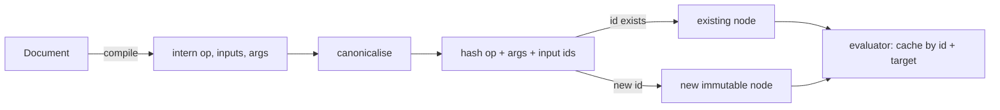

# Chapter 1 · Interned Operation Graph ★★

*Equal operations on equal inputs are one node, named by a hash of their content.*

## Intent

Represent a computation as a graph of operation nodes in which each node's identity is a hash of its operation, its
canonical arguments and its inputs' identities. Building the same computation twice yields the same nodes, so
caches, undo, cross-process transfer and test comparisons all agree on what a result *is* without any bookkeeping.

## Also known as

Hash-consed graph; content-addressed DAG; Merkle DAG; structural sharing of expressions; value numbering.

## Motivation

In the running example, every slider movement produces a new recipe, and the recipe is compiled into a graph of
about thirty operations: decode, scan conditioning, film, paper exposure, development, viewing, display. A naive
engine builds fresh node objects on every compile and caches results by object identity. Four things go wrong.

1. **Undo misses the cache.** Dragging the exposure time from 10 s to 12 s and back produces a graph equal to the
   first one, but its nodes are new objects, so the result computed seconds ago is not found.
2. **Shared prefixes are recomputed.** Changing the paper grade does not change the film stage, but the film nodes
   are new objects too, so nothing upstream can be reused.
3. **Workers disagree.** The agent's scripting sandbox runs in a worker, the CPU engine in another, and the interface
   on the main thread; each builds its own graph. To ask a worker for "the print node", you need a name that means
   the same thing in every one of them.
4. **Tests compare spellings.** `{ time: 10, fstop: 8 }` and `{ fstop: 8, time: 10 }`, or an argument left at its
   default and the same argument given explicitly, are different objects but the same computation.

The same problem appears wherever computations are rebuilt often and compared by value: a build system deciding
whether an action must rerun, a shader-graph editor deciding which material variants to compile, a notebook deciding
which cells are stale.

## Problem

**How do you give every intermediate result of a frequently rebuilt computation a name that is equal exactly when
the computation is equal?**

## Forces

- **Rebuilding against reuse.** Rebuilding the graph from the document on every edit keeps the code simple, but
  only stable names let the rebuilt graph reuse earlier work.
- **Spelling against meaning.** Arguments arrive in many spellings (key order, defaults omitted or explicit, `-0`
  against `0`); names must depend on meaning only.
- **Cheap names against safe names.** A short hash is fast to compute and compare; a long one makes collisions
  negligible. A collision silently returns a wrong picture.
- **One process against many.** Identity by object reference is free inside one heap and meaningless across two.
- **Fine names against coarse caches.** A node name says what was computed, not at which scale, region or
  precision; the cache key must add those.

## Solution

**Therefore: build every node through one `intern` operation. It canonicalises the arguments (sorted keys, defaults
filled, numbers normalised, node references moved out of the arguments into the inputs), hashes the length-prefixed
operation name, canonical arguments and input ids into the node's id, and returns the existing node when that id is
already in the graph. The id depends on nothing else (no counter, no salt, no build number), which is why another
process that interns the same definitions reaches the same ids. Make nodes immutable. Send a graph to another process
as the definitions of the requested node's closure, inputs first, and let the receiver re-intern them. Keep results
in a separate, evictable cache keyed by the node id plus the evaluation target (scale, region, precision).**

## Applicability

Use it when:

- the computation is rebuilt from a document or program often, and most of it is unchanged between rebuilds;
- results are expensive enough to cache, or must be named across processes or machines;
- tests or tools need to ask "is this the same computation?".

Do not use it when:

- the graph is built once and evaluated once (a batch conversion); identity buys nothing;
- operations have hidden inputs (time, randomness without a seed, global state) that the hash cannot see; make them
  explicit arguments first, or the names lie;
- argument values are huge (whole images as arguments); hash a content key of the value instead, or pass it as an
  input node.

## Structure

| Participant | Responsibility |
|---|---|
| **Operation registry** | knows each operation's argument specs, so `intern` can fill defaults and validate |
| **Canonicaliser** | turns arguments into one byte string per meaning (sorted keys, defaults, normalised numbers) |
| **Graph** | `intern(op, inputs, args) → node`; a map from id to node; `closure(id)`; `adopt(defs)` |
| **Node** | immutable: id, op, input ids, canonical args, inferred info (size, domain) |
| **Node definition** | the transferable form `{ op, inputs, args }` |
| **Result cache** | keyed by node id plus evaluation target (scale, region, precision) |

## Collaborations

1. The compiler walks the document and calls `intern` bottom-up; each call returns a node whose inputs already exist.
2. `intern` validates the receiver's kind, binds and canonicalises arguments, computes the id and returns the stored
   node if the id exists.
3. To hand a node to another process, the sender sends `closure(node)`, the definitions it depends on in
   topological order (inputs first); the receiver calls `adopt`, which re-interns them in that order, refuses unknown
   operations and cycles, and arrives at the same ids.
4. An evaluator asked for a node first looks up `(id, target)` in its cache.



Read it left to right: every path to a node goes through the canonicaliser and the hash, so two compiles of equal
documents meet at the same nodes before any evaluation happens.

## Sketch

```text
value Node: id, op, inputs, args, info
value NodeDef: op, inputs, args

-- canonical form: one spelling per meaning
canon(op, raw) → Args:
  args ← defaults(op) ⊕ raw                       -- explicit defaults equal omitted ones
  for each a in args: args[a] ← normalise(a, args[a])   -- -0 → 0, node refs → ids, sorted keys
  return args

intern(graph, opName, inputs, raw) → Node:
  op ← registry(opName) or refuse("unknown-op", opName)
  check receiver kinds and domains of inputs       -- see Chapter 5
  args ← canon(op, raw)
  -- input ids are fixed-width (32 bytes), so their concatenation is self-delimiting
  id ← hash(len(opName) ++ opName ++ len(json(args)) ++ json(args) ++ concat(bytes(i) for i in
      inputs))
  if graph.has(id): return graph[id]
  node ← Node(id, opName, inputs, args, infer(op, inputs, args))
  graph[id] ← node
  return node

closure(graph, id) → list of NodeDef               -- inputs before their users
adopt(graph, defs) → nodes: for d in defs: intern(graph, d.op, d.inputs, d.args)

-- in use: undo meets the cache
g ← new Graph
a ← compile(recipeAt10s, g); b ← compile(recipeAt12s, g); c ← compile(recipeAt10s, g)
assert c.print.id = a.print.id                     -- the 10 s result is found again
```

## Implementation notes

1. **Length-prefix every field before hashing.** Concatenating `op ++ args` without lengths lets two different
   (op, args) pairs produce the same bytes. The originating project writes a 32-bit length before the op name and
   before the canonical JSON; goja-cv does the same with SHA-256.
2. **Test canonicalisation as a law, not as examples.** The originating project has a property test ("hash-consing:
   key order, explicit defaults, -0 → same id; any change → different id") with a generator and shrinking. Both
   halves matter: equal meanings must collide, and every real change must not.
3. **Node-typed arguments become inputs.** A mask passed as an argument is a dependency. Replace the node object by
   its id in the arguments and append it to the inputs, so the hash covers it and the scheduler sees the edge.
4. **Validate at intern time, refuse with a fix.** The receiver's kind and domain are checked where the node is
   made, and the refusal names what to call first (Chapter 5). A graph that cannot contain an ill-typed node needs
   no later validation pass.
5. **Choose the cache granularity deliberately.** The originating project caches only whole final images, so a drag
   on a late operation re-runs every earlier stage from the source. Interning makes intermediate caching *possible*;
   it does not make it happen. Decide which nodes are checkpoints (Chapter 7).
   The key itself must add the evaluation target: the running example keys GPU results by `id | scale | region |
   precision`; forgetting one of these returns a thumbnail where a full render was asked for.
6. **Hash width is a risk decision; prefer wide.** Editor lab (a browser photo editor with a tiled engine) used a
   52-bit key so it fits a JavaScript number; by the birthday bound n²/2^(b+1), 10⁵ live keys give about a 10⁻⁶
   chance of any collision. The running example and goja-cv (a Go image-analysis engine) use 256-bit SHA-256 ids;
   the cost is negligible next to pixel work. If you must use a short key, store the canonical bytes beside the node
   and compare them on a hit; darktable guards its 64-bit pipe hashes by checking the buffer size on a match.
7. **Canonicalise numbers with one routine.** `-0` and `0`, `1` and `1.0`, `1e21` and `1e+21` must serialise alike;
   `NaN` should be refused, not hashed. Parameters that come from sliders may need quantising to a fixed precision so
   that 0.30000000000000004 and 0.3 are one node.
8. **Changing canonicalisation renames everything.** A new default or normalisation rule changes every id and
   invalidates every cache, persistent ones included. Treat it as a format version: record it, and include the
   version in persistent keys.
9. **A hidden input turns names into lies.** Grain needs a seed; a table depends on a data pack. The running
   example puts the seed in the arguments and hashes the *contents* of the arrays a table builder consumes, so a
   data update changes the key "without anyone bumping a version".
   The same goes for anything a result reports: goja-cv replays evaluation warnings when it serves a value from its
   cache, or a cached answer would arrive without the warning the first one had.
10. **Keys built from input keys cannot cut off early.** A change below always changes every name above, even when
   the change below produced identical pixels. Editor lab measured 33–52 % avoidable work above masked edits. If
   that matters, add output hashes (a verifying trace) at chosen checkpoints.

## Variations

- **Merkle tile keys.** Editor lab names *tiles* of each layer by a hash of the layer's settings, the pixel revisions
  it reads and the keys of the tiles below that its apron touches. Finer reuse for local edits; more keys to compute
  (0.2 ms per frame at 128 px tiles, 1.3 ms at 64 px).
- **Verifying traces.** Name results by a hash of their *output* instead of their inputs; enables early cutoff, but
  a result must be computed before anything above it can be named.
- **Interning without hashing.** A structural map keyed by `(op, args, input ids)` in one process; cheaper, but not
  transferable.
- **Version counters.** Each input carries a revision number and results store the revisions they saw. Simple for
  mutable documents; breaks across processes and makes undo miss.

## Consequences

- \+ Undo, redo and toggling hit the cache with no invalidation logic.
- \+ Processes and machines agree on names; graphs travel as definitions.
- \+ Tests compare ids instead of structures; spelling differences cannot cause false failures.
- \+ Every node is immutable, so evaluation can be parallel; only interning needs a single writer.
- − Every argument must be canonicalisable and every input explicit; a forgotten hidden input causes stale results
  that look correct.
- − Interning costs a hash per node per compile; negligible for tens of nodes, measurable for per-tile keys.
- − Names built from inputs cannot express "unchanged output"; early cutoff needs a second mechanism.

## Known uses

- **Git** names every object by a hash of its content; trees name their children by hash.
- **Nix and Bazel** key build actions by a hash of the command and the hashes of its inputs.
- **darktable** keys its pixelpipe cache by a hash of the image, the pipe type and every enabled module's
  parameters up to that module, plus the region.
- **libvips** reuses completed operations through a small in-process cache keyed by the operation and its
  arguments: the same idea without transferable ids.
- **goja-cv** hash-conses image-analysis nodes with SHA-256 over the op key, canonical arguments, metadata and input
  hashes, and keys its evaluation cache by node hash, quantised scale and input signatures.
- Hash consing is an old technique in Lisp and ML implementations; value numbering in compilers is the same idea in
  compiler form, without names that travel between processes.

## Related chapters

- [Chapter 2 · Unit-Tagged Parameter Catalogue](02-unit-tagged-parameter-catalogue.md) supplies the defaults and
  specs canonicalisation needs.
- [Chapter 5 · Domain-Typed Image Pipeline](05-domain-typed-pipeline.md) checks edges at intern time.
- [Chapter 7 · Barrier-Cut Fusion](07-barrier-cut-fusion.md) plans evaluation over the interned graph.
- [Chapter 9 · Vector Edit Document](09-vector-edit-document.md) is what gets compiled into it.
- [Chapter 12 · Shared Handle Vocabulary](12-shared-handle-vocabulary.md) names nodes for people and agents.
- GoF: **Flyweight** (shared immutable instances), **Interpreter** (the evaluator over the graph).
