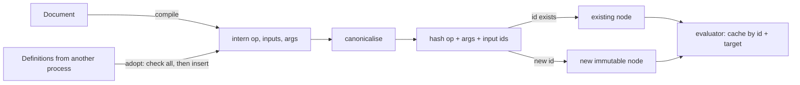

# Chapter 1 · Interned Operation Graph ★★

*Equal operations on equal inputs are one node, named by a hash of their content.*

## Intent

Represent a computation as a graph of operation nodes in which each node's identity is a hash of its operation, its
canonical arguments and its inputs' identities. Building the same computation twice yields the same nodes, so
caches, undo, cross-process transfer and test comparisons all agree on what a result *is* without any bookkeeping.

## Also known as

Hash-consed graph; content-addressed DAG; Merkle DAG; structural sharing of expressions; value numbering.

## Motivation

In the running example, every slider movement produces a new recipe, compiled into a graph of about thirty
operations: decode, scan conditioning, film, paper exposure, development, viewing, display. A naive engine builds
fresh node objects on every compile and caches results by object identity. Four things go wrong.

1. **Undo misses the cache.** Dragging the exposure time from 10 s to 12 s and back produces a graph equal to the
   first one, but its nodes are new objects, so the result computed seconds ago is not found.
2. **Shared prefixes are recomputed.** Changing the paper grade leaves the film stage alone, but its nodes are new
   objects too.
3. **Workers disagree.** The scripting sandbox, the CPU engine and the interface each build their own graph; asking
   a worker for "the print node" needs a name that means the same thing in all of them.
4. **Tests compare spellings.** `{ time: 10, fstop: 8 }` and `{ fstop: 8, time: 10 }`, or a default omitted and the
   same default given, are different objects but the same computation.

Build systems, shader-graph editors and notebooks deciding what is stale have the same problem.

## Problem

**How do you give every intermediate result of a frequently rebuilt computation a name that is equal exactly when
the computation is equal?**

## Forces

- **Rebuilding against reuse.** Rebuilding the graph on every edit keeps the code simple; only stable names let it
  reuse earlier work.
- **Spelling against meaning.** Arguments arrive in many spellings (key order, defaults omitted or explicit, `-0`
  against `0`); names must depend on meaning only, and different meanings must never share a name.
- **Cheap names against safe names.** A short hash is fast; a long one makes collisions, which silently return a
  wrong picture, negligible.
- **One process against many.** Identity by object reference is free inside one heap and meaningless across two;
  a name that arrives from elsewhere is a claim until it is checked.
- **Fine names against coarse caches.** A name says what was computed, not at which scale, region or precision; the
  cache key must add those, and the cache must be free to forget.

## Solution

**Therefore: build every node through one `intern` operation. It looks the operation up in a registry that declares
its arguments and its computation together, canonicalises the arguments (unknown keys refused, defaults filled,
numbers normalised, keys sorted, node references moved into the inputs), hashes the length-prefixed operation name,
canonical arguments and input ids into the node's id, and returns the existing node when that id is already in the
graph. The id depends on nothing else (no counter, no salt, no build number), so another process that interns the
same definitions reaches the same ids. Make nodes immutable. Send a graph to another process as the definitions of
the requested node's closure, inputs first, each with its id; the receiver checks every definition and recomputes
every id before interning any, so an import is all or nothing. Keep results in a separate, bounded cache keyed by
node id plus evaluation target (scale, region, precision), and let each evaluation hold its own results until it
returns.**

## Applicability

Use it when:

- the computation is rebuilt from a document or program often, and most of it is unchanged between rebuilds;
- results are expensive enough to cache, or must be named across processes or machines;
- tests or tools need to ask "is this the same computation?".

Do not use it when:

- the graph is built once and evaluated once (a batch conversion); identity buys nothing;
- operations have hidden inputs (time, unseeded randomness, global state) that the hash cannot see; make them
  explicit arguments first, or the names lie;
- argument values are huge (whole images); hash a content key of the value, or pass it as an input.

## Structure

| Participant | Responsibility |
|---|---|
| **Operation registry** | one declaration per operation: input count, argument specs and defaults, the computation |
| **Canonicaliser** | turns arguments into one byte string per meaning; refuses what has no meaning |
| **Graph** | `intern(op, inputIds, args) → node`; a map from id to node; `closure(id)`; `adopt(defs)` |
| **Node** | immutable: id, op, input ids, canonical args (plus size or domain, if intern-time checks use them) |
| **Node definition** | the transferable form `{ id, op, inputs, args }` |
| **Result cache** | keyed by node id plus evaluation target; bounded and evictable |

## Collaborations

1. The compiler walks the document and calls `intern` bottom-up.
2. `intern` prepares the node (lookup, checks, canonical arguments, id) without changing anything, then returns the
   stored node or inserts the new one.
3. To hand a node to another process, the sender sends `closure(node)`, inputs first. The receiver's `adopt`
   prepares and checks every definition before inserting any, so a refused import leaves the graph untouched.
4. An evaluator walks down only until it meets cached results, computes the rest inputs first, and returns a copy.



Every path to a node, local or imported, goes through the canonicaliser and the hash, so equal documents meet at
the same nodes before any evaluation happens.

## Sketch

```text
value Node: id, op, inputs, args                   -- inputs are ids; NodeDef has the same fields

-- one declaration per operation: arguments and computation together
registry["blur"] ← OpDecl(inputs: 1, args: { radius: int ≥ 0 = 1 }, run: (imgs, args, t) → …)

prepare(known, opName, inputs, raw) → NodeDef:      -- every check, no change
  decl ← registry(opName) or refuse("unknown-op", opName)
  check count(inputs) = decl.inputs, every input in known, kinds and domains (Chapter 5)
  args ← normalise(defaults(decl) ⊕ raw)           -- unknown keys, NaN refused; -0 → 0; sorted
  id ← sha256(DOMAIN ++ len(opName) ++ opName ++ len(json(args)) ++ json(args)
              ++ concat(inputs))                    -- 32-byte ids are self-delimiting
  return NodeDef(id, opName, inputs, args)

intern(graph, opName, inputs, raw) → Node:
  d ← prepare(ids(graph), opName, inputs, raw)
  if not graph.has(d.id): graph[d.id] ← Node(d)
  return graph[d.id]

adopt(graph, defs) → Node:                          -- all or nothing
  known, checked ← ids(graph), []
  for d in defs:                                    -- pass 1 refuses before anything changes
    p ← prepare(known, d.op, d.inputs, d.args)      -- inputs known or defined earlier
    p.id = d.id or refuse("id-mismatch", d.id); known ← known + p.id; checked ← checked ++ [p]
  for p in checked: if not graph.has(p.id): graph[p.id] ← Node(p)
  return graph[last(checked).id]

postorder(graph, root, stopAt) → ids                -- inputs first, each once; explicit stack
closure(graph, id) → list of NodeDef                -- postorder(graph, id) as definitions

evaluate(graph, root, target, cache) → Image:
  memo ← {}                                         -- this evaluation's results; never evicted
  hit(id): v ← cache.get((id, target)); if v ≠ none: memo[id] ← v; return v ≠ none
  for id in postorder(graph, root, stopAt: hit):    -- descends only below misses
    if id in memo: continue
    n ← graph[id]
    memo[id] ← registry(n.op).run([memo[i] for i in n.inputs], n.args, target)
    cache.put((id, target), memo[id])               -- the cache may evict; the memo may not
  return copy(memo[root])                           -- callers never alias a cached result

-- in use: undo meets the cache
a ← compile(recipeAt10s, g); b ← compile(recipeAt12s, g); c ← compile(recipeAt10s, g)
assert c.print.id = a.print.id                      -- the 10 s result is found again
```

## Implementation notes

1. **Length-prefix every field before hashing.** Concatenating `op ++ args` without lengths, or with delimiters,
   lets two different pairs produce the same bytes. The originating project and goja-cv (a Go image-analysis
   engine) write a length before the op name and before the canonical JSON.
2. **Canonicalise numbers with one routine, and do not round there.** `-0` and `0`, `1` and `1.0`, `1e21` and
   `1e+21` must serialise alike; `NaN` and unknown argument names are refused, since a typo that yields a valid
   node yields a misleading name. Do not quantise: 0.3 and 0.30000000000000004 are different computations. Round
   noise digits at the control that chooses the value (Chapter 2's step).
3. **Node-typed arguments become inputs.** A mask passed as an argument is a dependency. Replace the node by its id
   in the arguments and append it to the inputs, so the hash covers it and the scheduler sees the edge.
4. **Validate at intern time; keep each operation in one declaration.** Input counts, ranges, kinds and domains
   (Chapter 5) are checked where the node is made, so the graph cannot hold an ill-typed node. With the argument
   spec and the computation in separate tables, a new operation is two or three edits; one declaration makes it one.
5. **An import verifies before it interns.** Recompute each definition's id and refuse a mismatch; refuse inputs
   neither known nor defined earlier (which excludes cycles); change nothing until every definition has passed.
6. **Walk with an explicit stack, and write the walk once.** Editor chains thousands of nodes deep overflow
   recursive evaluation and export. One iterative post-order walker, shared by closure and evaluation, removes the
   overflow and the duplicated traversal.
7. **Cache every node, bound the cache by bytes, keep evaluation off it.** Interning makes reuse possible, not
   actual: the originating project caches only final images, so a drag on a late operation re-runs every earlier
   stage. Cache every materialised node (with fusion, Chapter 7 says which), evicting least recently used by bytes,
   and let each evaluation keep its own results: a design that reads inputs back from the cache breaks when an
   eviction lands in between. Key by `id | scale | region | precision`, and hand out copies or read-only views.
8. **Hash width is a risk decision; prefer wide.** Editor lab (a browser photo editor) used a 52-bit key to fit a
   JavaScript number; by the birthday bound n²/2^(b+1), 10⁵ live keys give about a 10⁻⁶ chance of a collision.
   The running example and goja-cv use 256-bit SHA-256, cheap next to pixel work and needing no byte comparison
   on a hit; only a short key needs that check (darktable compares buffer sizes when its 64-bit hashes match).
9. **Changing canonicalisation renames everything.** A new default or normalisation rule changes every id and
   invalidates every cache. Put a tag for the canonical form into the hash (`DOMAIN` in the sketch) so ids made
   under two rules never coincide; write a version into exports only if import checks it.
10. **A hidden input makes names lie, and so does a raw one.** Grain needs a seed; a table depends on a data pack.
   The running example puts the seed in the arguments and hashes the *contents* of a table builder's arrays.
   Computations must read the canonical arguments: a generator seeded from the raw value gives `-0` and `0` one id
   and two pictures. Warnings belong to a result too: goja-cv replays them when it serves a cached value.
11. **Test identity as laws, against independent references, across a real process.** The originating project's
   property test ("key order, explicit defaults, -0 → same id; any change → different id") checks both halves.
   Compare pixels with a separate reference (Chapter 3), and send closures to a second process, not a second graph.

## Variations

- **Merkle tile keys.** Editor lab names each layer's *tiles* by a hash of its settings, the pixel revisions it
  reads and the keys of the tiles below its apron. Finer reuse for local edits; more keys (1.3 ms per frame at 64 px).
- **Verifying traces.** Input-built keys cannot cut off early: a change below renames everything above, even when
  it produced identical pixels (Editor lab measured 33–52 % avoidable work above masked edits). Naming checkpoint
  results by a hash of their *output* restores early cutoff, but a result must exist before anything above is named.
- **Interning without hashing.** A map keyed by `(op, args, input ids)`; cheaper, not transferable.
- **Version counters.** Inputs carry revision numbers and results store the revisions they saw. Simple for mutable
  documents; breaks across processes and makes undo miss.

## Consequences

- \+ Undo, redo and toggling hit the cache with no invalidation logic.
- \+ Processes and machines agree on names; graphs travel as definitions and are checked on arrival.
- \+ Tests compare ids, so spelling differences cannot cause false failures.
- \+ Nodes are immutable, so evaluation can be parallel; only interning needs a single writer.
- − Every argument must be canonicalisable and every input explicit; a forgotten hidden input gives stale results
  that look correct.
- − Interning costs a hash per node per compile; negligible for tens of nodes, measurable for per-tile keys.
- − Names built from inputs cannot express "unchanged output"; early cutoff needs a second mechanism.

## Known uses

- **Git** names every object by a hash of its content.
- **Nix and Bazel** key build actions by a hash of the command and the hashes of its inputs.
- **darktable** keys its pixelpipe cache by a hash of the image, the pipe type and every enabled module's
  parameters up to that module, plus the region.
- **libvips** reuses operations through an in-process cache keyed by operation and arguments.
- **goja-cv** hash-conses nodes with SHA-256 over op key, canonical arguments, metadata and input hashes.
- Hash consing is old in Lisp and ML; value numbering is the same idea inside compilers.

## Validation

Four agents with this chapter and one without built the same engine. All passed the hidden tests; the blind design
review ranked every chapter run above the control, which accepted unknown arguments, hashed with delimiters into a
truncated key and exported shared inputs once per path. This version drops notes that cost code without paying back
and adds what the best runs found (`docs/patterns/experiments/RESULTS.md`).

## Related chapters

- [Chapter 2 · Unit-Tagged Parameter Catalogue](02-unit-tagged-parameter-catalogue.md) supplies the defaults and
  specs canonicalisation needs.
- [Chapter 3 · Reference Oracle with Negative Controls](03-reference-oracle.md) supplies independent references.
- [Chapter 5 · Domain-Typed Image Pipeline](05-domain-typed-pipeline.md) checks edges at intern time.
- [Chapter 7 · Barrier-Cut Fusion](07-barrier-cut-fusion.md) plans evaluation over the interned graph.
- [Chapter 9 · Vector Edit Document](09-vector-edit-document.md) is what gets compiled into it.
- [Chapter 12 · Shared Handle Vocabulary](12-shared-handle-vocabulary.md) names nodes for people and agents.
- GoF: **Flyweight** (shared immutable instances), **Interpreter** (the evaluator over the graph).
