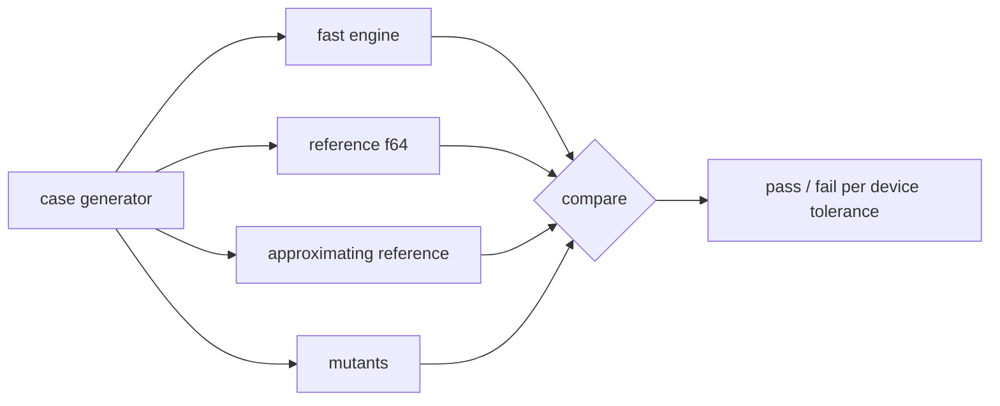

# Chapter 3 · Reference Oracle with Negative Controls ★★

*Keep a slow, exact implementation as the definition of correct, check every fast implementation against it at a
stated tolerance for each device, and prove the check works with deliberately broken variants that must fail.*

## Intent

Separate *what the answer is* from *how fast you get it*. One implementation, written for clarity and precision,
defines the answer. Every optimised implementation (GPU, SIMD, tables, approximations) is compared to it by tests
that state their tolerance and the device it was measured on. Each test is accompanied by a negative control, a
known-wrong variant that the test must reject, so a test that has quietly stopped testing is noticed.

## Also known as

Differential testing; golden model; reference kernels; parity tests; mutation testing (for the negative controls).

## Motivation

The running example renders a print in two engines: a CPU engine in 64-bit floats that evaluates every spectral
integral, and a WebGPU engine in 32-bit floats that reads precomputed tables and fuses operations. Without a
reference, four things go wrong, and the running example met all four.

1. **A wrong answer looks right.** A missing half-texel offset in a table lookup shifts every colour slightly. Nothing
   crashes; the print is a little off.
2. **A test can pass because it stopped looking.** A tolerance loosened during debugging, or a comparison against the
   wrong buffer, passes forever.
3. **A tolerance measured on one device is a claim about that device.** The running example's GPU tests ran for
   months on a software rasteriser (SwiftShader). On the first run on real hardware (an Apple M1 Max), six tests
   failed: the hardware texture filter computes interpolation weights with 8 fractional bits (measured: 257 distinct
   weights, maximum error 1/512), where the software rasteriser computes them in 32-bit floats.
4. **Two errors hide each other.** The fast path differs from the exact answer by table error *and* GPU arithmetic
   error; without separating them, neither can be bounded.

Numerical libraries comparing optimised kernels with reference kernels, compilers compared against other compilers,
and machine-learning runtimes comparing quantised inference with full precision all face the same problem.

## Problem

**How do you keep optimised implementations correct when their results are close to, but not exactly, the reference,
and how do you know your tests would notice if they were not?**

## Forces

- **Exactness against speed.** The reference is slow by design; tests on it must stay small enough to run often.
- **Tight against portable tolerances.** A tight bound catches small regressions on one device and fails on another;
  a loose bound passes everywhere and catches nothing.
- **Examples against laws.** Hand-picked cases are easy to read and miss the case that breaks; generated cases cover
  more and need a reason to exist.
- **Trust against verification.** A green suite is only evidence if something proves it can turn red.
- **One error budget against several.** Interpolation, arithmetic precision and hardware behaviour each contribute;
  a single number cannot say which grew.

## Solution

**Therefore: write one reference implementation for clarity and precision, and treat it as the definition of the
answer. Compare every fast implementation to it on generated inputs bounded by the declared parameter ranges, with
a tolerance that names its unit (levels of the output encoding, ULPs, ΔE) and the device it was measured on. Where a
fast path combines several approximations, compare against a reference that makes the same approximation, so each
error is bounded separately. For every comparison keep a negative control (a mutant engine, a broken lookup, a wrong
constant) that the comparison must reject. State property tests as laws with a written justification. Run the suite
on every class of device the product ships on.**

## Applicability

Use it when:

- there is more than one implementation of the same computation, or one fast implementation of a well-defined one;
- results are numeric and "close enough" must be defined;
- the fast path runs on hardware you do not control (GPUs, browsers, mobile chips).

Do not use it when:

- there is no slow way to compute the right answer (then define correctness by properties, not by a twin);
- the output is a matter of taste with no reference (a "look"); compare against stored approvals instead;
- the reference would need as much optimisation as the fast path to finish in test time.

## Structure

| Participant | Responsibility |
|---|---|
| **Reference engine** | computes the defined answer, clearly and precisely (here f64, exact integrals) |
| **Approximating reference** | the reference with the fast path's approximation (here: the same tables in f64) |
| **Fast engines** | GPU, SIMD, tables; implement the same engine interface |
| **Case generator** | produces inputs per operation, bounded by declared ranges and domains (Chapter 2) |
| **Comparator** | difference in a named unit; tolerance per device class |
| **Negative controls** | mutants and broken variants, each with the case kind it must fail |
| **Law harness** | property tests with generators, shrinking and a mandatory justification |

## Collaborations

1. The generator produces cases from the registry: operations, argument values within ranges, inputs within domains.
2. Each engine evaluates each case; the comparator measures the difference to the reference.
3. For fast paths with known approximations, the comparator also measures against the approximating reference; the
   difference between the two isolates the approximation from the engine's own error.
4. Each negative control runs through the same comparisons and must fail where it is declared to fail.
5. The suite runs on each device class; tolerances are looked up by the device the run reports.



Read it as four engines fed the same cases: the fast engine must land within tolerance; each mutant must land
outside it.

## Sketch

```text
-- e.g. (8-bit levels, 0.1, "software"), (8-bit levels, 1.0, "metal")
value Tolerance: unit, bound, device

cases ← generate(registry, seed)            -- ranges and domains from Chapter 2

for c in cases:
  exact  ← reference.evaluate(c)
  approx ← approximatingReference.evaluate(c)     -- same tables, f64
  fast   ← fastEngine.evaluate(c)
  assert diff(fast, approx) ≤ tolerance(c.op, "engine", device())       -- the engine's own error
  -- the table's error, device-free
  assert diff(approx, exact) ≤ tolerance(c.op, "approximation")

for m in mutants:                            -- negative controls
  assert someCaseFails(m.wrap(fastEngine), kind: m.mustFail)

law "interning": gen(r → randomArgs(r)), prop(args → id(args) = id(respell(args))),
    justifies: "hash-consing keys caches on content, not spelling"
```

## Implementation notes

1. **Name the device in the tolerance.** The running example's parity bounds were tuned on SwiftShader and failed on
   Metal: preview display up to 0.86 of an 8-bit level against a bound of 0.1. Its tests now look up the adapter and
   apply per-adapter bounds, with the measurement in a comment.
2. **Measure the hardware, then decide.** A twenty-line probe (a 2 × 1 texture holding 0 and 1, sampled at 4,096
   positions) showed the 8-bit filter weights directly. With the cause known, the project chose to change the code
   (an exact manual lookup costing 1.1 ms per 4,000 px preview) rather than loosen the bound.
3. **Every negative control is measured, not assumed.** When the running example raised a solve-table bound from
   2.5 × 10⁻⁶ to 3 × 10⁻⁶ (the software rasteriser on the Mac measured 2.62 × 10⁻⁶; on the Linux build machine it
   stayed below 2.5 × 10⁻⁶), it first measured the broken
   variant (a solver tolerance of 10⁻⁵) at 1.38–1.45 × 10⁻⁵: it still fails by a factor of 4.6. Loosening a bound
   without re-measuring its control is how a test stops testing.
4. **Broken variants in the parity suite.** The running example keeps a lookup without half-texel mapping (must be
   off by more than one level), a rounded constant (`LOG2_10 = 3.32` must fail the printing-density table), and a
   row-major matrix (must fail the print table). Each catches a class of mistake someone has made before.
5. **Mutants for the conformance suite.** Deliberately broken engines (for instance one that hashes arguments without
   sorting keys) wrap a correct engine; each declares the case kind it must fail. Without them, a conformance suite
   cannot show it would catch that class of bug.
6. **Laws need a reason.** The running example's law harness refuses to build a law without `justifies`, "because
   without it this is an example, not a law". The reason is what a reviewer checks the generator against.
7. **Compare like with like first.** The running example compares the GPU preview with the reference evaluating the
   same tables, then the reference's tables with its exact integrals. The first number bounds the GPU, the second the
   tables, and a regression points at one of them.
8. **The reference can build the fast path's data.** Tables are built by the f64 reference code in workers, so the
   worker's tables are bitwise the reference's; the GPU can build them too, and a test checks the two builders agree
   to a hundredth of an 8-bit level.
9. **Run where you ship.** For months, every green GPU run in the running example measured the software adapter,
   because a test configuration flag forced it on every machine. Make the real-device run a named, routine job.
10. **Keep the reference clear, not fast.** Editor lab's report keeps "JavaScript as the reference for every kernel";
    its WebAssembly kernels matched it to 0.0004 of a step and its fused GPU probe to 0.33. The reference's job is
    to be readable enough that a disagreement is settled by reading it.

## Variations

- **Golden images.** Store reference outputs instead of computing them; fast to run, but the store goes stale when
  the reference improves, and tolerances drift with re-blessing.
- **Property-only testing.** No twin; laws (identity, monotonicity, invariance) define correctness. Necessary when no
  reference exists; weaker for numerical accuracy.
- **Cross-implementation voting.** Several independent fast implementations compared with each other (differential
  testing of compilers). Finds disagreements without saying which is right.
- **Statistical tolerance.** Compare distributions of errors (mean, 99th percentile, share above a bound) instead of
  the maximum; tolerates rare outliers deliberately, so the outliers must be understood.

## Consequences

- \+ Optimisation becomes safe: any change to the fast path is checked against a fixed definition.
- \+ A failing test points at an error class (approximation, arithmetic, hardware), not just "different".
- \+ Negative controls make "the suite is green" mean something.
- − Two implementations of every operation must be maintained.
- − Device-specific tolerances multiply the configuration to maintain.
- − The reference's own bugs are inherited by every fast path that matches it; it needs its own laws.

## Known uses

- **TensorFlow Lite** keeps reference kernels beside optimised kernels and tests one against the other.
- **OpenCV** tests optimised code paths against reference implementations with explicit tolerances.
- **Khronos conformance test suites** (and the WebGPU conformance test suite) define correct behaviour that every
  driver is checked against.
- **Csmith** found compiler bugs by differential testing of compilers on generated programs.
- **Mutation-testing tools** (PIT for Java, mutmut for Python) apply the negative-control idea to test suites.
- **QuickCheck** introduced property-based testing with generators and shrinking.

## Related chapters

- [Chapter 2 · Unit-Tagged Parameter Catalogue](02-unit-tagged-parameter-catalogue.md) bounds the generators.
- [Chapter 6 · Tabulated Preview, Exact Export](06-tabulated-preview-exact-export.md) is the fast path most of these
  comparisons guard.
- [Chapter 7 · Barrier-Cut Fusion](07-barrier-cut-fusion.md) changes evaluation order, which the oracle must show
  harmless.
- [Chapter 1 · Interned Operation Graph](01-interned-operation-graph.md) lets every engine name the same case.
- GoF: **Strategy** (interchangeable engines behind one interface), **Decorator** (mutants wrap a correct engine).
