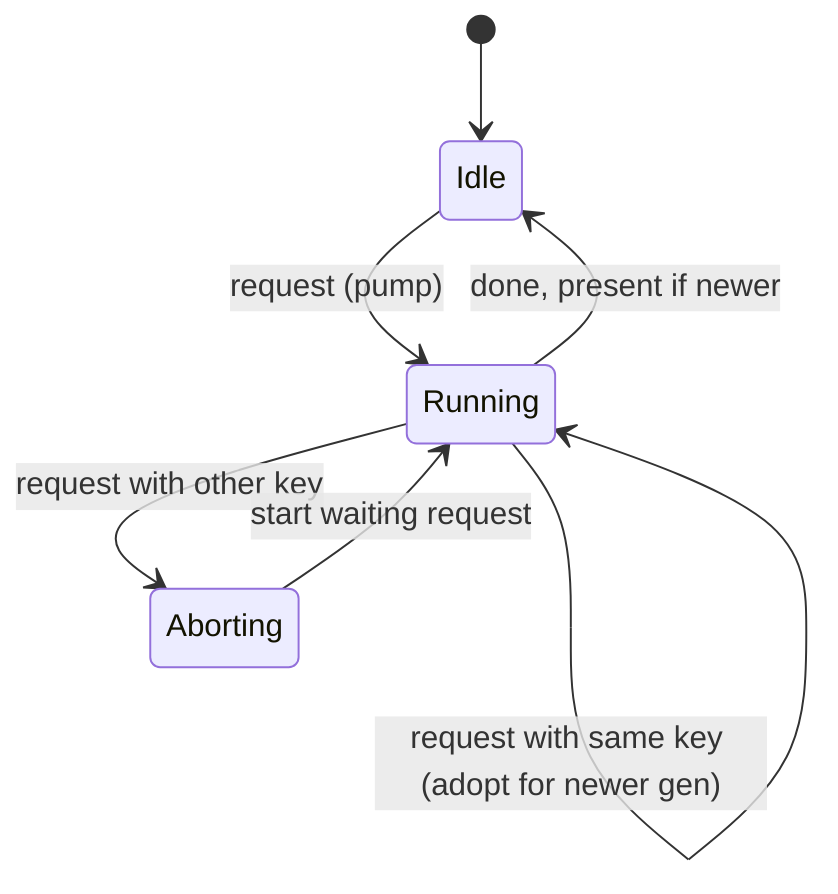

# Chapter 4 · Latest-Wins Render Slots ★★

*Give every place that shows a render a slot with a generation counter; a newer request supersedes the waiting one,
aborts the running one, and a result is shown only if it is newer than what is on screen.*

## Intent

Keep an interactive view correct and responsive when a render takes longer than the interval between requests.
Each view (the main viewer, the before image, each thumbnail) owns a **slot**. Requests carry a **pass** (draft,
screen, refine) chosen from the interaction state and the zoom. Live views run before background ones. Stale results
are dropped, so the screen never steps backwards.

## Also known as

Latest-wins scheduling; request coalescing; cancellation by generation; switch-to-latest; progressive refinement.

## Motivation

In the running example the photographer drags the exposure-time slider; the pointer produces an event every 16 ms
and a full-quality render takes longer than that. A naive viewer issues one render per event and shows each result
when it arrives. Four things go wrong.

1. **Lag grows with the drag.** Renders queue behind each other; the screen shows a position from a second ago.
2. **The screen steps backwards.** An older render that finishes after a newer one overwrites it.
3. **Background work steals the foreground.** Forty filmstrip thumbnails render while the hand is on the slider.
4. **Nothing is shown at all.** With a slow engine, aborting every render for the next request means that while the
   hand keeps moving, no render ever completes. The running example's usability session recorded this as a finding:
   on the CPU engine the picture froze until the hand stopped.

Map viewers panning across tiles, video editors scrubbing a timeline and search-as-you-type interfaces have the same
shape: requests faster than answers, and only the newest answer matters.

## Problem

**How does a view show the newest possible answer, never an older one, while answers take longer than the requests
that ask for them?**

## Forces

- **Freshness against progress.** Aborting superseded work keeps results fresh; never finishing anything shows
  nothing.
- **Quality against latency.** A full-resolution render is what the user wants; a coarse one is what can arrive in a
  frame.
- **Foreground against background.** Thumbnails and inspectors matter, but less than the view under the hand.
- **Aborting against wasting.** Abort saves work only if the engine can stop; with a synchronous engine it saves
  nothing and costs a restart.
- **Simplicity against starvation.** "Newest wins" is easy; guaranteeing that something is eventually shown needs a
  rule about time.

## Solution

**Therefore: give each display place a slot holding a generation counter, at most one waiting request and at most one
running render. A request's key is the renderable's content key together with its pass and pixel size; equal keys
mean interchangeable results. A new request increments the generation and replaces the waiting one. If a render is
running for a different key, abort it, unless no result has been presented for longer than a progress threshold and
the new request is only a draft; a request with the running render's key does not restart it. Run one render per
slot, and background slots only when no live slot is busy. Present a result only if its generation is newer than the
one on screen. Choose each request's pass from the interaction: a draft of a fixed pixel budget during a gesture, the
displayed size when it ends, full resolution when zoomed to 1:1 or beyond.**

## Applicability

Use it when:

- requests can arrive faster than results (pointer-driven parameters, scrubbing, panning);
- several views compete for one engine;
- the engine can produce coarse results much faster than fine ones.

Do not use it when:

- every request's result matters (an export queue, a batch job): latest-wins discards work by design;
- results are cheap enough to compute within one frame at full quality; a direct call is simpler;
- the order of side effects matters (a request that writes something must not be skipped).

## Structure

| Participant | Responsibility |
|---|---|
| **Slot** | id, lane (live, background), generation, shown generation, waiting request, running render |
| **Request** | renderable, pass, maximum side, region, presentation callback |
| **Render bridge** | turns a renderable into pixels with an engine; reports a key ("equal keys mean equal pixels") |
| **Queue** | creates slots, replaces waiting requests, aborts superseded renders, pumps lanes, presents in order |
| **Target chooser** | maps interaction state and zoom to a pass and a pixel size |
| **Thumbnail cache** | results of background slots, keyed by renderable key and size, bounded by count |

## Collaborations

1. The viewer computes a target: draft if a gesture is in progress, screen size × device pixel ratio (rounded up to
   the next multiple of 128) otherwise, full size if zoomed to 1:1 or beyond. The viewer that owns the gesture decides
   when it ends, including on a lost pointer (window blur, pen leaving the tablet), so a slot never stays at draft.
2. It calls `request(slot, renderable, target)`; the queue increments the slot's generation and stores the request
   as waiting.
3. If a render is running for a different key, the queue aborts it, unless the progress rule lets it finish.
4. `pump` starts the waiting request if the slot is idle; background slots wait while a live slot is busy.
5. When a render completes, the queue presents it only if its generation exceeds the slot's shown generation, then
   pumps the slot again.



Read it per slot: there is never more than one render running and one waiting, whatever the request rate.

## Sketch

```text
value Slot: id, lane, gen = 0, shownGen = 0, waiting = none, running = none, shownAt = now()

request(queue, slotId, renderable, target, lane) → gen:
  s ← queue.slot(slotId, lane)                               -- the requester chooses the lane
  s.gen ← s.gen + 1
  key ← (bridge(renderable).key(renderable), target.pass, target.maxSide, target.region)
  -- same result: adopt it
  if s.running and s.running.key = key: s.running.gen ← s.gen; return s.gen
  s.waiting ← (s.gen, renderable, key, target)
  starved ← target.pass = draft and s.running and now() − s.shownAt ≥ queue.progressMs
  if s.running and not starved: abort(s.running)
  pump(queue, s); return s.gen

pump(queue, s):
  if s.running or not s.waiting: return
  if s.lane = background and queue.liveBusy(): return       -- live first
  job ← take(s.waiting); s.running ← start(job)
  on success(result):
    s.running ← none
    if not job.aborted and job.gen > s.shownGen:
      release(s.shown); present(result); s.shown ← result; s.shownGen ← job.gen; s.shownAt ← now()
    else: release(result)                                  -- stale: drop it, free its memory
    pump(queue, s)
  on failure(error):
    s.running ← none
    if not job.aborted: report(error)                      -- an abort is not an error
    pump(queue, s)                                         -- a failure never wedges the slot

close(queue, slotId):                                      -- a view goes away
  s ← queue.slot(slotId); s.waiting ← none; if s.running: abort(s.running)

chooseTarget(previewing, shownSize, dpr, zoom, srcSize) → (pass, maxSide):
  if previewing: return (draft, side for a fixed pixel budget at this aspect)
  if zoom ≥ 1: return (refine, srcSize)
  return (screen, roundUp(shownSize × dpr, 128))

-- in use
on pointer move: request("main", frame.print(), chooseTarget(previewing: true, …))
on pointer up:   request("main", frame.print(), chooseTarget(previewing: false, …))
```

## Implementation notes

1. **Present by generation, not by arrival.** The check `job.gen > s.shownGen` is the whole defence against the
   screen stepping backwards. Keep it even if aborts are reliable; a render may complete before its abort lands.
2. **Add a progress guarantee for slow engines.** The running example aborted every superseded render, which was right
   for the GPU engine and wrong for the CPU engine: the picture froze during a drag. Its fix is a threshold
   (`progressMs`): a slot that has shown nothing for that long lets the running render finish when the new request is
   another draft. A screen or refine request (the hand stopped) still aborts at once.
3. **Preempting background work is a property of the engine.** Live requests aborting background renders saves time
   only when the engine runs off the main thread or on the GPU. The running example keeps `preemptBackground` off by
   default because with a main-thread engine an abort saves nothing.
4. **Do not poll from idle callbacks.** The running example once re-queued a background pump from an idle callback;
   while a worker computed, the main thread was idle, so the callback ran about 10,000 times a second, a core
   spinning against the worker. Wake waiting work from completion events instead.
5. **The draft is a pixel budget, not a scale.** The running example's draft is 500,000 pixels at the picture's
   aspect, whatever the zoom; the screen pass is the displayed size times the device pixel ratio, rounded up to 128.
   Editor lab adapts its preview level from the last preview's cost (coarser above 12 ms, finer below 2.5 ms); a
   fixed budget is simpler, an adaptive one holds a frame rate on slow devices.
6. **Keep finished results when you can.** If results are named by content (Chapter 1), a render that completes
   after being superseded is still a valid cache entry. Editor lab's book recommends keeping it; the running example
   discards aborted work ("nothing partial enters the cache"), which is safe but wastes completed renders.
7. **Moving pixels can cost more than computing them.** On the running example's M1 Max, the preview chain computes
   even a 4,000 × 2,674 image in about 6 ms, while reading a *smaller* 3,000 × 2,000 result back from the GPU takes
   26 ms and re-uploading it for display about 22 ms. A slot scheduler cannot fix that; present GPU results without a
   round trip where the engine and presenter can share a device.
8. **Same key, no restart.** The originating project does not coalesce a request whose key equals the running
   render's: it renders the identical key again afterwards, and relies on the engine's content-keyed result cache to
   make the repeat cheap. Adopting the running render for the newer generation, as in the sketch, is cleaner.
9. **Failures, aborts and memory.** A render can fail, be aborted, or finish stale. The originating project clears the
   running render in every case, reports only real failures, and releases both stale results and the result a newer
   one replaces; a slot that keeps a failed render "running" never draws again, and stale results leak GPU memory.
10. **Bound the thumbnail cache by count and key it by size.** The running example keeps 400 thumbnails keyed by
   renderable key and maximum side; a hit draws at once, a miss renders on the background lane.
11. **Measure response time, not service time.** A test that waits for each render before the next request measures
   how long one render takes; the user sees the age of what is on screen. Drive tests with events on a clock.

## Variations

- **Tile-level refinement.** Instead of whole-image passes, refine visible tiles in time slices, centre first, after
  a short pause (Editor lab: 8 ms slices, 220 ms after the last change). Better on CPU engines with tiled caches.
- **Starvation by count.** Let every Nth render finish regardless; simpler than a time threshold, less predictable.
- **Cooperative cancellation inside a render.** Check the abort signal between stages of a long render, not only
  before it starts; finer latency at the cost of checks in the engine.
- **One generation for dependent views.** Scopes (waveform, histogram) beside a viewer must show the same state, or
  a colourist reads balance across mismatched frames. Give dependent views one shared generation: one slot whose
  result fans out, or a gate that holds each panel until all have the same generation.
- **Ordered streams.** A generator that streams intermediate results (a diffusion model's denoising steps) needs a
  step index inside each generation, so step 4 of a new run is never replaced by step 12 of an old one.
- **Activation of a complete frame.** Render a complete new frame off screen and swap it in atomically (Chromium's
  pending and active trees); never shows a mixture, needs memory for two frames.

## Consequences

- \+ The screen never shows an older state after a newer one.
- \+ Request rate and render cost are decoupled: at most one render and one waiting request per view.
- \+ Coarse results arrive during gestures, exact ones when the hand stops.
- − Work is discarded by design; with slow engines, without a progress rule, nothing may be shown.
- − Pass choice and progress thresholds are tuning parameters that differ per engine and device.
- − Every render must be abortable or cheap to discard; long uninterruptible renders bound the latency.

## Known uses

- **Chromium's compositor** rasterises a pending tree while the active tree is shown, and drops unstarted raster
  tasks when a new task graph is submitted.
- **darktable** runs a separate low-resolution preview pipe beside the full pipe.
- **Krita**'s Instant Preview renders strokes on a reduced canvas first.
- **GIMP** renders its projection in chunks sized adaptively to fill a time interval.
- **RxJS `switchMap`** subscribes to the newest inner request and unsubscribes from the previous one.
- **React**'s concurrent rendering interrupts lower-priority updates for urgent ones and discards the interrupted
  work: the same freshness guarantee, reached by restarting rather than by comparing generations.

## Related chapters

- [Chapter 1 · Interned Operation Graph](01-interned-operation-graph.md) supplies the keys that decide "same render".
- [Chapter 6 · Tabulated Preview, Exact Export](06-tabulated-preview-exact-export.md) makes drafts cheap.
- [Chapter 12 · Shared Handle Vocabulary](12-shared-handle-vocabulary.md) names what a slot renders.
- GoF: **Command** (a request as an object), **Proxy** (the slot stands in for the view's eventual image).
