# Chapter 4 · Latest-Wins Render Slots ★★

*Give every place that shows a render a slot with a generation counter; a newer request supersedes the waiting one,
aborts the running one, and a result is shown only if nothing newer has been shown.*

## Intent

Keep an interactive view correct and responsive when a render takes longer than the interval between requests.
Each view (the main viewer, the before image, each thumbnail) owns a **slot**. Requests carry a **pass** (draft,
screen, refine) chosen from the interaction and zoom, and a **lane** (live or background); live work runs first.
Stale results are dropped, so the screen never steps backwards.

## Also known as

Latest-wins scheduling; request coalescing; cancellation by generation; switch-to-latest; progressive refinement.

## Motivation

In the running example the photographer drags the exposure-time slider; the pointer produces an event every 16 ms
and a full-quality render takes longer than that. A naive viewer issues one render per event and shows each result
when it arrives. Four things go wrong.

1. **Lag grows with the drag.** Renders queue behind each other; the screen shows a position from a second ago.
2. **The screen steps backwards.** An older render that finishes after a newer one overwrites it.
3. **Background work steals the foreground.** Forty filmstrip thumbnails render while the hand is on the slider.
4. **Nothing is shown at all.** If every render is aborted for the next request, none completes while the hand
   moves; on the running example's CPU engine the picture froze until the hand stopped.

Map viewers panning, video editors scrubbing and search-as-you-type have the same shape: requests faster than
answers, and only the newest answer matters.

## Problem

**How does a view show the newest possible answer, never an older one, while answers take longer than the requests
that ask for them?**

## Forces

- **Freshness against progress.** Aborting superseded work keeps results fresh; never finishing anything shows
  nothing.
- **Quality against latency.** The user wants full resolution; a coarse render is what arrives in a frame.
- **Foreground against background.** Thumbnails and inspectors matter, but less than the view under the hand.
- **Aborting against occupying.** An abort is a request, not a fact: until the render settles it still holds memory
  and the device.
- **The scheduler against its callers.** Presenters, release hooks and engines throw, call back in and return odd
  values.

## Solution

**Therefore: give each display place a slot holding a generation counter, at most one waiting request and at most one
running render. A request carries its lane and its key (the renderable's content key with its pass and pixel size;
equal keys mean interchangeable results). A new request increments the generation and replaces the waiting one. If
the running render has the same key and was not aborted, it serves the new request; otherwise decide now: abort it,
or, if nothing has been presented for longer than a progress threshold and the new request is only a draft, keep it
to be presented. A render occupies its slot until it settles, aborted or not. Start background requests only when no
live work is waiting or running. Present only renders that were not aborted, the new result first and then release
the one it replaces; release every result not shown, exactly once. Choose the pass from the interaction: a draft of
a fixed pixel budget during a gesture, the displayed size when it ends, full resolution at 1:1 or beyond.**

## Applicability

Use it when:

- requests can arrive faster than results (pointer-driven parameters, scrubbing, panning);
- several views compete for one engine;
- the engine can produce coarse results much faster than fine ones.

Do not use it when:

- every request's result matters (an export queue, a batch job): latest-wins discards work by design;
- full-quality results fit within one frame; a direct call is simpler;
- the order of side effects matters (a request that writes something must not be skipped).

## Structure

| Participant | Responsibility |
|---|---|
| **Slot** | id, generation, shown result and its generation and time, waiting request, running render |
| **Request** | generation, renderable, key, target (pass, maximum side, region), lane |
| **Render** | one started request: generation, key, lane, abort signal, fate (wanted, kept, aborted) |
| **Render bridge** | turns a renderable into pixels with an engine; reports a key ("equal keys mean equal pixels") |
| **Queue** | creates slots, replaces waiting requests, decides abort or keep, pumps lanes, presents and releases |
| **Target chooser** | maps interaction state and zoom to a pass and a pixel size |

## Collaborations

1. The viewer computes a target from the gesture and zoom; the viewer that owns the gesture decides when it ends,
   including on a lost pointer, so a slot never stays at draft.
2. It calls `request(slot, renderable, target, lane)`; the queue increments the generation and lets the running
   render serve it, or stores it as waiting and aborts or keeps the running render.
3. `pump` starts waiting requests in slots with nothing running, live lane first.
4. When a render settles, its slot is free; the result is presented or released, a failure reported unless the
   render was aborted, and the queue pumps again.
5. `close(slot)` drops the waiting request, aborts the running one and releases the shown result.

```mermaid
stateDiagram-v2
  [*] --> Idle
  Idle --> Running: request (pump)
  Running --> Running: same key (serves the newer generation)
  Running --> Kept: other key, starved draft (must present)
  Running --> Aborted: other key, otherwise; or close
  Kept --> Aborted: screen or refine request; or close
  Running --> Idle: settles, present
  Kept --> Idle: settles, present
  Aborted --> Idle: settles, release
```



Per slot, an aborted render still holds the slot, so there is never more than one render running and one waiting.

## Sketch

```text
value Slot: id, gen = 0, shown = none, shownGen = 0, shownAt = now(), waiting = none, running = none
value Render: gen, key, lane, signal, fate = wanted     -- wanted | kept (must present) | aborted

request(q, slotId, renderable, target, lane) → gen:
  s ← q.slot(slotId); s.gen ← s.gen + 1
  key ← (bridge(renderable).key(renderable), target.pass, target.maxSide, target.region)
  r ← s.running
  if r and r.fate ≠ aborted and r.key = key:        -- same result: the running render serves it
    r.gen ← s.gen; r.fate ← wanted; s.waiting ← none; return s.gen
  s.waiting ← Request(s.gen, renderable, key, target, lane)
  if r and r.fate ≠ aborted:                         -- decide now: abort or keep
    starved ← q.progressMs > 0 and now() − s.shownAt ≥ q.progressMs
    if target.pass = draft and starved: r.fate ← kept else: abort(r)
  pump(q); return s.gen

abort(r): r.fate ← aborted; signal(r.signal)        -- also revokes a kept render

pump(q):
  if q.pumping: q.again ← true; return              -- a callback called back in
  q.pumping ← true
  repeat: q.again ← false
    for s in slots with a waiting request and nothing running, live requests first:
      if s.waiting.lane = background and q.liveBusy(): continue   -- live work not aborted
      req ← take(s.waiting); r ← Render(req.gen, req.key, req.lane); s.running ← r
      wall(render(req, r.signal)) then settle(q, s, r, outcome)   -- a synchronous throw fails
  until not q.again
  q.pumping ← false

settle(q, s, r, outcome):
  s.running ← none                                  -- only now may the slot start again
  if outcome is a failure: if r.fate ≠ aborted: wall(report(outcome))   -- an abort is no error
  else if r.fate = aborted: wall(release(outcome.result))   -- stale: free its memory
  else:
    assert r.gen > s.shownGen                       -- never backwards
    old ← s.shown                                   -- results are boxed: none is not a result
    wall(present(outcome.result, r.gen, r.key))
    s.shown ← outcome.result; s.shownGen ← r.gen; s.shownAt ← now()
    if old ≠ none: wall(release(old))               -- present first, then release
  pump(q)                                           -- a failure never wedges the slot

close(q, slotId):                                   -- a view goes away
  s ← q.slot(slotId); s.waiting ← none
  if s.running: abort(s.running)                    -- it keeps the slot until it settles
  if s.shown ≠ none: wall(release(s.shown)); s.shown ← none   -- exactly once

idle(q): resolves when no slot has a waiting or running render, aborted ones included

chooseTarget(previewing, shownSize, dpr, zoom, srcSize) → (pass, maxSide):
  if previewing: return (draft, side for a fixed pixel budget)
  return (refine, srcSize) if zoom ≥ 1 else (screen, roundUp(shownSize × dpr, 128))
```

## Implementation notes

1. **Never backwards is kept by structure.** One render per slot, held until it settles; a decision at request time
   for each superseded render; presentation only of renders not aborted. These keep `r.gen > s.shownGen` true, so
   assert it as the law; if a slot can have two renders in flight, the comparison must guard every present.
2. **Add a progress guarantee for slow engines.** The running example aborted every superseded render, right for the
   GPU engine and wrong for the CPU engine: the picture froze during a drag. Its fix is a threshold (`progressMs`):
   a slot that has shown nothing for that long keeps its running render when the new request is another draft. The
   render's fate records the decision; a later screen or refine request, or a close, revokes "kept" by aborting. A
   render that must always be shown (a proof) is "kept" for another reason.
3. **The lane belongs to the request, and the running render keeps it.** A slot is a place, not a priority: a
   thumbnail can carry a live request while hovered, and a lane stored on the slot misjudges the running render once
   the next request changes it. An aborted live render no longer blocks background work.
4. **An aborted render keeps its slot until it settles.** If close frees the slot at once, a request right after it
   starts a second render in the same slot. `idle()` waits for aborted renders too, so "idle" means the engine is
   quiet and every release has happened; an engine-wide cap must count aborted renders still on the device.
5. **Present first, then release; release exactly once.** Releasing the shown result before presenting its
   replacement frees the buffer on screen. Every result is presented or released, none twice; box results, so one
   that happens to be `undefined` is still tracked.
6. **Wall off callers, guard the pump, wake from events.** A throw from `present`, `release`, `report` or an abort
   listener is reported and the pump goes on; a synchronous throw from `render` is a failure. A `request` from inside
   `present` marks work pending instead of nesting a pump. Never poll: the running example once re-queued a pump from
   an idle callback, which ran about 10,000 times a second against a busy worker.
7. **Same key, no restart, unless aborted.** Adoption gives the running render the newer generation, so `present`
   reports what `request` returned, and drops the superseded waiting request. Never adopt an aborted render; its
   result is not coming to the screen. The originating project re-renders the same key and relies on its cache.
8. **Preempting background work is a property of the engine.** Live requests aborting background renders saves time
   only when the engine runs off the main thread or on the GPU; the running example keeps `preemptBackground` off
   by default, because with a main-thread engine an abort saves nothing.
9. **The draft is a pixel budget, not a scale.** The running example's draft is 500,000 pixels at the picture's
   aspect, whatever the zoom; Editor lab (a browser photo editor) adapts its level from the last preview's cost.
   Measure transfers too: a 3,000 × 2,000 GPU readback takes 26 ms, the computation about 6 ms.
10. **Results named by content outlive their requests.** With keys from an interned graph (Chapter 1), a superseded
   render that completes is still a valid cache entry; the running example discards it, safe but wasteful. Its
   thumbnail cache keeps 400 results keyed by renderable and maximum side.
11. **Test laws on a clock, with engines that misbehave.** Drive the queue with events on a fake clock and measure
   the age of what is on screen. A seeded fuzz, with engines that ignore aborts, resolve after aborting and fail at
   random, checks the laws: never backwards, at most one render per slot at every moment (across closes and
   reopens), every result presented or released exactly once, and the last request of an open slot ends on screen.

## Variations

- **Tile-level refinement.** Refine visible tiles in time slices, centre first, after a short pause (Editor lab: 8 ms
  slices, 220 ms after the last change); better on tiled CPU engines. Starvation by count (every Nth render
  finishes) is a simpler, less predictable progress rule.
- **Cooperative cancellation.** Check the abort signal between stages of a long render; finer latency, more checks.
- **One generation for dependent views.** Scopes beside a viewer must show the same state: one slot whose result
  fans out, or a gate that holds each panel until all have the same generation.
- **Ordered streams.** Streamed intermediate results (a diffusion model's denoising steps) need a step index inside
  each generation, so step 4 of a new run is never replaced by step 12 of an old one.
- **Activation of a complete frame.** Render the new frame off screen and swap it in atomically (Chromium's pending
  and active trees); never a mixture, memory for two frames.

## Consequences

- \+ The screen never shows an older state after a newer one.
- \+ Request rate and render cost are decoupled: at most one render and one waiting request per view.
- \+ Coarse results arrive during gestures, exact ones when the hand stops.
- − Work is discarded by design; with slow engines, without a progress rule, nothing may be shown.
- − Pass choice and progress thresholds are tuning parameters that differ per engine and device.
- − An engine that ignores aborts still holds its slot; long uninterruptible renders bound the latency.

## Known uses

- **Chromium's compositor** rasterises a pending tree while the active one is shown, dropping unstarted tasks.
- **darktable** runs a separate low-resolution preview pipe beside the full pipe.
- **Krita**'s Instant Preview renders strokes on a reduced canvas first.
- **GIMP** renders its projection in chunks sized to fill a time interval.
- **RxJS `switchMap`** subscribes to the newest inner request and drops the previous one.
- **React**'s concurrent rendering interrupts lower-priority updates and discards the interrupted work.

## Validation

All six scheduler runs, four with this chapter and two without, passed the hidden tests. The blind review recognised
the chapter runs but did not rank them higher: the best design was a control, and chapter runs carried the
sketch's defects (the lane on the slot, release before present, an unspecified close). This version fixes the
sketch and adds the best runs' ideas; see `docs/patterns/experiments/RESULTS.md`.

## Related chapters

- [Chapter 1 · Interned Operation Graph](01-interned-operation-graph.md) supplies the keys that decide "same render".
- [Chapter 6 · Tabulated Preview, Exact Export](06-tabulated-preview-exact-export.md) makes drafts cheap.
- [Chapter 12 · Shared Handle Vocabulary](12-shared-handle-vocabulary.md) names what a slot renders.
- GoF: **Command** (a request as an object), **Proxy** (the slot stands in for the view's eventual image).
