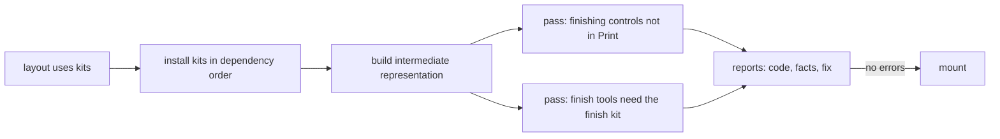

# Chapter 11 · Kits with Policy Passes ★

*Bundle each domain area (its tools, commands, panels, state, keys and documentation) as a kit with declared
dependencies, and let the kit install passes that check every layout using it against the area's rules.*

## Intent

Make a domain area installable as one unit, and make its rules travel with it. A kit adds viewport tools with
gestures and overlays, commands, panels built from the shared vocabulary, a slice of state and its documentation. It
also adds **passes**: pure checks that run over the layout's intermediate representation when the application is
built, and report problems with a code, the facts behind them and a fix. A layout that misuses the kit is told so when
it is built, not when a user stumbles.

In this chapter the **shell** is the generic application builder of Chapter 10: the object layouts call to declare
modules and install kits, which also owns the build step and the pass runner.

## Also known as

Plugins with lint rules; feature modules; extensions with contributions; domain packs; build-time policy checks.

## Motivation

The running example (chromobench, a browser darkroom whose interface is written in a layout DSL, Chapter 10) has
domain areas that layouts combine freely: finishing (crop, straighten, spot healing, finishing tones), a roll-of-film
workflow, looks, an assistant. Its central product rule is that the darkroom stays physical: digital finishing
controls belong after the print, not among the enlarger's controls. Without kits and passes, four things go wrong.

1. **Areas are half-installed.** A layout adds the crop tool to a viewer but forgets the commands, the state and the
   keys it needs; the tool does nothing, silently.
2. **Rules live in people's heads.** "No digital controls in the Print module" is easy to break with one line in a
   new layout, and nobody notices until a user mixes physical and digital controls.
3. **Dependencies are implicit.** The finishing area assumes the core area's state; installing it alone fails at the
   first gesture.
4. **Errors without directions.** A broken layout produces a blank panel instead of a message saying what to change.

Plugin ecosystems of IDEs, add-on systems of 3-D tools and lint ecosystems of programming languages solve the same
problem: optional areas that must install completely and whose authors want to enforce their own rules.

## Problem

**How do you let layouts combine domain areas freely while each area installs completely and its rules are enforced
wherever it is used?**

## Forces

- **Freedom against correctness.** Layout authors should compose without asking; some compositions are wrong for the
  product.
- **Central checks against local knowledge.** A central validator cannot know every area's rules; each area's author
  does.
- **Strict against helpful.** Refusing to build stops a broken layout; warning lets a deliberate exception through.
- **Order against independence.** Kits depend on each other and passes on each other's results, but each should be
  written alone.
- **Checks against side effects.** A check that changes the layout is a second layout system in disguise.

## Solution

**Therefore: package each domain area as a kit: a named, versioned value that declares the kits it requires and
contributes state, derived state, tools (with gestures, cursors and overlays), commands, documentation and passes,
and returns the panels and key maps layouts place. Install kits in dependency order, refusing missing and circular
dependencies. Run each pass after the layout is built, over its intermediate representation, in an order derived from
the passes' declared `after` and `before`; passes may only read and report. Every report carries a stable code, a
message, the call site in the layout, the facts that triggered it and a fix. Warnings let deliberate exceptions
through; errors stop the build. A rule that must hold even when its kit is absent (tools placed without their kit) is
installed on the shell itself.**

## Applicability

Use it when:

- several optional domain areas are combined by many layouts or by several authors (including agents);
- areas have rules about placement or combination that the shell cannot know;
- layouts are built before they are shown, so there is a moment to check them.

Do not use it when:

- there is one area and one layout; a code review enforces its rules;
- the rules are about runtime data, not about layouts (validate documents instead, Chapter 9);
- layouts are built incrementally by user drags with no build step; check on each change, or not at all.

## Structure

| Participant | Responsibility |
|---|---|
| **Kit** | name, version, requires, state, derived state, tools, commands, passes, documentation; returns panels and keys |
| **Kit installer** | collects kits from the layout, orders by dependencies, refuses missing ones and cycles |
| **Tool** | id, label, key, cursor, gestures (down, drag, up, hover, escape), overlay, image override |
| **Pass** | name, the representation it inspects, `after` / `before`, a pure function `(ir, report) → nothing` |
| **Pass runner** | orders passes, runs each, turns a throwing pass into a report of its own |
| **Report** | code, severity, message, call site, facts, fix |
| **Shell-level pass** | a rule installed on the shell so it holds even when the kit is missing |

## Collaborations

1. A layout uses kits (`studio.use(finishKit)`) and places their panels and tools.
2. The installer orders the kits so each one's requirements come first; a missing kit or a cycle is a report.
3. Each kit contributes state, tools, commands and documentation to the application under construction.
4. The shell builds the intermediate representation; the runner orders passes by `after`/`before` and runs them.
5. Reports are shown to the layout author (and to the agent, for agent-written layouts); errors stop the mount.



Read it as two phases: kits shape what is built, passes judge it; nothing reaches the screen past an error.

## Sketch

```text
value Report: severity ∈ { warning, error }, code, message, at, facts, fix
report(severity, code, message, at, facts, fix)       -- one signature for every report

kit "finish" version "1":
  requires ["core"]
  state finish: { tool: none, selectedSpot: none }
  tools:
    tool "crop": key R, cursor crosshair, on: { down: cropDown, drag: cropDrag, up: cropUp,
        escape: cancel },
                 overlay: cropOverlay
    tool "spot": key Q, on: { down: spotDown, drag: spotDrag, up: spotUp }, overlay: spotOverlay
  commands: crop.reset, crop.swap, spot.delete, finish.toggle, …
  passes: [labelPass]
  docs: "Crop and straighten (R) … the recipe stores vectors, never pixels …"
  returns: { viewer, cropPanel, retouchPanel, tonesPanel, keys }

pass labelPass on ui after "slots":
  for module in ir.modules where module.label matches /print|darkroom/i:
    for node in walk(module.regions) where node.type = "arg" and node.path starts with
        "finishing.":
      report(warning, "CB-F101", "finishing control in the module " ++ module.label, node.at,
             facts: ["finishing tones are digital,
                 after the print; the Print module is physical"],
             fix: "move it to a Finish module, or relabel the module")

shell pass framePass on ui after "slots":           -- holds even when the finish kit is absent
  for viewer in ir.find("viewport") where viewer.tools ∩ { crop,
      spot } ≠ ∅ and not installed("finish"):
    report(error, "CB-F102", "viewer lists the finish tools,
        but the finish kit is not installed", viewer.at,
           facts: ["tools: " ++ viewer.tools], fix: ".use(finishKit) on the studio")

runPasses(ir, passes):
  order ← orderBy(after, before, passes)
  if order has a cycle: report(error, "CK-X140", "passes depend on each other in a cycle", none,
      facts: [names], fix: …)
  for p in order:
    try p.run(ir, report)
    catch e: report(error, "CK-X150", "pass " ++ p.name ++ " threw", p.at, facts: [e],
                    fix: "passes are pure checks; guard reads that can be missing")

-- a fix, end to end
--   report:  CB-F101 at layouts/darkroom:42  "finishing control in the module Darkroom"
--   change:  move cb.arg("finishing.values.clarity") into the Finish module's right region
--   rebuild: no reports; the layout mounts
```

## Implementation notes

1. **Passes are pure.** The running example's runner reports a pass that throws as its own error with the fix
   "Passes are pure checks; guard reads that can be missing". A pass that edits the layout makes the built
   application depend on pass order and hides the layout's real content from its author.
2. **Order by declaration, refuse cycles.** Passes declare `after` and `before`; in the running example a cycle is
   error CK-X140, and a pass naming an `after`/`before` pass that is not installed is warning CK-X141. Kits are
   ordered dependencies-first; a required kit that is missing is X130, a cycle among kits X131.
3. **Every report has a code, facts and a fix.** The codes are stable (tests and documentation refer to them); the
   facts say what the pass saw; the fix says what to type. This is the same refusal shape the engine uses for an
   ill-typed graph (Chapter 5), so people and agents read one kind of message everywhere.
4. **Warn for policy, error for breakage.** "A finishing control in the Print module" is a product rule a layout may
   break on purpose (a warning); "finish tools without the finish kit" cannot work (an error).
5. **Negative rules about a kit belong to the shell.** The rule that a viewer listing the finish tools needs the
   finish kit cannot live in that kit: if the kit is absent, so is its pass. The running example installs that pass on
   the shell instance. In general, any rule of the form "never X unless kit K" must be installed outside K, or it
   disappears with K.
6. **Report the call site.** Each node of the representation records where in the layout source it was created;
   reports point there. Without it, an author with nine layouts cannot find the offending line.
7. **Let deliberate exceptions be explicit.** A layout that intentionally puts a digital panel beside the enlarger
   should acknowledge the warning in its source (an explicit allow), so the next reader sees the decision. The
   running example does not have this yet; warnings are only shown.
8. **The kit's documentation is part of the kit.** The running example's kits carry a documentation string beside
   their tools and commands, so explanations of a layout can include it; a tool whose rules live only in a wiki is
   used wrongly, by people and by agents.
9. **Match on concepts, not on labels.** The running example's CB-F101 finds "the Print module" by matching module
   labels against `/print|darkroom/i`, a debt: a module relabelled "Enlarger" escapes the rule. Give modules a role
   (physical, digital, library) and tools a capability set in the representation, and let passes read those.
10. **Test passes with fixture layouts.** A pass is a function from a representation to reports; its tests build a
    small layout and assert the codes it produces, including that a correct layout produces none.
11. **Kits return parts; layouts place them.** A kit that inserts its own panels decides the layout for its users. The
   running example's kits return `viewer`, `cropPanel`, `retouchPanel`, `tonesPanel` and `keys` and let each layout
   choose where they go.

## Variations

- **Manifest-only extensions.** Kits declared as data (contribution manifests); easy to analyse without running
  code, limited to what the manifest format foresees.
- **Runtime guards instead of passes.** Each tool checks its preconditions when used; no build step, but problems
  surface only when a user reaches them.
- **Fixing passes.** Passes that propose an automatic fix the author can apply (like lint autofixes); keep the pass
  pure by returning the fix as data.
- **Validate on every change.** When users drag panels instead of authoring layouts, run the same pure passes on each
  change and show reports inline; needs passes fast enough to run per gesture.
- **Path rules over graphs.** In node-based tools a placement rule is about paths, not slots ("every path from the
  source to this node passes through the input transform"); passes then check reachability in the node graph.
- **Type-level policies.** Encode placement rules in the layout DSL's types (a Print region accepts only physical
  controls); caught by the compiler, rigid for deliberate exceptions.

## Consequences

- \+ Domain areas install completely or not at all; tools never arrive without their commands and state.
- \+ Product rules travel with the area that owns them and hold in every layout, including agent-written ones.
- \+ Authors get precise, actionable reports at build time.
- − Passes are another program to maintain, with their own tests.
- − A build step is required between layout source and screen.
- − Over-eager policies turn into friction; warnings need a way to be acknowledged, or authors learn to ignore them.

## Known uses

- **ESLint** plugins contribute rules that visit a syntax tree and report problems with locations, and can offer fixes.
- **Rust's Clippy** shows named lint groups with allow, warn and deny levels that code can override locally: the
  model for acknowledging a warning in the source.
- **Visual Studio Code** extensions contribute commands, views, menus and keybindings, and declare dependencies on
  other extensions.
- **Blender** add-ons register operators, panels and keymaps as a unit.

## Related chapters

- [Chapter 10 · Two-Vocabulary Layout DSL](10-two-vocabulary-layout-dsl.md) builds the representation passes inspect.
- [Chapter 5 · Domain-Typed Image Pipeline](05-domain-typed-pipeline.md) uses the same refusal shape for graphs.
- [Chapter 9 · Vector Edit Document](09-vector-edit-document.md) is what kits' tools write.
- [Chapter 12 · Shared Handle Vocabulary](12-shared-handle-vocabulary.md) for agents that author layouts and edits.
- GoF: **Visitor** (passes over the representation), **Chain of Responsibility** (ordered passes), **Facade** (a kit
  in front of an area).
