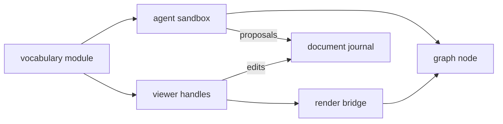

# Chapter 12 · Shared Handle Vocabulary ★

*Give the meaningful places of the pipeline names, and let the interface's viewers and the agent's scripting language
use the same names, from one module, for the same graph nodes; every handle can say how the agent would write it.*

## Intent

Make the interface and the programmable surface speak one language. When the viewer shows "the print at 12 seconds",
it holds a handle whose meaning is exactly what an agent's `frame.print({ time_s: 12 })` evaluates to: the same graph
node, built by the same code. Handles are plain values that compile nothing; a renderer lowers them. Each handle
carries its expression in the scripting language, so the interface can show the code for what is on screen and an
agent can refer to what the person is looking at.

## Also known as

Shared vocabulary; one API seam; scriptable interface; command-line parity; handles over the document.

## Motivation

The running example (chromobench, a browser darkroom) has a viewer, thumbnails, a test-strip tool, a ring-around,
and an assistant that writes JavaScript in a sandbox to inspect and change prints. Without a shared vocabulary, four
things go wrong.

1. **Two meanings of "the print".** If the viewer shows the output of one operation and the agent's `print()` names
   another (before or after viewing flare), a statistic the agent computes does not match what the person sees.
2. **The agent cannot point.** A person asks "why is this corner so dark?"; without a shared name for "what is in
   the viewer", the agent has to reconstruct it.
3. **Options drift.** The viewer's what-if ("show me +1/3 stop") and the agent's `print({ time_s })` accept different
   option names, units and paths into the recipe.
4. **Documentation and validator disagree.** Editor lab (a browser photo editor driven by an in-page agent) documents
   its API to the agent in a separate reference; one documented option is rejected by its validator, so agents fail
   on a documented call.

Audio workstations with scripting (tracks and clips named the same in the interface and the scripts), spreadsheets
with macro recorders and CAD tools whose buttons are commands all solve the same problem.

## Problem

**How do the interface and a programmatic user (script or agent) refer to the same things, so that what one shows
the other can name, and what one does the other can repeat?**

## Forces

- **Human names against stable identifiers.** People want "the print"; caches and graphs want node ids.
- **Convenience against precision.** A viewer can hold whatever object is handy; an agent needs a value it can write
  down and send.
- **One module against two consumers.** The interface and the sandbox run in different processes with different
  needs; sharing code between them constrains both.
- **Expressiveness against safety.** An agent with full access can do anything; a narrow vocabulary is safer and
  easier to explain.
- **Live state against what-ifs.** A handle may mean the current recipe, the initial one, or a hypothetical change;
  all must be expressible without mutating anything.

## Solution

**Therefore: define, in one module that both the interface and the scripting host import, the vocabulary of the
pipeline's meaningful places: accessors (`source`, `scan`, `negative`, `print`, `display`), each naming the operation
whose node it denotes and that node's domain, and the options a what-if may set, each naming the operation argument it
binds and the document path it would change. In the interface, viewers and tools hold handles: frozen plain values
`{ frame, recipe or "initial", what, args, expr }` that compile nothing; a render bridge lowers a handle by compiling
the recipe (with the what-if applied to a copy) and selecting the accessor's node. Give every handle the expression an
agent would write for it. In the scripting language, the same accessors return the same nodes. Route every change
either path makes through the document's mutations (Chapter 9), stamped with its author.**

## Applicability

Use it when:

- people and programs (scripts, agents, tests) both drive the system;
- the interface shows derived results that a program should be able to name and reproduce;
- explanations ("why", "what would happen if") must refer to what the person sees.

Do not use it when:

- there is no programmable surface, and none is planned;
- the domain has no stable intermediate places worth naming (a single-step filter);
- programs need a lower-level interface than the interface's concepts (engine tests); give them the graph directly,
  and keep the vocabulary for people and agents.

## Structure

| Participant | Responsibility |
|---|---|
| **Vocabulary module** | accessors (name → operation, domain), what-if options (name → operation argument, document path) |
| **Handle** | frozen value: frame, recipe (current or initial), what, options, expression |
| **Render bridge** | lowers a handle: apply options to a copy of the recipe, compile, pick the accessor's node, evaluate |
| **Scripting host** | runs agent code in a sandbox; `frame.<accessor>(options)` returns graph nodes from the same module |
| **Mutation path** | the only way either side changes the document; stamped with author (user, agent, script) |
| **Provenance links** | from a result or layer to what made it (agent step, script line, preset), and back |

## Collaborations

1. The interface builds a handle for each viewer and tool: `frame(s).print()` or `frame(s).print({ time_s: 12 })`.
2. The render bridge lowers the handle with the vocabulary module: it applies the options to a copy of the recipe
   through their document paths, compiles, and selects the accessor's node (Chapter 1).
3. The agent, in its sandbox, writes `frame.print({ time_s: 12 })`; the host uses the same module and reaches the
   same node id.
4. The interface shows a handle's expression (in a tooltip, an inspector, a "copy as code" action); the agent can be
   given the expression of what the person is looking at.
5. When the agent changes something, it proposes mutations; the journal records them with the agent's step, and the
   interface links the result back to the step.



Read it as one vocabulary feeding two users who meet at the same graph node and change the same document.

## Sketch

```text
-- the one shared module
accessors ← {
  source:   (op: "source.open",  domain: camera-linear),
  scan:     (op: "scan.density", domain: scanner-density),
  negative: (op: "invert.dyes",  domain: film-dyes),
  print:    (op: "view.adapt",   domain: print-xyz),
  display:  (op: "output.frame", domain: display-rgb) }
-- option → (operation argument, document path)
printOptions ← {
  time_s: ("print.expose".time_s, "print.enlarger.time_s"),
  grade:  ("print.develop".grade, "print.grade"),
  paper:  ("print.expose".paper,  "print.paper"), … }

value Handle: frame, recipe, what, options, expr

-- interface side: a handle compiles nothing
handle(frame, what, options) → Handle(frame, current recipe, what, options,
                                        expr: "frame." ++ what ++ "(" ++ literal(options) ++ ")")
bridge.lower(h) → node:
  r ← h.recipe ⊕ { printOptions[k].path: v for (k, v) in h.options }     -- what-if on a copy
  g ← compile(r); return g.nodeOf(accessors[h.what].op)

-- agent side: the same words reach the same node
frame.print({ time_s: 12 })   →   same id as bridge.lower(handle(f, print, { time_s: 12 }))

-- changes go through the journal, with provenance
agent: propose([set("print.enlarger.time_s", 12)], author: (agent, turn: 4, step: 2))
```

## Implementation notes

1. **One module, imported by both sides.** The running example's frame vocabulary is a single contract module;
   the scripting host and the viewer handles both import it "so viewer and agent name the same node for the same
   words". Two copies would drift exactly as Editor lab's documentation and validator did.
2. **Accessors name an operation, not a position in the chain.** `print` is "the node of `view.adapt`", wherever the
   chain puts it. When operations are inserted (retouching, a digital stage), the accessor's meaning does not move;
   add a new accessor (for example `finished`) for the new place instead of shifting an old one.
3. **What-ifs bind to both an argument and a path.** Each print option names the operation argument that validates it
   and the recipe path it would change. The viewer's test strip and the agent's what-if then share validation, units
   and typed entry (Chapter 2), and a what-if can be turned into a real edit by applying the same paths.
4. **Handles compile nothing.** The running example's handles are frozen plain objects; only the render bridge
   compiles. Handles can be created on every frame, compared, logged and sent to a worker without cost.
5. **Every handle knows its expression.** A handle's `expr` ("how the agent would write it: `frame.print({ time_s: 12 })`")
   lets the interface show the code behind a picture and lets a person hand the agent exactly what they see.
6. **Agent changes are proposals with provenance.** The running example's journal records the author of every
   mutation and keeps an agent's changes pending until approved (Chapter 9). Editor lab stamps each layer with what
   made it (a preset, a script's file and line, an agent's thread, turn and step) and links both ways between the
   layer and its source.
7. **Errors speak the vocabulary.** When a script asks for something ill-typed, the refusal names the accessor or
   operation to use ("call `invert.dyes` first", Chapter 5). goja-cv, whose agents drive an image engine through one
   evaluation tool, returns errors as a code, a message, where, a hint and a literal fix.
8. **Keep the sandbox narrow.** The agent's language exposes the vocabulary, documents and measurements, not the
   engine's internals. A narrow surface is easier to document completely, and its documentation can be generated from
   the same declarations (Chapter 2).

## Variations

- **Command parity.** Every interface action is a named command that a script can call with the same arguments
  (command-line parity); simpler than handles, but describes actions rather than results.
- **Recorded macros.** The interface records actions as script text; good for repetition, weak for naming results.
- **Selection as context.** The agent receives the current selection and view as structured context with every
  message, instead of handles; works for chat, less so for scripts.
- **Separate agent API.** A purpose-built API for agents beside the interface; freedom to design for agents, at the
  cost of a second vocabulary to keep in sync.

## Consequences

- \+ What the person sees and what the agent computes are the same node; statistics and explanations match.
- \+ The interface can show the code for any picture; the agent can name what the person points at.
- \+ Validation, units and paths for what-ifs are shared, so a what-if becomes an edit without translation.
- − The shared module couples the interface and the scripting host; changing a word is a versioned change.
- − Accessors fix the vocabulary of meaningful places; new places need new words, carefully named.
- − Agent changes need a review path (pending, approve, reject), which is interface work of its own.

## Known uses

- **Blender** can show the Python data path or operator of a control in its tooltip, and its interface calls the same
  operators scripts call.
- **Emacs** binds keys to named interactive commands that are also callable from Lisp.
- **AutoCAD** commands can be issued from toolbars, the command line or scripts by the same names.
- **Spreadsheet macro recorders** (Excel) turn interface actions into script code.
- **Editor lab** routes its agent, code editor, benchmark and book through one lab API.
- **goja-cv** exposes one evaluation tool to agents and returns structured errors with fixes.

## Related chapters

- [Chapter 1 · Interned Operation Graph](01-interned-operation-graph.md) gives both sides the same node ids.
- [Chapter 5 · Domain-Typed Image Pipeline](05-domain-typed-pipeline.md) gives accessors their domains.
- [Chapter 9 · Vector Edit Document](09-vector-edit-document.md) receives both sides' changes.
- [Chapter 10 · Two-Vocabulary Layout DSL](10-two-vocabulary-layout-dsl.md) places the viewers that hold handles.
- [Chapter 4 · Latest-Wins Render Slots](04-latest-wins-render-slots.md) renders handles.
- GoF: **Proxy** (a handle stands for a result), **Command** (proposals), **Facade** (the vocabulary over the graph).
