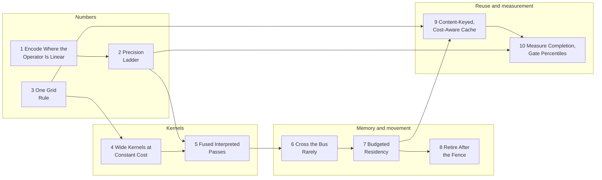

# Fast and Checkable: GPU Image Computation Patterns

*Ten patterns for number-crunching programs that must be fast and still provably right, for graduate students.*

## The kit and the quality

This volume is for people who write programs whose inner loops run billions of times: image and video processing,
computer vision, simulation, inference, anything that moves large arrays through a GPU or a vector unit. It assumes
you can program, know what a floating-point number is, and have met linear algebra and a little signal processing. It
does not assume you have written GPU code; each GPU idea is explained the first time it appears.

The quality we are after has two halves that pull against each other. The program must be **fast**: interactive
latencies, memory that fits, data that does not shuttle needlessly between devices. And it must be **checkable**: a
fast result must be comparable, number for number, with a slow one you trust, and a regression in speed or accuracy
must show up as a failing test, not as a user's complaint. Most performance techniques make results harder to check
(they approximate, reorder, cache, reduce precision); most correctness techniques cost speed. Each pattern here is a
way to have both. In Christopher Alexander's terms, the patterns resolve forces; in Richard Gabriel's, they keep fast
code habitable, so that the next person can change a kernel without being afraid of it.

The ten patterns answer questions every such program meets:

- In which representation should each operation work, so that its mathematics is simple?
- Where does each number need 64 bits, where are 32 enough, where 16, and how do you decide rather than guess?
- How do a preview, a crop and a full-size result stay exactly comparable when they are computed on different grids?
- How can a filter with a radius of hundreds of pixels cost the same as one with a radius of two?
- How do you avoid both recompiling a GPU program on every slider move and launching one pass per operation?
- What should cross the narrow link between the GPU and the host, and when?
- How does a program manage memory on a device that will not tell it how much is free?
- When is it safe to free or reuse a GPU resource?
- What should a cache of expensive results keep, and how is a result named?
- How do you time asynchronous GPU work, and make a slowdown fail the build?

## The running example

The examples come from two browser programs and a textbook. **chromobench** is a darkroom in the browser: it opens
raw camera files and film scans and prints them through a numerical model of film and photographic paper. Its image
pipeline runs on the GPU through WebGPU, beside a double-precision reference engine that is slow but exact; both
answer the same contract, and parity tests compare them. **Editor lab** is a small teaching editor written alongside
a nine-chapter textbook on compositing, blend modes, masks, neighbourhood filters, tiles and pyramids, caching,
scheduling and the GPU; its engine is about 750 lines of JavaScript, and the book measures its design choices.

Nothing in the patterns depends on these programs. Every chapter names other systems with the same problem, and its
exercises ask you to apply the pattern elsewhere: to an inference runtime, a physics simulation, a video pipeline or a
columnar database.

Two sibling volumes cover neighbouring ground. The [image engine language](../00-overview.md) is about the structure of
such an engine: operation graphs, fusion, tiling, the edit document. [A Small Pattern Language for Modular
Software](../modular/00-overview.md) teaches modular design to undergraduates with the same example. Where a chapter
here goes deeper into a pattern one of those volumes introduces, it says so and links to it; you do not need to have
read them.

## How each pattern is written

Every chapter has the same sections, in the same order: Intent, Also known as, Motivation, Problem, Forces,
Solution, Applicability, Structure, Collaborations, Sketch, Implementation notes, Variations, Consequences, Known
uses, Related chapters, and Exercises. The **Solution** paragraph begins "Therefore:" and states the pattern so that
it stands alone. The **Forces** name the tensions; for this volume they are usually between throughput, memory,
latency, precision and the ability to check. The **Implementation notes** include the mistakes the example programs
made, with their numbers. The **Exercises** include one to implement and measure, one to analyse (an error bound, a
cost model or a proof), and one in another domain.

Each pattern carries a rating:

- **★★** the pattern is close to invariant: we believe any good solution to this problem has this shape.
- **★** a good form among several; the Variations section names the others.

## Pseudocode conventions

Sketches are pseudocode, not any real language. The first table is shared with the sibling volumes; the second adds
what GPU work needs.

| Notation | Means |
| --- | --- |
| `value T:` | an immutable record type; its methods return new values |
| `copy(x, f: v)` | x with field f replaced by v |
| `a ⊕ b` | map a with b's entries laid over it |
| `xs ++ ys` | list concatenation |
| `f(a) → B` | a signature: f returns a B |
| `x → expr` | an anonymous function |
| `match x:` | case analysis over the forms x can take |
| `refuse(kind, …)` | return a structured refusal: kind, message, hints, fix, where |
| `-- text` | a comment |

| GPU notation | Means |
| --- | --- |
| `kernel k(bindings) over grid:` | a function run once per element of a grid, in parallel, on the device |
| `dispatch(k, grid, bindings)` | record one run of a kernel into the current batch of commands |
| `submit(batch) → fence` | hand the recorded commands to the device; the fence signals when they have finished |
| `await fence` | wait until the device has finished that batch |
| `f64`, `f32`, `f16` | 64-, 32- and 16-bit floating point |
| `upload(x)`, `readback(x)` | copy host memory to the device, or device memory back to the host |

## The pattern map



Read an arrow as "is completed by". An encoding (1) is completed by a decision about how many bits each value in it
needs (2). A grid rule (3) is what lets a decimated wide kernel (4) and a cached result (9) be compared with the
full-size truth. Budgeted residency (7) needs safe lifetimes (8) and a policy for what to keep (9), and every
pattern is completed by a measurement that notices when it stops paying (10).

## The chapters

| # | Pattern | ★ | In one line |
| --- | --- | --- | --- |
| 1 | [Encode Where the Operator Is Linear](01-encode-where-the-operator-is-linear.md) | ★★ | run each operation in the representation where its mathematics is simple |
| 2 | [Precision Ladder](02-precision-ladder.md) | ★★ | solve rarely in wide precision, apply often in narrow precision, store narrower only within a measured budget |
| 3 | [One Grid Rule](03-one-grid-rule.md) | ★★ | one sampling convention for every engine, so a region is bit-identical to a crop of the whole |
| 4 | [Wide Kernels at Constant Cost](04-wide-kernels-at-constant-cost.md) | ★ | running sums, separability and decimation make cost independent of radius; reach is declared |
| 5 | [Fused Interpreted Passes](05-fused-interpreted-passes.md) | ★ | one kernel interprets a fused program of pointwise steps; passes break only where neighbours are read |
| 6 | [Cross the Bus Rarely](06-cross-the-bus-rarely.md) | ★★ | reduce, quantise and pack on the device; move results, not intermediates |
| 7 | [Budgeted Residency](07-budgeted-residency.md) | ★ | count your own device memory against a derived budget; keep per owner, evict by visibility, recover once |
| 8 | [Retire After the Fence](08-retire-after-the-fence.md) | ★★ | a resource's life ends when the device's last use of it finishes, not when the host drops it |
| 9 | [Content-Keyed, Cost-Aware Cache](09-content-keyed-cost-aware-cache.md) | ★ | name results by what made them; stop early when outputs repeat; evict by cost of remaking per byte |
| 10 | [Measure Completion, Gate Percentiles](10-measure-completion-gate-percentiles.md) | ★★ | time device work to completion, from the user's intended moment, and fail the build on regressions |

## Using the language

1. **Before the first kernel:** decide the encodings (1) and the grid rule (3). Both are expensive to change later,
   because every test's expected numbers depend on them.
2. **With the first kernel:** write the slow reference and the timing harness (10). Decide each value's precision by
   measurement against the reference (2), not by habit.
3. **When a filter gets wide:** make its cost independent of radius and declare its reach (4).
4. **When the pipeline grows past a handful of steps:** fuse pointwise runs and interpret them instead of generating
   a program per combination (5).
5. **When anything crosses to the host:** reduce and pack first (6).
6. **When a second document, frame or model is open at once:** budget the device memory (7), make lifetimes follow
   the device's timeline (8), and decide what to keep (9).

## All of them in one sketch

```text
-- 1 Encode Where the Operator Is Linear: exposure is a gain in linear light; a seam fix is additive in log density
img_lin = decode(raw)                         -- linear light
img_d   = -log10(transmittance(scan))         -- density: a gain becomes an offset

-- 2 Precision Ladder: the rare solve in f64 on the host, the per-pixel apply in f32 on the device
coeffs = solveSeam_f64(spot, window)          -- once per spot
kernel heal(coeffs) over spot.box: out[p] = patch[p] + seam(coeffs, p)    -- f32, per pixel

-- 3 One Grid Rule: every grid reads the source at the same pixel centres
fp(p) = region.x + floor((p + 0.5) · region.w / w)

-- 4 Wide Kernels at Constant Cost: three running-sum boxes ≈ a Gaussian; reach declared for the tiler
blur(σ) = box(r1) ∘ box(r2) ∘ box(r3)  with reach = r1 + r2 + r3

-- 5 Fused Interpreted Passes: one pass runs a program of pointwise steps; a blur breaks it
dispatch(pointwise, grid, program: [EXPOSURE 1.5, CURVE c, MIX 0.8])     -- no recompilation when values change

-- 6 Cross the Bus Rarely: pack 16-bit codes on the device; read back 8 bytes per pixel, not 16
dispatch(pack16, grid, …); bytes = readback(packed)

-- 7 Budgeted Residency: a budget from what the adapter reports; evict what is not on screen first
budget = clamp(deviceMemory / 8, 512 MiB, 2 GiB)

-- 8 Retire After the Fence: destroy only after the batch that used it has finished
fence = submit(batch); retire(texture, after: fence)

-- 9 Content-Keyed, Cost-Aware Cache: a key from what made the tile; eviction by cost per byte
cache.put(key(op, params, input_keys), tile, cost: 38 ms)

-- 10 Measure Completion, Gate Percentiles: from the intended input time to the frame that showed the result
bench("drag exposure", device: "integrated GPU") → { p50, p95, p99 } ; require p95 ≤ 50 ms
```

## The same language in other systems

| System | Encode where linear | Precision ladder | Wide kernels | Fused passes | Cross the bus rarely | Budgeted residency | Retire after the fence |
| --- | --- | --- | --- | --- | --- | --- | --- |
| A neural-network inference runtime | log-space softmax (log-sum-exp) | f32 accumulate, f16/int8 weights within an accuracy budget | strided and dilated convolutions | operator fusion in the graph compiler | keep activations on the device; read back logits | a memory planner with a fixed arena | buffers reused only after the stream that used them completes |
| A real-time renderer | lighting in linear light, tone mapping last | f32 shading, f16 render targets | blur at reduced resolution (bloom chains) | ubershaders against specialised shaders | GPU-driven culling instead of CPU readback | texture streaming pools | per-frame deletion queues |
| A physics simulation | log-transformed positive quantities | double-precision accumulation of forces | fast multipole and Barnes–Hut instead of all pairs | fused stencil updates | checkpoint only every n steps | domain decomposition sized to device memory | halo buffers recycled after the exchange completes |
| A video pipeline | colour conversion in linear light | 10-bit storage, float processing | scaled-down motion search | one pass for scale, convert and denoise | hardware decode straight into GPU memory | frame pools sized to the codec's references | frames recycled after the encoder releases them |

## What to leave out

These patterns do not teach the algorithms themselves (a Levenberg–Marquardt solve, a spectral film model), the API
of any one GPU interface, or how to write a fast kernel instruction by instruction. They are about where work,
precision, memory and time are placed, which is what decides whether a fast program stays correct as it grows.

## Further reading

- David Goldberg, "What Every Computer Scientist Should Know About Floating-Point Arithmetic", *ACM Computing
  Surveys* 23(1), 1991; Nicholas J. Higham, *Accuracy and Stability of Numerical Algorithms* (SIAM, second edition
  2002).
- Thomas Porter and Tom Duff, "Compositing Digital Images", SIGGRAPH 1984.
- Peter J. Burt and Edward H. Adelson, "The Laplacian Pyramid as a Compact Image Code", *IEEE Transactions on
  Communications* 31(4), 1983.
- Jonathan Ragan-Kelley et al., "Halide: A Language and Compiler for Optimizing Parallelism, Locality, and
  Recomputation in Image Processing Pipelines", PLDI 2013.
- Samuel Williams, Andrew Waterman and David Patterson, "Roofline: An Insightful Visual Performance Model for
  Multicore Architectures", *Communications of the ACM* 52(4), 2009.
- Andrey Mokhov, Neil Mitchell and Simon Peyton Jones, "Build Systems à la Carte", ICFP 2018.
- Jeffrey Dean and Luiz André Barroso, "The Tail at Scale", *Communications of the ACM* 56(2), 2013.
- Todd Mytkowicz, Amer Diwan, Matthias Hauswirth and Peter F. Sweeney, "Producing Wrong Data Without Doing Anything
  Obviously Wrong!", ASPLOS 2009.
- The W3C WebGPU and WGSL specifications.
