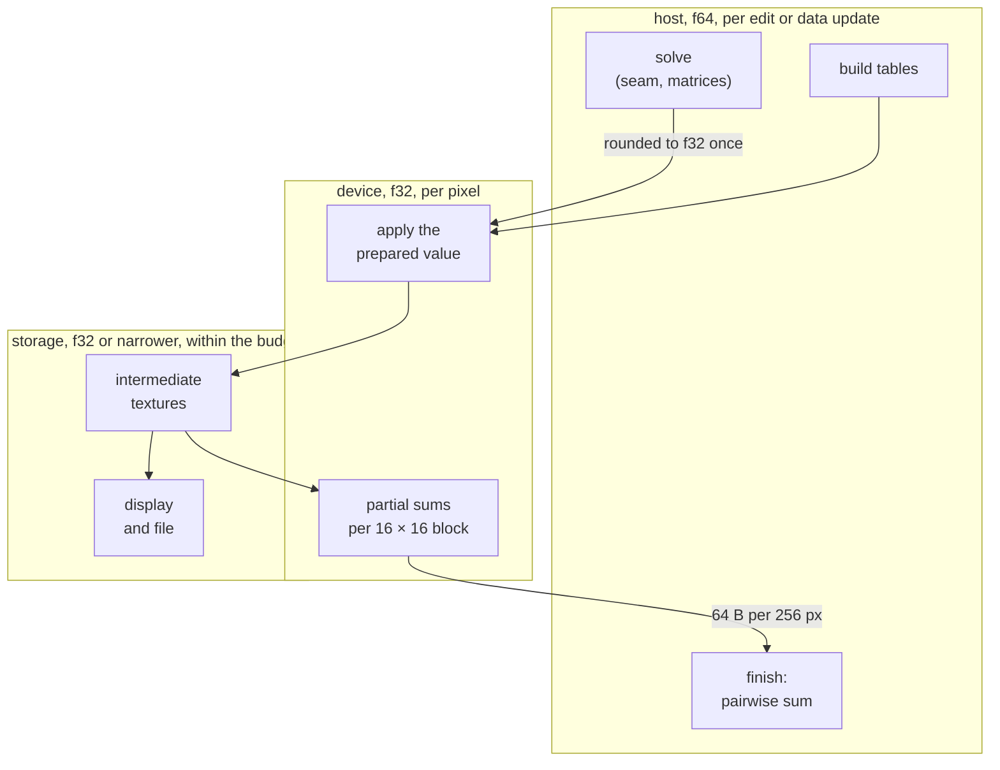

# Chapter 2 · Precision Ladder

*Solve rarely in wide precision, apply often in narrow precision, and store narrower only within a measured budget.*

**★★** We believe any good solution to this problem has this shape.

## Intent

Give every value a precision chosen by how often it is computed and how its errors grow, not by habit. Rare,
ill-conditioned work (solves, the last step of a reduction, table builds) runs in 64-bit floats when its inputs
change. Per-element work runs in the device's 32-bit floats. Storage narrows to 16 bits or fewer only where a
measurement at the output, against a reference, shows the error stays inside the budget.

## Also known as

Mixed precision; compute narrow, accumulate wide; solve on the host, apply on the device; iterative refinement;
precision budget.

## Motivation

chromobench's GPU engine runs in WebGPU, whose shading language has 32-bit floats, optional 16-bit floats and no
64-bit type. Its reference engine runs in JavaScript's 64-bit floats. A print passes through matrix solves, Fourier
fits, iterative solves, sums over millions of pixels, and tables. Choosing one precision for all of it fails in four
ways.

1. **A long sum drifts.** A light meter needs the mean of a region. Summed one value after another in 32 bits (we
   measured it on a CPU), a uniform grey of 0.18 over 4,000 × 2,674 pixels averages to 0.157, 12.6 % low. Once the
   running sum is large, each new 0.18 is rounded to a multiple of the sum's ulp (the gap between adjacent floats at
   that magnitude).
2. **A per-pixel solve in 32 bits fails where it is ill-conditioned.** The output knee finds, for each pixel, the
   largest chroma the display can show at that pixel's lightness and hue, by bisection. Near the top of the RGB cube
   that boundary is ill-conditioned. On an Apple M1 Max, 0.34 % of the values miss the 64-bit result by more than
   2 × 10⁻⁶, by up to 3.0 × 10⁻⁵: four codes of a 16-bit file.
3. **An iterative solve cannot converge below its precision.** chromobench builds a 33³ table of film dye amounts,
   one Levenberg–Marquardt solve per node, stopping when the gradient falls below 10⁻⁹. In 32 bits that test is
   never met. The GPU builder raises the tolerance to at least 10⁻⁶.
4. **"Half floats are enough" was not.** Editor lab's textbook says 16-bit floats keep about three decimal digits,
   "enough for any intermediate that will be shown in 8 bits". chromobench measured it on a camera file. Rounding
   the source to half floats (relative error 4.8 × 10⁻⁴) moved the scene result by up to 1.6 × 10⁻⁴ against a
   tolerance of 3 × 10⁻⁵, and the display by 0.013, 3.4 8-bit levels, against 2 × 10⁻⁴. The film model downstream
   amplifies the rounding.

Other fields know these failures. Training a neural network in 16-bit floats loses small gradient updates to
rounding and underflow, so mixed-precision training keeps a 32-bit master copy of the weights. Solving `Ax = b` with
an LU factorisation in 32 bits is fast, but accurate only to about `κ(A) · 2⁻²⁴`, where `κ` is the condition
number; iterative refinement recovers 64-bit accuracy by computing residuals in 64 bits.

## Problem

**Wide precision everywhere is too slow, too large, or not available on the device; narrow precision everywhere is
wrong wherever the computation is long or ill-conditioned. How do you decide the precision of each value?**

## Forces

- **Throughput against accuracy.** GPUs are fast in 32 bits; on consumer parts 64-bit arithmetic runs at a small
  fraction of that rate, or not at all.
- **Memory against headroom.** 16-bit storage halves memory and bandwidth; every stage downstream may amplify its
  rounding.
- **Solving on the host against solving where the data are.** A 64-bit host solve needs a readback (a copy from the
  device to the host) and a wait; a device solve avoids both, in narrow precision and with a second implementation.
- **Rules of thumb against measurement.** "Three digits suffice" is quick and portable; a measured budget holds for
  one pipeline on one device class and must be measured again when either changes.
- **Reuse against freshness.** A wide solve is cheap only when its result is reused for as long as its inputs stay
  the same; solved per call, its cost returns.

## Solution

**Therefore: solve rarely in wide precision, apply often in narrow precision, and store narrower only within a
measured budget. Compute each value at the slowest binding time (the moment its inputs can change) that its inputs
allow, do the rare and ill-conditioned work there in wide precision, and round the result to the device's precision
once, at the boundary. Finish every reduction the other way round: narrow partial results near the data, a wide sum
of the partials. Treat a table or a narrower storage format as an approximation with a share of the
error budget, measured at the output against the reference in the output's units, and keep it only within that
share. Record the precision in each result's identity (the builder in a table's key, the device in a tolerance), so
a narrower rung never stands in for a wider one unnoticed.**

## Applicability

Use it when:

- the computation splits into rare work (per edit, per data update) and per-element work;
- the device is fast only in narrow precision, or has no wide precision at all;
- a reference implementation exists against which every narrowing can be measured.

Do not use it when:

- the per-element work is itself ill-conditioned; then reformulate it, compensate it, or lift it to a table;
- moving the inputs to the host costs more than solving narrow on the device and testing that solve;
- the values are counts or codes: integers are exact in any width that holds them.

## Structure

| Participant | Responsibility |
| --- | --- |
| **Binding-time list** | the moments each input can change: per data update, per edit, per request, per element |
| **Wide solver** | the rare, ill-conditioned work, in f64 on the host, shared by every engine |
| **Prepared value** | the solver's small result, rounded to the device's precision once |
| **Narrow applier** | the per-element formula in f32 on the device; one per engine |
| **Reducer and finisher** | narrow partial results per block on the device; a wide sum of the partials on the host |
| **Approximations** | tables and narrower storage formats, each named by its builder and precision |
| **Error budget** | the output tolerance per device, with shares for tables, arithmetic and storage |

In mixed-precision linear algebra (LAPACK's `DSGESV`) the wide part is the residual and the solution update, the
narrow part the LU factorisation, and the budget the 64-bit backward error; when it is not met, the routine falls
back to a 64-bit factorisation.

## Collaborations

1. When an edit or a data update arrives, the wide solver runs once on the host and returns a prepared value.
2. The value is rounded to f32 and uploaded; the narrow applier reads it for every pixel.
3. Reductions run the other way: each block of pixels writes one partial result, and the host sums the partials in
   f64.
4. Each table or narrower format is accepted once, by a measurement at the output against the reference; the
   acceptance is part of the parity suite and repeated per device class.



Read it from the top down for application and from the bottom up for reductions. Precision narrows on the way down
only at labelled boundaries, and widens on the way up before anything is summed at length.

## Sketch

```text
-- binding times, slowest first; each value is computed at the slowest one at which all its inputs are known
--   data     per installation or data update   (film tables)
--   edit     per change to the document        (seam coefficients, matrices)
--   request  per evaluation of a view or tile  (the region, the scale)
--   element  per pixel, on the device

value Budget: unit, bound, device, shares: { table, arithmetic, storage }   -- the shares sum to at most bound
value Prepared: key, payload: f32[]
store: map from key to Prepared

-- rung 1: wide, rare, on the host; shared by every engine
prepare(stage, inputs) → Prepared:
  key ← hash(stage.name, stage.version, inputs)
  if key not in store:
    exact ← stage.solve_f64(inputs)
    store[key] ← Prepared(key, round_f32(exact))      -- the only narrowing of the solve's result
  return store[key]

-- rung 2: narrow, per element, on the device
kernel apply(stage, prepared) over grid:
  out[p] ← stage.formula_f32(prepared.payload, in[p])

-- reductions: narrow near the data, wide at the end
kernel partials(img, box) over blocks of 16 × 16:
  s ← tree sum of the block's 256 values in f32       -- 8 rounding levels, not 255
  c ← number of the block's pixels inside box          -- exact: at most 256
  partial[block] ← (s, c)

mean(img, box) → f64:
  dispatch(partials, blocks(box), img, box)            -- blocks(box): the 16 × 16 blocks covering box
  await submit(batch)
  ps ← readback(partial)
  n ← pairwiseSum(ps.c)                                -- both sums in f64
  return if n = 0: 0 else pairwiseSum(ps.s) / n

pairwiseSum(xs) → f64:                                 -- error grows with log |xs|, not |xs|
  if |xs| ≤ 8: return xs[0] + … + xs[|xs| − 1]
  return pairwiseSum(first half of xs) + pairwiseSum(second half of xs)

-- iterative solves: the stopping test must be reachable in the precision used
-- floorOf(prec): the smallest tolerance this solver meets in that precision, measured once per solver
-- levenbergMarquardt: any iterative solver that stops when its gradient falls below gtol
solveIterative(f, x0, tol, prec) → x:
  return levenbergMarquardt(f, x0, gtol: max(tol, floorOf(prec)), arithmetic: prec)

-- rung 3: a table or narrower format, accepted only within its share
-- output(c, with: a): the whole pipeline's result for case c with approximation a in place
-- diff: the largest difference, in the budget's unit; stored(t, fmt): texture t rounded to fmt
accept(a, share, cases) → bool:
  return max over c in cases of diff(output(c, with: a), output(c, with: nothing)) ≤ share

chooseStorage(texture, budget, cases) → format:
  for fmt in [f16, f32]:                               -- narrowest first; f32 always qualifies
    if fmt = f32 or accept(stored(texture, fmt), budget.shares.storage, cases): return fmt

-- in use: one heal spot, one meter reading, one storage decision
budget ← Budget(unit: "display value", bound: 2e-4, device: "M1 Max",
                shares: { table: 0, arithmetic: 1e-4, storage: 1e-4 })
seam ← prepare(seamStage, (spot, readback(windows around spot)))     -- once per edit
dispatch(apply, spot.box, seamStage, seam)                            -- once per pixel
meter ← mean(sceneImage, meterBox)                                    -- f32 partials, f64 finish
fmt ← chooseStorage(sourceTexture, budget, cases)                     -- f32 here: f16 measured 0.013
```

## Implementation notes

1. **Let the binding times decide the rungs.** chromobench's editing design (a proposal, decision D6) names four
   times at which code runs: build, compile, interaction and pixel. At pixel time no user code runs: "Every
   per-pixel computation is a catalogue op with a reference (f64) and a GPU implementation, checked for parity."
   Everything computed before pixel time therefore runs on the host, where 64 bits cost little.
2. **Share the wide solver and round once.** The seam coefficients of heal come from one 64-bit function in the
   shared core package. The GPU engine reads back small windows around each spot (radius plus 4 pixels), calls the
   same function, and packs 54 coefficients per spot into a 32-bit array: one rounding, at the boundary. Every film
   binding (camera matrix, film table, curves, halation and grain settings) comes from the same `*At` helpers in both
   engines. The engines can then differ only in the per-pixel formula. The debt is the binding time. The coefficients
   are kept for one GPU call, so every render and every export tile reads the windows back, waits for the device and
   solves again (task P10-1).
3. **Lift a per-pixel solve when it is ill-conditioned.** The knee's bisection runs per pixel because its answer
   depends on each pixel's lightness and hue; in 32 bits it misses by up to 3.0 × 10⁻⁵ near the top of the cube, and
   the bound now carries 1.5 times the measured worst case with the reason beside it. For its CPU engine the project
   recorded the way up the ladder: a table of the largest chroma over (lightness, hue), in the tabulated mode only.
   That trades bisection error for a table error with a key and a budget.
4. **Give an iterative solve a reachable stopping test.** The GPU dye solve raises its gradient tolerance to
   10⁻⁶ ("f32 cannot reach the CPU gtol of 1e-9"). Its tables then agree with 64-bit tables to 2.38 × 10⁻⁶ on Metal
   and 2.62 × 10⁻⁶ on a software rasteriser, against a bound of 3 × 10⁻⁶. A deliberately loose variant (10⁻⁵) lands
   at 1.4 × 10⁻⁵ and fails, so the bound still separates right from wrong
   ([Reference Oracle](../03-reference-oracle.md)).
5. **Finish reductions wide.** The GPU's reduction kernel sums each 16 × 16 workgroup (a block of threads that share
   fast memory and can wait for each other) as a tree in 32 bits, eight levels deep, and writes one 64-byte partial:
   sum, minimum, maximum and count. The host sums the partials pairwise in 64 bits, "so the f32 error stays near
   log2(n) roundings". On the 4,000 × 2,674 grey above, a CPU model of this scheme is off by 2.3 × 10⁻¹⁰ relative,
   where the sequential 32-bit sum was off by 12.6 %. The readback is 2.6 MiB, against 163 MiB for the image in
   32-bit RGBA. Minimum and maximum never round, and histogram bins are 32-bit integer counters; neither needs a
   wider rung.
6. **Spend the budget where the error is.** The GPU preview reads 33³ tables. Against the reference engine's
   tabulated mode (the same tables, read the same way, in 64 bits) it is within 0.05 of an 8-bit level. Against the
   exact reference it reaches 1.6 levels, all of it table error, which the 64-bit tabulated mode shows too. Widening
   the preview's arithmetic would buy nothing; a larger table or tetrahedral interpolation would. Exports take the
   exact path, and table keys name their builder: previews may use the GPU's 32-bit builder, exports name `f64`.
7. **Measure narrower storage at the output.** chromobench rounded a camera file's source to half floats and
   measured at the scene result and the display, not at the texture: 1.6 × 10⁻⁴ against 3 × 10⁻⁵, and 0.0134
   against 2 × 10⁻⁴ on a software rasteriser (0.0116 on Metal). Full-size intermediates stay `rgba32float`. Half
   floats are used where nothing amplifies them any more: the canvas the viewer draws, which holds display values.
   The data pack ships its spectra table as half-float bits and widens it to 64 bits on load; that rounding is part
   of the data, not of an engine.
8. **Device functions have their own accuracy.** WGSL states the accuracy of `exp2`, `log2` and their kin in ulps
   and absolute error, and implementations differ. chromobench's suite probes the adapter: `10^x` computed as
   `exp2(x · log2 10)` must stay within 10⁻⁵ relative, `log10` via `log2` within 10⁻⁶ absolute. Constants count too.
   A negative control rounds `log2 10` to 3.32 and must fail the printing-density table.
9. **Tolerances are the budget; give each a unit, a device and a reason.** chromobench's parity bounds are a ledger:
   film dyes at export within 5 × 10⁻⁶, the scene within 3 × 10⁻⁵, the display within 2 × 10⁻⁴, separable blends on
   OkLab layers within 3 × 10⁻⁴ ([Chapter 1](01-encode-where-the-operator-is-linear.md)). A tolerance without its
   shares cannot say which rung grew when it fails.

## Variations

- **Solve on the device, check against the host.** Build a table of tens of thousands of solves in 32 bits on the
  device, without a readback, and hold it to a 64-bit builder in a test. Good for large, well-conditioned solves;
  needs a second solver and a reachable stopping test.
- **Iterative refinement.** Solve in narrow precision, compute the residual in wide precision, solve for a
  correction, repeat. It reaches wide accuracy when `κ · u_narrow < 1`; three-precision variants add a third rung for
  the residual.
- **Compensated arithmetic.** Kahan summation, or pairs of 32-bit floats ("float-float"), on a device with no wide
  type. Everything stays on the device, at several times the operations per element.
- **Integers and fixed point.** Counts, codes and histograms in integers: exact and independent of evaluation order,
  so results repeat bit for bit. The range is fixed and overflow must be bounded.

## Consequences

- \+ The device runs only what it is fast at; the hard numerics run once, in 64 bits, in code every engine shares.
- \+ Long reductions are accurate to a few roundings, and only partial results cross to the host.
- \+ Each narrowing has a measured share of a stated budget, so a failing test names the rung that grew.
- − A readback and a wait sit between the device and the wide solver; the binding time must be right, or both
  return on every call.
- − Budgets are per pipeline and per device class, and must be measured again when either changes.
- − Approximations multiply keys, builders and acceptance tests to maintain.

## Known uses

- **David Goldberg**, "What Every Computer Scientist Should Know About Floating-Point Arithmetic", *ACM Computing
  Surveys* 23(1), 1991; **Nicholas J. Higham**, *Accuracy and Stability of Numerical Algorithms*, SIAM, second
  edition 2002, whose summation chapter bounds recursive, pairwise and compensated sums.
- **William Kahan**, "Further Remarks on Reducing Truncation Errors", *Communications of the ACM* 8(1), 1965:
  compensated summation.
- **Pairwise summation** in NumPy's `sum` for floating-point arrays; Pierre Blanchard, Nicholas J. Higham and Théo
  Mary, "A Class of Fast and Accurate Summation Algorithms", *SIAM Journal on Scientific Computing* 42(3), 2020,
  analyse blocked sums of exactly this shape.
- **Mixed-precision training**: Paulius Micikevicius et al., "Mixed Precision Training", ICLR 2018 (16-bit storage
  and arithmetic, a 32-bit master copy of the weights, loss scaling).
- **LAPACK's `DSGESV`**: 32-bit LU with 64-bit iterative refinement, after Julie Langou, Julien Langou, Piotr
  Luszczek, Jakub Kurzak, Alfredo Buttari and Jack Dongarra, "Exploiting the Performance of 32 bit Floating Point
  Arithmetic in Obtaining 64 bit Accuracy", SC 2006. Erin Carson and Nicholas J. Higham extended it to three
  precisions (*SIAM Journal on Scientific Computing* 40(2), 2018).
- **GPU texture formats**: real-time renderers keep colour textures in 8-bit sRGB, render targets in 16-bit floats
  or packed 11/11/10-bit floats, and accumulate in 32 bits.
- **chromobench** (shared f64 solvers, f64 finishes, a 32-bit GPU table builder checked against the 64-bit one, the
  measured half-float decision) and **Editor lab** (32-bit tables of the sRGB curve).

## Related chapters

- [Chapter 1 · Encode Where the Operator Is Linear](01-encode-where-the-operator-is-linear.md): the encoding decides
  where precision is lost; this chapter decides how much may be.
- [Chapter 6 · Cross the Bus Rarely](06-cross-the-bus-rarely.md): partial results, not pixels, cross to the host.
- [Chapter 9 · Content-Keyed, Cost-Aware Cache](09-content-keyed-cost-aware-cache.md): where prepared values live
  between edits.
- [Chapter 10 · Measure Completion, Gate Percentiles](10-measure-completion-gate-percentiles.md): accuracy budgets
  gate like time budgets.
- Image engine volume: [Reference Oracle](../03-reference-oracle.md) holds the tolerances;
  [Tabulated Preview, Exact Export](../06-tabulated-preview-exact-export.md) the tables.
- Modular volume: [Solve Once, Apply Many](../modular/05-solve-once-apply-many.md), the binding-time split this
  chapter gives precisions.
- GoF: **Flyweight** (one prepared value shared by every pixel), **Strategy** (interchangeable table builders).

## Exercises

1. **Sums on a CPU model of the device (implement and measure).** Sum a 4,000 × 2,674 array of 32-bit floats in
   four ways: sequentially in 32 bits; with Kahan summation in 32 bits; in blocks of 256 summed as trees in 32 bits,
   then pairwise in 64 bits; and the same with blocks of 64 and 4,096. Use a constant 0.18, uniform values in
   [0, 0.36], and a real image. Report the relative error, the time, and the bytes a GPU would read back (16 per
   block per channel). Which block size would you choose, and why?
2. **Bounds (analyse).** (a) Show that the block scheme's error is at most about `(log2 b · u₃₂ + log2(n/b) · u₆₄)`
   times `Σ|xᵢ|` for blocks of `b`, and compare with `(n − 1) · u₃₂` for the sequential sum at `n` = 10.7 million.
   (b) Note 7's measurement put a relative error of 4.8 × 10⁻⁴ in and found 0.0134 at the display. Estimate the
   amplification of that path. How many significand bits would the stored source need to fit the 2 × 10⁻⁴ bound?
3. **Iterative refinement (another domain).** Solve `Ax = b` for random 500 × 500 matrices with condition numbers
   10², 10⁴, 10⁶ and 10⁸: factor in 32 bits, compute residuals in 64 bits, refine. Count the iterations needed to
   reach 64-bit backward error, find where refinement stops converging, and relate it to `κ · 2⁻²⁴`.
4. **Reading.** Read Micikevicius et al. (2018). Name each rung of their ladder, the budget they measure it against,
   and the step that corresponds to this chapter's wide finish.
