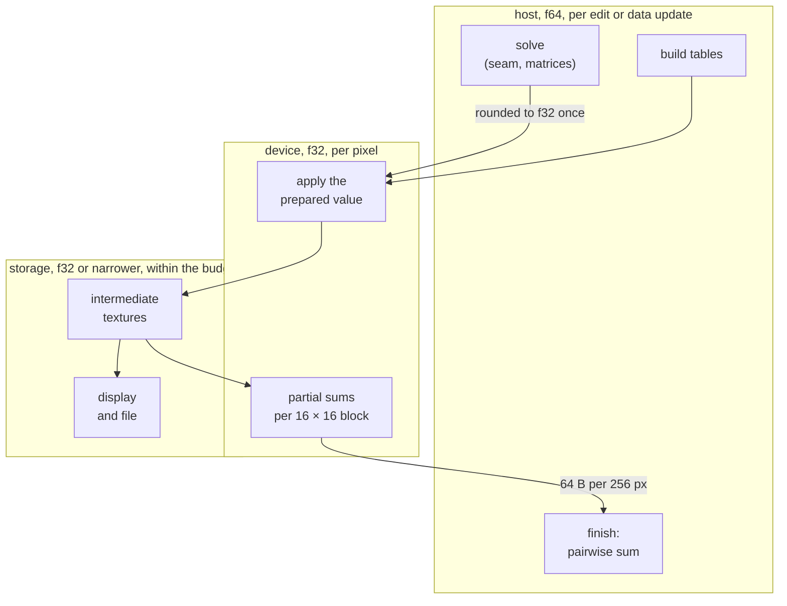

# Chapter 2 · Precision Ladder

*Solve rarely in wide precision, apply often in narrow precision, and store narrower only within a measured budget.*

**★★** We believe any good solution to this problem has this shape.

## Intent

Choose each value's precision by how often it is computed and how its errors grow, not by habit. Rare,
ill-conditioned work (solves, the end of a reduction, table builds) runs in 64-bit floats when its inputs change.
Per-element work runs in the device's 32-bit floats, in a form that is well-conditioned there. Storage narrows only
where a measurement at the output, against a reference, stays inside a stated budget.

## Also known as

Mixed precision; compute narrow, accumulate wide; solve on the host, apply on the device; iterative refinement;
precision budget.

## Motivation

chromobench's GPU engine runs in WebGPU, whose shading language has 32-bit floats, optional 16-bit floats and no
64-bit type; its reference engine runs in JavaScript's 64-bit floats. Raw camera files are decoded to a working image
with a 4,000-pixel long side: 4,000 × 2,674, 10.7 million pixels. One precision for everything fails in four ways.

1. **A long sum drifts.** A light meter needs the mean of a region. Summed one value after another in 32 bits (our
   measurement, on a CPU), 4,000 × 2,674 values drawn uniformly from [0, 0.36] come out 0.16 % low, and a uniform
   grey of 0.18 averages to 0.157, 12.6 % low. Once the running sum is large, each new value is rounded to a multiple
   of the sum's ulp (the gap between adjacent floats at that magnitude).
2. **A per-pixel solve in 32 bits fails where it is ill-conditioned.** The output knee, the last colour step,
   compresses colours outside the display's gamut (the colours it can show). For each pixel it finds by bisection the
   largest chroma (colourfulness) displayable at that pixel's lightness and hue. Near the top of the RGB cube (the
   displayable values, each channel in [0, 1]) that boundary is ill-conditioned. On an Apple M1 Max, 0.34 % of the
   values miss the 64-bit result by more than 2 × 10⁻⁶, by up to 3.0 × 10⁻⁵ in linear RGB, about two codes of a
   16-bit file; measured on the encoded file, the worst value is four codes off.
3. **An iterative solve cannot converge below its precision.** chromobench tabulates the amounts of the film's three
   dyes on a 33³ grid (33 points per axis), one Levenberg–Marquardt solve per node, stopping when every gradient
   component is below 10⁻⁹. In 32 bits the computed gradient carries more rounding error than that, so the test is
   never met. The GPU builder raises the tolerance to 10⁻⁶.
4. **"Half floats are enough" was not.** Editor lab's textbook says 16-bit floats are "enough for any intermediate
   that will be shown in 8 bits". chromobench measured it. Rounding a camera file's source to half floats (relative
   error at most 2⁻¹¹ ≈ 4.9 × 10⁻⁴ for normal values) moved the display by 0.0134, 3.4 8-bit levels, against a
   tolerance of 2 × 10⁻⁴: the film and paper model amplifies the rounding about 28-fold.

Other fields know these failures. Mixed-precision training of neural networks keeps a 32-bit master copy of weights
whose small 16-bit updates would round away. An LU factorisation in 32 bits is accurate only to about `κ(A) · 2⁻²⁴`,
`κ` the condition number; iterative refinement recovers 64-bit accuracy with residuals computed in 64 bits.

## Problem

**Wide precision everywhere is too slow, too large, or not available on the device; narrow precision everywhere is
wrong wherever the computation is long or ill-conditioned. How do you decide the precision of each value?**

## Forces

- **Throughput against accuracy.** GPUs are fast in 32 bits; on consumer parts 64-bit arithmetic runs at a small
  fraction of that rate, or not at all.
- **Memory against headroom.** 16-bit storage halves memory and bandwidth; stages downstream may amplify its rounding.
- **Solving on the host against solving where the data are.** A host solve needs a readback (a copy from device to
  host) and a wait; a device solve avoids both, in narrow precision and with a second implementation.
- **Rounding once against evaluating well.** A prepared value rounded to 32 bits is only as good as the formula that
  consumes it; coefficients in a badly scaled basis lose every digit.
- **Measurement against guarantee.** A measured maximum holds for the cases tried on one device class; an a-priori
  bound holds everywhere but is often too loose to use.

## Solution

**Therefore: solve rarely and wide, apply often and narrow, and store narrower only within a measured budget. Compute
each value once per change of its fastest-changing input, do its ill-conditioned work there in wide precision, and
round the result once, into a representation in which the per-element formula is well-conditioned. Where
per-element work is itself ill-conditioned, reformulate it, or move its hard part to a slower binding time as a
table. Finish reductions wide: narrow partial results near the data, a wide sum of the partials. Admit each table or
narrower format only as a named share of an output budget, measured against the reference in the output's units, and
accept the approximations together as well as one by one. Record precision and builder in each result's key.**

## Applicability

Use it when:

- the computation splits into rare work (per edit, per data update) and per-element work;
- the device is fast only in narrow precision, or has no wide precision at all;
- a reference implementation exists against which every narrowing can be measured.

Do not use it when:

- per-element work can be neither made well-conditioned nor tabulated; widen or compensate it instead;
- moving the inputs to the host costs more than solving narrow on the device and testing that solve;
- the values are counts or codes: integers are exact in any width that holds them.

## Structure

| Participant | Responsibility |
| --- | --- |
| **Binding-time list** | the moments each input can change: per data update, per edit, per request, per element |
| **Wide solver** | the rare, ill-conditioned work, in f64 on the host, shared by every engine |
| **Prepared value** | the solver's small result in a well-conditioned basis, rounded to f32 once, keyed with "f64" |
| **Narrow applier** | the per-element formula in f32 on the device; one per engine |
| **Reducer and finisher** | narrow partial results per block on the device; a wide sum of the partials on the host |
| **Approximations** | tables and narrower storage formats, as operators on the pipeline, each with a builder |
| **Error budget** | the output tolerance per device, its shares, and the margin over measured maxima |

In a molecular-dynamics code, the neighbour list rebuilt every few steps is the prepared value, the per-pair forces
are the narrow applier, and the per-atom force sum is the reduction that needs a wide finish.

## Collaborations

1. When an edit or a data update changes a value's key, the wide solver runs once on the host; a hit reads nothing
   back.
2. The result is rounded to f32 and uploaded; the narrow applier reads it for every pixel.
3. Reductions run the other way: each block writes one partial result, and the host sums them in f64.
4. Each approximation is accepted by a measurement at the output, alone and then together with the others, on every
   device class the product ships on.



Read it from the top down for application, from the bottom up for reductions: precision narrows only at labelled
boundaries, and widens before anything is summed at length.

## Sketch

```text
-- binding times, slowest first; a value is computed once per change of its fastest-changing input
--   data     per installation or data update   (film tables)
--   edit     per change to the document        (seam coefficients, matrices)
--   request  per evaluation of a view or tile  (the region, the scale)
--   element  per pixel, on the device

value Budget: unit, bound, device, shares: { table, arithmetic, storage }, margin
-- the arithmetic share is checked by comparing engines in the same mode (same tables, same formats)
value Prepared: key, payload: f32[]
store: map from key to Prepared

-- rung 1: wide, rare, on the host; shared by every engine
-- receiverKey: the content key of the image the solve reads (Chapter 9), known without touching its pixels
-- solve_f64 returns coefficients in a basis the formula evaluates well (centred, scaled, orthogonal)
prepare(stage, args, receiverKey, readInputs) → Prepared:
  key ← hash(stage.name, stage.version, args, receiverKey, precision: "f64")
  if key not in store:                                  -- only a miss reads back and waits
    exact ← stage.solve_f64(args, readInputs())
    store[key] ← Prepared(key, round_f32(exact))        -- the only narrowing of the solve's result
  return store[key]

-- rung 2: narrow, per element, on the device
kernel apply(stage, prepared) over grid:
  out[p] ← stage.formula_f32(prepared.payload, in[p])

-- reductions: narrow near the data, wide at the end (one channel and the sum shown; the real record
-- also holds minimum, maximum and four channels: 64 bytes per block)
kernel partials(img, box) over blocks of 16 × 16:
  v ← if p inside box: img[p] else 0                    -- pixels outside box add nothing
  s ← tree sum of the block's 256 values v, in f32      -- 8 levels of rounding, not 255
  c ← number of the block's pixels inside box           -- exact: at most 256
  partial[block] ← (s, c)

mean(img, box) → f64:
  dispatch(partials, blocks(box), img, box)             -- blocks(box): the 16 × 16 blocks covering box
  await submit(batch)
  ps ← readback(partial)                                -- f32 partials convert to f64 exactly
  n ← pairwiseSum(ps.c)
  return if n = 0: 0 else pairwiseSum(ps.s) / n

pairwiseSum(xs) → f64:
  if |xs| ≤ 8: return xs[0] + … + xs[|xs| − 1]
  return pairwiseSum(first half of xs) + pairwiseSum(second half of xs)

-- iterative solves: a stopping test scaled to what the arithmetic can resolve
-- f: the model's values f(x); r = f − y: the residual; J: its Jacobian; u: unit roundoff (2⁻²⁴ f32, 2⁻⁵³ f64)
converged(J, r, f, τ, u) → bool:
  if ‖r‖ ≤ 10 · u · ‖f‖: return true                    -- the residual is rounding noise
  return ‖Jᵀr‖ ≤ τ · ‖J‖ · ‖r‖                          -- scale-free; reachable when τ ≫ m·u (m: rows of J)

-- rung 3: approximations are operators on the pipeline: "read table T in slot s", "round slot s to f16"
-- output(c, with: as): the pipeline's result for case c with the approximations as in place
-- diff: the largest difference over the image, in the budget's unit
measured(as, cases) → max over c in cases of diff(output(c, with: as), output(c, with: []))

accept(a, share, budget, cases) → bool:                  -- a measured maximum, not a bound: keep a margin
  return budget.margin · measured([a], cases) ≤ share

acceptAll(as, budget, cases) → bool:                     -- shares measured alone need not add up in a
  return budget.margin · measured(as, cases) ≤ budget.bound    -- nonlinear pipeline: measure them together

chooseStorage(slot, budget, cases) → format:
  for fmt in [f16, f32]:                                 -- narrowest first; f32 always qualifies
    if fmt = f32 or accept(roundSlot(slot, fmt), budget.shares.storage, budget, cases): return fmt

-- in use: an export budget (exports read no tables, so the table share is 0)
budget ← Budget(unit: "display value", bound: 2e-4, device: "M1 Max",
                shares: { table: 0, arithmetic: 1e-4, storage: 1e-4 }, margin: 1.5)
seam ← prepare(seamStage, spot, receiverKey, () → readback(windows around spot))   -- per edit
dispatch(apply, spot.box, seamStage, seam)                                         -- per pixel
meter ← mean(sceneImage, meterBox)                                                 -- f32 partials, f64 finish
fmt ← chooseStorage(sourceSlot, budget, cases)          -- f32: f16 measured 0.0116 on this device
if not acceptAll([roundSlot(sourceSlot, fmt)], budget, cases): refuse("budget", "approximations exceed it together")
```

## Implementation notes

1. **Let the binding times decide the rungs.** chromobench's editing design (a proposal) runs no user code per pixel:
   "Every per-pixel computation is a catalogue op with a reference (f64) and a GPU implementation", a catalogue op
   being a declared operation. Everything computed before pixel time runs on the host, where 64 bits cost little.
2. **Share the wide solver and round once.** Heal copies a disc of pixels over a blemish and adds a seam correction,
   a smooth function that makes the copy's edge match its surroundings. Its 54 coefficients come from one 64-bit
   function in the shared core. The GPU engine reads back windows around the spot, calls that function, and packs
   the result into a 32-bit array: one rounding, at the boundary. Every film setting (camera matrix, film table,
   curves, halation, grain) comes from the same helpers in both engines, which can then differ only per pixel.
3. **Round into a representation the formula evaluates well.** For `y = Σ cₖ φₖ(x)` in f32, the relative forward
   error is about `(κ_c + κ_x + K) · u₃₂` for `K` sequential operations, where `κ_c = Σ|cₖ φₖ(x)| / |y|` measures
   cancellation among the terms and `κ_x = |x y′(x)| / |y|` sensitivity to the input. The seam correction keeps
   `κ_c` near 1: centred on the spot, scaled so that `|d| / R ≤ 1`, in a Fourier basis (orthogonal on the circle),
   evaluated by the angle-addition recurrence, so no term exceeds its coefficient. A degree-8 polynomial in absolute
   pixel coordinates has monomials near 4,000⁸ ≈ 6.6 × 10²⁸ that cancel to order one: every digit gone. Centre and
   scale, use an orthogonal basis (Chebyshev, Fourier), evaluate by Horner's rule; watch matrices with large entries
   of opposite sign.
4. **Lift a per-pixel solve when it is ill-conditioned.** Bisection on `g(C) ≤ 0` (here the largest channel minus
   one) locates the root only to `|δg| / |∂g/∂C|`, `δg` being the rounding error of `g`. Near the top of the cube the
   binding channel is green, which carries most of the lightness; at fixed lightness, chroma changes it slowly, so
   `∂g/∂C` is small. The bound is 1.5 times the measured 3.0 × 10⁻⁵: a margin, not a guarantee. The project recorded
   the way up the ladder for its CPU engine: a table of the largest chroma over (lightness, hue).
5. **Derive the stopping test, then measure it.** The computed gradient satisfies `|fl(Jᵀr) − Jᵀr| ≤ γ_m |J|ᵀ|r|`
   with `γ_m = m·u / (1 − m·u)`, and `r = f(x) − y` carries about `u‖f‖` of its own, adding `‖J‖·u‖f‖`. An absolute
   test `max|g| < 10⁻⁹`, chromobench's, lies below that noise in f32 whenever `J` has entries near one. Raised to
   10⁻⁶, the GPU's dye table agrees with the 64-bit table to 2.38 × 10⁻⁶ on Metal and 2.62 × 10⁻⁶ on a software
   adapter (a CPU implementation of the GPU API), against 3 × 10⁻⁶; a loose 10⁻⁵ lands at 1.4 × 10⁻⁵ and fails. A
   scaled test, `‖Jᵀr‖ ≤ τ‖J‖‖r‖` (MINPACK's `gtol` is such a cosine), is reachable in any precision once `τ ≫ m·u`.
6. **Finish reductions wide.** The GPU sums each 16 × 16 workgroup (threads that share fast memory and can wait for
   each other) as a tree in 32 bits, eight levels deep, and writes a 64-byte partial: sum, minimum, maximum, count.
   The host adds the partials pairwise in 64 bits. Our CPU model of this, on the uniform values above, is off by
   5.7 × 10⁻¹² relative. A constant input is a degenerate test: trees of equal values sum exactly and the 42,000
   partials add exactly in f64, so the 0.18 grey comes out as f32's 0.18, itself 4 × 10⁻⁸ off in relative terms.
   The readback is 2.6 MiB against 163 MiB for the image in 32-bit RGBA. Minimum, maximum and histogram counts
   never round.
7. **Spend the budget where the error is.** The GPU preview reads 33³ tables. Against the reference engine's
   tabulated mode (the same tables, read the same way, in 64 bits) it is within 0.05 of an 8-bit level; against the
   exact reference it reaches 1.6 levels, all table error. Wider arithmetic would buy nothing; a larger table or
   tetrahedral interpolation (four table points per lookup instead of eight) would. Exports take the exact path, and
   table keys name their builder: previews may use the GPU's 32-bit builder, exports name `f64`.
8. **Measure narrower storage at the output, and mind the subnormals.** Rounding a camera file's source to half
   floats moved the scene (XYZ) by 1.6 × 10⁻⁴ against a tolerance of 3 × 10⁻⁵, and the display by 0.0134 on the
   software adapter (0.0116 on Metal) against 2 × 10⁻⁴. The scene figure is below the rounding of a value near one:
   no amplification, just a tight tolerance. The growth lies between scene and display, in film and paper curves that
   act on log exposure and a display encoding whose slope near black reaches 12.92; the test did not separate them.
   Below 2⁻¹⁴ ≈ 6.1 × 10⁻⁵ half floats are subnormal: absolute error 2⁻²⁵ ≈ 3 × 10⁻⁸, relative error unbounded. One
   16-bit code of linear data (1.5 × 10⁻⁵) is subnormal, and WGSL lets implementations flush subnormals to zero, so a
   deep shadow may become 0 and its logarithm meaningless. Intermediates stay `rgba32float`; only the viewer's
   canvas, holding display values, is half float.
9. **Know what the device promises.** WGSL states the accuracy of `exp2`, `log2` and their kin in ulps and absolute
   error; implementations differ within it and may assume that no infinities or NaNs occur. chromobench probes the
   adapter: `10^x` as `exp2(x · log2 10)` within 10⁻⁵ relative, `log10` via `log2` within 10⁻⁶ absolute. An error ε
   in the exponent is a relative error `ln 2 · ε` in the result, so `log2 10` rounded to 3.32 costs 0.4 % at
   `x = 3`; that variant must fail the printing-density table (the density the paper sees through the negative).
10. **Tolerances are the budget; say what each bounds.** chromobench's parity suite (the tests comparing its engines)
    holds film dye amounts per pixel at export within 5 × 10⁻⁶ of the 64-bit solve, the dye table's entries within
    3 × 10⁻⁶, scene XYZ within 3 × 10⁻⁵, display values within 2 × 10⁻⁴, and separable blends (computed channel by
    channel) on OkLab layers within 3 × 10⁻⁴ ([Chapter 1](01-encode-where-the-operator-is-linear.md)). Each is a
    measured maximum with a margin; shares measured alone do not add up in a nonlinear pipeline, so the suite also
    runs everything together. Where outputs are not smooth, compare in their own terms: agreement rate or KL
    divergence for a classifier's argmax, conserved quantities or statistics for a chaotic simulation.

## Variations

- **Solve on the device, check against the host.** No readback; needs a second solver, a reachable stopping test, and
  a test against a 64-bit builder. Good for large, well-conditioned batches of solves.
- **Iterative refinement.** Solve narrow, compute the residual wide, correct, repeat; it reaches wide accuracy when
  `κ · u_narrow < 1`.
- **Compensated arithmetic.** Kahan summation or "float-float" pairs on a device with no wide type: everything stays
  on the device, at several times the operations.
- **Integers and fixed point.** Counts and histograms in integers: exact and order-independent, so results repeat bit
  for bit; the range is fixed.

## Consequences

- \+ The device runs only what it is fast at; the hard numerics run once, in 64 bits, in code every engine shares.
- \+ Long reductions are accurate to a few roundings.
- \+ Each narrowing has a measured share of a stated budget, so a failing test names the rung that grew.
- − A readback and a wait sit between the device and the wide solver whenever a key misses.
- − The solver's output representation is constrained by how the device evaluates it.
- − Budgets are measured maxima per pipeline and device class, not proofs; they must be measured again.

## Known uses

- **William Kahan**, "Further Remarks on Reducing Truncation Errors", *Communications of the ACM* 8(1), 1965.
- **Pairwise summation** in NumPy's `sum`; Pierre Blanchard, Nicholas J. Higham and Théo Mary, "A Class of Fast and
  Accurate Summation Algorithms", *SIAM Journal on Scientific Computing* 42(3), 2020, analyse blocked sums like this.
- **MINPACK** (Jorge Moré, Burton Garbow and Kenneth Hillstrom, *User Guide for MINPACK-1*, Argonne ANL-80-74,
  1980): Levenberg–Marquardt with a scale-free gradient test.
- **Mixed-precision training**: Paulius Micikevicius et al., "Mixed Precision Training", ICLR 2018.
- **LAPACK's `DSGESV`**: 32-bit LU with 64-bit refinement, after Julie Langou, Julien Langou, Piotr Luszczek, Jakub
  Kurzak, Alfredo Buttari and Jack Dongarra, SC 2006; Erin Carson and Nicholas J. Higham added a third precision
  (*SIAM Journal on Scientific Computing* 40(2), 2018).
- **chromobench** (shared f64 solvers, f64 finishes, keyed table builders, the measured half-float decision) and
  **Editor lab** (32-bit tables of the sRGB curve).

## Related chapters

- [Chapter 1 · Encode Where the Operator Is Linear](01-encode-where-the-operator-is-linear.md): where precision is
  lost.
- [Chapter 6 · Cross the Bus Rarely](06-cross-the-bus-rarely.md): partial results, not pixels, cross to the host.
- [Chapter 9 · Content-Keyed, Cost-Aware Cache](09-content-keyed-cost-aware-cache.md): content keys.
- [Chapter 10 · Measure Completion, Gate Percentiles](10-measure-completion-gate-percentiles.md): budgets that gate.
- Image engine volume: [Reference Oracle](../03-reference-oracle.md) holds the tolerances;
  [Tabulated Preview, Exact Export](../06-tabulated-preview-exact-export.md) the tables.
- Modular volume: [Solve Once, Apply Many](../modular/05-solve-once-apply-many.md), the binding-time split.
- GoF: **Flyweight** (one prepared value shared by every pixel), **Strategy** (interchangeable table builders).

## Exercises

1. **Sums on a CPU model of the device (implement and measure).** Sum a 4,000 × 2,674 array of 32-bit floats:
   sequentially in 32 bits; with Kahan summation in 32 bits; in blocks of 64, 256 and 4,096 summed as trees in 32
   bits, then pairwise in 64 bits. (Blocks of 4,096 exceed WebGPU's default 256 threads per workgroup; on a GPU they
   need a two-stage reduction.) Use uniform values in [0, 0.36], a real image, and a constant 0.18; explain why the
   constant flatters the tree. Report error, time, and bytes a GPU would read back (16 per block per channel).
2. **Bounds (analyse).** (a) Show that the block scheme's error is at most about
   `(log2 b · u₃₂ + (log2(n/(8b)) + 7) · u₆₄) · Σ|xᵢ|` for blocks of `b`: f32 partials convert to f64 exactly, and the
   pairwise base case adds up to 8 values in sequence. Compare with `γ_{n−1}` for the sequential sum at
   `n` = 10.7 million. (b) Note 8 put a relative error of 4.8 × 10⁻⁴ in and found 0.0134 at the display. As a
   linearised estimate, what is the amplification, and how many significand bits would the stored source need for
   the whole 2 × 10⁻⁴ budget, and for a storage share of 10⁻⁴?
3. **Iterative refinement (another domain).** Build 500 × 500 matrices `A = UΣVᵀ` with random orthogonal `U`, `V`
   and geometrically spaced singular values, `κ = 10², 10⁴, 10⁶, 10⁸`. Factor in 32 bits, compute residuals in 64
   bits, and refine until the normwise backward error `‖b − Ax̂‖ / (‖A‖‖x̂‖ + ‖b‖)` is at most `√n · u₆₄`. Count the
   iterations; where does refinement stop converging, and how does that relate to `κ · 2⁻²⁴`?
4. **Reading.** Read Micikevicius et al. (2018). Name each rung of their ladder, the budget they measure it against,
   and the step that corresponds to this chapter's wide finish.
