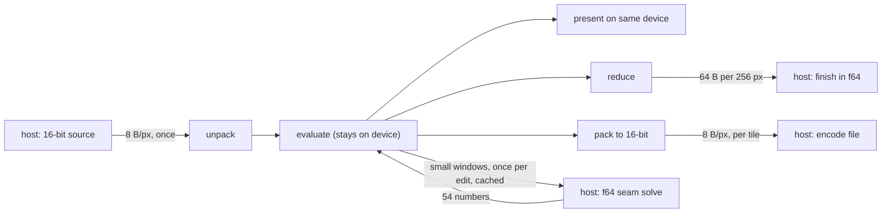

# Chapter 6 · Cross the Bus Rarely

*Reduce, quantise and pack on the device; move results, not intermediates.*

**★★** We believe any good solution to this problem has this shape.

## Intent

Keep the boundary between host and device memory from costing more than the computation on either side of it. The
"bus" is any such boundary: a PCIe link on a discrete GPU, or, on shared memory, the driver's and the browser's path
of waiting, copying and handing over. Data crosses only as results: a statistic reduced on the device, an image
quantised and packed to its file format, a source in its most compact exact form.

## Also known as

Data residency; compute where the data is; device-side reduction; minimise host–device transfers.

## Motivation

The running example's GPU engine computes a 4,000 × 2,674 preview through its whole print chain (the numerical model
of film, enlarger and paper) in 6.4 ms on an M1 Max, Apple's laptop chip. On the same machine, reading an image of
that size back as `rgba32float` (four 32-bit floats per pixel, 163 MiB) takes 56.3 ms, about 3.0 GB/s. CPU and GPU
share the same memory chips there, so no bus limits it: the time is the browser's path, waiting for the device,
copying into a buffer the page may read, and handing it from the GPU's process to the page's. Three ways of using that
path fail.

1. **Reading back every picture to show it.** chromobench's previews come back to the CPU as float arrays and go to the
   presenter (the code that draws on screen), which uploads them again. A full-window preview on a high-density
   display is about 3,000 × 2,000 pixels: 26 ms of readback, three JavaScript loops over six million pixels, and a
   second upload (the probe measured 21.8 ms for that image in 32-bit floats; the presenter sends half floats). The
   computation takes a few milliseconds; a drag of the print's exposure time (how long the
   enlarger lights the paper) settles in about 205 ms.
2. **Reading back the image to measure it.** A mean, a percentile or a histogram is a few numbers or a few kibibytes.
   Reading back 163 MiB to compute them on the host spends the whole cost on bytes that are thrown away. Editor lab's
   textbook puts it plainly: a 256-bin histogram is 4 KiB to read, not 9.4 MiB.
3. **Waiting for small things, often.** Healing a dust spot needs a seam correction solved in 64-bit on the host from
   two small windows around the spot; the answer is 54 numbers. Each read makes the host wait for the device, so a
   print with forty spots stalls forty times per render.

A training loop that reads its loss every step idles the GPU while the host prints. A GPU database that moves its
columns per query can spend longer moving than joining. A renderer that reads visibility back is a frame late.

## Problem

**How do you keep the slow boundary between host and device memory from dominating a computation the device finishes
in milliseconds?**

## Forces

- **Bytes against round trips.** Bandwidth cost grows with bytes, latency cost with the number of waits. At 3 GB/s,
  forty reads of 40 KiB cost more than one read of 40 MiB once each wait exceeds about 0.34 ms.
- **Fewer bytes against matching rounding.** Narrow formats halve or quarter the bytes; their rounding must agree,
  code for code, with the reference that tests compare against.
- **Host comfort against device residency.** The host has 64-bit arithmetic, libraries and debuggers; the device
  has the data.
- **Parallel reductions against reproducible ones.** A device reduction reorders floating-point sums; a fixed order
  finished in wider precision on the host is reproducible, at the price of moving partial results.
- **Residency against inspection.** An image kept on the device is fast to show and invisible to the host's tests
  and tools.

## Solution

**Therefore: treat every host–device crossing as costing a latency plus bytes over a bandwidth, and move results,
not intermediates.** Reduce on the device to what the host needs, and finish the remainder on the host in wider
precision and a fixed order. Quantise and pack on the device with the reference's rounding rule, and upload sources in
their most compact exact form. Keep images that are only displayed on the device. Record each unavoidable readback in
the batch of commands that produces it, and await it only once per computation.

## Applicability

Use it when:

- host and device memories are separate, or the path between them waits and copies (a bus, a process boundary);
- results are much smaller than the data they summarise;
- data is used several times on the device between edits.

Do not use it when:

- the host needs every value anyway (a full-resolution export): pack before crossing, but the bytes must cross;
- the work is a serial, data-dependent algorithm (a flood fill) that the device does badly: read back the small
  region it needs, once per edit, and cache the result;
- the data is small and touched once: a device round trip costs more than computing on the host.

## Structure

| Participant | Responsibility |
| --- | --- |
| **Reduction kernels** | device functions run per pixel; per workgroup (up to 256 invocations sharing on-chip memory): sums, minima, maxima; histograms |
| **Host finisher** | combines partials in 64-bit in a fixed order; derives percentiles from histograms |
| **Pack and unpack kernels** | quantise results to output codes; expand compact uploads to the working format |
| **Transfer recorder** | copies results into mappable buffers inside the producing batch; one wait per computation |
| **Device presenter** | draws from the result texture on the same device, with no readback |
| **Host result cache** | keeps host-side solves (seam coefficients) keyed by what they were computed from |

In a training loop the roles are the loss accumulated on the device, a logger that copies it asynchronously every
hundred steps, a data loader with pinned (page-locked) host buffers, and periodic checkpoints.

## Collaborations

1. Sources are uploaded once, compact, and expanded on the device; the upload's staging buffer (host-written memory
   the copy reads from) is freed after the copy.
2. Every evaluation computes on the device; intermediates never leave it.
3. A preview is drawn from its texture by a presenter on the same device.
4. A measurement runs reduction kernels; the batch also copies kibibytes of partials and bins into mappable buffers;
   the host waits once and finishes in 64-bit.
5. An export packs each tile to 16-bit codes; the host reads 8 bytes per pixel and encodes the file.
6. A host solve that needs device pixels reads small windows once per edit and caches its result.



Read it left to right: only the labelled arrows cross the boundary, and each carries a result or a small, cached
input to one, never an intermediate image.

## Sketch

```text
G = 16 ; NB = 4096                               -- workgroup side (256 invocations); histogram bins (16 KiB)
-- helpers: deviceBuffer(n) and mappable(n) allocate device memory; a mappable buffer is only a copy destination
--   the host may read. copyOut(src, m) records a copy into m in the current batch. await mapped(m, after: fence)
--   is a host view of m, valid until unmap(m). groups(box) is ⌈box.w / G⌉ × ⌈box.h / G⌉ workgroups whose pixels p
--   start at the box's corner. render(node, grid) evaluates on the device and returns a texture; present(tex) draws
--   it on the same device. encodeRows and finishFile are the host's file encoder. pairwiseSum_f64 adds halves
--   recursively in 64-bit. Images are NaN-free (WGSL lets implementations assume it).

value Partial: sum, min, max, count              -- one channel; one record per workgroup
EMPTY = Partial(0, 0, 0, 0)                      -- count 0: min and max are ignored, so no infinities are needed

combine(a, b) → b if a.count = 0 else a if b.count = 0
                else Partial(a.sum + b.sum, min(a.min, b.min), max(a.max, b.max), a.count + b.count)

kernel momentsPartial(img, box, out) over workgroups of G × G:
  -- p: this invocation's pixel; lane: its index 0 … 255; group: the workgroup's index
  shared[lane] ← Partial(img[p], img[p], img[p], 1) if p ∈ box else EMPTY
  barrier()                                      -- every lane has written
  for stride in 128, 64, 32, 16, 8, 4, 2, 1:     -- a fixed tree: the same order on every run
    if lane < stride: shared[lane] ← combine(shared[lane], shared[lane + stride])
    barrier()
  if lane = 0: out[group] ← shared[0]

kernel rangeOf(parts, n, range) over one invocation:   -- tens of thousands of records: a loop is enough
  r ← EMPTY
  for g in 0 ..< n: r ← combine(r, parts[g])
  range ← (r.min, r.max)                         -- stays on the device for the histogram

kernel histogram(img, box, range, bins) over workgroups of G × G:
  -- h: NB integer counters in workgroup memory; integer adds give the same counts in any order
  for b in lane, lane + 256, … < NB: h[b] ← 0
  barrier()
  if p ∈ box:
    w ← range.max − range.min
    b ← 0 if w ≤ 0 else min(⌊(img[p] − range.min) / w · NB⌋, NB − 1)   -- a constant image: every pixel in bin 0
    atomicAdd(h[b], 1)
  barrier()
  for b in lane, lane + 256, … < NB: if h[b] > 0: atomicAdd(bins[b], h[b])

stats(img, box) → (mean, min, max, bins):        -- one batch, one wait, a few MiB across
  n ← |groups(box)|
  if n = 0: return refuse(emptyBox, box)
  parts ← deviceBuffer(n partials) ; range ← deviceBuffer(2) ; bins ← deviceBuffer(NB)
  mParts ← mappable(n partials) ; mBins ← mappable(NB)
  dispatch(momentsPartial, groups(box), { img, box, out: parts })
  dispatch(rangeOf, single, { parts, n, range })  -- single: a grid of one invocation
  clear(bins)                                    -- recorded in the batch, before the histogram
  dispatch(histogram, groups(box), { img, box, range, bins })
  copyOut(parts, mParts) ; copyOut(bins, mBins)
  fence ← submit(batch)
  ps ← await mapped(mParts, after: fence) ; hs ← await mapped(mBins, after: fence)
  r ← Partial(pairwiseSum_f64(ps.sum), min over ps with count > 0 of min,
              max over ps with count > 0 of max, pairwiseSum_f64(ps.count))
  out ← (r.sum / r.count, r.min, r.max, copy of hs)
  unmap(mParts) ; unmap(mBins)
  for x in [parts, range, bins, mParts, mBins]: retire(x, after: fence)
  return out

kernel pack16(img, out) over grid:
  q(x) = ⌊0.5 + 65535 · clamp(x, 0, 1)⌋           -- WGSL's real-number rule; the device may round the product
  out[p] ← (q(img[p].r), q(img[p].g), q(img[p].b), 65535)   -- four 16-bit codes: 8 bytes per pixel

export(node, tiles) → file:                      -- tile t is computed while tile t − 1 is encoded
  if tiles = []: return refuse(noTiles, node)
  T ← max over tiles of pixels
  stage ← [deviceBuffer(8 · T), deviceBuffer(8 · T)] ; host ← [mappable(8 · T), mappable(8 · T)]
  pending ← none
  for t in 0 ..< |tiles|:
    i ← t mod 2                                  -- host[i] was unmapped at the end of step t − 1 or never mapped
    tex ← render(node, tiles[t])
    dispatch(pack16, tiles[t].grid, { img: tex, out: stage[i] })
    copyOut(stage[i], host[i])
    fence ← submit(batch) ; retire(tex, after: fence)
    if pending ≠ none:
      encodeRows(await mapped(host[pending.i], after: pending.fence)) ; unmap(host[pending.i])
    pending ← (i: i, fence: fence)
  if pending ≠ none:
    encodeRows(await mapped(host[pending.i], after: pending.fence)) ; unmap(host[pending.i])
  for x in stage ++ host: retire(x, after: fence)  -- fence: the last submission's
  return finishFile()

kernel unpack(src, lut, dst) over grid:          -- 16-bit codes → working floats, as the reference converts them
  dst[p] ← (lut[src[p].r], lut[src[p].g], lut[src[p].b], 1)

luts ← {}                                        -- maximum code → device table, kept for the session
lutFor(m) → luts[m] if m ∈ luts else (luts[m] ← upload([ f32(c / m) for c in 0 … m ]))   -- f64 quotient, one rounding

uploadCompact(codes, w, h, m) → texture:         -- 8 bytes per pixel cross instead of 16
  staging ← upload(codes)
  out ← allocate(w, h, rgba f32)
  dispatch(unpack, grid(w, h), { src: staging, lut: lutFor(m), dst: out })
  fence ← submit(batch) ; retire(staging, after: fence)
  return out

-- in use
s ← stats(print, frame)                          -- 2.6 MiB of partials and 16 KiB of bins, not 163 MiB
present(render(print, screenGrid))               -- nothing crosses
file ← export(print, tilesOf(print))             -- each pixel crosses once, as 8 bytes
```

## Implementation notes

1. **Model a crossing as T = Σ (L + b/β) + idle, and measure L and β separately.** L is the latency of one wait, b the
   bytes, β the bandwidth; idle is the time the device sits empty because the host waited before submitting more.
   chromobench's probe read back three sizes at 3.7, 3.7 and 3.0 GB/s with no visible intercept: at 23–163 MiB
   bandwidth dominates, so L needs its own probe with tiny buffers. Upload was faster (4.1–4.5 GB/s); Editor lab's
   textbook measured readback at over three times upload on a software adapter (a CPU emulation of a GPU). For
   comparison, PCIe 4.0 × 16 carries 31.5 GB/s per direction in theory; copies from pinned host memory reach about
   25 GB/s, copies from ordinary pageable memory less, because the driver copies them through its own buffer first.
2. **Know what a wait waits for.** In WebGPU the host reads results through a mappable buffer, which may only be the
   destination of copies, so the copy must be recorded in the batch that produced the data. `mapAsync` promises only
   that earlier commands using that buffer have finished; implementations often wait for the whole queue, so plan for
   that. A mapped buffer must be unmapped before any submission that uses it. A texture copied into a buffer needs
   rows padded to multiples of 256 bytes (a 3,000-pixel row of 48,000 bytes is not): pad on the device, unpad on the
   host, as chromobench does. CUDA's equivalents are an event recorded after the copy and a synchronise on it; Vulkan
   lets memory stay mapped, but the host still waits on a fence before reading.
3. **Know the hidden waits.** In CUDA, `cudaMemcpy`, and `cudaMemcpyAsync` from pageable memory, block the host;
   `cudaFree` synchronises the device. In PyTorch, `.item()`, `.cpu()`, `.tolist()`, `nonzero()` and indexing with a
   boolean mask all wait, the last two because the result's size depends on the data. `cudaStreamSynchronize`,
   `cudaEventSynchronize` and `torch.cuda.synchronize` are the explicit form of `await`. Where the adapter offers
   timestamps, chromobench reads them back after every pass: a wait per pass, in production renders too.
4. **Reduce in a fixed tree, finish in 64-bit.** chromobench sums each 16 × 16 block in an 8-level tree in 32-bit,
   one 64-byte record per block, and the host adds the records pairwise in 64-bit: at 4,000 × 2,674, 42,000 records,
   2.6 MiB. Each record's error is at most γ₈ times the sum of its |xᵢ|, where γₖ = ku/(1 − ku) and u = 2⁻²⁴: about
   4.8 × 10⁻⁷ of Σ|xᵢ| in all; the 64-bit stage adds little. One 32-bit accumulator over 10.7 million pixels has the
   first-order bound (n − 1)u ≈ 0.64 and the rigorous γₙ₋₁ ≈ 1.76: no guarantee. The tree fixes the order, so one
   box gives the same bits on one device; across devices only if both treat subnormals alike (WGSL lets them flush
   to zero).
5. **Fit the workgroup's storage.** WebGPU guarantees by default 256 invocations and 16 KiB of workgroup memory
   (on-chip memory shared within a group). 4,096 integer bins fill the 16 KiB exactly, and so do 256 records of
   64 bytes; chromobench keeps the count in a separate array and uses 13 KiB for its moments. A second channel per
   histogram pass does not fit; run one pass per channel in the same batch. CUDA's default is 48 KiB per block.
6. **Use operations whose order is free; state a percentile's error.** Minimum, maximum and integer counts are exactly
   associative and commutative, so atomic adds (indivisible read-modify-writes) give the same result in any order.
   chromobench counts in workgroup memory, then adds each non-empty bin to the global array once per workgroup.
   Percentiles interpolated within 4,096 bins over [min, max] are off by at most (max − min)/4,096. For three
   channels its statistics wait seven times (moments, then two histograms per channel) where the sketch waits once.
7. **Quantise on the device; let the host emulate the device.** WGSL defines `pack2x16unorm` (unorm: an integer code
   read as a fraction of its maximum) by the real number ⌊0.5 + 65535·clamp(v, 0, 1)⌋, but a device may round the
   product to 32-bit, fuse it, or convert in hardware. Over all 2²³ 32-bit values in [0.5, 1), a 32-bit product,
   with or without a fused multiply-add, gives one code more than the exact rule for 16,384 of them, exactly 2⁻⁹
   (our enumeration); below 0.5 the rate is lower. chromobench's host quantiser rounds in 64-bit. Emulate the 32-bit
   product on the host and let parity tests (comparisons with the reference) allow one code at that rate. A NaN
   through `clamp` gives an indeterminate code; the host maps it to 0, so filter NaN before packing.
8. **Expand on the device with the reference's rounding.** chromobench uploads 16-bit sources as 16-bit integers,
   8 bytes per pixel, and converts them through a table of code/max computed in 64-bit and rounded once; multiplying
   by a 32-bit 1/max rounds twice and was an ulp off on some codes, which parity tests caught. Raw files are decoded
   to a 4,000 × 2,674 working image, 163 MiB as `rgba32float`; keeping its 122 MiB 32-bit staging buffers in a pool
   filled the 512 MiB budget with two files open ([Chapter 7](07-budgeted-residency.md)).
9. **Present from the device.** chromobench's engine and presenter each request their own GPU device, and textures
   cannot pass between devices, so every preview crosses twice (Motivation, item 1). Presenting from the result
   texture on one device is proposed and not built; reading back half floats would halve the bytes meanwhile.
   Its engine also measures by reading an image back and uploading it again (163 MiB down, 122 MiB up) before the
   device reduction, because its result cache holds host arrays: reduce the texture where it lies.
10. **Small reads are latency; cache what consumes them.** chromobench's heal reads back two windows per spot (the
    radius plus 4 pixels), solves the seam in 64-bit and uploads 54 coefficients. The solve is kept only for one
    call, so every render and every export tile the spot touches waits and solves again. Keyed by the spot and the
    content key of the image it read ([Chapter 9](09-content-keyed-cost-aware-cache.md)), it runs once per edit.

## Variations

- **Unified or managed memory.** Integrated GPUs and CUDA managed memory remove the explicit copy; synchronisation,
  page migration on first touch and coherence remain, so the pattern applies with smaller constants.
- **Overlapped asynchronous transfers.** Pinned host memory, copy engines (DMA units that move data while kernels run)
  and several streams overlap transfers with computation: the cost is hidden, not reduced. It suits work that must
  move everything, such as video.
- **Decisions on the device.** Indirect dispatch and indirect draws take their counts from a device buffer, so the
  device decides how much work comes next and the host never reads the count.
- **Compression before the crossing.** Encode on the device (hardware video encoders), so the file crosses, not the
  pixels.

## Consequences

- \+ The cost of crossing grows with the size of results, not of data.
- \+ The device stays busy; the host waits once per computation.
- \+ Reductions in a fixed order, finished in 64-bit, are reproducible on one device and have a stated error.
- − Every statistic needs a kernel; a host loop would be shorter to write.
- − Rounding rules exist twice, on the device and in the reference, and agree only within a stated tolerance.
- − Device-resident images are invisible to host tools; tests and debugging need an explicit readback path.
- − Presenting from the device ties presenter and engine to one device: losing the device loses both.

## Known uses

- **chromobench** reduces on the device (moments finished pairwise in 64-bit, histograms with integer atomics),
  packs 16-bit exports to 8 bytes per pixel and uploads 16-bit sources at 8 bytes per pixel. **Editor lab**'s
  textbook measured readback at more than three times upload and recommends keeping images on the GPU.
- **Gregg and Hazelwood**, "Where is the data? Why you cannot debate CPU vs. GPU performance without the answer"
  (ISPASS 2011), showed that published GPU speedups shrink or vanish once transfer times are counted.
- **CUDA** and **PyTorch** offer pinned memory, asynchronous copies, streams and events; Mark Harris's "Optimizing
  Parallel Reduction in CUDA" (NVIDIA, 2007) and the **CUB** library describe tree reductions in shared memory.
- **GPU-driven rendering** (Haar and Aaltonen, "GPU-Driven Rendering Pipelines", SIGGRAPH 2015 course *Advances in
  Real-Time Rendering in Games*) culls and builds draw lists on the GPU, removing the readback of visibility.
- **Hardware video decoders** (NVDEC, VideoToolbox) decode into GPU memory; WebCodecs frames can be imported into
  WebGPU as external textures (textures backed by a video frame) without reading their pixels into script memory.
- The **Roofline model** (Williams, Waterman and Patterson, *CACM* 2009): with the link's bandwidth as the roof, it
  bounds anything that crosses.

## Related chapters

- [Chapter 2 · Precision Ladder](02-precision-ladder.md): partials in 32-bit, the finish in 64-bit.
- [Chapter 5 · Fused Interpreted Passes](05-fused-interpreted-passes.md) keeps intermediates inside one pass; this
  chapter keeps them inside the device.
- [Chapter 7 · Budgeted Residency](07-budgeted-residency.md) and [Chapter 8 · Retire After the
  Fence](08-retire-after-the-fence.md) decide what stays and when staging can go.
- [Chapter 9 · Content-Keyed, Cost-Aware Cache](09-content-keyed-cost-aware-cache.md) names host-side solves.
- [Chapter 10 · Measure Completion, Gate Percentiles](10-measure-completion-gate-percentiles.md) counts crossings and
  waits in the benchmark.
- [Solve Once, Apply Many](../modular/05-solve-once-apply-many.md) introduces the device-many, host-few reduction;
  [Tabulated Preview, Exact Export](../06-tabulated-preview-exact-export.md) is the exact path whose output is packed.
- GoF: **Proxy** (a remote proxy: the host holds a handle to an image that lives on the device).

## Exercises

1. **Implement and measure (CPU model).** Model the boundary as a copy between two threads' buffers that costs a
   latency L plus bytes over β, with β = 3 GB/s and β = 25 GB/s. Compute the mean and a 256-bin histogram of a
   4,000 × 2,674 × 4 float image (a) by copying the image and reducing on the "host", (b) by reducing on the
   "device" and copying partials, (c) as (b) but with seven separate waits. Vary L from 10 µs to 20 ms. Check your
   break-even against the model: seven waits cost more than one image copy when 6L exceeds 163 MiB/β, about 9.5 ms
   at 3 GB/s and 1.1 ms at 25 GB/s.
2. **Analyse a pipeline and a rounding rule.** (a) An export runs, per tile, device work D, a copy X and host
   encoding E, through k buffers. Show that in steady state a tile takes max(D, X, E) when stage times are constant
   and k is large enough; find the smallest such k. Then let E vary from tile to tile and show why two buffers stall;
   bound the expected time per tile. (b) Reproduce the 2⁻⁹ rate of note 7 by enumerating the 32-bit values in
   [0.5, 1), and give the rate for a device that converts with round-to-nearest-even.
3. **Another domain.** A training loop runs steps of T = 5 ms on the GPU; enqueuing a step costs the host H = 1 ms. A
   synchronising read of the loss (latency L = 0.3 ms) drains the queue, so the GPU idles for L + H before the next
   step starts. Model throughput when reading every k steps, and find k for a loss under 1 %. Then replace the read
   by an asynchronous copy into pinned memory followed by an event the host polls later: what does it cost now?
4. **Read a paper.** Read Gregg and Hazelwood (ISPASS 2011). Take one speedup from a paper in your field, add the
   transfer times their method asks for, and say whether the claim survives.
