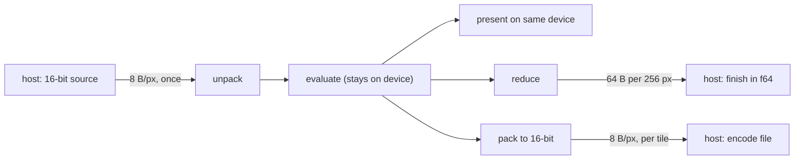

# Chapter 6 · Cross the Bus Rarely

*Reduce, quantise and pack on the device; move results, not intermediates.*

**★★** We believe any good solution to this problem has this shape.

## Intent

Keep the narrow, slow link between host and device from costing more than the computation on either side of it. Data
crosses only as results: a statistic reduced on the device, an image quantised and packed to its file format, a
source in its most compact exact form. Images that are only looked at stay on the device, and the host never waits
for the device in the middle of a computation.

## Also known as

Data residency; compute where the data is; device-side reduction; minimise host–device transfers.

## Motivation

The running example's GPU engine computes a 4,000 × 2,674 preview through its whole print chain in 6.4 ms on an M1
Max. Measured on the same machine, reading an image of that size back from the GPU as `rgba32float` (four 32-bit
floats per pixel, 171 MB) takes 56.3 ms, and uploading it takes 38.1 ms. The readback moves about 3 GB/s, more than a
hundred times below the GPU's nominal 400 GB/s to its own memory, although CPU and GPU share the same memory chips.
The link, not the arithmetic, is the narrow pipe. Three ways of using it fail.

1. **Reading back every picture to show it.** chromobench's previews come back to the CPU as float arrays and go to a
   presenter that uploads them again. On a high-density display a full-window preview is about 3,000 × 2,000 pixels:
   26 ms of readback, three JavaScript loops over six million pixels (repack to RGB, expand to RGBA, convert to half
   floats), and about 22 ms of upload, around a computation of a few milliseconds. A drag of the print's exposure
   time settles in about 205 ms.
2. **Reading back the image to measure it.** A mean, a minimum, a percentile or a histogram is a few numbers or a few
   kilobytes. Reading back 171 MB to compute them on the host spends the link's whole cost on bytes that are thrown
   away. Editor lab's textbook puts it plainly: a 256-bin histogram is 4 KiB to read, not 9.8 MB.
3. **Waiting for small things, often.** Healing a dust spot needs a seam correction solved in 64-bit on the host
   from two small windows around the spot. The windows are small and the answer is 54 numbers. But each read makes
   the host wait until the device has finished everything submitted before it, so a print with forty spots stalls
   forty times per render.

The same problem appears wherever two memories meet. A training loop that reads its loss back on every step leaves
the GPU idle while the host prints. A GPU database whose columns cross the PCIe bus per query can spend longer moving
them than joining them. A renderer that reads visibility back to decide what to draw is a frame late, or waits.

## Problem

**How do you keep the narrow, high-latency link between host and device from dominating a computation the device
finishes in milliseconds?**

## Forces

- **Bytes against round trips.** Bandwidth cost grows with bytes, latency cost with the number of waits; forty
  reads of 40 KB can cost more than one read of 40 MB.
- **Fewer bytes against matching rounding.** Narrow formats halve or quarter the bytes, and their rounding must
  agree, code for code, with the reference that tests compare against.
- **Host comfort against device residency.** The host has 64-bit arithmetic, libraries and debuggers; the device
  has the data.
- **Parallel reductions against exact ones.** A device reduction reorders floating-point sums; finishing exactly on
  the host costs a transfer of partial results.
- **Staging reuse against memory held.** Reusing upload buffers saves allocations; keeping large ones holds memory
  the device's budget needs.
- **Residency against inspection.** An image kept on the device is fast to show and invisible to the host's tests
  and tools.

## Solution

**Therefore: treat every crossing between host and device as a cost to be justified, and move results, not
intermediates.** Reduce on the device to what the host needs (sums per workgroup, minima, maxima, histograms) and
finish only the small remainder on the host, in wider precision and a fixed order. Quantise and pack to the output
format on the device before reading back, with the reference's rounding rule; upload sources in their most compact
exact form and expand them on the device. Keep images that are only displayed on the device and present them from
there. Batch what must cross into few transfers that the host does not await in the middle of a computation, cache
host-side results by what they were computed from, and release large staging memory once its copy has finished.

## Applicability

Use it when:

- host and device have separate memories or a costly boundary between them (a bus, a process boundary, a network);
- results are much smaller than the data they summarise;
- data is used several times on the device between edits.

Do not use it when:

- the host needs every value anyway (a full-resolution export): then pack before crossing, but the bytes must cross;
- the work is a serial, data-dependent algorithm (a flood fill) that the device does badly: read back the small
  region it needs, once per edit, and cache the result;
- the data is small and touched once: a device round trip costs more than computing on the host.

## Structure

| Participant | Responsibility |
| --- | --- |
| **Reduction kernels** | per-workgroup partial sums, minima, maxima; histograms with integer atomics |
| **Host finisher** | combines partials in 64-bit in a fixed order; derives percentiles from histograms |
| **Pack and unpack kernels** | quantise results to output codes; expand compact uploads to the working format |
| **Transfer scheduler** | records readbacks into the batch that produces them; awaits them only at the end |
| **Staging pool** | reuses small upload buffers; lets large ones go once their copy has finished |
| **Device presenter** | draws from the result texture on the same device, with no readback |
| **Host result cache** | keeps host-side solves (seam coefficients) keyed by what they were computed from |

In a training loop the roles are the loss reduced on the device, a logger reading it every hundred steps, a data
loader with page-locked buffers, and periodic checkpoints.

## Collaborations

1. Sources are uploaded once, in their compact form, and expanded on the device; large staging buffers are released
   after the copy.
2. Every evaluation computes on the device; intermediates never leave it.
3. A preview is drawn from its texture by a presenter on the same device.
4. A measurement runs a reduction kernel; the host reads kilobytes of partials or bins and finishes in 64-bit.
5. An export packs each tile to 16-bit codes on the device; the host reads 8 bytes per pixel and encodes the file.
6. A host solve that needs device pixels reads a small window once per edit and caches its result by content.



Read it left to right: only the three labelled arrows cross the bus, and each carries a result, never an
intermediate.

## Sketch

```text
G = 16                                           -- workgroup side: 256 invocations reduce together
KEEP_LIMIT = 16 MiB                              -- staging larger than this is destroyed after its copy
-- helpers: deviceBuffer(n) allocates device memory; groups(box) is ⌈box.w / G⌉ × ⌈box.h / G⌉ workgroups whose
-- pixels p start at the box's corner; pairwiseSum_f64 adds halves recursively in 64-bit; encodeRows and finishFile
-- are the host's file encoder; nodeKey is a node's content key; windows(receiver, spot) is the receiver rendered
-- over the spot's two small boxes; solve_f64 is the seam solve; releaseToPool returns a buffer for reuse

value Partial: sum, min, max, count              -- per channel; one record per workgroup

combine(a, b) → Partial(a.sum + b.sum, min(a.min, b.min), max(a.max, b.max), a.count + b.count)

kernel momentsPartial(img, box, out) over workgroups of G × G:
  -- p: this invocation's pixel; lane: its index 0 … 255 in the group; group: the workgroup's index
  shared[lane] ← Partial(img[p], img[p], img[p], 1) if p ∈ box else Partial(0, +∞, −∞, 0)
  barrier()                                      -- every lane has written
  for stride in 128, 64, 32, 16, 8, 4, 2, 1:     -- a fixed tree: same order on every run
    if lane < stride: shared[lane] ← combine(shared[lane], shared[lane + stride])
    barrier()
  if lane = 0: out[group] ← shared[0]

kernel histogram(img, box, lo, hi, nb, bins) over workgroups of G × G:
  -- img: one channel; h: nb integer counters in workgroup memory; integer adds are exact in any order
  for b in lane, lane + 256, … < nb: h[b] ← 0
  barrier()
  if p ∈ box: atomicAdd(h[clamp(⌊(img[p] − lo) / (hi − lo) · nb⌋, 0, nb − 1)], 1)
  barrier()
  for b in lane, lane + 256, … < nb: if h[b] > 0: atomicAdd(bins[b], h[b])

kernel pack16(img, out) over grid:
  q(x) = ⌊0.5 + 65535 · clamp(x, 0, 1)⌋          -- the reference quantiser's rule, stated once for both
  out[p] ← (q(img[p].r), q(img[p].g), q(img[p].b), 65535)   -- four 16-bit codes: 8 bytes per pixel

measure(img, box) → (mean, min, max):            -- one batch, one wait, kilobytes across
  parts ← deviceBuffer(⌈box.w / G⌉ · ⌈box.h / G⌉ partials)
  dispatch(momentsPartial, groups(box), { img, box, out: parts })
  fence ← submit(batch)
  ps ← await readback(parts, after: fence)       -- 64 bytes per 256 pixels
  s ← pairwiseSum_f64(ps.sum) ; n ← pairwiseSum_f64(ps.count)
  if n = 0: return refuse(emptyBox, box)
  return (s / n, min over ps of min, max over ps of max)

export(node, tiles) → file:                      -- two staging buffers: tile t packs while t − 1 crosses
  stage ← [deviceBuffer(8 · maxTilePixels), deviceBuffer(8 · maxTilePixels)]
  pending ← none
  for t in 0 ..< |tiles|:
    tex ← evaluate(node, tiles[t])               -- on the device
    dispatch(pack16, tiles[t].grid, { img: tex, out: stage[t mod 2] })
    fence ← submit(batch) ; retire(tex, after: fence)
    if pending ≠ none: encodeRows(await readback(pending.buf, after: pending.fence))
    pending ← (buf: stage[t mod 2], fence: fence)  -- read during t + 1, before tile t + 2 rewrites it
  if pending ≠ none: encodeRows(await readback(pending.buf, after: pending.fence))
  return finishFile()

kernel unpack(src, lut, dst) over grid:         -- 16-bit codes → working floats, as the reference converts them
  dst[p] ← (lut[src[p].r], lut[src[p].g], lut[src[p].b], 1)

uploadCompact(codes, w, h, maxCode) → texture:   -- 8 bytes per pixel cross instead of 16
  staging ← upload(codes)
  out ← allocate(w, h, rgba f32)
  dispatch(unpack, grid(w, h), { src: staging, lut: lutFor(maxCode), dst: out })
  fence ← submit(batch)
  if bytes(staging) > KEEP_LIMIT: retire(staging, after: fence)       -- destroyed, not pooled
  else: releaseToPool(staging, after: fence)
  return out

luts ← {} ; seams ← {}                           -- maximum code → device table; key → seam coefficients
lutFor(m) → luts[m] if m ∈ luts else (luts[m] ← upload([ f32(c / m) for c in 0 … m ]))   -- f64 quotient, one rounding

seam(spot, receiver) → coefficients:             -- a host solve on device pixels, once per edit
  key ← (spot, nodeKey(receiver))                -- Chapter 9: named by what made the pixels
  if key ∉ seams: seams[key] ← solve_f64(await readback(windows(receiver, spot)))
  return seams[key]

-- in use
stats ← measure(print, frame)                    -- 2.7 MB of partials for 4,000 × 2,674, not 171 MB
present(render(print, screenGrid))               -- drawn from the device texture; nothing crosses
file  ← export(print, tilesOf(print))            -- each pixel crosses once, as 8 bytes
```

## Implementation notes

1. **Know which cost you are paying: bytes or waits.** Readback is slower than upload. Editor lab's textbook measured
   12 ms against 3.6 ms for 9.8 MB on a software adapter; chromobench's probe measured 26 ms against 21.8 ms at
   3,000 × 2,000. A readback must wait for the device to finish everything submitted before it, copy into a buffer
   the host can map, and return through the event loop. In a browser the GPU usually runs in another process, which
   adds a copy. Unified memory removes none of these. Measure bytes per second and waits per evaluation separately.
2. **Never await the device inside a chain.** In WebGPU, `mapAsync` resolves only after the commands submitted
   earlier that use the buffer have completed. Awaited between passes, it serialises host and device: each idles
   while the other works. Where the adapter offers timestamps, chromobench reads them back after every pointwise
   segment and combine pass, in production renders too (task P10-4). Read them once per evaluation.
3. **Reduce in a fixed tree, finish in 64-bit.** chromobench sums each 16 × 16 block in a fixed 8-level tree in
   32-bit, one 64-byte record per block, and the host adds the records pairwise in 64-bit: at 4,000 × 2,674,
   42,000 records, 2.7 MB instead of 171 MB. Each record's error is at most γ₈ times the sum of its |xᵢ|, where
   γₖ = ku/(1 − ku) and u = 2⁻²⁴: about 4.8 × 10⁻⁷ of Σ|xᵢ| in all, and the 64-bit stage adds almost nothing. A
   single 32-bit accumulator over 10.7 million pixels has the bound (n − 1)u ≈ 0.64: no guarantee at all. The tree's
   order is fixed by the dispatch shape, so the same box gives the same bits; another box or tiling regroups sums.
4. **Use exact operations where order is free.** Minimum, maximum and integer counts are exactly associative and
   commutative, so atomics give the same answer in any order. chromobench's histogram counts into workgroup memory
   with integer atomics and adds each non-empty bin to the global array once per workgroup, which keeps contention
   low; 4,096 bins are 16 KiB to read. Its percentiles interpolate within a 4,096-bin histogram over [min, max], so
   their error is at most one bin width, (max − min)/4,096: state that in the result.
5. **Do not read back to reduce. This is a debt found while writing this chapter.** chromobench's GPU engine measures
   an image by evaluating it, reading it back as 32-bit floats, and uploading it again to run the device reduction.
   It still pays for the whole image in both directions: at full size about 56 ms down and 30 ms up, estimated from
   the probe. For a three-channel image its statistics run one moments pass and six histogram passes, each awaited
   alone: seven waits, though the three histograms over the fixed domain range could share one batch. The cause is
   upstream: the engine's result cache holds host arrays. Reduce the rendered texture where it lies.
6. **Quantise on the device with the reference's rule.** chromobench packs exports with WGSL's `pack2x16unorm`,
   ⌊0.5 + 65535·clamp(v, 0, 1)⌋, 8 bytes per pixel instead of 16. The fourth code is a constant alpha, so a quarter
   of what crosses carries nothing; three codes across word boundaries would need 6 bytes. The host quantiser
   describes itself as "what WGSL's pack2x16unorm computes", yet it rounds the product in 64-bit, while the device
   may form it in 32-bit. Near a half-integer the two can differ by one code (Exercise 2). The export runner also
   finds the packing path by testing whether the engine has the method, not by a declared capability (task P10-7).
7. **Expand on the device, with the reference's rounding.** chromobench uploads 16-bit sources as 16-bit integers,
   8 bytes per pixel, and converts them on the device through a table of code/max, computed once in 64-bit and
   rounded once. Multiplying by a 32-bit 1/max rounds twice and differed by an ulp on some codes, which parity tests
   caught. It uploads 32-bit sources as they are and expands three channels to four on the device; expanding them on
   the CPU had held the main thread about 95 ms per opened 4,000-pixel image.
8. **Let large staging go after the copy. This is the bug chromobench shipped.** The 32-bit upload's staging buffer,
   128 MB for a 4,000-pixel RGB source, went back into the buffer pool's free list, where the texture pool's trimming
   never looked. With two 24-megapixel raw files open, 160 MB of free staging buffers and two 164 MB source textures
   filled the 512 MB budget, and renders failed for lack of memory. Staging buffers larger than 16 MiB are now
   destroyed once the device has finished with them; free buffers held fell from 160 MB to 48 MB
   ([Chapter 7](07-budgeted-residency.md), [Chapter 8](08-retire-after-the-fence.md)).
9. **Present from the device. chromobench still pays this crossing.** Its engine and its presenter each request
   their own GPU device, and textures cannot pass between devices, so every preview goes GPU → CPU → GPU (Motivation,
   item 1). The design decision on record is one device, presenting from the result texture, with readback kept for
   statistics, export and parity tests; it remains a proposal. A smaller step reads back 16-bit values instead of
   32-bit, halving the bytes. Separately, each 32-bit image readback makes two full-size device copies, texture to
   buffer and buffer to a mappable buffer, where one would do.
10. **Small reads are latency; cache what consumes them.** chromobench's heal reads back two windows per spot (the
    radius plus 4 pixels), solves the seam in 64-bit and uploads 54 coefficients. The solve is memoised only within
    one call of the heal step, so every render and every export tile the spot touches waits and solves again (task
    P10-1). The bytes are negligible; the stalls are not. Keyed by the spot and the content key of the image it read
    ([Chapter 9](09-content-keyed-cost-aware-cache.md)), the solve happens once per edit.

## Variations

- **Unified or managed memory.** Integrated GPUs and CUDA managed memory remove the explicit copy; synchronisation,
  page migration on first touch and cache coherence remain, so the pattern still applies, with smaller constants.
- **Overlapped asynchronous transfers.** Page-locked host memory, copy engines and several streams overlap transfers
  with computation: the cost is hidden, not reduced. It suits workloads that must move everything, such as video.
- **Decisions on the device.** Indirect dispatch and indirect draws let the device compute even the counts the host
  would otherwise read back to launch the next step (how many workgroups, which objects to draw).
- **Compression before the crossing.** Encode on the device (hardware video encoders, block compression), so that
  what crosses is the file, not the pixels.

## Consequences

- \+ The cost of crossing grows with the size of results, not of data.
- \+ The device stays busy and the host never stalls in the middle of a computation.
- \+ Reductions in a fixed order, finished in 64-bit, are reproducible and have a stated error.
- − Every statistic needs a kernel; a host loop would be shorter to write.
- − Rounding rules exist twice, on the device and in the reference, and must agree code for code.
- − Device-resident images are invisible to host tools; tests and debugging need an explicit readback path.
- − Presenting from the device ties presenter and engine to one device: losing the device loses both.

## Known uses

- **chromobench** reduces on the device (per-workgroup moments finished pairwise in 64-bit, histograms with integer
  atomics), packs 16-bit exports to 8 bytes per pixel and uploads 16-bit sources at 8 bytes per pixel. **Editor
  lab**'s textbook measured readback at more than three times the cost of upload and recommends residency.
- **Gregg and Hazelwood**, "Where is the data? Why you cannot debate CPU vs. GPU performance without the answer"
  (ISPASS 2011), showed that published GPU speedups shrink or vanish once transfer times are counted.
- **CUDA** offers page-locked host memory, asynchronous copies and streams to overlap transfers with kernels; **CUB**
  and Mark Harris's "Optimizing Parallel Reduction in CUDA" (NVIDIA, 2007) describe tree reductions in shared memory.
- **OpenGL pixel buffer objects** (`ARB_pixel_buffer_object`) made `glReadPixels` asynchronous, so a readback could
  complete a frame later instead of stalling the pipeline.
- **GPU-driven rendering** (Haar and Aaltonen, "GPU-Driven Rendering Pipelines", SIGGRAPH 2015 course *Advances in
  Real-Time Rendering in Games*) culls and builds draw lists on the GPU, removing CPU readback of visibility.
- **Hardware video decoders** (NVDEC, VideoToolbox) decode into GPU memory; WebCodecs frames can be imported into
  WebGPU as external textures without reading their pixels into script memory.
- **PyTorch** synchronises on `.item()` and `.cpu()`; its data loader's `pin_memory` and `non_blocking` copies exist
  to keep transfers off the critical path. **NVIDIA GPUDirect** moves data between network or storage and GPU memory
  without passing through host memory.
- The **Roofline model** (Williams, Waterman and Patterson, *CACM* 2009): with the link's bandwidth as the roof, it
  bounds anything that crosses.

## Related chapters

- [Chapter 2 · Precision Ladder](02-precision-ladder.md): partials in 32-bit, the finish in 64-bit.
- [Chapter 5 · Fused Interpreted Passes](05-fused-interpreted-passes.md) keeps intermediates inside one pass; this
  chapter keeps them inside the device.
- [Chapter 7 · Budgeted Residency](07-budgeted-residency.md) and [Chapter 8 · Retire After the
  Fence](08-retire-after-the-fence.md) decide what stays and when staging can go.
- [Chapter 9 · Content-Keyed, Cost-Aware Cache](09-content-keyed-cost-aware-cache.md) names host-side solves.
- [Chapter 10 · Measure Completion, Gate Percentiles](10-measure-completion-gate-percentiles.md) counts crossings and
  waits in the benchmark.
- [Solve Once, Apply Many](../modular/05-solve-once-apply-many.md) introduces the device-many, host-few reduction;
  [Tabulated Preview, Exact Export](../06-tabulated-preview-exact-export.md) is the exact path whose output is packed.
- GoF: **Proxy** (a remote proxy: the host holds a handle to an image that lives on the device).

## Exercises

1. **Implement and measure (CPU model).** Model the link with two threads and a copy between their buffers that
   costs a fixed latency L plus bytes divided by a bandwidth β. Compute the mean and a 256-bin histogram of a
   4,000 × 2,674 × 4 float image (a) by copying the image and reducing on the "host", (b) by reducing on the
   "device" into partials and copying those. Measure time and bytes for L from 10 µs to 2 ms. At what L do seven
   small waits cost more than one image copy? If you have a GPU, repeat it for real.
2. **Analyse two rounding rules.** (a) Prove the error bound of a two-level sum: a fixed tree over g values in
   32-bit, then pairwise summation of n/g partials in 64-bit, and compare it with recursive summation in 32-bit.
   (b) The device computes ⌊0.5 + 65535·v⌋ with the product rounded to 32-bit; the host computes round(65535·v)
   in 64-bit. Find a 32-bit v in [0, 1] where they differ, and estimate the fraction of 32-bit values in [0.5, 1)
   where they do.
3. **Another domain.** A training loop runs steps of time T on the GPU and logs its loss with a synchronising read
   that costs latency L and stops the queue. Model throughput for logging every step and every k steps from a
   device-side accumulator. With T = 5 ms and L = 0.3 ms, what k loses less than 1 %?
4. **Read a paper.** Read Gregg and Hazelwood (ISPASS 2011). Take one speedup from a paper of your field, add the
   transfer times their method asks for, and say whether the claim survives.
