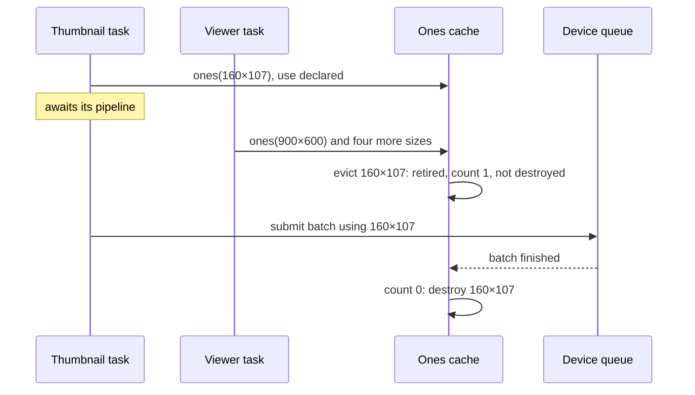

# Chapter 8 · Retire After the Fence

*A resource's life ends when the device's last use of it finishes, not when the host drops it.*

**★★** We believe any good solution to this problem has this shape.

## Intent

Separate "the program no longer needs this resource" from "the resource may be destroyed or reused". The first is an
event on the host; the second is an event on the device, reached only when every batch of commands that uses the
resource has passed the point the platform requires. A resource let go in between waits on a retirement list, out of
every pool and every budget, and is never handed out again.

## Also known as

Deferred destruction; deletion queue; frames in flight; grace period; safe memory reclamation.

## Motivation

GPU work runs on several clocks. The host **records** commands into a command buffer, **submits** the buffer to the
device's queue, and goes on; the device **executes** it later and **completes** it later still, signalling a
**fence** (a marker the host can wait on or poll). WebGPU names three timelines: the content timeline (the script),
the device timeline (validation and object state) and the queue timeline (execution on the GPU). A resource is in use
from the moment a task takes its handle until the last command that touches it completes.

chromobench's film grain needed a **texture of ones** (an image whose every value is 1) as the constant input of an
**axpy** pass (a·x + y, per pixel). The grain module cached one such texture and destroyed it whenever a different
size was asked for. A 160-pixel filmstrip thumbnail and the main viewer render at the same time, and each GPU pass
awaits its pipeline from a cache before it records and submits; an await yields to other tasks even when the cache
hits. Four things went wrong.

1. **Destroyed between taking and submitting.** The thumbnail took its 160 × 107 texture and yielded. The viewer asked
   for its own size; the cache destroyed the thumbnail's texture and made a new one. The thumbnail then submitted. The
   console said, once per alternation of the two renders:
   `Destroyed texture [Texture (unlabeled 160x107 px, TextureFormat::RGBA32Float)] used in a submit.`
2. **The waiting was in the wrong place.** Every grain pass already waited for the device to complete its work
   before the next pass. The hazard was not on the device's timeline but on the host's: the window between taking a
   handle and recording its use spanned an await. The waiting only made the two renders alternate in lockstep, so the
   race repeated.
3. **The error named nothing.** The texture was found by searching the code for `rgba32float` textures sized like an
   image.
4. **The first regression test passed on the broken code.** It opened two files and rendered thumbnails and the viewer
   together, but the race needs both renders at the grain's pass in the same turn of the event loop.

The problem is old. In a lock-free list, a writer unlinks a node a reader may still be traversing. A CUDA program
that frees a buffer on one stream while a kernel on another still reads it gets no error: the allocator hands the
memory to the next request, and the kernel reads someone else's numbers.

## Problem

**When may a program destroy or reuse a device resource it no longer needs, while commands that use it may still be
held, recorded, queued or running?**

## Forces

- **Free early against free safely.** Destroying at release returns memory at once; any command that still uses the
  resource then fails or, worse, reads reused memory.
- **Precise tracking against cheap tracking.** Counting, per resource, the batches that still use it frees each one as
  early as possible; one global counter of work in flight is simpler, but frees only at a quiet moment, which
  continuous load may never give.
- **Waiting against overlap.** Waiting for the device after every pass makes later releases safe but serialises host
  and device, and does nothing for the host's own window; overlap needs lifetimes known without waiting.
- **Reuse against aliasing hazards.** A pool that hands a released texture to the next task saves an allocation; handed
  out before its last reader has run, it becomes a data race that produces wrong pixels and no error.

## Solution

**Therefore: treat "no longer needed" and "may be destroyed" as two events on two timelines, and connect them by the
batches that use the resource. A task declares its use when it takes a handle, not when it records the command. When
the host lets go of a resource for good, take it out of every pool, cache and budget at once and put it on a
retirement list; destroy it when every batch that declared a use has finished: completed on the device where the
program frees memory itself, submitted where the API defers the free (WebGPU), abandoned if it was never submitted.
Apply the same rule to reuse: a released resource re-enters its pool only when no unfinished batch uses it, and a
retired resource never re-enters at all.**

## Applicability

Use it when the device runs asynchronously from the host, when resources are shared between concurrent tasks, and
when pools or caches recycle resources between tasks.

Do not use it when the API retains every resource a submitted command buffer references and nothing is recycled by
hand: then only the host's window before submission remains, which a **lease** (a mark that a task holds a resource
now) covers. Nor when all work is synchronous, or when resources live as long as the device.

## Structure

| Participant | Responsibility |
| --- | --- |
| **Resource** | a texture or buffer, with a descriptor and a label |
| **Batch** | commands recorded together; recording, submitted or finished |
| **Fence** | the device's signal that a submitted batch has completed |
| **Use registry** | per resource, the number of unfinished batches that declared a use |
| **Retirement list** | resources let go for good, waiting for their count to reach zero |
| **Pool** | resources released for reuse, available only when their count is zero |
| **Finish rule** | the platform's point at which a batch stops needing what it uses: submission or completion |

In a lock-free map with epoch-based reclamation: a node is the resource, a reader's critical section is the batch,
the global epoch is the fence, and the limbo list is the retirement list.

## Collaborations

1. A task opens a batch and declares a use of each handle as it takes it.
2. A cache may evict a resource a batch has declared; eviction retires it, and it waits on the retirement list.
3. The task submits its batch (or abandons it on failure); under the finish rule the batch finishes and every count
   it holds drops by one.
4. A resource whose count reaches zero is destroyed if retired, or returned to its pool if released.



Read it top to bottom as time on the host. The race needs the eviction to fall inside the thumbnail's await; the
declared use is what keeps the destruction after the submit.

## Sketch

```text
-- the platform's finish rule: when a submitted batch stops needing what it uses
--   completion: the program frees device memory itself (Vulkan, Direct3D 12, CUDA streams)
--   submission: the API keeps resources alive for submitted work and frees them later (WebGPU)
FINISH_AT ← submission

value Batch: { id, used: set of resources, state: recording | submitted | finished }
-- record c into b: append command c to b's command list (c's resources were declared with use(b, r))

owner Lifetimes:
  pending: map resource → count, default 0   -- unfinished batches that declared a use
  retired ← {} ; waitingFree ← {}            -- let go for good; released for reuse but still in use
  pools: map descriptor → list of resources  -- free for reuse now

  begin() → Batch: return Batch{ id: fresh(), used: {}, state: recording }

  use(b, r):                                 -- declare at the moment the handle is taken
    if r ∈ retired: refuse("use-after-retire", label(r) ++ " was let go")
    if r ∉ b.used: add r to b.used ; pending[r] ← pending[r] + 1

  submit(b) → fence:
    f ← device.submit(b) ; b.state ← submitted
    match FINISH_AT:
      submission: finish(b)
      completion: when f signals: finish(b)
    return f

  abandon(b): finish(b)                      -- recorded, never submitted: nothing will run

  finish(b):
    if b.state = finished: return
    b.state ← finished
    for r in b.used:
      pending[r] ← pending[r] − 1
      if pending[r] = 0: settle(r)

  settle(r):                                 -- no unfinished batch uses r
    if r ∈ retired: remove r from retired ; destroy(r)
    else if r ∈ waitingFree: remove r from waitingFree ; append r to pools[descriptor(r)]

  retire(r):                                 -- for good; the budget forgets r now (Chapter 7)
    if r ∈ retired: return
    remove r from pools[descriptor(r)] and waitingFree ; add r to retired
    if pending[r] = 0: settle(r)

  release(r):                                -- for now; reuse later
    if r ∈ retired: return                   -- retired meanwhile (by a recovery): never resurrected
    if r ∈ pools[descriptor(r)] or r ∈ waitingFree: return       -- released twice: hand it out once
    if pending[r] = 0: append r to pools[descriptor(r)] else add r to waitingFree

  acquire(b, desc, label) → resource:
    r ← take(pools[desc]) if pools[desc] is not empty else create(desc, label)   -- every resource labelled
    use(b, r) ; return r

-- in use: constant textures, one per size, the newest four kept
onesBySize: map size → resource, oldest first
ones(b, size) → resource:
  r ← onesBySize[size]
  if r = none:
    r ← acquire(b, textureDesc(size), "grain.ones " ++ size)
    writeConstant(b, r, 1)                   -- records a command into b that sets every texel of r to 1
    onesBySize[size] ← r
    while |onesBySize| > 4: (s, old) ← oldest(onesBySize) ; remove s from onesBySize ; retire(old)
  else: use(b, r) ; move size to newest
  return r

thumb ← begin() ; t ← ones(thumb, 160×107)   -- the thumbnail declares its use, then awaits its pipeline
view  ← begin()
for s in [900×600, 640×427, 480×320, 320×213, 1200×800]: ones(view, s)   -- evicts 160×107: retired, count 1
record axpy(t) into thumb ; submit(thumb)    -- valid: t is alive; finishing thumb destroys it
record grain into view ; submit(view)
```

## Implementation notes

1. **This is the bug chromobench shipped, and the fix it chose.** The grain now keeps a texture of ones per size (the
   newest four) and retires an evicted one. Retirement is coarser than the sketch: all engine work runs inside
   `GpuRuntime.busy`, which counts tasks in flight, and `retire` destroys at once when the count is zero, otherwise
   when it next returns to zero. A task enters `busy` before it takes any handle, so every use is covered.
2. **Know what your API guarantees, and what it leaves to the implementation.** WebGPU: `submit()` validates that no
   texture its command buffers use has been destroyed; the specification's note on `destroy()` says it "allows the
   user agent to reclaim the GPU memory associated with the GPUTexture once all previously submitted operations using
   it are complete", so destroying after submission is valid and when memory returns is the implementation's
   business. `writeBuffer` and `submit` both put their work on the queue timeline in call order, so a write issued
   after a submit cannot change what that submitted work reads. Vulkan: every submitted command that refers to a
   resource must have completed before it is destroyed; renderers wait on a fence and keep per-frame deletion queues.
   Direct3D 12: the same with `ID3D12Fence` values. CUDA: `cudaFreeAsync` frees in stream order; memory used on
   another stream needs an event, or in PyTorch `Tensor.record_stream`.
3. **Why it is safe: a happens-before chain.** Take a resource r and any command c that uses r. The task that records
   c declared r in c's batch b before it took the handle, so `pending[r]` counts b from before c exists. `destroy(r)`
   runs only when `pending[r]` = 0, which is after `finish(b)`; `finish(b)` runs after b's submit (WebGPU) or after
   b's fence (Vulkan, Direct3D 12); and after `retire(r)` no new declaration is accepted. So every use of r is
   submitted, or completed, before r is destroyed. Reuse follows the same chain with `release` for `retire`: the new
   owner's commands go into batches submitted after every earlier reader's batch has finished, and the in-order queue
   puts its writes after their reads.
4. **Count per resource, because batches finish out of order.** A single watermark ("every batch up to k has
   finished") assumes batches finish in the order they were numbered. They do not: a task numbers its batch when it
   begins and submits when its awaits end, so a later batch can be submitted first; with several queues or streams,
   completion order differs again. A count of unfinished batches per resource needs no order at all.
5. **A global quiescent point may never come.** `busy` reaches zero only when no render is running. During a drag
   with thumbnails drawing, renders can overlap without a gap, and the retired list grows with no bound, while its
   bytes have already left the budget ([Chapter 7](07-budgeted-residency.md)). The fix's own notes call this
   "bounded in practice"; nothing enforces it. Per-resource counts or epochs remove the dependence on quiet moments.
   This is a debt.
6. **Release into a pool is also a retirement point.** When a preview starts, chromobench releases an exact export's
   field textures into the pool. An export tile that has taken one and not yet submitted can then read another
   render's writes: wrong pixels, no error. Found during the fix and left as it was; a debt.
7. **Waiting for completion is not the same as being safe, and it costs.** The grain and spatial passes await
   `onSubmittedWorkDone` (a promise resolved when the queue's submitted work completes) after every pass before
   returning a small uniform buffer to the pool; upload code returns the same kind of buffer right after submit, which
   queue order makes safe. Each wait is a host–device round trip per pass, and it is what made two renders alternate.
   Its cost is unmeasured; a debt.
8. **Label every resource, and force the interleaving in a test.** Every texture, buffer, sampler, query set and bind
   group now carries a label, and the runtime records the node it started last; an error reads
   `Destroyed texture [Texture "test.injected"] used in a submit`, and the **journal** (the program's diagnostic log)
   adds the node, a hint rather than a proof while renders overlap. The regression test takes `ones(160×107)`, asks
   for five other sizes, then submits a write to the first; on the old code it fails with the user's message byte for
   byte, and it checks that nothing is left waiting afterwards. A retired resource must also never re-enter a pool;
   [Count What You Own](../modular/08-count-what-you-own.md) shows how chromobench's pool ignores its release.
9. **Pool by descriptor.** chromobench keys textures by format, size, dimension and usage, and rounds buffer sizes up
   to multiples of 256 bytes. WebGPU exposes no memory heaps, so different descriptors never share memory; aliasing
   (below) is not available.

## Variations

- **Frames in flight.** A renderer (a frame here is one displayed image) keeps N, usually two or three, sets of
  per-frame resources, each with a fence and a deletion queue, flushed when that fence is next waited on. Bounded
  delay, almost no bookkeeping; everything lives N frames, needed or not.
- **Epochs.** Each batch records the global epoch when it begins; a retired resource is tagged with the epoch at its
  retirement and freed when every batch that began at or before that epoch has finished. This is epoch-based
  reclamation: memory waits for the slowest batch in flight at retirement, not for a quiet moment.
- **Retained references.** The API keeps what a command buffer uses alive (Metal by default; WebGPU after submit);
  the program needs only a lease for the host's window.
- **Planned lifetimes and aliasing.** When the whole batch is known before it runs (a frame graph), each transient's
  lifetime is an interval of passes, and resources with disjoint intervals can share memory. With equal sizes, greedy
  colouring by start time needs exactly the maximum overlap; with unequal sizes the placement problem is NP-complete,
  and first-fit heuristics are used.

## Consequences

- \+ Use-after-destroy is impossible by construction, and the pool cannot hand a resource to a writer while a reader
  is pending; a use of a retired handle is a refusal that names it, not a silent data race.
- \+ Host and device can overlap: nothing waits for completion merely to free.
- \+ Errors name their resources.
- − Memory is held past the host's release, sometimes long past it; the budget must decide whether to count it.
- − Every handle taken must be declared; one undeclared use reopens the window.
- − Per-resource counts cost a set insertion per use and a pass over the batch at finish.

## Known uses

- **Vulkan** frames in flight with per-frame deletion queues; **Direct3D 12** fences; **Metal** command buffers, which
  retain the resources they reference unless made with unretained references.
- **CUDA**'s stream-ordered allocator (`cudaMallocAsync`, `cudaFreeAsync`, CUDA 11.2); **PyTorch**'s caching allocator
  with `Tensor.record_stream`.
- **Read-copy update**: Paul E. McKenney and John D. Slingwine, "Read-Copy Update: Using Execution History to Solve
  Concurrency Problems", PDCS 1998: writers free after a grace period in which every reader has passed a quiescent
  state.
- **Epoch-based reclamation**: Keir Fraser, *Practical Lock-Freedom*, PhD thesis, University of Cambridge, 2004.
- **Hazard pointers**: Maged M. Michael, "Hazard Pointers: Safe Memory Reclamation for Lock-Free Objects", *IEEE
  Transactions on Parallel and Distributed Systems* 15(6), 2004: a reader publishes what it is about to use, this
  chapter's "declare when the handle is taken".
- **Frostbite's FrameGraph**: Yuriy O'Donnell, "FrameGraph: Extensible Rendering Architecture in Frostbite", GDC
  2017: transient resources aliased when their lifetimes do not overlap.
- Madanlal Musuvathi et al., "Finding and Reproducing Heisenbugs in Concurrent Programs" (CHESS), OSDI 2008.

## Related chapters

- [Chapter 7 · Budgeted Residency](07-budgeted-residency.md): eviction and recovery retire; this chapter says when the
  memory really comes back.
- [Chapter 9 · Content-Keyed, Cost-Aware Cache](09-content-keyed-cost-aware-cache.md): a cache that hands out results
  must lease them while held.
- [Chapter 10](10-measure-completion-gate-percentiles.md): completion is also what a timer must wait for.
- Image engine volume: [Latest-Wins Render Slots](../04-latest-wins-render-slots.md): an aborted render still holds
  its resources until it settles.
- Modular volume: [Count What You Own](../modular/08-count-what-you-own.md) introduces `busy` and `retire`.
- GoF: a reference-counting **Proxy** is the nearest relative of a declared use.

## Exercises

1. **Implement and measure, without a GPU.** Extend Chapter 10's fake device: resources with a `destroyed` flag, a
   queue that completes a batch 2 ms after submission, a `submit` that throws on a destroyed resource. Implement the
   sketch under both finish rules and a variant with one global counter of tasks in flight. Tasks arrive as a Poisson
   process, run for an exponential time of mean 5 ms with an await in the middle, and use four 16 MiB resources, one
   of which they retire. Plot bytes retired but not destroyed against time at loads ρ from 0.2 to 3.
2. **Analyse.** (a) Note 3's argument assumes one in-order queue. With two queues, what must reuse also wait for,
   and how would the sketch's `finish` change? (b) A
   simpler design tags each resource with the highest batch id that used it and frees it when that batch finishes.
   Give a two-task counterexample on one in-order queue. (c) With the global counter, model tasks as an M/M/∞
   queue (arrival rate λ, mean duration 1/μ, ρ = λ/μ). The mean busy period is (e^ρ − 1)/λ. What does that imply for
   how long a retired resource waits, and for memory as load grows?
3. **Another domain: a lock-free stack.** In a language without garbage collection, implement a Treiber stack whose
   pop frees the node. Show a use-after-free and an ABA failure under a forced interleaving, then fix both with
   epoch-based reclamation and with hazard pointers. Compare the memory each holds under a reader that stalls.
4. **Aliasing.** Given a frame graph's transients as (first pass, last pass, bytes), compute the lower bound (the
   largest total of live bytes at any pass) and a first-fit placement of offsets. Find an instance where first-fit
   exceeds the bound, and one with equal sizes where greedy colouring by start time meets it.
