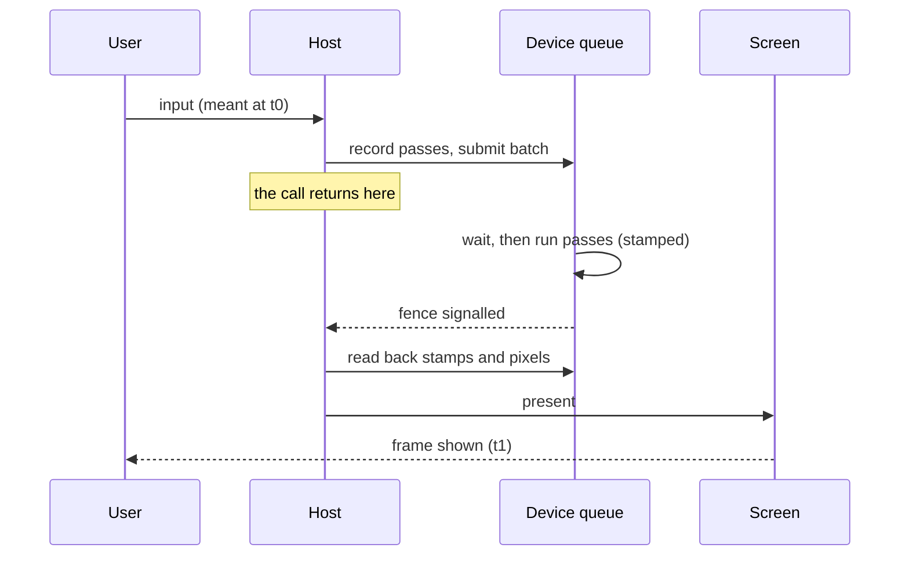

# Chapter 10 · Measure Completion, Gate Percentiles

*Time device work until it has finished, start the clock when the user meant to act, and let a percentile that
grows fail the build.*

**★★** We believe any good solution to this problem has this shape.

## Intent

Time asynchronous device work from submission to the device's signal that it has finished, and attribute time
inside a batch with device timestamps read once per batch. Time what people wait from the moment a request was meant
to be made to the moment its result is visible. Turn the distribution of those times into a gate that fails the
build, with enough samples and a noise estimate that the decision means something.

## Also known as

Completion timing; open-loop benchmarking; latency objectives; performance regression gates; tail-latency budgets.

## Motivation

chromobench renders a print on the graphics processor (GPU) through WebGPU or, without one, on a slow, exact
double-precision engine in a background thread (a **worker**). The screen redraws every 16.7 ms at 60 Hz. Four
measurements went wrong in this program and its sibling, Editor lab.

1. **A dispatch returns before the work starts.** A **dispatch** records a request to run a **kernel** (a function
   run once per element of a grid) into a batch of commands; **submit** hands the batch to the device and returns
   at once. A timer around either call measures how fast work is queued. Device **timestamps**, written by the
   device at the start and end of a **pass** (a group of dispatches run as one unit), measure the work, but Chrome
   rounds them to 0.1 ms, coarser than most single dispatches on a hardware GPU.
2. **The test watched the wrong clock.** chromobench's drag test records gaps between the browser's animation frames
   (the callbacks it runs before each screen redraw) and fails above 1,000 ms. With the engine in a worker the
   window never froze, so the test passed while each screen render took 4,100 to 4,300 ms. Once someone measured
   the render itself, two fixes took a step from 4,200 to 740 ms.
3. **Noise swamps a doubling.** On the shared build machine (load average about 20), one build took 4,211 ms for a
   step in one run and 9,238 ms in another. A darkroom export that went from 781 to 1,650 ms was seen only because
   an engineer ran the benchmark by hand before and after; it runs only on request and asserts nothing.
4. **A summary that is no statistic.** Editor lab's bench reports the mean of each repeat's 95th percentile, a
   number that is not a percentile of any set of samples; its textbook gives one scenario's 95th percentile as
   28 ms in one run and 17 ms in the next.

The same problems meet anyone serving neural-network inference (a kernel launch returns at once, and a batching
server tested one request at a time hides its queue), game engines (an average frame rate hides stutters), and web
services load-tested by clients that wait for each response.

## Problem

**How do you measure asynchronous device work as the people waiting for it experience it, and turn the measurement
into a check that fails when the program gets slower?**

## Forces

- **Host clock against device clock.** The host sees submission and a completion signal that includes queueing and
  notification; the device sees the work, through timestamps that are coarse and need a read back.
- **Resolution against perturbation.** Timing every pass shows where time goes; waiting for each reading before
  recording the next pass removes the overlap between host and device that made the program fast.
- **Response against comparability.** People wait for queues and the screen; engines are compared on equal work.
- **The tail against the sample count.** What people remember lives at the 95th and 99th percentiles, and a
  percentile of few samples is little more than the maximum.
- **Tight gates against noisy machines.** A tight limit catches small regressions; noise makes it flap, and a
  flapping gate gets switched off.
- **Time against counts.** Counts of passes, bytes and pixels can be gated exactly on any machine; they miss a slower
  kernel.

## Solution

**Therefore: time device work from its submission to the device's signal that it has finished, never around the
call that records it, and attribute time inside a batch only from device timestamps read after that batch has
finished. Time what people wait from the moment each request was meant to be made, on the user's schedule, to the
moment its result is visible. Summarise by percentiles of all samples pooled, never by averaging summaries, and gate
a percentile only when there are enough samples to bound it at a stated confidence. State each requirement as an
event, a percentile, a limit and a device class, and run baseline and candidate interleaved on one fixed machine of
that class. Fail the build when the candidate's bound exceeds the limit, or when it is slower than the baseline by
more than the baseline differs from itself.**

## Applicability

Use it when work runs on an asynchronous device or in another thread; when people or clients wait for results;
when a change could make the program slower without making it wrong; and when two implementations must be compared.

Do not use it for batch jobs judged by throughput (gate total time and rate); do not gate time where no machine can
be held fixed (gate counts there and plot time); and do not write a gate before someone has stated what fast enough
means, as a number, for a named device class.

## Structure

| Participant | Responsibility |
| --- | --- |
| **Device timer** | stamps passes inside a batch; reads the stamps once, after the batch's fence |
| **Clock** | one monotonic host clock for every start and end |
| **Driver** | issues requests at scheduled times, open loop, whatever the program is doing |
| **Probe** | ends each request when a visible result includes it, with the presentation time |
| **Histogram** | buckets of fixed relative width; merges exactly across runs |
| **Requirement** | event, percentile, limit, smallest regression worth failing for, device class |
| **Gate** | interleaves baseline and candidate, bounds the percentile, compares with limit and noise |

In an inference service the device timer is a pair of GPU events around each batch, the driver a load generator at
a fixed request rate, the probe the client's receipt of the last byte, and the gate a job on a reserved machine.

## Collaborations

1. The driver stamps each request with its scheduled time and hands it to the program without waiting.
2. The program records and submits device work; the device timer stamps passes and reads them after the fence.
3. When a result is presented, the probe records, for every request that result includes, presentation time minus
   scheduled time.
4. The gate runs baseline and candidate alternately, merges each one's histograms, bounds the candidate's
   percentile, and compares with the limit and with the baseline's spread between its own runs.



Read it top to bottom as one request. A timer around the submit measures the second arrow. Submit to fence measures
queueing, the passes and the signal; the stamps measure the passes alone. The person waits from t0 to t1.

## Sketch

```text
-- helpers: clock.now() (monotonic, ms); waitUntil(t); newBatch(); runPass(batch, p, startSlot, endSlot): record
-- pass p's dispatches as one pass whose start and end the device writes, in ns, into the two slots;
-- resolveStamps(batch, buf): copy the slots into buf; stampBuf: a device buffer the host may read after a fence;
-- binomialCdf(k, n, p) = P(X ≤ k) for X ~ Binomial(n, p); shuffle; range(xs) = max(xs) − min(xs);
-- start(build, device): a fresh instance of the program; Histogram(lo, ratio): empty buckets, relative width ratio

-- 1 device time: one fence per batch; stamps are read after it, never between passes
timeBatch(passes) → { wallMs, passMs }:
  b ← newBatch()
  for (i, p) in passes: runPass(b, p, 2i, 2i + 1)
  resolveStamps(b, stampBuf)
  t0 ← clock.now() ; f ← submit(b) ; await f ; wall ← clock.now() − t0    -- queueing and signal included
  s ← readback(stampBuf)                                                   -- after the fence: no extra stall
  passMs ← []
  for i in 0 .. length(passes) − 1:
    d ← s[2i + 1] − s[2i]                      -- ns; quantised, not promised monotonic: d can be ≤ 0
    if d > 0: passMs ← passMs ++ [d / 1e6] else: passMs ← passMs ++ [none]
  return { wallMs: wall, passMs }

-- 2 summaries that merge: buckets of fixed relative width
value Histogram: { counts, lo, ratio }         -- bucket j holds [lo · ratio^j, lo · ratio^(j+1)); all start at 0
record(h, x): h.counts[floor(log(max(x, h.lo) / h.lo) / log(h.ratio))] += 1      -- x below lo goes to bucket 0
merge(a, b) → Histogram: return copy(a, counts: a.counts + b.counts)      -- exact; percentiles do not add
size(h) = sum(h.counts)
at(h, r) → ms: the upper edge of the bucket that holds the r-th smallest sample, 1 ≤ r ≤ size(h)
quantile(h, p) → ms | none:                    -- nearest rank
  if size(h) = 0: return none
  return at(h, max(1, ceil(p · size(h))))
upper(h, p, conf) → ms | none:                 -- P(true p-quantile ≤ r-th smallest) = P(Binomial(n, p) ≤ r − 1)
  for r in 1 .. size(h): if binomialCdf(r − 1, size(h), p) ≥ conf: return at(h, r)
  return none                                  -- too few samples (or none) to bound this percentile

-- 3 response time, open loop: requests on the user's schedule; each ends at the frame that includes it
openLoop(scenario, app, h) → done | refuse:
  t0 ← clock.now() ; asked ← {}                -- request id → scheduled time, in id order
  app.onPresented((id, shownAt) → for q in asked with q ≤ id: record(h, shownAt − asked[q]) ; remove q)
                                               -- shownAt: when the frame reached the screen, on the same clock
  for (i, a) in scenario.actions:
    due ← t0 + i · scenario.intervalMs
    waitUntil(due) ; asked[a.id] ← due ; app.apply(a)       -- never wait for the previous answer
  app.waitIdle() ; app.stop()
  if asked ≠ {}: return refuse(unanswered, "requests never shown", where: scenario)
  return done

-- 4 the gate: interleaved runs on one machine; the noise is the baseline measured against itself
value Requirement: { scenario, p, conf, limitMs, minEffectMs, device }
gate(req, base, cand, rounds) → pass | refuse:
  if req.scenario.actions = [] or rounds < 2: return refuse(noData, "need actions and two rounds", where: req)
  hb ← Histogram(0.1, 1.02) ; hc ← Histogram(0.1, 1.02) ; baseRuns ← []
  for r in 1 .. rounds:
    for build in shuffle([base, cand]):
      h ← Histogram(0.1, 1.02)
      res ← openLoop(req.scenario, start(build, req.device), h) ; if res ≠ done: return res
      if build = base: hb ← merge(hb, h) ; baseRuns ← baseRuns ++ [quantile(h, req.p)]
      else: hc ← merge(hc, h)
  u ← upper(hc, req.p, req.conf)
  if u = none: return refuse(tooFewSamples, "add rounds or actions", where: req.scenario)
  if u > req.limitMs:
    return refuse(overLimit, "cannot show the percentile is within its limit", where: req.scenario)
  if quantile(hc, req.p) − quantile(hb, req.p) > max(req.minEffectMs, range(baseRuns)):
    return refuse(regression, "slower than the baseline by more than its own spread", where: req.scenario)
  return pass

-- in use: dragExposure is 60 slider actions at 16.7 ms; five rounds give 300 candidate samples, enough to bound
-- even a 99th percentile; segmentPasses are the passes of one fused segment
req ← Requirement{ scenario: dragExposure, p: 0.95, conf: 0.95, limitMs: 50, minEffectMs: 2, device: "integrated GPU" }
gate(req, base: mainBranch, cand: thisChange, rounds: 5)
cost ← timeBatch(segmentPasses).wallMs         -- what a cache entry records as its cost (Chapter 9)
```

## Implementation notes

1. **Know what the completion signal covers.** WebGPU's `onSubmittedWorkDone` resolves when all work submitted to
   the queue before the call has finished, other code's work included, and the host learns of it through its event
   loop; time on a quiet queue. Submit to that signal covers queueing, the passes and the notification; for small
   batches the fixed part dominates. A first run also compiles the device program (79 ms in the textbook's probe,
   one machine): report cold runs apart from warm ones.

2. **Know what a timestamp promises.** In WebGPU timestamps are an optional feature (`timestamp-query`) the device
   must request. They are written at pass boundaries as 64-bit counts of nanoseconds, which the implementation may
   quantise (Chrome to 0.1 ms) and does not promise to increase monotonically, so a difference can be zero or
   negative. Read stamps around groups of passes and take percentiles of the sums, not sums of rounded parts. CUDA's
   events give elapsed milliseconds between two points on a stream; Vulkan's timestamps count ticks, converted with
   the device's `timestampPeriod` in nanoseconds per tick.

3. **Read timestamps once per batch, after its fence.** On devices that offer timestamps, chromobench's timer stamps
   each labelled pass and, in five places, awaits the reading right after every submit, so the host cannot record
   the next pass while the device runs this one. Nothing reads the results: they go into a log that grows by one
   record per timed pass for the device's lifetime, and the timer's completion method has no caller. No one has
   measured what the waits cost. Sample one batch in N, resolve into a ring of buffers, read each after its fence.

4. **Service time steers; response time gates.** chromobench times each render from its start to the pixels read
   back, folds pixels per millisecond into a running average (weight 0.4, renders under 20 ms ignored) and sizes
   drag drafts to about 150 ms. That suits sizing work, which costs service time. It leaves out the wait behind an
   earlier render and the presentation, and the numbers go only to a debug log. Gate response time.

5. **A timeout is not a requirement.** After the 4,100 to 4,300 ms finding, the drag test was changed to hold the
   mouse until a draft shows, with a timeout of 120,000 ms; it would still pass at 100,000. The fixes took a step from
   4,200 to 1,370 to 740 ms, and nothing fails if that returns. Write the limit as a percentile per device class.

6. **Bound percentiles with order statistics; never average them.** Take n independent samples from a continuous
   distribution with p-quantile q. The number below q is Binomial(n, p), and the r-th smallest exceeds q exactly
   when fewer than r samples lie below it, so P(X₍ᵣ₎ ≥ q) = P(Binomial(n, p) ≤ r − 1). For r = n this is 1 − pⁿ: the
   maximum is a 95 % upper bound only when pⁿ ≤ 0.05, n ≥ ln 0.05 / ln p, that is n ≥ 59 for p = 0.95 and n ≥ 299
   for p = 0.99. Samples in one drag are correlated, so treat this as optimistic. Averages break percentiles: one
   run of twenty 10 ms samples and one of eighteen at 10 ms and two at 100 ms have 95th percentiles (nearest rank)
   of 10 and 100 ms; their mean, 55 ms, is no sample, and the pooled 95th percentile is 10 ms. Histograms of fixed
   relative width merge exactly. Tails compound across parallel parts: with 100 independent parts each slow 1 % of
   the time, 1 − 0.99¹⁰⁰ ≈ 63 % of wholes are slow (Dean and Barroso's example).

7. **Coordinated omission is a sampling bias; drive open loop, or correct.** A closed-loop driver takes one sample
   per completed request. A stall of S ms yields one sample of S, while a user acting every Δ ms would have waited
   S, S − Δ, S − 2Δ and so on: about S / Δ samples, averaging S / 2. Correct closed-loop data by also recording
   x − Δ, x − 2Δ, … down to Δ for every sample x above Δ (HdrHistogram offers this), or better, drive open loop.

8. **Measure the noise; do not assume it.** While the 4,200 ms render was investigated, only runs alternating old
   and new code on the loaded machine could be compared. Take the noise from the baseline against itself.
   Mytkowicz and colleagues showed that environment size and link order alone bias measured speed-ups; Kalibera and
   Jones show how to choose repetitions at each level (process, iteration) from measured variance.

9. **The test machine may not have the device.** chromobench's browser tests run WebGPU on SwiftShader, a software
   adapter (a CPU implementation of the GPU interface), unless a flag selects the real one. Time there says nothing
   about a GPU: gate counts in CI (passes, bytes read back, pixels computed) and time on a fixed machine of the real
   device class. Editor lab models slower devices by multiplying measured time by 1.8, 3.5 or 5, as if bandwidth,
   arithmetic and per-dispatch overhead slowed alike; calibrate each class instead.

10. **Make accepting a regression a recorded act.** The export from 781 to 1,650 ms was the price of exact tile
    borders and was accepted by hand. The benchmark runs only when an environment variable asks, and asserts
    nothing; it does avoid flattering itself (each round changes a setting so the result cache misses, two warm-up
    rounds are dropped, the median of eight is reported). With a gate, acceptance is a baseline change in the same
    commit, with its reason.

## Variations

- **Closed-loop benchmark.** The next request waits for the last answer. It measures service time, right for
  comparing engines on equal work, and undercounts slow periods once the program is slower than its input.
- **Field telemetry.** Record response times from real users, as Interaction to Next Paint does on the web.
  Realistic, not repeatable, and available only after release.
- **Count-based gates.** Gate on instruction counts, passes, bytes moved or tiles computed. Exact and portable;
  blind to a kernel that got slower per element.
- **Device profilers.** Vendor tools capture every pass with hardware counters. Right for attributing time, wrong for
  gating: they change the timing and need the vendor's machine.

## Consequences

- \+ A slowdown fails the change that caused it, on the device class it matters for.
- \+ Numbers describe what people wait for, queue and screen included.
- \+ The gate's decision carries a stated confidence instead of a feeling.
- − It needs reserved machines with the real device, time in every build, and someone who owns the baselines.
- − Tail percentiles need hundreds of samples per scenario; a 99th-percentile gate on forty is a gate on the maximum.
- − Open-loop drivers and presentation probes are harder to write than a timer around a call.

## Known uses

- **Gil Tene**, "How NOT to Measure Latency" (talks from 2013): coordinated omission; **HdrHistogram** records
  latencies in buckets of fixed relative precision that merge; **wrk2** sends requests at a constant rate and times
  each from when it should have been sent.
- **Jeffrey Dean and Luiz André Barroso**, "The Tail at Scale", *Communications of the ACM* 56(2), 2013.
- **Chrome's RAIL model** gives budgets per kind of interaction; **Interaction to Next Paint** became a Core Web
  Vital in 2024 (good at 200 ms or less).
- **Google's *Site Reliability Engineering*** (O'Reilly, 2016) states objectives as latency percentiles.
- **rustc-perf** benchmarks the Rust compiler on every merge, tracks instruction counts, and judges changes against
  each benchmark's historical noise.
- **Todd Mytkowicz, Amer Diwan, Matthias Hauswirth and Peter Sweeney**, "Producing Wrong Data Without Doing Anything
  Obviously Wrong!", ASPLOS 2009; **Tomas Kalibera and Richard Jones**, "Rigorous Benchmarking in Reasonable Time",
  ISMM 2013; **Andy Georges, Dries Buytaert and Lieven Eeckhout**, "Statistically Rigorous Java Performance
  Evaluation", OOPSLA 2007.
- **GPU timing interfaces**: CUDA events, Vulkan's timestamp queries, WebGPU's `timestamp-query` feature; vendor
  profilers such as NVIDIA Nsight Systems, AMD Radeon GPU Profiler and Apple's Metal tools in Xcode.

## Related chapters

- [Chapter 9](09-content-keyed-cost-aware-cache.md): its eviction policy needs costs timed to completion, and is
  chosen by these gates.
- [Chapter 6](06-cross-the-bus-rarely.md): a read-back of timestamps is a crossing too; batch it.
- [Chapter 8](08-retire-after-the-fence.md): the same fences that free resources end timings.
- [Chapter 2](02-precision-ladder.md): its accuracy budgets are gated beside these time budgets.
- [Chapter 5](05-fused-interpreted-passes.md): fusion changes pass counts, which count-based gates see.
- Sibling volumes: [Measure From the User's Clock](../modular/10-measure-from-the-users-clock.md) introduces
  response time, open loops and gates; [Latest-Wins Render Slots](../04-latest-wins-render-slots.md) is the queue
  whose waiting this chapter counts; [Reference Oracle](../03-reference-oracle.md) is the correctness gate beside it.
- GoF: the probe is an **Observer** of presentations; a scenario is a list of **Commands**.

## Exercises

1. **Build and measure.** Write a fake device: a thread that runs queued passes of set durations, adds 0.2 ms per
   batch, signals a fence, and offers timestamps rounded to 0.1 ms. Time a batch of twenty 0.06 ms passes (a) around
   submit, (b) submit to fence, (c) by stamps per pass, summed, (d) by stamps around the batch, and compare with the
   true 1.2 ms of work. Then make the host wait for the stamps after every pass while recording the next batch, and
   report the loss in batches per second.
2. **Analyse.** (a) For n = 100 samples, find the smallest r for which the r-th smallest is a 95 % upper bound on
   the 95th percentile, and say what a gate gains over using the maximum. (b) Give two runs whose 95th percentiles
   average to less than the pooled 95th percentile. (c) A frame waits for 16 tiles rendered in parallel, each over
   budget independently with probability q. Find the largest q for which the frame is over budget at most 5 % of
   the time, exactly and by the linearised estimate 16q ≤ 0.05.
3. **Another domain.** An inference server collects requests for up to 10 ms, then runs a batch on the GPU in
   20 ms whatever its size (up to 64 requests); requests arrive at 400 per second. Write its requirement; say what
   a closed-loop client with one request in flight would report, and what an open-loop client would; name the
   counts you would gate in CI.
4. **Read a real system.** Read wrk2's description of its constant-rate mode, or rustc-perf's description of how it
   decides a change is significant. Which parts of the sketch's gate does each have, and which does it lack?
