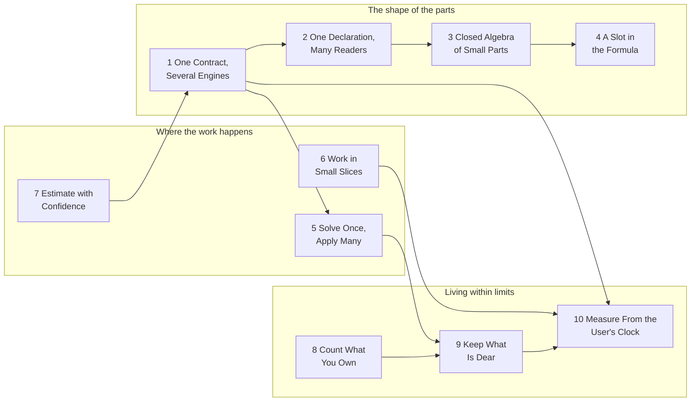

# A Small Pattern Language for Modular Software

*Ten patterns for building software that people can live in and keep changing, taught through an image editor.*

## The kit and the quality

This is a short course in how to cut a program into parts. It is written for students who can already write a
working program and now want to write one that stays workable: one that a second person can enter, change in one
place, and leave without breaking something far away.

Christopher Alexander called the quality we are after "the quality without a name": the feeling that a place is
alive, that its parts support each other, that it could grow without being torn down. Richard Gabriel, translating
Alexander for programmers, named two of its ingredients. **Habitability** is the property that lets a programmer
come to the code later and live in it comfortably: understand it, change it, repair it. **Piecemeal growth** is the
way such code comes about: not by a master plan carried out once, but by many small repairs, each one leaving the
whole a little more coherent. Gabriel also warned against the opposite of habitability, which he called
**compression** carried too far: code so dense with shared context that every line depends on every other.

The ten patterns answer questions every growing program meets:

- How do I have a fast version and a slow, obviously-correct version of the same thing, and keep them honest?
- How do I stop the same fact (a field list, a byte layout, a set of options) being written in four places that drift?
- How do I let users build things out of my parts without my code growing a case for every combination?
- Where should the variable part of an algorithm go, so that the rest stays fixed?
- How do I keep expensive work out of loops that run millions of times?
- How do I keep the interface responsive while long work runs?
- What should a function return when its answer is a guess?
- Who owns a scarce resource, and how does the program recover when it runs out?
- What should a cache keep when it cannot keep everything?
- How do I know whether the program is fast, and notice when it gets slower?

None of them is about images. Each is shown with an image editor because pictures make the consequences visible: a
wrong cache shows the wrong picture, a slow loop freezes a slider, a bad guess makes a print orange.

## The running example

The examples come from two browser programs. **chromobench** is a darkroom in the browser: it opens raw camera files
and film scans and "prints" them through a numerical model of film and photographic paper, with layers, masks,
retouching, an undo history and export to 16-bit files. It runs its image pipeline on the GPU (WebGPU) and keeps a
slow double-precision reference engine beside it. **Editor lab** is a small teaching editor written alongside a
textbook of nine chapters on compositing, blend modes, masks, neighbourhood filters, tiles and pyramids, caching,
scheduling, and the GPU. Its engine is about 750 lines of JavaScript, small enough to read in an afternoon.

Nothing in the patterns depends on either program. Where a chapter says "the editor", read "your program"; every
chapter names at least two other kinds of system with the same problem, and its exercises ask you to apply the
pattern to one of them.

This volume is the general companion to the [image engine language](../00-overview.md) in the parent folder, which
goes deeper into graphs, tiling and fusion for people building such engines. You do not need it to read this one.

## How each pattern is written

Every chapter has the same sections, in the same order: Intent, Also known as, Motivation, Problem, Forces,
Solution, Applicability, Structure, Collaborations, Sketch, Implementation notes, Variations, Consequences, Known
uses, Related chapters, and Exercises. The **Solution** paragraph begins "Therefore:" and is the part to remember;
it should make sense on its own. The **Forces** are the heart of a pattern: each is a tension between two things you
want, and the solution is good exactly to the extent that it lets both be had. The **Implementation notes** include
the mistakes the example programs actually made, named plainly.

Each pattern carries a rating, as in Alexander's book:

- **★★** the pattern is close to invariant: we believe any good solution to this problem has this shape.
- **★** a good form among several; the Variations section names the others.

## Pseudocode conventions

Sketches are pseudocode, not any real language. They show shape, not syntax.

| Notation | Means |
| --- | --- |
| `value T:` | an immutable record type; its methods return new values |
| `copy(x, f: v)` | x with field f replaced by v |
| `a ⊕ b` | map a with b's entries laid over it |
| `xs ++ ys` | list concatenation |
| `f(a) → B` | a signature: f returns a B |
| `x → expr` | an anonymous function |
| `match x:` | case analysis over the forms x can take |
| `refuse(kind, …)` | return a structured refusal: kind, message, hints, fix, where |
| `-- text` | a comment |

## The pattern map



Read an arrow as "is completed by": a contract with several engines (1) is completed by one declaration they all read
(2) and by a measurement that compares them (10); an estimator (7) is completed by a contract that lets a careful
twin check it (1). The groups run from large to small, as Alexander's do: first how the parts meet, then how work is
placed inside them, then how the whole lives within a finite machine.

## The chapters

| # | Pattern | ★ | In one line |
| --- | --- | --- | --- |
| 1 | [One Contract, Several Engines](01-one-contract-several-engines.md) | ★★ | several implementations behind one interface, one of them slow and obviously right |
| 2 | [One Declaration, Many Readers](02-one-declaration-many-readers.md) | ★★ | write a shape once; generate everything that must agree with it |
| 3 | [Closed Algebra of Small Parts](03-closed-algebra-of-small-parts.md) | ★★ | parts combine, by a few operators, into parts of the same kind |
| 4 | [A Slot in the Formula](04-a-slot-in-the-formula.md) | ★ | keep the invariant skeleton fixed and let variation in at exactly one place |
| 5 | [Solve Once, Apply Many](05-solve-once-apply-many.md) | ★★ | split work by how often its inputs change; hoist the rare, hard part out of the hot loop |
| 6 | [Work in Small Slices](06-work-in-small-slices.md) | ★ | coarse result first, then interruptible steps sized to a time budget |
| 7 | [Estimate with Confidence](07-estimate-with-confidence.md) | ★ | a function that guesses returns its guess, how sure it is, why, and what happens otherwise |
| 8 | [Count What You Own](08-count-what-you-own.md) | ★★ | the module that holds a scarce resource keeps its own ledger and its own recovery |
| 9 | [Keep What Is Dear](09-keep-what-is-dear.md) | ★ | cache by content; when full, drop what is cheapest to remake, not what is oldest |
| 10 | [Measure From the User's Clock](10-measure-from-the-users-clock.md) | ★★ | time from when the user asked, report percentiles, and fail the build when they grow |

## Using the language

Introduce each pattern when its need first shows, not before. A pattern applied too early is speculation; Gabriel's
piecemeal growth means repairing what the program has, not what it might have.

1. **From the first day:** keep a slow, obviously-correct version of the core computation and a test that compares
   (1). Write a timing harness before you need one, because without it you will not notice the day things got slower
   (10).
2. **When a fact appears in a second place** (a field list in the code and in the file format, a layout on the CPU
   and in a shader): declare it once and generate the rest (2).
3. **When users start combining features:** give the combinable things a closed algebra (3) and find the one place
   where their behaviour varies (4).
4. **When a hot loop is slow:** before optimising the loop, move what does not change per element out of it (5).
5. **When the interface stalls under long work:** slice it (6).
6. **When a function starts guessing from messy input:** make the guess honest (7).
7. **When memory or handles run out:** give them one owner with a ledger (8), and then decide what the cache keeps (9).

## All of them in one sketch

```text
-- 1 One Contract, Several Engines: the reference and the fast engine answer the same contract
contract Engine:
  render(document, region, level) → Image
  measure(image, box) → Stats

-- 2 One Declaration, Many Readers: each operation's parameters are declared once
declare Adjustment "exposure": { stops: number in [-5, 5] default 0 }
  -- the UI slider, the file format, the GPU uniform layout and the docs are generated from this

-- 3 Closed Algebra of Small Parts: masks combine into masks
sky  = gradient(top, horizon) ∩ colourRange(blue)
mask = sky − brush(strokes)

-- 4 A Slot in the Formula: compositing is fixed; only the blend function varies
out = over(blend: modes["screen"], source: layer, backdrop: below, coverage: mask)

-- 5 Solve Once, Apply Many: the per-spot seam correction is solved once, applied per pixel
coeffs = solveSeam(spot, window)                       -- once per spot, careful and slow
for each pixel p in spot: out[p] = patch(p) · gain(coeffs, p)   -- millions of times, simple

-- 6 Work in Small Slices: coarse first, then steps that fit the frame
show render(document, view, level: coarse)
for step in plan(document, view): if budget.spent(): yield; if stale(request): stop; run(step)

-- 7 Estimate with Confidence: a measured film base says how sure it is
base = estimateBase(scan) → { value, confidence: 0.92, why: "rebate along the long edge", fallback: "blank film in the frame" }

-- 8 Count What You Own: the GPU budget is a ledger the engine keeps itself
texture = gpu.acquire(desc)        -- counted against the budget; over it, something not on screen is evicted first
gpu.release(texture)               -- back to the pool; destroyed later, only after the work that used it has finished

-- 9 Keep What Is Dear: results are kept by content key, and evicted by cost of remaking
cache.put(key(op, inputs), tile, cost: 38 ms)

-- 10 Measure From the User's Clock: latency from the moment the slider moved
bench.run(scenario: "drag exposure", device: "mid laptop") → { p50, p95, p99 } ; gate p95 < 50 ms
```

## The same language in other systems

| System | One Contract, Several Engines | One Declaration, Many Readers | Closed Algebra | Solve Once, Apply Many | Count What You Own | Keep What Is Dear |
| --- | --- | --- | --- | --- | --- | --- |
| A compiler | an interpreter as the reference for the code generator | the grammar generates parser and syntax tree types | types built from types (functions, tuples) | constant folding, loop-invariant code motion | register allocation | incremental compilation caches keyed by content |
| A web service | an in-memory fake beside the real database | an API schema generates server stubs, clients and docs | query filters composed with and/or/not | prepared statements | connection pools | a CDN keyed by URL and version |
| A game engine | a software renderer beside the GPU path | a component schema generates editor panels and save files | scene graphs of nodes made of nodes | skinning matrices per bone, applied per vertex | texture streaming budgets | level-of-detail and shader caches |
| A spreadsheet | a naive full recalculation to check the incremental one | a function catalogue generates help, autocomplete and the evaluator's arity checks | formulas built from formulas | a lookup table built once for a column | memory per open workbook | memoised cell values keyed by inputs |

## What to leave out

These patterns are about how parts meet and how work is placed; they do not teach algorithms. A running-sum blur, a
Levenberg–Marquardt solve or a gamut-compression curve appear only as the content that a pattern organises. The
domain vocabulary of the example (film stocks, paper grades, printer lights) is never a pattern. Neither is anything
an established library already does well: use the platform's image codecs, a real colour-management library, and a
real test framework.

## Further reading

- Christopher Alexander, Sara Ishikawa, Murray Silverstein, *A Pattern Language* (Oxford University Press, 1977), and
  Christopher Alexander, *The Timeless Way of Building* (1979).
- Richard P. Gabriel, *Patterns of Software: Tales from the Software Community* (Oxford University Press, 1996),
  especially the essays "Habitability and Piecemeal Growth" and "Reuse Versus Compression".
- Erich Gamma, Richard Helm, Ralph Johnson, John Vlissides, *Design Patterns: Elements of Reusable Object-Oriented
  Software* (Addison-Wesley, 1994).
- David L. Parnas, "On the Criteria To Be Used in Decomposing Systems into Modules", *Communications of the ACM*
  15(12), 1972.
- Harold Abelson and Gerald Jay Sussman, *Structure and Interpretation of Computer Programs* (MIT Press, 1985;
  second edition 1996), on the closure property and on building systems from combinable parts.
- John Ousterhout, *A Philosophy of Software Design* (Yaknyam Press, 2018), on deep modules.
