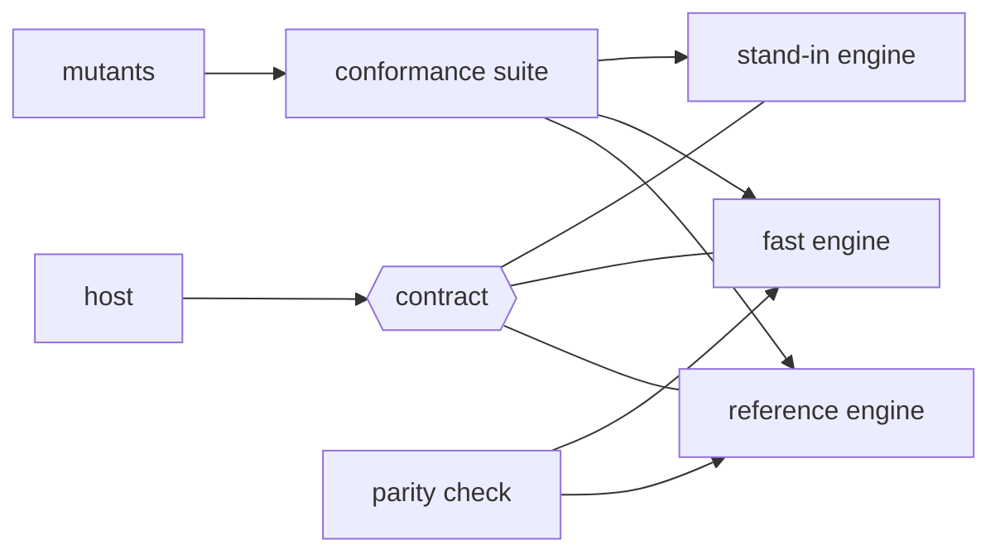

# Chapter 1 · One Contract, Several Engines

*Several implementations behind one interface, one of them slow and obviously right.*

**★★** We believe any good solution to this problem has this shape.

## Intent

Put every implementation of a computation behind one interface that states behaviour, not only signatures. Keep one
implementation whose only job is to be obviously right, however slow, and check every faster one against it with
tests that run both. Callers ask an engine what it can do, never which engine it is.

## Also known as

Reference implementation; golden model; test oracle; pluggable back end; Strategy with a referee.

## Motivation

The editor must redraw the picture while a slider moves, so it renders on the GPU (the graphics processor, which runs
one small program on millions of pixels at once). The first version calls the GPU code directly from the interface.
Four things go wrong.

1. **A wrong answer looks right.** A table lookup on the GPU reads half a cell off. Every colour shifts a little.
   Nothing crashes, and nobody can say the picture is wrong, because there is nothing to compare it with.
2. **The fast path disappears.** The user's browser has no WebGPU, or the driver resets in the middle of a session
   (a "lost device"). If forty places in the program say "if GPU, do this", the fallback is forty edits.
3. **Two implementations agree on numbers and disagree on behaviour.** A second engine is added for machines without
   a GPU. It ignores the region it was asked for, or leaves a half-finished result in its cache when cancelled. Each
   difference is small; together they make bugs that appear on one machine only.
4. **Callers learn which engine they have.** The export code checks "is this the GPU engine?" to use a faster
   read-back. Now a third engine cannot be added without reading every caller.

The same problem appears wherever a fast implementation stands beside a simple one. A web service tests against
an in-memory fake of its database; if the fake keeps different rules, tests pass against something the product never
runs. A numerical library has a plain matrix multiply and tuned ones per processor. A language runtime has an
interpreter and a compiler, and compiled code must mean what the interpreter says it means.

## Problem

**How do you have one or more fast implementations of a computation without losing the ability to say what the right
answer is, and without callers depending on which implementation runs?**

## Forces

- **Speed against trust.** Users see the fast engine; you can believe the obvious one. Keep only the first and you
  lose the definition of right; keep only the second and you lose the product.
- **One interface against different strengths.** A GPU engine can plan work in tiles; a reference engine cannot. A
  narrow interface hides such strengths; a wide one makes every engine fake them.
- **Equal against close.** Floating-point engines on different hardware will not agree to the bit. Demanding equality
  makes every test fail; accepting "close" without a number makes every test pass.
- **Signatures against behaviour.** Types say what goes in and out. They do not say what happens on cancellation, on
  an unsupported request, or on a second call with the same input. Those rules are where engines differ.
- **A second implementation against not knowing.** Two engines cost twice the upkeep; one engine cannot find its
  own silent errors.
- **Choosing once against surviving loss.** Picking an engine at start-up is simple, but a device can vanish
  mid-session, and the document must survive.

## Solution

**Therefore: write the computation down once as a contract: its operations, their signatures, and the behavioural
rules every implementation must keep, including what must be identical, what may be close and within what stated
tolerance, and what happens on cancellation, failure and unsupported requests. Implement one reference engine whose
only goal is to be obviously correct, and implement fast engines as further implementations of the same contract.
Let each engine report its capabilities, with a reason for what it cannot do. Run one conformance suite, derived from
the contract, against every engine; compare each fast engine with the reference at a tolerance that names its unit
and device; keep deliberately broken engines that the suites must reject. Callers depend on the contract and on
capabilities only, so the program can choose an engine at start, or replace one after a failure, without changing
anything else.**

## Applicability

Use it when:

- the same computation has, or will have, more than one implementation (fast and simple, CPU and GPU, local and
  remote, real and fake);
- correctness is hard to see by looking at the output;
- the fast implementation runs on hardware or services you do not control and can fail or disappear.

Do not use it when:

- there is only one implementation and no prospect of a second; an interface with one implementation is ceremony;
- no slow, obviously correct version can be written (then define correctness by properties: identities, symmetries,
  bounds);
- the "engines" differ in what they compute, not how; sharing a method name is not sharing a contract.

## Structure

| Participant | Responsibility |
| --- | --- |
| **Contract** | operations, signatures and behavioural rules; the capability record; error kinds |
| **Reference engine** | computes the defined answer as plainly as possible; slow by design |
| **Fast engines** | the same contract, optimised; each declares what it implements |
| **Stand-in engine** | trivial and deterministic; lets the rest of the program run without the real work |
| **Capabilities** | what an engine can do here and now, and why not when it cannot |
| **Conformance suite** | generated from the contract; checks behaviour rules on every engine |
| **Parity check** | compares a fast engine with the reference in a named unit, per device class |
| **Mutants** | deliberately broken engines; each must fail a named check |
| **Host** | chooses an engine by capabilities, falls back on failure; the only code that names engines |

## Collaborations

1. The host creates the preferred engine and reads its capabilities. If it is unavailable, the host logs the reason
   and tries the next, ending with the reference.
2. Callers use only the contract. An engine lacking an operation refuses with "not implemented" and lists what it
   supports.
3. In the build, the conformance suite runs against every engine, and the parity check runs each fast engine and the
   reference on the same inputs.
4. Each mutant wraps a correct engine and breaks one behaviour; its check must pass on the correct engine and fail
   on the mutant.
5. A fast engine that fails at run time reports a typed error and rebuilds on the next call; the host retries once
   or switches engines.



Read it from the contract outwards: every engine hangs from it; the conformance suite tests them all, the parity
check compares the fast engine with the reference, and the mutants test the suite itself.

## Sketch

```text
-- the contract: signatures and the rules that go with them
contract Engine:
  capabilities() → Caps                       -- { ops, available, why, limits }
  evaluate(node, target) → Image              -- refuse("not-implemented", valid: caps.ops) if node.op ∉ caps.ops
  measure(node) → Stats
  plan(node, target) → TilePlan               -- optional: callers check caps, not engine identity
  rules:
    same engine, same input       → bit-identical result
    reference and fast engine     → within tolerance(op, unit, device)
    cancelled                     → refuse("cancelled"); nothing partial kept
    device lost                   → refuse("device-lost"); the next call rebuilds

-- the engines
engine Reference implements Engine:          -- double precision, every pixel through the plain formula
engine Gpu implements Engine:                -- single precision, fused, tabulated
engine StandIn implements Engine:            -- trivial maths, deterministic

-- the suites, all derived from the contract
for engine in [Reference, Gpu, StandIn]:
  for case in conformanceCases(engine.capabilities().ops): assert case.holds(engine)

for case in parityCases(registry):
  assert diff(Gpu.evaluate(case), Reference.evaluate(case)) ≤ tolerance(case.op, "8-bit levels", device())

for m in mutants:                            -- e.g. "ignores region", "adds noise"
  assert m.check.holds(StandIn) and not m.check.holds(m.wrap(StandIn))

-- the host: the only place that names engines
chooseEngine() → Engine:
  for make in [Gpu, Reference]:
    e = make()
    if e.capabilities().available: return e
    log(e.capabilities().why)

-- in use
engine = chooseEngine()
picture = engine.evaluate(document.output, { scale: 0.25, precision: preview })
```

## Implementation notes

1. **A contract is behaviour, not signatures.** chromobench's Engine interface opens with rules: images and
   measurements are different kinds of request; the same request to the same engine gives bit-identical data; a
   cancelled request leaves nothing in the cache; an operation not in `capabilities().ops` fails with
   `E_NOT_IMPLEMENTED`. Each rule has generated tests. The determinism rule says "same engine"; across engines,
   results are only close. State both halves.
2. **Generate the conformance suite from the declaration.** chromobench builds its cases from the operation
   registry, "so a new op is tested the moment it is registered", in fifteen kinds (bounds, region, determinism,
   cancellation, …). The same generator runs against the stand-in and the reference in unit tests and against
   the GPU engine in a browser. [Chapter 2](02-one-declaration-many-readers.md) is the pattern behind the registry.
3. **Keep the reference plain, not fast.** chromobench's reference calls itself "slow but exact": 64-bit floats,
   every integral computed. Editor lab keeps "JavaScript as the reference for every kernel". The reference settles
   arguments by being read; each optimisation added to it is a place where it, too, can be wrong.
4. **Separate the errors you expect from the ones you do not.** chromobench's GPU preview reads precomputed tables.
   Against the exact reference it differs by up to 1.6 levels of an 8-bit value; against a reference reading the same
   tables in 64-bit floats, by less than 0.1. The first number is a design choice; the second is the GPU's own error.
   The parent volume's [Reference Oracle](../03-reference-oracle.md) develops this, with per-device tolerances.
5. **Prove the suite can fail.** chromobench keeps five mutant engines: one ignores the region, one mislabels its
   output, one adds 1e-12 times a random number, one builds cache keys without sorting object keys, one drops a
   measured field. Each test first requires the clean engine to pass the same cases, then the mutant to fail. Editor
   lab shows the gap: its GPU test prints the parity report (0.33 of an 8-bit step) but asserts no tolerance. A
   printed number is not a test.
6. **Ask for capabilities, with reasons.** chromobench engines report their operations, whether they are available,
   why not, and whether the GPU is a software fallback. Editor lab's GPU plan names a reason for every layer it
   leaves to the CPU: "masked", "reads neighbours", "no WGSL yet". A reason turns a silent slow path into something a
   user, a test or a log can read.
7. **Optional abilities belong in the contract.** This is chromobench's debt. `plan()` is declared as optional, and
   the export driver uses it when present. Three other abilities live outside the contract: the export driver checks
   `typeof engine.evaluateU16 === 'function'`, and the studio reaches `openDecoded` and `forgetSource` through type
   casts. A new engine cannot learn from the contract that these exist. Declare them as optional members and give
   them conformance cases.
8. **If the reference is also the fallback, give it the same inputs.** Without WebGPU, chromobench's studio ships
   the reference engine, in a worker, on a 640-pixel working image instead of 4,000. The proposed first exposure then
   depended on which engine ran, because metering read a different image. Now every engine meters an image of the
   same size. A contract fixes what goes in, not only what is computed.
9. **Failure is part of the contract.** When the GPU device is lost, chromobench's engine keeps its CPU state, raises
   `E_DEVICE_LOST` ("retry: the engine recreates the device") and rebuilds on the next call. The error code is
   declared in the contract, so the caller recovers without knowing about GPUs. [Chapter 8](08-count-what-you-own.md)
   covers who owns what was lost.
10. **A stand-in engine pays for itself.** chromobench's mock does "trivial, deterministic f64 maths" for every
    operation. The component kit's demo runs on it and the mutants wrap it because it is fast. Interface work does
    not wait for the physics.

The result is habitable in Gabriel's sense: whoever wants to know what an operation means reads the plain reference,
and whoever wants it faster changes one engine while the suites say whether the meaning survived. It grows piecemeal:
an operation enters the reference first, and a fast engine claims it in its capabilities only when it passes.

## Variations

- **Reference only in tests.** The reference never ships. Simpler to deploy, but the product has no fallback and
  the reference never meets real inputs.
- **Router engine.** One engine implements the contract by sending each request to another engine: previews to a
  quick engine that reads tables, exports to the exact one. Callers see one engine; the routing is a small, testable
  policy.
- **No reference: engines vote.** Several independent implementations are run on the same inputs and disagreements
  are reported. This finds bugs without saying which engine is right; it suits mature domains with many
  implementations, such as SQL databases or C compilers.

## Consequences

- \+ Optimisation becomes safe: the suites say whether a rewritten engine's meaning changed.
- \+ The program degrades instead of failing when a fast engine is missing or lost.
- \+ Callers are simpler: no engine checks, only capability checks.
- \+ New engines are cheap to start: the conformance suite is their specification.
- − Every operation exists two or three times, and each copy must be maintained.
- − Tolerances need units, device classes and reasons: more configuration to keep.
- − The reference's own mistakes are inherited by every engine that matches it; it needs laws of its own.
- − Abilities that do not fit the contract tempt developers to reach around it, as note 7 shows.

## Known uses

- **CPython** keeps pure-Python and C implementations of several standard modules (for example `decimal` and
  `datetime`); PEP 399 requires the two to pass the same tests.
- **BLAS**: the Netlib reference BLAS defines the routines; tuned libraries such as OpenBLAS and Intel MKL implement
  the same interface.
- **TensorFlow Lite** keeps reference kernels beside optimised kernels and tests one against the other.
- **The WebAssembly specification** comes with a reference interpreter and a test suite that production engines also
  run.
- **SQLite's sqllogictest** runs the same SQL on several database engines and compares the answers.
- **SwiftShader** and Mesa's **llvmpipe** implement graphics APIs in software, behind the same interface as hardware
  drivers, as fallbacks and test targets.
- **Csmith** found hundreds of compiler bugs by compiling random programs with several compilers and comparing.

## Related chapters

- [Chapter 2 · One Declaration, Many Readers](02-one-declaration-many-readers.md): the one declaration every engine
  and every suite reads.
- [Chapter 10 · Measure From the User's Clock](10-measure-from-the-users-clock.md): comparing engines by time, not
  value.
- [Chapter 7 · Estimate with Confidence](07-estimate-with-confidence.md): a careful twin checks an estimator.
- [Chapter 5 · Solve Once, Apply Many](05-solve-once-apply-many.md): fast engines precompute; the reference does
  not, which makes it a check.
- [Chapter 8 · Count What You Own](08-count-what-you-own.md): what a fast engine holds, and recovery when it is lost.
- Parent volume: [Reference Oracle with Negative Controls](../03-reference-oracle.md), the same idea worked out for
  numerical image engines.
- GoF: **Strategy** (interchangeable engines), **Bridge** (callers and engines vary independently), **Decorator**
  (mutants and routers wrap an engine), **Proxy** (an engine in a worker).

## Exercises

1. **Another domain.** Design a contract for a key-value store with `get`, `put`, `delete` and `scan(prefix)`, a
   reference backed by a sorted list, and a fast one backed by files. List three behavioural rules a signature cannot
   express (for example: what `scan` returns while a `put` runs), and one mutant per rule.
2. **Find the forces in your own code.** Pick a function you wrote that has a fast path (a cache, a special case, a
   lookup table). Write the slow, obvious version beside it and a test comparing them on random inputs. Which forces
   above did you meet? What tolerance did you need, and why?
3. **Capabilities.** A spell checker has a large engine that suggests corrections and a small one that only says
   "misspelled". Write the capability record, and the editor code that decides whether to offer suggestions without
   naming either engine.
4. **The leaking ability.** Take one ability from note 7, write it as an optional member of the contract, and write
   the conformance case an engine claiming it must pass.
