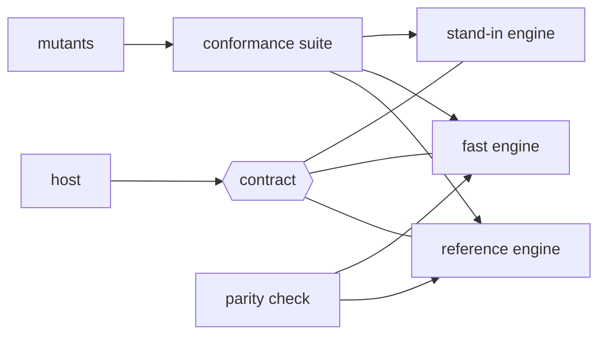

# Chapter 1 · One Contract, Several Engines

*Several implementations behind one interface, one of them slow and obviously right.*

**★★** We believe any good solution to this problem has this shape.

## Intent

Put every implementation of a computation behind one interface that states behaviour, not only signatures. Keep one
implementation whose only job is to be obviously right, however slow, and check every faster one against it with
tests that run both. Callers ask an engine what it can do, never which engine it is.

## Also known as

Reference implementation; golden model; test oracle; pluggable back end.

## Motivation

The editor must redraw the picture while a slider moves, so it renders on the GPU (the graphics processor, which runs
one small program on millions of pixels at once), through WebGPU, the browser's interface to it. The first version
calls the GPU code directly from the interface. Four things go wrong.

1. **A wrong answer looks right.** A lookup in a precomputed table reads half a cell off. Every colour shifts a
   little. Nothing crashes, and nobody can say the picture is wrong, because there is nothing to compare it with.
2. **The fast path disappears.** The user's browser has no WebGPU, or the graphics driver resets mid-session (a
   "lost device"). If forty places in the program say "if GPU, do this", the fallback is forty edits.
3. **Two implementations agree on numbers and disagree on behaviour.** A second engine, for machines without a GPU,
   leaves a half-finished result in its cache when a request is cancelled. The bug appears on those machines only.
4. **Callers learn which engine they have.** The code that saves the final file checks "is this the GPU engine?"
   to use a faster path. A third engine now means reading every caller.

The same problem appears wherever a fast implementation stands beside a simple one. A web service tests against an
in-memory fake of its database; if the fake keeps different rules, tests pass against something the product never
runs. A language runtime has an interpreter and a compiler, and compiled code must mean what the interpreter says.

## Problem

**How do you have one or more fast implementations of a computation without losing the ability to say what the right
answer is, and without callers depending on which implementation runs?**

## Forces

- **Speed against trust.** Users see the fast engine; you can believe the obvious one. Keep only the first and you
  lose the definition of right; only the second, and you lose the product.
- **One interface against different strengths.** One engine can split a large job into pieces and plan them; another
  cannot. A narrow interface hides such strengths; a wide one makes every engine fake them.
- **Equal against close.** Floating-point engines on different hardware rarely agree to the bit. Demanding
  equality makes every test fail; accepting "close" without a number makes every test pass.
- **Signatures against behaviour.** Types say what goes in and out, not what happens on cancellation, on an
  unsupported request, or on a repeated call. Those rules are where engines differ.
- **A second implementation against not knowing.** Two engines cost twice the upkeep; one engine cannot find its
  own silent errors.
- **Choosing once against surviving loss.** Picking an engine at start-up is simple, but a fast engine can fail
  mid-session, and the user's work must survive.

## Solution

**Therefore: write the computation down once as a contract: its operations, their signatures, and the behavioural
rules every implementation must keep, including what must be identical, what may be close and within what stated
tolerance, and what happens on cancellation, failure and unsupported requests. Implement one reference engine whose
only goal is to be obviously correct, and implement fast engines as further implementations of the same contract.
Let each engine report its capabilities, with a reason for what it cannot do. Run one conformance suite, derived from
the contract, against every engine; compare each fast engine with the reference at a tolerance that names its unit
and the machine it was measured on; keep deliberately broken engines that the suites must reject. Callers depend on
the contract and on capabilities only, so the program can choose an engine at start, or replace one after a failure,
without other changes.**

## Applicability

Use it when:

- the same computation has, or will have, more than one implementation (fast and simple, CPU and GPU, real and fake);
- correctness is hard to see by looking at the output;
- the fast implementation runs on hardware or services you do not control.

Do not use it when:

- there is one implementation and no prospect of a second; an interface with one implementation is ceremony;
- no slow, obviously correct version can be written (then test properties instead, such as "sorting twice changes
  nothing");
- the "engines" differ in what they compute, not how; sharing a method name is not sharing a contract.

## Structure

| Participant | Responsibility |
| --- | --- |
| **Contract** | operations, signatures and behavioural rules; the capability record; error kinds |
| **Reference engine** | computes the defined answer as plainly as possible; slow by design |
| **Fast engines** | the same contract, optimised; each declares what it implements |
| **Stand-in engine** | trivial, deterministic answers; the rest of the program runs without the real work |
| **Capabilities** | what an engine can do here and now, and why not when it cannot |
| **Conformance suite** | generated from the contract; checks behaviour rules on every engine |
| **Parity check** | compares a fast engine's results with the reference's, in a named unit, per kind of machine |
| **Mutants** | deliberately broken engines; each must fail a named check |
| **Host** | chooses an engine by capabilities, falls back on failure; the only code that names engines |

In a web service the same participants are: the repository interface (contract), an in-memory map (reference), the
database client (fast engine), canned rows (stand-in), and the start-up code that picks one (host).

## Collaborations

1. The host creates the preferred engine and reads its capabilities. If it cannot run, the host logs the reason and
   tries the next, ending with the reference.
2. Callers use only the contract. An engine lacking an operation refuses with "not implemented".
3. In the build, the conformance suite runs against every engine, and the parity check runs each fast engine and the
   reference on the same inputs.
4. Each mutant wraps a correct engine and breaks one rule; that rule's check must pass on the correct engine and fail
   on the mutant.
5. A fast engine that fails at run time reports a typed error and rebuilds on the next call; the host retries once
   or switches.



Read it from the contract outwards: every engine hangs from it; the conformance suite tests them all, the parity
check compares the fast engine with the reference, and the mutants test the suite.

## Sketch

```text
value Request: op, inputs, region            -- what to compute, and which part of the result is wanted
value Result: pixels, region
value Caps: ops, available, why              -- operations implemented; can it run here; if not, why

-- the contract: signatures, and rules every engine must keep (each rule is a conformance case)
contract Engine:
  capabilities() → Caps
  evaluate(request, cancel) → Result         -- cancel: a flag the caller may set during the work
  dispose()                                  -- release what the engine holds
  rule "not implemented": request.op ∉ capabilities().ops ⇒ refuse("not-implemented")
  rule "deterministic":   same engine, same request ⇒ bit-identical results
  rule "region":          the result covers exactly request.region
  rule "cancel":          cancel set ⇒ refuse("cancelled"), and no partial result stays in any cache
  rule "failure":         device lost ⇒ refuse("device-lost"); the next call rebuilds (GPU engines)

engine Reference implements Engine           -- the plain formula, 64-bit floats, slow
engine Fast implements Engine                -- precomputed tables, 32-bit floats, GPU
engine StandIn implements Engine             -- trivial deterministic answers

-- the checks, all derived from the contract
caseFor(rule, op) → Check                    -- a request for op, and what the rule demands of its result
conformance(e):
  for op in e.capabilities().ops: for rule in Engine.rules: assert caseFor(rule, op).holds(e)

parity(fast, ref, tolerance):                -- tolerance in a named unit, measured on a named machine
  for request in sampleRequests(fast.capabilities().ops):          -- seeded random requests
    a = fast.evaluate(request, cancel: never); b = ref.evaluate(request, cancel: never)   -- never: not cancelled
    assert maxDifference(a.pixels, b.pixels) ≤ tolerance                 -- the worst pixel decides

delegate(e, overrides) → Engine              -- forwards every call to e except the ones in overrides
value Mutant: name, breaks, wrap             -- breaks: the rule it must fail; wrap: Engine → Engine
m = Mutant("ignores region", breaks: "region",
  wrap: e → delegate(e, evaluate: (r, c) → e.evaluate(copy(r, region: whole), c)))   -- whole: all of it
assert caseFor(m.breaks, "blur").holds(StandIn())                    -- passes on a correct engine
assert not caseFor(m.breaks, "blur").holds(m.wrap(StandIn()))        -- fails on the broken one

-- the host: the only code that names engines
chooseEngine() → Engine:
  for make in [Fast, Reference]:
    e = make()
    if e.capabilities().available: return e
    log(e.capabilities().why); e.dispose()
  refuse("no-engine", why: "neither engine can run here")

-- in use (picture, visibleArea, newerRequest: from the editor)
engine = chooseEngine()
result = engine.evaluate(Request(op: "exposure", inputs: [picture], region: visibleArea), cancel: newerRequest)
parity(Fast(), Reference(), tolerance: 0.5 levels)   -- in the build; a level is one step of 0–255
```

## Implementation notes

1. **A contract is behaviour, not signatures.** chromobench's Engine interface opens with rules: the same request
   to the same engine gives bit-identical data; a cancelled request leaves nothing in the cache; an unimplemented
   operation fails with `E_NOT_IMPLEMENTED`. Each rule has generated tests, built from the list of operations, so "a
   new op is tested the moment it is registered" ([Chapter 2](02-one-declaration-many-readers.md)). The determinism
   rule says "same engine"; across engines, results are only close. State both halves.
2. **Keep the reference plain, not fast.** chromobench's reference calls itself "slow but exact": 64-bit floats and,
   by default, no tables. Editor lab keeps plain JavaScript as the reference for every GPU routine. A reference
   settles arguments when read.
3. **Separate the errors you expect from the ones you do not.** A level is one step on the 0–255 scale a screen
   shows. chromobench's GPU preview (the quick picture shown while editing) reads precomputed tables. It differs from
   the exact reference by up to 1.6 levels, a cost accepted for speed, but from a reference reading the same tables
   by under 0.1, far below what anyone sees. Growth in the first number points at the tables, in the second at the
   GPU code. See the parent volume's [Reference Oracle](../03-reference-oracle.md).
4. **Prove the suite can fail.** chromobench keeps five mutant engines. One ignores the requested region; one adds
   1e-12 times a random number, invisible but enough to break bit-identical results. Each mutant test first requires
   the clean engine to pass. Editor lab shows the gap: its GPU test prints the difference from the reference (0.33
   of a level) but asserts no bound. A printed number is not a test.
5. **Ask for capabilities, with reasons.** Editor lab's GPU path names a reason for every layer it leaves to the
   CPU: "masked" (limited to part of the picture), "reads neighbours", "no WGSL yet" (no version in the GPU's
   language). A silent slow path becomes something a user, a test or a log can read.
6. **Optional abilities belong in the contract.** This is chromobench's debt. One optional ability, `plan()`, is in
   the contract. Three are not: the export code checks `typeof engine.evaluateU16 === 'function'`, and the host
   reaches two more through type casts. A new engine cannot learn that they exist. Declare them as optional members,
   with conformance cases.
7. **If the reference is also the fallback, give it the same inputs.** Without WebGPU, chromobench runs the
   reference on a 640-pixel-wide copy of the picture instead of 4,000, so the slow engine stays responsive. The
   automatic exposure (how bright to make the picture) then depended on which engine ran, because it measured a
   different image. Now every engine measures the same 640-pixel image. A contract fixes the inputs too.
8. **Failure is part of the contract.** When the GPU device is lost, chromobench's engine keeps its CPU-side state,
   fails with `E_DEVICE_LOST` and rebuilds on the next call. The code is declared in the contract, so callers retry
   without knowing about GPUs. [Chapter 8](08-count-what-you-own.md) covers who owns what was lost.
9. **A stand-in engine pays for itself.** chromobench's mock gives trivial, deterministic answers for every
   operation. Interface components are developed against it, and the mutants wrap it because it is fast.

The result is habitable in Gabriel's sense: to learn what an operation means, read the plain reference; to make it
faster, change one engine while the suites guard the meaning. It grows piecemeal: an operation enters the reference
first, and a fast engine claims it only when it passes.

## Variations

- **Reference only in tests.** Simpler, but the product has no fallback and the reference never meets real inputs.
- **Router engine.** One engine implements the contract by passing each request on: quick previews to a
  table-reading engine, final exports to the exact one. The routing is a small, testable policy.
- **No reference: engines vote.** Several independent implementations run the same inputs and disagreements are
  reported. This finds bugs without saying who is right; it suits domains with many implementations (SQL, C).

## Consequences

- \+ Optimisation becomes safe: the suites say whether a rewritten engine's meaning changed.
- \+ The program degrades instead of failing when a fast engine is missing or lost.
- \+ Callers are simpler: capability checks, never engine checks.
- − Every operation exists two or three times, and each copy must be maintained.
- − Tolerances need units, machines and reasons: more configuration to keep.
- − Every engine that matches the reference inherits its mistakes; it needs tests of its own.
- − Abilities that do not fit the contract tempt developers to reach around it (note 6).

## Known uses

- **CPython** keeps pure-Python and C versions of several standard modules (for example `decimal`); PEP 399 requires
  both to pass the same tests.
- **TensorFlow Lite** tests its optimised numerical routines against plain reference versions.
- **The WebAssembly specification** comes with a reference interpreter and a test suite that production engines also
  run.
- **SQLite's sqllogictest** runs the same SQL on several database engines and compares the answers.
- **SwiftShader** and Mesa's **llvmpipe** implement graphics interfaces on the CPU, behind the same interface as
  hardware drivers, as fallbacks and test targets.
- **Csmith** found hundreds of compiler bugs by comparing several compilers on random programs.

## Related chapters

- [Chapter 2 · One Declaration, Many Readers](02-one-declaration-many-readers.md): the declaration every engine and
  suite reads.
- [Chapter 10 · Measure From the User's Clock](10-measure-from-the-users-clock.md): comparing engines by time.
- [Chapter 7 · Estimate with Confidence](07-estimate-with-confidence.md): a careful twin checks an estimator.
- [Chapter 8 · Count What You Own](08-count-what-you-own.md): what a fast engine holds, and losing it.
- Parent volume: [Reference Oracle with Negative Controls](../03-reference-oracle.md), for numerical image engines.
- GoF: **Strategy** (interchangeable engines), **Bridge** (callers and engines vary independently), **Decorator**
  (mutants wrap an engine), **Proxy** (an engine in another thread).

## Exercises

1. **Write the check the pattern relies on.** Write two engines for `total(xs)`, the sum of a list of floats. The
   reference is exact (Python's `math.fsum`); the fast one adds left to right. Write a parity test over 1,000 random
   lists of 10,000 numbers, with a tolerance you state and justify (hint: it should grow with the list's length and
   magnitude). Then write a broken engine that drops the last element and confirm the test fails it. Would your test
   catch an engine that is off by 1e-9 per element? Should it?
2. **Another domain.** A key-value store has `get`, `put`, `delete` and `scan(prefix)`. The reference keeps a sorted
   list of pairs; the fast engine keeps a hash map. Write three rules a signature cannot express (for example, whether
   `scan` returns keys in order), a conformance case for each, and one mutant per case.
3. **Find the forces in your own code.** Pick a function you wrote that has a fast path (a cache, a special case, a
   lookup table). Write the slow, obvious version beside it and compare them on random inputs. Which forces above did
   you meet?
4. **Capabilities.** A spell checker has a large engine that suggests corrections and a small one that only says
   "misspelled". Write the capability record, and the code that decides whether to offer suggestions without naming
   either engine.
