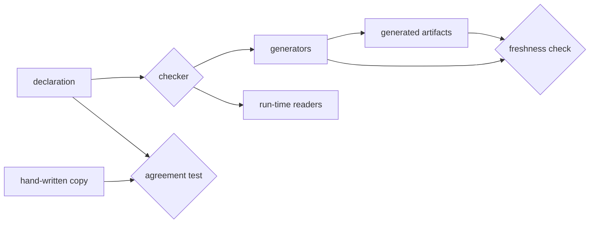

# Chapter 2 · One Declaration, Many Readers

*Write a shape once; generate everything that must agree with it.*

**★★** We believe any good solution to this problem has this shape.

## Intent

When several parts of a program must agree about one shape (a list of fields, a byte layout, the parameters of an
operation), write the shape once, as data, and derive every artifact that must agree with it: code, layouts, forms,
documentation, tests. A check in the build fails when a derived artifact is out of date.

## Also known as

Single source of truth; schema-driven generation; interface definition language; metadata-driven design; X macro.

## Motivation

The editor's exposure adjustment brightens or darkens a picture. It has one parameter, `stops` (one stop doubles the
light), from −6 to 6, default 0. That fact is needed in at least seven places: the validator that refuses 9; the
slider's range and step; the saved file; the uniform, the small block of bytes that carries parameters to a GPU
program, where `stops` sits at some byte offset; the matching structure declared inside the GPU program; the
reference documentation; and the type that scripts are checked against. Written by hand in each place, the copies
drift.

1. **Byte layouts disagree silently.** The CPU packs the uniform; the GPU program declares the same fields in its own
   language. GPU layout rules are strict: a three-number vector starts on a 16-byte boundary but is 12 bytes long, so
   the next number fits in its last four bytes. Get one rule wrong and every later field is read from the wrong
   place. Nothing crashes; the picture is merely wrong.
2. **A round trip loses information.** Editor lab writes a setting as `[min, max, value, label, unit, step]` but
   reads it back as `[min, max, value, label, unit]`. Every round trip through its code view loses the slider step.
3. **The documentation describes last month.** Someone widens `stops` to −10…10 in the validator. The reference page
   and the slider still say −6…6, and nothing fails.
4. **Adding an operation means editing N files.** chromobench numbers its GPU operations in TypeScript
   (`EXPOSURE: 19`), and the GPU program chooses what to run by the same numbers, written again (`case 19u:`). A new
   operation is two edits in two languages, and only a wrong picture says one was missed.

Other domains have the same shape. A web API's request format must agree in the server's validator, the client
library and the documentation. A database table must agree with the classes that read it, the forms that edit it
and the migrations that change it. A network protocol is encoded by one program and decoded by another, often in a
different language.

## Problem

**How do you keep many artifacts that must agree about one shape from drifting apart as the shape changes?**

## Forces

- **One place against many views.** Each reader wants something different: the validator wants bounds, the slider a
  step, the GPU byte offsets, the documentation prose.
- **Generated against hand-written.** Generated code agrees by construction; hand-written code can be tuned and read.
  Some readers need both.
- **Build step against run-time reading.** Generated code is checked by the compiler and costs nothing at run time,
  but needs a build step. Reading the declaration at run time needs no build, but gives up static checks.
- **Simple declaration against expressive declaration.** Each reader asks for one more field or rule. A declaration
  that keeps growing becomes a programming language, with none of the tools.
- **Central against independent.** The declaration becomes a dependency of every module that reads it; a change to
  it touches them all.
- **Real duplication against coincidental duplication.** Two pieces of code that look alike may change for different
  reasons. Merging them into one declaration couples what should stay apart.

## Solution

**Therefore: choose one representation of the shape, a declaration in plain data, close to the domain, and make it
the only place the shape is written. Validate the declaration itself when it is loaded. Derive every artifact that
must agree with it, either by generating it with an ordinary, tested generator (types, byte layouts, declarations in
other languages, documentation, snapshots) or by interpreting the declaration at run time (validation, forms, test
cases). Mark generated files as generated, never edit them by hand, and make the build fail when any is stale. Keep
meaning and presentation in separate parts of the declaration. Where a copy cannot be generated yet, add a test that
compares it with the declaration, so that the copy is at least checked.**

## Applicability

Use it when:

- the same shape is written in two or more places that must agree exactly;
- the shape crosses a boundary between languages, processes or machines (CPU and GPU, client and server, program
  and file);
- the shape changes often, or many shapes follow the same pattern (seventy operations, each with parameters).

Do not use it when:

- there is one reader; a declaration plus a generator is more code than the thing it generates;
- the copies only look alike and change for different reasons;
- the shape needs arbitrary logic to describe. Then write code, and test the agreement (note 10).

## Structure

| Participant | Responsibility |
| --- | --- |
| **Declaration** | the shape, as data: names, types, ranges, units, defaults, documentation, presentation hints |
| **Declaration checker** | refuses an inconsistent declaration when it is loaded |
| **Generators** | write derived artifacts: types, layouts, declarations in other languages, documentation, snapshots |
| **Run-time readers** | interpret the declaration: validator, form builder, test-case generator |
| **Generated artifacts** | marked as generated; read by the compiler, by other programs and by people |
| **Freshness check** | regenerates in the build and fails if anything differs from what is checked in |
| **Agreement test** | compares a copy that is still hand-written with the declaration |

In a web service the same participants are: the API schema (declaration), a schema linter (checker), client and
server type generators, the request validator and admin forms (run-time readers), and a build job that regenerates
the client and fails on a difference (freshness check).

## Collaborations

1. A developer changes the declaration, and only the declaration.
2. Loading it runs the checker: a default outside its own range, or a number without a unit, is refused here, once,
   instead of in every reader.
3. The generators write the artifacts. Run-time readers need no step: the next run sees the change.
4. In the build, the freshness check runs every generator again and compares. A stale file fails the build with its
   name and the command that fixes it.
5. Agreement tests compare hand-written copies with the declaration until those copies can be generated too.



Read it left to right: everything flows from the declaration through its checker; the two diamonds on the right are
the build's guards, one for generated artifacts and one for copies not yet generated.

## Sketch

```text
-- 1. the declarations: plain data, meaning apart from presentation
-- f32, u32: 32-bit float and unsigned integer; vec3: three f32s
declare struct "ExposureParams" for uniform:
  gain: f32, offset: f32, tint: vec3, mode: u32       -- offsets 0, 4, 16, 28; size 32

declare op "exposure":
  stops: number, unit: stop, min: -6, max: 6, usual: -3..3, default: 0, doc: "doubles the light per stop"
    ui: { widget: slider, step: 1/30, detents: [0] }  -- presentation only; detents: values the slider snaps to

ops = { "exposure": … }                               -- every operation declaration, by name

-- 2. the checker, run when the declarations load
check(op) → ok or refusal:
  for arg in op.args:
    if arg.type = number and arg.unit absent: refuse("declaration", op.name, arg.name, "needs a unit")
    if not (arg.min ≤ arg.default ≤ arg.max): refuse("declaration", arg.name, "default outside its range")

-- 3. generators: one function per artifact
layout(struct) → [(field, offset, size)]              -- alignment rules applied here, once
packer(layout) → (values → bytes)                      -- refuses unknown, missing and overlong fields
gpuDeclaration(struct) → text                          -- the same fields in the GPU's language
scriptTypes(ops) → text ;  referencePages(ops) → text
artifacts = [("gpu/exposure-params.gen", () → gpuDeclaration(ExposureParams)),
             ("scripts/types.gen", () → scriptTypes(ops)), ("docs/ops.gen", () → referencePages(ops))]

-- 4. run-time readers
validate(op, raw) → args or refusal                    -- bounds from min and max
control(op, arg) → slider(min: arg.min, max: arg.max, step: arg.ui.step)

-- 5. the build's guards
freshness():
  for (file, generate) in artifacts:
    if read(file) ≠ generate(): fail("out of date: " ++ file ++ "; run the generator")
parseGpuStruct(text) → [(field, offset, size)]         -- reads a GPU-side declaration back
agreement(handWritten, struct):                         -- for a copy not generated yet
  assert parseGpuStruct(read(handWritten)) = layout(struct)

-- in use: a slider moves (show: display a refusal; upload: send bytes to the GPU)
match validate(ops["exposure"], { stops: 1.5 }):
  refusal r: show(r)
  args:      upload(packer(layout(ExposureParams))({ gain: 2 ^ args.stops, offset: 0, tint: (1, 1, 1), mode: 0 }))
```

## Implementation notes

1. **Compute a layout once, from the rules.** chromobench's `defineStruct` takes a list of fields and returns their
   offsets, a packer and the GPU-language declaration. Its tests pin the cases a hand packer gets wrong: a number
   packed into a three-vector's last four bytes (offset 28 after a vector at 16), and a 16-byte step between the
   elements of a number array in a uniform.
2. **Generate both sides, or test that they agree.** This is chromobench's open debt. `defineStruct` can write the
   GPU declaration, yet the GPU programs still declare their structures by hand, and the operation numbers and the
   most operations one GPU pass may run (12) are repeated as literals. Only tests comparing GPU pictures with the
   reference ([Chapter 1](01-one-contract-several-engines.md)) would notice a mismatch. The cure is already used
   once: a few colour matrices are generated as GPU-language constants, "one definition for both engines".
3. **Refuse what the declaration does not name.** chromobench's packer refuses an unknown field and an overlong
   vector, but fills missing fields with zero. That is convenient and a trap: a field renamed on one side is packed
   as zero without complaint. The sketch refuses missing fields instead; either way, write the decision down.
4. **Check the declaration itself.** chromobench refuses an operation whose numeric argument has no unit, whose
   default breaks its own range, or whose example does not parse. A declaration with ten readers is a program with
   ten callers; one mistake reaches all ten.
5. **Mark generated files and check freshness in the build.** Every chromobench generated file begins "GENERATED …
   Do not edit". On every push a check regenerates all 26 (types for 72 operations, reference pages, manuals) and
   fails on any difference, naming the file.
6. **One parser per shorthand.** Editor lab's writer and reader of the same setting format disagree, so the step is
   lost (Motivation, item 2). If a short form exists, exactly one function expands it, and a round-trip test (write,
   read, compare) guards it.
7. **A generated artifact is only as right as its inputs.** chromobench's reference pages list which engines
   implement each operation, but the generator asks only the stand-in engine, so the pages name it alone. Check what
   each generator reads, not only what it writes.
8. **Keep meaning apart from presentation.** chromobench's arguments hold the hard range, the usual range and the
   default; a separate `ui` block holds widget, step and label. Controls are built from both. Changing a label never
   changes what a saved document means.
9. **Snapshot the declaration and diff it.** chromobench snapshots every operation and sorts differences from a
   baseline into breaking and compatible. Saved files depend on the declaration; the snapshot turns "did we
   break them?" into a diff.
10. **Know where to stop.** Editor lab keeps each adjustment's maths twice, in JavaScript and as GPU code, matched by
    name. Generating GPU code from one description of the maths would be a compiler, a far larger project. For logic,
    the guard is a test comparing outputs (Chapter 1), not a bigger declaration. Editor lab's test only checks that
    every GPU version compiles: the weakest form of that guard.

Habitability comes from knowing where to look: one file answers "what are the parameters of exposure?", and nothing
elsewhere can contradict it. Growth is piecemeal: a new operation is one declaration, and the readers follow. A
hand-written copy can stay until it hurts, guarded by an agreement test, and be generated later.

## Variations

- **Generate and check in.** Generated files live in version control, so diffs, editors and programs in other
  languages can read them; a freshness check keeps them honest.
- **Interpret at run time.** No generated files: controls, defaults and help text are built by walking the
  declaration when the program runs. Simple and immediate, but nothing is checked before it runs.
- **The other language declares; reflect from it.** The GPU program or the database schema is the declaration, and
  the host reads offsets or columns from it by reflection. Nothing to generate on that side, but the declaration
  carries no units, ranges or documentation unless you add them.
- **Check without generating.** Both copies stay hand-written, and a test parses one and compares it with the
  other. The cheapest first step; it catches drift, but does not stop it from being written.

## Consequences

- \+ Readers cannot disagree about the shape; whole classes of bug (offsets, lost fields, stale documentation)
  disappear.
- \+ Adding a field or an operation is one edit, and the build lists anything it missed.
- \+ The declaration doubles as documentation and as the input to test generators.
- − Generators are code to maintain, and their output is harder to step through than hand-written code.
- − The declaration is a central dependency; changing it touches every reader at once.
- − The declaration language tends to grow until it needs its own checker, versioning and documentation.

## Known uses

- **Protocol Buffers** (and Thrift, FlatBuffers): one `.proto` file generates encoders, decoders and types in many
  languages.
- **OpenAPI Generator** produces client libraries, server stubs and documentation from one API description.
- **LLVM TableGen**: target descriptions in `.td` files generate instruction encoders, assemblers, disassemblers and
  instruction selection tables.
- **SPIRV-Reflect** and **SPIRV-Cross** read bindings and structure offsets out of compiled GPU programs: the
  reflection variation.
- **Django models**: one class per table yields migrations, admin pages and forms.
- **X macros** in C: a list written once and expanded into an enum, a name table and a switch.
- **Interface definition languages** such as CORBA IDL and Microsoft's MIDL generate stubs on both sides of a call.

## Related chapters

- [Chapter 1 · One Contract, Several Engines](01-one-contract-several-engines.md): the engines read one declaration,
  and the conformance suite is generated from it.
- [Chapter 3 · Closed Algebra of Small Parts](03-closed-algebra-of-small-parts.md): an algebra's operators are a
  list worth declaring once.
- [Chapter 4 · A Slot in the Formula](04-a-slot-in-the-formula.md): the list of variants, declared once.
- Parent volume: [Unit-Tagged Parameter Catalogue](../02-unit-tagged-parameter-catalogue.md), this pattern for
  image operations, with units and scaling.
- GoF: **Interpreter** (run-time readers), **Abstract Factory** (one declaration, many products), **Visitor** (each
  generator walks the same structure).

## Exercises

1. **Write the check the pattern relies on.** A sign-up form has five fields. Write one declaration (name, type,
   required, maximum length, label) and generate from it the server's validator, the HTML form and a documentation
   table, each written to a file. Write the freshness check: a test that regenerates all three and fails, naming the
   file, if any differs. Edit a generated file by hand and confirm the test fails. Then add a sixth field: how many
   files did you edit?
2. **Find the forces in your own code.** Find a fact written twice in a program you wrote: a list of columns, an
   enum mirrored in a database, command-line options and their help text. Which forces above apply? Which copy should
   be the declaration?
3. **Layout by hand.** Under the uniform rules (a 32-bit number, f32, aligns to 4 bytes; three- and four-number
   vectors to 16, a three-number vector being 12 bytes long; each array element in a uniform to 16), compute the
   offsets and size, rounded up to 16, of `{ a: f32, v: vec3, b: f32, w: array<vec4, 3>, s: array<f32, 2> }`.
   (Answer: v 16, b 28, w 32, s 80, size 112.) Then write the agreement test that would catch a hand-written copy
   with b at 32.
4. **When not to.** Find two functions that look alike but change for different reasons. Argue why sharing a
   declaration would make the program harder to change.
