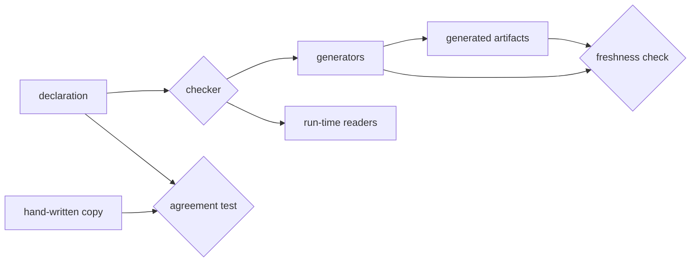

# Chapter 2 · One Declaration, Many Readers

*Write a shape once; generate everything that must agree with it.*

**★★** We believe any good solution to this problem has this shape.

## Intent

When several parts of a program must agree about one shape (a list of fields, a byte layout, the parameters of an
operation), write the shape once, as data, and derive every artifact that must agree with it: code, layouts, forms,
documentation, tests. A check in the build fails when a derived artifact is out of date.

## Also known as

Single source of truth; schema-driven generation; interface definition language; metadata-driven design; X macro.

## Motivation

The editor's exposure adjustment has one parameter, `stops`, from −6 to 6, default 0. That fact is needed in at least
seven places: the validator that refuses 9; the slider's range and step; the saved file; the GPU uniform (the small
block of parameters a GPU program reads), where `stops` sits at some byte offset; the matching structure declared
inside the GPU program; the reference documentation; and the type that scripts are checked against. Written by hand
in each place, the copies drift.

1. **Byte layouts disagree silently.** The CPU packs the uniform; the GPU program declares the same fields in its own
   language. GPU layout rules are strict: a three-component vector starts on a 16-byte boundary but is only 12 bytes
   long, so the next number fits in its tail. Get one rule wrong and every field after it is read from the wrong
   place. Nothing crashes; the picture is merely wrong. chromobench's source records that the program it grew from
   packed a 112-byte uniform by hand.
2. **A round trip loses information.** Editor lab writes a code layer's setting as `[min, max, value, label, unit,
   step]` but reads it back as `[min, max, value, label, unit]`. Every "edit as code" round trip loses the slider
   step.
3. **One copy learns something; the other does not.** chromobench has two configurations for its GPU tests. The main
   one learned to use the machine's real GPU on request; the GPU package's own copy still forces the software
   rasteriser on every run.
4. **Adding a field means editing N files.** chromobench's GPU operations are numbered in TypeScript (`EXPOSURE: 19`)
   and the GPU program switches on the same numbers written as literals (`case 19u:`). A new operation is two edits
   in two languages, and only a failing picture says that one was missed.

Other domains have the same shape. A web API's request format must agree in the server's validator, the client
library, and the documentation. A database table must agree with the classes that read it, the forms that edit it
and the migrations that change it. A network protocol must be encoded by one program and decoded by another, often
in a different language. A compiler's instruction set must agree in the assembler, the disassembler and the code
generator.

## Problem

**How do you keep many artifacts that must agree about one shape from drifting apart as the shape changes?**

## Forces

- **One place against many views.** Each reader wants something different: the validator wants bounds, the slider a
  step, the GPU byte offsets, the documentation prose.
- **Generated against hand-written.** Generated code agrees by construction; hand-written code can be tuned and read.
  Some readers need both.
- **Build step against run-time reading.** Generated code is checked by the compiler and costs nothing at run time,
  but needs a build step. Reading the declaration at run time needs no build, but gives up static checks.
- **Simple declaration against expressive declaration.** Each reader asks for one more field or rule. A declaration
  that keeps growing becomes a programming language, with none of the tools.
- **Central against independent.** The declaration becomes a dependency of every module that reads it; a change to
  it touches them all.
- **Real duplication against coincidental duplication.** Two pieces of code that look alike may change for different
  reasons. Merging them into one declaration couples what should stay apart.

## Solution

**Therefore: choose one representation of the shape, a declaration in plain data, close to the domain, and make it
the only place the shape is written. Validate the declaration itself when it is loaded. Derive every artifact that
must agree with it, either by generating it with an ordinary, tested generator (types, byte layouts, declarations in
other languages, documentation, snapshots) or by interpreting the declaration at run time (validation, forms, test
cases). Mark generated files as generated, never edit them by hand, and make the build fail when any is stale. Keep
meaning and presentation in separate parts of the declaration. Where a copy cannot be generated yet, add a test that
compares it with the declaration, so that the copy is at least checked.**

## Applicability

Use it when:

- the same shape is written in two or more places that must agree exactly;
- the shape crosses a boundary between languages, processes or machines (CPU and GPU, client and server, program
  and file);
- the shape changes often, or many shapes follow the same pattern (seventy operations, each with parameters).

Do not use it when:

- there is one reader; a declaration plus a generator is more code than the thing it generates;
- the copies only look alike and change for different reasons;
- the shape needs arbitrary logic to describe. Then write code, and test the agreement (note 10).

## Structure

| Participant | Responsibility |
| --- | --- |
| **Declaration** | the shape, as data: names, types, ranges, units, defaults, documentation, presentation hints |
| **Declaration checker** | refuses an inconsistent declaration when it is loaded |
| **Generators** | write derived artifacts: types, layouts, declarations in other languages, documentation, snapshots |
| **Run-time readers** | interpret the declaration: validator, form builder, test-case generator |
| **Generated artifacts** | marked as generated; read by the compiler, by other programs and by people |
| **Freshness check** | regenerates in the build and fails if anything differs from what is checked in |
| **Agreement test** | compares a copy that is still hand-written with the declaration |

## Collaborations

1. A developer changes the declaration, and only the declaration.
2. Loading it runs the checker: a default outside its own range, or a number without a unit, is refused here, once,
   instead of in every reader.
3. The generators write the artifacts. Run-time readers need no step: the next run sees the change.
4. In the build, the freshness check runs every generator again and compares. A stale file fails the build with its
   name and the command that fixes it.
5. Agreement tests compare hand-written copies with the declaration until those copies can be generated too.



Read it left to right: everything flows from the declaration through its checker; the two diamonds on the right are
the build's guards, one for generated artifacts and one for copies not yet generated.

## Sketch

```text
-- 1. the declaration: plain data, meaning apart from presentation
declare struct "ExposureParams" for uniform:
  gain: f32, offset: f32, tint: vec3, mode: u32, matrix: mat3   -- offsets 0, 4, 16, 28, 32; size 80

declare op "exposure":
  stops: number, unit: stop, min: -6, max: 6, usual: -3..3, default: 0, doc: "linear RGB × 2^stops"
    ui: { widget: slider, step: 1/30, detents: [0] }

-- 2. the checker
check(op) → ok or refusal:
  for arg in op.args:
    if arg.type = number and arg.unit absent: refuse("declaration", op.name, arg.name, "needs a unit")
    if not inRange(arg.default, arg.min, arg.max): refuse("declaration", arg.name, "default outside its range")

-- 3. generators: one function per artifact
layout(struct) → [(field, offset, size)]              -- alignment rules applied once, here
packer(layout) → (values → bytes)                      -- refuses unknown fields and overlong vectors
gpuDeclaration(struct) → text                          -- the same fields in the GPU language
scriptTypes(ops) → text ;  referencePages(ops) → text

-- 4. run-time readers
validate(op, raw) → args or refusal                    -- bounds from min, max
control(op, arg) → slider(min: arg.min, max: arg.max, step: arg.ui.step)

-- 5. the build's guards
freshness():
  for (file, generate) in artifacts: if read(file) ≠ generate(): fail("out of date: " ++ file ++ "; run gen")
agreement(): assert parseGpuStruct(read("exposure.gpu")) = layout(ExposureParams)   -- until generated

-- in use: a slider moves
args  = validate(ops["exposure"], { stops: 1.5 })
bytes = packer(layout(ExposureParams))({ gain: 2 ^ args.stops })   -- offsets agree with the GPU side
```

## Implementation notes

1. **Compute a layout once, from the rules.** chromobench's `defineStruct` takes a list of fields and returns their
   offsets, a packer, and the GPU-language declaration, applying the alignment rules in one function. Its tests pin
   the cases a hand packer gets wrong: a number packs into a three-vector's tail (offset 28 after a vector at 16); an
   array of single numbers in a uniform has a 16-byte stride; the example struct comes to 112 bytes.
2. **Generate both sides, or test that they agree.** This is chromobench's open debt. `defineStruct` can emit the GPU
   declaration, but the GPU programs still declare their structs by hand, and the generated text is used only in a
   unit test. The operation numbers and the program's maximum length (12) are repeated as literals in the GPU
   program. Only the parity tests ([Chapter 1](01-one-contract-several-engines.md)) would notice a mismatch, as a
   wrong picture. The project already has the cure in one place: core's colour matrices are generated as GPU-language
   constants, "one definition for both engines", and spliced in by the kernel linker.
3. **Refuse what the declaration does not name.** chromobench's packer throws on an unknown field and on a vector
   longer than its slot. It fills missing fields with zero, which is convenient and a trap: a field renamed on one
   side is packed as zero without complaint. Decide which you want and write the decision down.
4. **Check the declaration itself.** chromobench's registry refuses an operation whose numeric argument has no unit,
   whose default breaks its own range, whose usual range lies outside its hard range, or whose example does not
   parse. A declaration read by ten readers is a program with ten callers; a mistake in it reaches all ten.
5. **Mark generated files and check freshness in the build.** Every chromobench generated file begins "GENERATED …
   Do not edit; run `pnpm gen`". `gen:check` regenerates 26 files (argument types for 72 operations, a canonical
   snapshot, 13 reference pages, the scripting language's types and manual, the texts a Go program embeds) and fails
   naming each stale one; the CI runs it on every push.
6. **One parser per shorthand.** Editor lab's two functions for the same setting format disagree: the writer emits a
   sixth element, the step; the reader takes five. If a short form exists, exactly one function expands it, and a
   round-trip test (write, read, compare) guards it.
7. **A generated artifact is only as right as its inputs.** chromobench's reference pages say which engines implement
   each operation, but the generator asks only the stand-in engine, so the pages say "mock" for operations the
   reference and GPU engines also implement. Check what each generator reads, not only what it writes.
8. **Keep meaning apart from presentation.** chromobench's argument declaration holds the hard range, the usual range
   and the default; a separate `ui` block holds widget, step, detents, label and an "advanced" flag. The component
   kit builds its controls from both. Changing a label never changes what a saved document means.
9. **Snapshot the declaration and diff it.** chromobench writes a canonical snapshot of every operation and checks it
   against a baseline, sorting differences into breaking and compatible. Saved documents and outside programs depend
   on the declaration; a snapshot turns "did we break them?" into a diff.
10. **Know where to stop.** Editor lab keeps each adjustment's maths twice: a JavaScript function and a GPU-language
    template, matched by name, with "no WGSL yet" as the reason when a template is missing. Generating the GPU code
    from one description of the maths would be a compiler, a far larger project. For logic, the right guard is a
    parity test (Chapter 1), not a bigger declaration. Editor lab's GPU test checks only that every template
    compiles, which is the weakest form of that guard.

Habitability comes from knowing where to look: one file answers "what are the parameters of exposure?", and the
answer cannot be contradicted elsewhere. Growth is piecemeal: a new operation is one declaration, and each reader
follows. A hand-written copy can stay until it hurts, guarded by an agreement test, and be generated later.

## Variations

- **Generate and check in.** Generated files live in version control, so diffs, editors and programs in other
  languages can read them; a freshness check keeps them honest.
- **Interpret at run time.** No generated files: controls, defaults and help text are built by walking the
  declaration when the program runs. Simple and immediate, but nothing is checked before it runs.
- **The other language declares; reflect from it.** The GPU program or the database schema is the declaration, and
  the host reads offsets or columns from it by reflection. Nothing to generate on that side, but the declaration
  carries no units, ranges or documentation unless you add them.
- **Check without generating.** Both copies stay hand-written, and a test parses one and compares it with the
  other. The cheapest first step; it catches drift, but does not stop it from being written.

## Consequences

- \+ Readers cannot disagree about the shape; whole classes of bug (offsets, lost fields, stale documentation)
  disappear.
- \+ Adding a field or an operation is one edit, and the build lists anything it missed.
- \+ The declaration doubles as documentation and as the input to test generators.
- − Generators are code to maintain, and their output is harder to step through than hand-written code.
- − The declaration is a central dependency; changing it touches every reader at once.
- − The declaration language tends to grow until it needs its own checker, versioning and documentation.

## Known uses

- **Protocol Buffers** (and Thrift, FlatBuffers): one `.proto` file generates encoders, decoders and types in many
  languages.
- **OpenAPI Generator** produces client libraries, server stubs and documentation from one API description.
- **LLVM TableGen**: target descriptions in `.td` files generate instruction encoders, assemblers, disassemblers and
  instruction selection tables.
- **SPIRV-Reflect** and **SPIRV-Cross** read descriptor bindings and struct member offsets out of compiled shaders,
  the reflection variation.
- **Django models**: one class per table generates the database migrations, the admin interface and model forms.
- **X macros** in C: a list of entries written once and expanded several times, into an enum, a name table and a
  switch.
- **Interface definition languages** such as CORBA IDL and Microsoft's MIDL generate stubs on both sides of a call.

## Related chapters

- [Chapter 1 · One Contract, Several Engines](01-one-contract-several-engines.md): the engines read one declaration,
  and the conformance suite is generated from it.
- [Chapter 3 · Closed Algebra of Small Parts](03-closed-algebra-of-small-parts.md): an algebra's operators are a
  list worth declaring once.
- [Chapter 4 · A Slot in the Formula](04-a-slot-in-the-formula.md): the varying part is often a declared table entry.
- Parent volume: [Unit-Tagged Parameter Catalogue](../02-unit-tagged-parameter-catalogue.md), this pattern for
  image operations, with units and scaling.
- GoF: **Interpreter** (run-time readers), **Abstract Factory** (one declaration, many products), **Visitor** (each
  generator walks the same structure).

## Exercises

1. **Another domain.** A sign-up form has five fields. Write one declaration (name, type, required, maximum length,
   label) and from it generate the server's validator, the HTML form and a documentation table. Then add a sixth
   field. How many files did you edit?
2. **Find the forces in your own code.** Find a fact written twice in a program you wrote: a list of columns, an
   enum mirrored in a database, a set of command-line options and their help text. Which forces above apply? Which
   copy should be the declaration?
3. **Layout by hand.** Under the uniform rules of note 1 (scalars align to 4, two-vectors to 8, three- and
   four-vectors to 16 with a three-vector 12 bytes long, array elements in a uniform to 16), compute the offsets of
   `{ a: f32, v: vec3, b: f32, w: array<vec4, 3>, s: array<f32, 2> }` and its size, rounded to 16. Check your answer
   against note 1.
4. **When not to.** Find two functions that look alike but change for different reasons. Argue why sharing a
   declaration would make the program harder to change.
