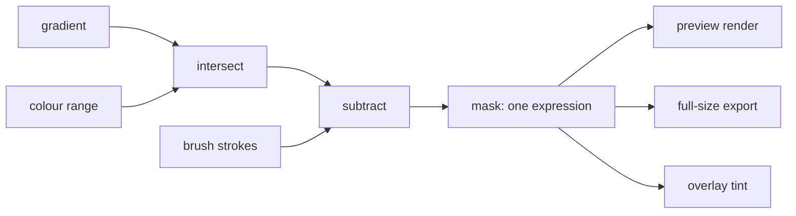

# Chapter 3 · Closed Algebra of Small Parts

*Parts combine, by a few operators, into parts of the same kind.*

**★★** We believe any good solution to this problem has this shape.

## Intent

Give users a few kinds of primitive part and a few operators that take parts and return a part of the same kind.
Because every combination is again a part, the same code combines, stores, shows and tests it as a primitive. The
program grows by adding primitives, never by adding a case for a combination.

## Also known as

Closure property; combinator library; means of combination; Composite (when the operators are containers).

## Motivation

A **mask** limits where a layer acts. Think of it as a **coverage function**: for every pixel it gives a number from
0 (the layer has no effect here) to 1 (the layer applies fully). Users want masks like "the sky, graduated from the
top, but only where it is blue, and not where I painted over the tree". Four naive designs fail.

1. **A feature per combination.** The editor offers "gradient mask", then "gradient mask with a brush eraser", then
   "gradient limited to a colour". Each is its own code path. With five kinds of shape there are dozens of pairs, and
   the combination a user needs next is the one nobody wrote.
2. **Masks stored as pixels.** A mask flattened into a grey image cannot be re-angled, only painted again. It exists
   at one size, so the quarter-size preview and the full-size export read resampled copies whose soft edges
   disagree. Editor lab, the teaching editor, keeps its brush component as pixels, and that component ignores the
   layer's offset, which the layer's own image honours.
3. **Two algebras for one idea.** Editor lab subtracts one selection from another with `min(a, 1 − b)` and one mask
   component from another with `a · (1 − b)`. The same gesture gives two different edges. chromobench's first mask
   intersection was a minimum, its later one a product; when it settled on one algebra, one of its 58 golden test
   cases changed by up to 0.10 at the print.
4. **A second drawing path for the overlay.** The editor shows the mask as a tinted overlay so the user can see what
   they are editing. If the overlay computes the mask by its own code, it shows a mask, not the mask the render used.

The same problem appears wherever users compose behaviour. A search page filters by price, brand and stock, and soon
needs "brand A or brand B, but not refurbished". A CAD program builds solids from boxes and cylinders by union,
difference and intersection. A text tool matches patterns built from smaller patterns.

## Problem

**How do you let users build an unbounded variety of things from a few kinds of part, without the code growing a case
for every combination?**

## Forces

- **Expressiveness against a small vocabulary.** Users want any combination; every operator is one more thing to
  learn, to implement in every engine and to test.
- **Uniform readers against special knowledge.** If a combination is a part like any other, the renderer, the
  overlay and the file format handle it with no new code; but an editing panel wants to know what is inside, to show
  a handle on the gradient.
- **Exact laws against convenient semantics.** Users expect "add" twice to equal "add" once and "intersect" not to
  care about order; floating-point rounding and convenience controls (an amount slider) quietly break such laws.
- **A description against a stored result.** A description can be evaluated at any size and edited later; a stored
  result is cheap to read and easy to paint into.
- **Flat lists against nesting.** Arbitrary nesting gives the most power; a flat list of parts fits a panel and a
  user's head.

## Solution

**Therefore: define one kind of part by what every reader needs from it (for masks, a function from a position to a
coverage in 0…1), make the primitives parts, and give a few operators that take parts and return a part of the same
kind. Give each operator an identity element and state its laws (add is idempotent, intersect commutes, an amount of
0 changes nothing); make them hold exactly and test them. Keep parts as descriptions and evaluate them on demand, on
whatever grid the reader asks for, so the render, the export and the overlay all read the same expression and get the
same answer. Grow the vocabulary by adding primitives, never by adding a case for a combination.**

## Applicability

Use it when:

- users combine features, and requests for "X but also Y" keep arriving;
- several parts of the program read the result (render, export, preview, display, file format);
- the result must be evaluated at more than one size or edited after it is made.

Do not use it when:

- the combinations are few and fixed (two checkboxes do not need an algebra);
- the parts do not share one meaning; an operator that takes a mask and a font returns nothing sensible;
- the thing is edited cell by cell and never re-evaluated (a painting is pixels; its strokes can be a primitive).

## Structure

| Participant | Responsibility |
| --- | --- |
| **Part** | the one kind: `at(position, image) → coverage in [0, 1]` |
| **Primitive** | a part made from parameters: gradient, radial, brush strokes, luminance range, colour range |
| **Operator** | part × part → part (add, subtract, intersect, each with an amount); part → part (feather, invert) |
| **Identity** | the empty part (coverage 0) from which a list is folded; amount 0, which changes nothing |
| **Evaluator** | turns a part into values on a requested grid, at pixel centres |
| **Readers** | the layer's mix, the exporter, the overlay, the file format, the law tests |

## Collaborations

1. The user builds a part from primitives and operators; the document stores the description, not pixels.
2. A reader asks the evaluator for the part on its own grid: the screen region for a preview, the whole frame for an
   export.
3. The evaluator evaluates each primitive at the grid's sample positions and folds the operators from the identity.
4. Each reader uses the values in its own way: the mix as the layer's coverage, the overlay as a tint.



Read it left to right: three primitives combine, by two operators, into one part; three readers evaluate that part,
each on its own grid, so they cannot disagree about where the mask is.

## Sketch

```text
-- the kind: every part answers one question
value Mask:
  at(p, image) → number in [0, 1]

-- primitives: parts made from parameters (positions in document pixels, never screen pixels)
gradient(from, to)              → Mask    -- 1 at from, 0 at to, linear between
radial(box, angle, feather)     → Mask    -- 1 inside, smooth fall to 0 at the ellipse
strokes(paths, radius, hardness)→ Mask    -- painted paths, kept as paths
luminance(above, below, soft)   → Mask    -- reads the image
colourRange(sample, tol, soft)  → Mask    -- reads the image
constant(v)                     → Mask

-- operators on one pixel's values; each returns a value of the same kind
combine(op, v, c) → number:
  match op:
    add       → max(v, c)
    subtract  → v · (1 − c)
    intersect → v · c

faded(op, v, c, amount) → number:          -- amount 0: v exactly; amount 1: combine exactly
  if amount = 1: return combine(op, v, c)
  return v + amount · (combine(op, v, c) − v)

-- a mask as a list of components, folded from the identity
fold(components) → Mask:
  m ← constant(0)                          -- the empty mask
  for (op, amount, part) in components:
    prev ← m
    m ← (p, image) → faded(op, prev.at(p, image), part.at(p, image), amount)
  return m

invert(m)          → Mask: p, image → 1 − m.at(p, image)
feather(m, radius) → Mask                  -- reads neighbours: evaluated as a whole image

-- the evaluator: any part, on any grid
rasterise(m, grid, image) → Image:
  for each cell q of grid: out[q] ← m.at(centre(grid, q), image)

-- in use: one expression, three readers
sky ← fold([ (add, 1, gradient(top, horizon)),
             (intersect, 1, colourRange(blue, 0.10, 0.05)),
             (subtract, 1, strokes(tree, 40, 0.5)) ])
preview ← mix(below, layer, coverage: rasterise(sky, screenGrid, below))
export  ← mix(below, layer, coverage: rasterise(sky, fullGrid, below))
overlay ← tint(rasterise(sky, screenGrid, below))
```

## Implementation notes

1. **Fold from the identity, not from the first part.** chromobench folds a mask's components from the empty mask
   (coverage 0), so a mask that starts with a subtract component is empty, as the algebra says. As an optimisation it
   skips the constant when the first component is an add at amount 1, which equals the fold. Editor lab takes the
   first component as the base and ignores its operator, so its first "subtract" means "add".
2. **Put the amount where it cannot break a law.** chromobench fades every operator the same way, `v + a·(op(v, c) −
   v)`, so an amount of 0 leaves the mask unchanged for every operator. Editor lab instead scales the component's value
   by the amount before combining. For add and subtract that is harmless; for intersect, an amount of 0 multiplies the
   whole mask by 0 and empties it, the opposite of "this component does nothing".
3. **Make the laws exact, and test them.** chromobench's intersect at amount 1 was first computed as `v + 1·(r − v)`.
   That rounds: `a·b` and `b·a` came out as 0.0075 and 0.007500000000000007, so intersect did not commute bit for
   bit. The fix returns the operator's own result at amount 1. A test now checks idempotence, identities, commutation
   and amount 0 on a 21 × 21 grid of values. Exact laws let tests use equality instead of tolerances, and let the
   compiler drop a component at amount 0 knowing that the picture cannot change.
4. **One algebra for one idea.** Choose the operators once and use them everywhere the idea appears: selections,
   mask components, group masks. Both programs use products for subtract and intersect because two soft edges
   multiplied fall off smoothly, while their minimum has a corner, a faint line in a smooth sky. Add stays the maximum
   because that is what users expect "add" to mean.
5. **Keep parts as descriptions in one unit.** chromobench stores mask positions in document pixels (pixels of the
   full-resolution source) and brush strokes as paths with a radius, and rasterises them on the grid being evaluated,
   at pixel centres. A preview at any zoom and an export at any size read the same description, so they agree, and
   nothing needs resampling. A component that stores pixels is the place such guarantees break first.
6. **Make soft edges agree between engines.** A hard edge flips whole pixels when two engines round differently. The
   ellipse primitive is therefore antialiased over one pixel, so the 32-bit GPU engine and the 64-bit reference agree
   to rounding. Mask parity on a software GPU came within 2.7 × 10⁻⁶.
7. **The algebra is written twice; keep it honest.** chromobench's mask operators exist in TypeScript for the
   reference engine and in WGSL for the GPU: one combine pass with three modes, and most primitives as opcodes of the
   pointwise kernel. One function is named the definition and parity tests compare the two. This is a debt, paid
   for by [Chapter 1](01-one-contract-several-engines.md); [Chapter 2](02-one-declaration-many-readers.md) shows how
   to keep such copies from drifting.
8. **Every reader reads the same expression.** chromobench's overlay asks the compiled document for an entry's
   coverage: its mask intersected with the masks of the groups around it, built from the same mask nodes and the same
   combine operator the render uses. To place the overlay over a cropped and straightened picture, the team widened
   the frame operation to accept a mask instead of writing a second geometry path. Editor lab's overlay also calls
   the engine's own coverage function, on a grid no wider than 480 pixels.
9. **Closed in the evaluator, flat in the document.** chromobench stores a mask as one flat list of components; no
   component can refer to another mask. Nesting arises only through groups, whose masks multiply their children's.
   In the graph the operators are closed (combine, feather and invert take a mask and return one), so the evaluator
   could take a tree tomorrow. The flat list is a choice for the panel, not a limit of the algebra.
10. **Not every operator is pointwise.** Add, subtract and intersect read one pixel; feather reads its neighbours.
    An evaluator that fuses pointwise work must treat feather (and painted strokes) as places where a whole image is
    made; see the parent volume's [Barrier-Cut Fusion](../07-barrier-cut-fusion.md).
11. **Look for closure beyond values.** In chromobench a group is an entry with the same fields as a layer (amount,
    mask, blend) and holds a list of entries, so whatever handles a layer handles a group. Its document library has one
    collection shape for every list and four mutations (set, insert, remove, move); each mutation's inverse is a
    mutation, so a transaction's undo is a transaction.

## Variations

- **Flat list with an operator per item** (Lightroom's masking panel, both example programs). Easy to show and reorder;
  one level of combination.
- **Expression tree** (CSG in CAD, SICP's picture language). Full nesting; needs a tree editor, and cycle checks
  once parts can be named.
- **Algebra over stored images** (Photoshop channels and selections). Reads are cheap and painting is natural; the
  result is fixed to one resolution and cannot be re-edited.
- **Structural closure** (Composite). The operator is a container, a group of layers that is itself a layer; the
  "combination" is the container's own rule for its children.

## Consequences

- \+ A handful of primitives and operators gives an unbounded set of parts with a handful of pieces of code.
- \+ Every reader evaluates the same expression, so preview, export and overlay agree.
- \+ New primitives join every combination and every reader at once. chromobench added radial and colour-range
  components late, as two new primitives, without touching the operators, which is piecemeal growth in Gabriel's
  sense: a small repair that leaves the whole more capable.
- − A description is evaluated on every read; a cache ([Chapter 9](09-keep-what-is-dear.md)) has to make up for it.
- − Every operator must exist in every engine and stay in parity.
- − A convenience control placed in the wrong spot (the amount) breaks a law silently.
- − A flat list cannot express every expression; a tree costs a harder editor.

## Known uses

- **SICP's closure property** (Abelson and Sussman): `cons` of lists gives a list; the picture language's `beside`
  and `below` combine painters into painters.
- **Relational algebra and SQL**: operations on relations return relations; `WHERE` predicates combine with `AND`,
  `OR` and `NOT` into predicates.
- **Regular expressions**: concatenation, alternation and star build patterns from patterns.
- **Parser combinators** (Parsec in Haskell; Hutton and Meijer, "Monadic Parsing in Haskell", 1998).
- **Constructive solid geometry** in CAD (OpenSCAD's `union`, `difference`, `intersection`).
- **Unix pipelines**: a pipeline of filters is a filter.
- **Lightroom Classic masking**: components added, subtracted and intersected into one mask.

## Related chapters

- [Chapter 4 · A Slot in the Formula](04-a-slot-in-the-formula.md): the mask's coverage is the amount the fixed
  compositing formula receives.
- [Chapter 1 · One Contract, Several Engines](01-one-contract-several-engines.md): the algebra in two engines, kept in
  parity.
- [Chapter 2 · One Declaration, Many Readers](02-one-declaration-many-readers.md): the operator list declared once.
- [Chapter 9 · Keep What Is Dear](09-keep-what-is-dear.md): equal expressions share one cached result.
- Parent volume: [Barrier-Cut Fusion](../07-barrier-cut-fusion.md) and [Vector Edit Document](../09-vector-edit-document.md).
- GoF: **Composite** (a group is a layer), **Interpreter** (the evaluator walking an expression).

## Exercises

1. **Search filters.** Design a closed algebra for product search: primitives (price range, brand, in stock), operators
   (and, or, not). What are the identity elements of `and` and `or`? Does an "amount" make sense here, and if so,
   where must it go so that amount 0 changes nothing?
2. **The crease.** Take two soft edges along one row of pixels, `a(x) = 1 − x` and `b(x) = x` for x from 0 to 1.
   Compute `min(a, b)` and `a · b` at eleven points and sketch both. Where is the corner, and why does the product not
   have one?
3. **Your own code.** Find a function you wrote with a flag for a combination of two features (`if (a && b)`). Which
   forces from this chapter were at work? What would the primitives and operators be?
4. **Nesting.** Add a component kind "another mask" to the sketch. What must the evaluator now check, and what
   happens to the panel?
