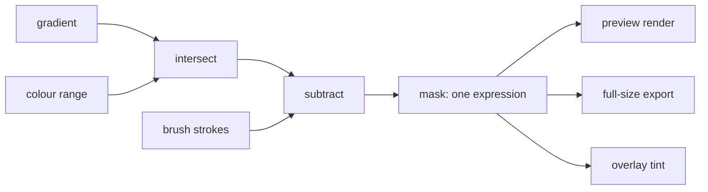

# Chapter 3 · Closed Algebra of Small Parts

*Parts combine, by a few operators, into parts of the same kind.*

**★★** We believe any good solution to this problem has this shape.

## Intent

Give users a few kinds of primitive part and a few operators that take parts and return a part of the same kind.
Because every combination is again a part, the same code combines, stores, shows and tests it as a primitive. The
program grows by adding primitives, never by adding a case for a combination.

## Also known as

Closure property; combinator library; means of combination; Composite (when the operators are containers).

## Motivation

A **mask** limits where a layer of the picture acts. Think of it as a **coverage function**: for every pixel it gives
a number from 0 (the layer has no effect here) to 1 (the layer applies fully). Users want masks like "the sky,
fading out towards the horizon, but only where it is blue, and not where I painted over the tree". Four naive designs
fail.

1. **A feature per combination.** The editor offers "gradient mask", then "gradient with a brush eraser", then
   "gradient limited to a colour", each its own code path. Five kinds of shape make dozens of pairs, and the one a
   user needs next is the one nobody wrote.
2. **Masks stored as pixels.** A mask flattened into a grey image cannot be re-angled, only painted again. It exists
   at one size, so the small preview on screen and the full-size export read resized copies whose soft edges
   disagree.
3. **Two algebras for one idea.** Editor lab, the teaching editor, subtracts one selection from another with
   `min(a, 1 − b)` and one mask component from another with `a · (1 − b)`. The same gesture gives two different
   edges. chromobench first intersected masks with a minimum and later with a product; settling on one algebra
   changed results users already had.
4. **A second drawing path for the overlay.** The editor shows the mask as a tinted overlay. If the overlay computes
   the mask by its own code, it shows a mask, not the mask the render used.

The same problem appears wherever users compose behaviour. A search page filters by price, brand and stock, and soon
needs "brand A or brand B, but not refurbished". A CAD program builds solids from boxes and cylinders by union,
difference and intersection.

## Problem

**How do you let users build an unbounded variety of things from a few kinds of part, without the code growing a case
for every combination?**

## Forces

- **Expressiveness against a small vocabulary.** Users want any combination; every operator is one more thing to
  learn, to implement in every engine and to test.
- **Uniform readers against special knowledge.** If a combination is a part like any other, the renderer, the
  overlay and the file format need no new code; but an editing panel wants to see inside, to show a gradient's
  handle.
- **Exact laws against convenient semantics.** Users expect "add" twice to equal "add" once and "intersect" not to
  care about order; floating-point rounding and convenience controls (a strength slider) quietly break such laws.
- **A description against a stored result.** A description can be evaluated at any size and edited later; a stored
  result is cheap to read and easy to paint into.
- **Flat lists against nesting.** Arbitrary nesting gives the most power; a flat list of parts fits a panel and a
  user's head.

## Solution

**Therefore: define one kind of part by what every reader needs from it (for masks, a function from a position to a
coverage in 0…1). Make the primitives parts, and give a few operators that take parts and return a part of the same
kind. For each operator, know its identity (the part that changes nothing) and its zero, and state its laws (for
masks: add is idempotent, intersect commutes, a strength of 0 changes nothing); make them hold exactly and test them.
Keep parts as descriptions and evaluate them on demand, in whatever context the reader supplies (for masks, a grid
of pixels), so every reader evaluates the same expression and gets the same answer; a reader that needs to know what
is inside, such as an editing panel, can still open the description. Grow the vocabulary by adding primitives, never
by adding a case for a combination.**

## Applicability

Use it when:

- users combine features, and requests for "X but also Y" keep arriving;
- several parts of the program read the result (render, export, preview, display, file format);
- the result is evaluated at more than one size or edited later.

Do not use it when:

- the combinations are few and fixed (two checkboxes do not need an algebra);
- the parts share no meaning (a mask combined with a font is nothing);
- the thing is edited cell by cell and never re-evaluated (a painting is pixels; its strokes can be a primitive).

## Structure

| Participant | Responsibility |
| --- | --- |
| **Part** | the one kind: `(position, image) → coverage in [0, 1]` |
| **Primitive** | a part made from parameters: gradient, radial, brush strokes, brightness range, colour range |
| **Operator** | part × part → part (add, subtract, intersect, each with a strength); part → part (feather, invert) |
| **Identity** | for each operator, the part that changes nothing: 0 for add, 0 on the right for subtract, 1 for intersect |
| **Start value** | the empty mask (coverage 0), from which a list of components is folded |
| **Evaluator** | turns a part into values on the grid a reader asks for |
| **Readers** | the layer's mix, the exporter, the overlay, the file format, the law tests |

In a search system the parts are filters, the operators and, or and not, and the readers are the SQL generator, an
in-memory matcher, the filter chips on screen and the URL serialiser. In a spreadsheet the parts are formulas and the
readers are the evaluator, the dependency tracker and the formula display.

## Collaborations

1. The user builds a part from primitives and operators; the document stores the description, not pixels.
2. A reader asks the evaluator for the part on its own grid: the screen region for a preview, the whole picture for
   an export.
3. The evaluator evaluates each primitive at the grid's positions and folds the operators from the start value.
4. Each reader uses the values its own way: the mix as the layer's coverage, the overlay as a tint.



Read it left to right: three primitives combine, by two operators, into one part; three readers evaluate that part,
each on its own grid, so they cannot disagree about where the mask is.

## Sketch

```text
-- the kind: a mask is any function from a position and an image to a coverage
-- (it takes the image because range parts measure the picture under the layer)
type Mask = (p, image) → number in [0, 1]

-- primitives (positions in pixels of the full-size picture, never screen pixels)
gradient(from, to)               → Mask   -- 1 at from, 0 at to
radial(box, angle, softness)     → Mask   -- 1 inside an ellipse, 0 outside
strokes(paths, radius, hardness) → Mask   -- painted paths, kept as paths
brightness(above, below, soft)   → Mask   -- reads the image's brightness
colourRange(sample, tol, soft)   → Mask   -- reads the image's colour
constant(v)                      → Mask

-- operators on one position's values; the overview writes a ∩ b and a − b as shorthand for these
combine(op, v, c) → number:
  match op:
    add       → max(v, c)
    subtract  → v · (1 − c)
    intersect → v · c

faded(op, v, c, strength) → number:       -- strength 0: v exactly
  if strength = 1: return combine(op, v, c)          -- exact at 1, not v + 1·(… − v) (note 3)
  return v + strength · (combine(op, v, c) − v)

-- a mask as a list of components, folded from the start value
fold(components) → Mask:
  m ← constant(0)                         -- the empty mask: identity of add, zero of intersect
  for (op, strength, part) in components:
    prev ← m                              -- the new mask refers to the one before it, not to itself
    m ← (p, image) → faded(op, prev(p, image), part(p, image), strength)
  return m

invert(m) → Mask: (p, image) → 1 − m(p, image)

-- the evaluator: any mask, on any grid of positions
rasterise(m, grid, image) → Image:
  for each cell q of grid: out[q] ← m(centre(grid, q), image)

-- feather (soften the edge by blurring) reads neighbours, so it has no (p, image) form;
-- the evaluator computes the inner mask on the grid first, then blurs that image
rasterise(feather(m, radius), grid, image) = blur(rasterise(m, grid, image), radius)

-- in use: one expression, three readers; `below` is the picture already composited under the layer
sky ← fold([ (add, 1, gradient(top, horizon)),
             (intersect, 1, colourRange(blue, 0.10, 0.05)),
             (subtract, 1, strokes(tree, 40, 0.5)) ])
preview ← mix(below, layer, coverage: rasterise(sky, screenGrid, below))
export  ← mix(below, layer, coverage: rasterise(sky, fullGrid, below))
overlay ← tint(rasterise(sky, screenGrid, below))
```

## Implementation notes

1. **Fold from a start value the algebra defines, not from the first part.** chromobench folds a mask's components
   from the empty mask. That is the identity of add, so a first add gives just its part; it is the zero of intersect
   and the left zero of subtract, so a first intersect or subtract leaves the mask empty. Editor lab takes the first
   component as the base and ignores its operator, so its first "intersect" acts as "add".
2. **Put the strength where it cannot break a law.** chromobench fades every operator the same way, `v + a·(op(v, c)
   − v)`, so a strength of 0 leaves the mask unchanged whatever the operator. Editor lab instead multiplies the
   component's value by the strength before combining. For add and subtract that is harmless; for intersect, a
   strength of 0 multiplies the whole mask by 0 and empties it.
3. **Make the laws exact, and test them.** In chromobench, `intersect(a, b)` and `intersect(b, a)` computed through
   the fade as `v + 1·(v·c − v)` gave 0.0075 and 0.007500000000000007. The product commutes; the extra subtraction and
   addition rounded differently depending on which value was `v`. The fix returns the operator's result at strength 1.
   The candidate laws are identity, zero, idempotence, commutativity and associativity (which floating-point
   products keep only approximately). chromobench checks them on every pair from 21 values; property-based testing
   (QuickCheck, Hypothesis) checks them on random inputs. Exact laws let tests use equality and let the renderer skip
   a component at strength 0.
4. **One algebra for one idea.** Choose the operators once and use them everywhere the idea appears. chromobench
   uses products for subtract and intersect everywhere: two soft edges multiplied fall off smoothly, while their
   minimum has a corner, a faint line in a smooth sky. Editor lab still uses a minimum for selections, the split of
   Motivation 3. Add stays the maximum because that is what users expect "add" to mean.
5. **Keep parts as descriptions in one unit.** chromobench stores mask positions in pixels of the full-size picture
   and brush strokes as paths, and evaluates them on whatever grid is asked for. A preview at any zoom and an export
   at any size read the same description, so nothing is resized.
6. **The algebra is written twice.** chromobench evaluates masks on the CPU in a reference engine and on the graphics
   card, and tests that the two agree; soft edges are ramps one pixel wide rather than hard steps, so the two engines'
   rounding cannot flip whole pixels. [Chapter 1](01-one-contract-several-engines.md) and [Chapter
   2](02-one-declaration-many-readers.md) treat such copies.
7. **Every reader reads the same expression.** chromobench's overlay asks for an entry's coverage: its mask
   intersected with the mask of each group around it (a group's mask limits every layer inside it), built from the
   same mask descriptions and the same combine operator the render uses.
8. **Closed in the evaluator, flat in the document.** chromobench stores a mask as one flat list of components; no
   component can refer to another mask. Internally, combine, feather and invert each take a mask and return one, so
   the evaluator could take a tree tomorrow. The flat list is a choice for the panel, not a limit of the algebra.
9. **Not every operator reads one position.** Add, subtract and intersect read one value from each input; feather
   reads a neighbourhood. An evaluator that handles one position at a time must compute feather's input as a whole
   image first, then blur it, as the sketch's last `rasterise` rule does.

## Variations

- **Flat list with an operator per item** (Lightroom's masking panel, both example programs). Easy to show and
  reorder; one level of combination.
- **Expression tree** (CSG in CAD, SICP's picture language). Full nesting; needs a tree editor, and cycle checks
  once parts can be named.
- **Structural closure** (Composite). The operator is a container: a group of layers is itself a layer, with the
  same fields. chromobench's four document edits (set, insert, remove, move) have edits as inverses, so an undo is
  a transaction like any other.
- **A weaker form: algebra over stored results** (Photoshop channels and selections). It keeps closure but gives up
  evaluation on demand: reads are cheap, but the result has one resolution and cannot be re-edited.

## Consequences

- \+ A handful of primitives and operators gives an unbounded set of parts with a handful of pieces of code.
- \+ Every reader evaluates the same expression, so preview, export and overlay agree.
- \+ New primitives join every combination and every reader at once. chromobench added radial and colour-range
  components late without touching the operators: piecemeal growth in Gabriel's sense, a small repair that leaves
  the whole more capable.
- − A description is evaluated on every read; a cache ([Chapter 9](09-keep-what-is-dear.md)) has to make up for it.
- − Every operator must exist in every engine and agree across them.
- − A convenience control placed in the wrong spot (the strength) breaks a law silently.
- − A flat list cannot express everything; a tree costs a harder editor.

## Known uses

- **SICP's closure property** (Abelson and Sussman): the picture language's `beside` and `below` combine painters
  into painters.
- **Relational algebra and SQL**: operations on relations return relations; `WHERE` predicates combine with `AND`,
  `OR` and `NOT` into predicates.
- **Regular expressions**: concatenation, alternation and star build patterns from patterns.
- **Parser combinators** (Parsec in Haskell; Hutton and Meijer, "Monadic Parsing in Haskell", 1998).
- **Constructive solid geometry** in CAD (OpenSCAD's `union`, `difference`, `intersection`).
- **Lightroom Classic** (Adobe's photo editor): mask components added, subtracted and intersected into one mask.

## Related chapters

- [Chapter 4 · A Slot in the Formula](04-a-slot-in-the-formula.md): the mask's coverage feeds the fixed compositing
  formula.
- [Chapter 1](01-one-contract-several-engines.md) and [Chapter 2](02-one-declaration-many-readers.md): the algebra in
  two engines, and its operator list declared once.
- [Chapter 9 · Keep What Is Dear](09-keep-what-is-dear.md): equal expressions share one cached result.
- Parent volume: [Barrier-Cut Fusion](../07-barrier-cut-fusion.md) (operators that read neighbours) and [Vector
  Edit Document](../09-vector-edit-document.md).
- GoF: **Composite** (a group is a layer), **Interpreter** (the evaluator walking an expression).

## Exercises

1. **Ranked search.** Each filter of a product search scores a product in [0, 1] (1: in the price range; 0.5: a
   little above). Scores combine by `and` = product and `or` = max, and each filter has a weight in [0, 1]. Name the
   identity and the zero of each operator and the start value for a list of `and`s. Where must the weight go so that
   weight 0 means "ignore this filter"? Show that multiplying the score by the weight breaks one operator.
2. **Watch a law fail.** Test that `intersect(a, b) = intersect(b, a)` exactly for all pairs from 0, 0.05, …, 1,
   with intersect computed as `v + 1·(v·c − v)`. Record a failing pair, return `v·c` directly, and run it again;
   then rewrite the test with a property-based testing library.
3. **Your own code.** Find a function you wrote with a flag for a combination of two features (`if (a && b)`). Which
   forces from this chapter were at work? What would the primitives and operators be?
4. **Nesting.** Add a component "another mask, by name" to the sketch. How do you detect a cycle (A uses B, B uses
   A)? In what order are named masks evaluated, and is one used twice evaluated twice? How would a panel show a tree?
