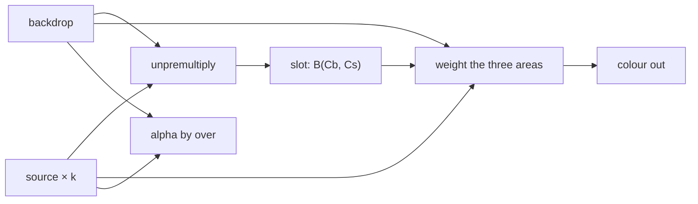

# Chapter 4 · A Slot in the Formula

*Keep the invariant skeleton fixed and let variation in at exactly one place.*

**★** A good form among several; the Variations section names the others.

## Intent

When a family of behaviours shares most of a computation, write the shared part once as a fixed skeleton with one
hole, and let each variant fill only the hole. Choose where the hole goes so that the properties every variant must
keep live in the skeleton, where no variant can reach them.

## Also known as

Template Method; Strategy; hook; plug-in point; higher-order function.

## Motivation

A layer in an image editor has a **blend mode**: normal, multiply, screen, overlay and a dozen more. The mode decides
what colour the layer gives where it lies over the **backdrop** (the picture already composited below it). Pixels also
carry **alpha**, the fraction of the pixel the layer covers, and editors store colour **premultiplied**: each channel
already multiplied by alpha, which makes compositing and blurring cheaper and correct at soft edges.

The naive design writes one compositor per mode. Each must handle alpha, the layer's opacity, its mask, premultiplied
storage, and the edge where the layer lies over nothing. Four things go wrong.

1. **Coverage drifts per mode.** A multiply compositor written as "backdrop × source" on whole pixels also multiplies
   where the backdrop is transparent, and changes alpha. Each compositor gets coverage right or wrong on its own.
2. **Variants see the wrong numbers.** Overlay chooses its branch by whether the backdrop is below 0.5. Given
   premultiplied colour, a half-transparent white pixel arrives as 0.5 and takes the dark branch.
3. **A fix must be made sixteen times.** When opacity 1 must give the blended colour exactly, not a rounded copy, the
   change goes into every compositor, and one is missed.
4. **New structure multiplies the copies.** Groups arrive: a group's result is composited like a layer, in either of
   two ways. Every compositor is copied again.

Other domains share the shape. A sorting routine is the same for every ordering; only the comparison differs. A
numerical integrator steps the same way for every equation; only the right-hand side `f(t, y)` differs. A web
framework handles every request the same way, routing, sessions, errors, and differs only in the handler.

## Problem

**Where should the variable part of a computation go, so that each variant is small and none of them can break the
properties all of them must keep?**

## Forces

- **Small variants against expressive ones.** A narrow hole keeps each variant to one line; some variants need more
  (hue and saturation modes need all three channels at once).
- **Invariants in the skeleton against freedom in the variant.** Coverage must follow the same rule in every mode; a
  hole that sees alpha lets a mode break it.
- **One stated input against each variant's natural space.** The hole must receive values in one known form (straight
  colour, linear light); a variant may be most natural in another (luminosity is about lightness).
- **A call in the inner loop against specialised code.** A function per pixel per layer costs something; sixteen
  hand-specialised loops cost more to keep correct.
- **A fixed skeleton against later needs.** Masks, groups and isolation came after the first blend modes; a skeleton
  that cannot take them is rewritten.
- **Familiar results against the right arithmetic.** Users know multiply from programs that compute on display-encoded
  numbers; multiply in linear light is physically sounder and looks heavier.

## Solution

**Therefore: write the computation once as a fixed formula with exactly one hole: a small pure function with a stated
signature and a stated input space. Put the hole where the variation truly lives and away from the invariants. For
compositing, the hole is the blend function B(backdrop, source) of straight colours, and it is used only for the part
of the pixel where source and backdrop overlap, inside an over operator that alone computes coverage, opacity and
mask. Make the skeleton exact at its ends (amount 0 gives the backdrop, amount 1 gives the blend), so every variant
inherits those laws. A new variant is one new function; nothing else changes.**

## Applicability

Use it when:

- many variants share most of a computation and differ in one identifiable step;
- there are invariants every variant must keep (coverage, termination, stability, units);
- variants will be added over time, by other people.

Do not use it when:

- there are two variants and no third in sight; write both;
- the variants differ in structure, not in one step (a bubble sort and a merge sort share no useful skeleton);
- the hole would need so many inputs that it is the whole computation; then there are two programs, not one.

## Structure

| Participant | Responsibility |
| --- | --- |
| **Skeleton** | the over operator: coverage, opacity × mask, premultiplied storage, the three areas of a pixel |
| **Slot** | `B(backdrop, source) → colour`, pure, on straight colours in one stated space |
| **Variants** | the sixteen modes: twelve per-channel functions, four whole-colour functions |
| **Adapter** | puts values into the slot's space (unpremultiply; convert to the working encoding) and back |
| **Amount** | `k = opacity × mask coverage`, computed by the skeleton, never seen by the slot |
| **Callers** | layers, and groups composited as one layer |

## Collaborations

1. A layer arrives with its source, mode, opacity and mask.
2. The skeleton computes `k` from opacity and the mask's coverage ([Chapter 3](03-closed-algebra-of-small-parts.md)).
3. The adapter turns backdrop and source into straight colours in the slot's space.
4. The slot computes `B(backdrop, source)`.
5. The skeleton weights the three areas of the pixel, computes alpha by over, and stores the result premultiplied.



Read it from left to right and notice what does not pass through the slot: alpha goes straight from the inputs to
"alpha by over", and the weights belong to the skeleton. A mode can only change the colour of the overlap.

## Sketch

```text
-- the slot: a pure function of two straight colours in one stated space
type Blend = (backdrop: Colour, source: Colour) → Colour

-- variants: per-channel modes are one scalar function each, lifted to colours
perChannel(f) → Blend: (b, s) → (f(b.r, s.r), f(b.g, s.g), f(b.b, s.b))
modes ← {
  normal:     perChannel((b, s) → s),
  multiply:   perChannel((b, s) → b · s),
  screen:     perChannel((b, s) → b + s − b · s),
  overlay:    perChannel((b, s) → if b ≤ 0.5: 2·b·s else 1 − 2·(1 − b)·(1 − s)),
  difference: perChannel((b, s) → |b − s|),
  luminosity: (b, s) → withLightness(b, lightness(s)),   -- whole-colour: needs all channels
  …                                                       -- sixteen in all
}

-- the skeleton: over in premultiplied colour, the slot only in the overlap term
value Pixel: c (premultiplied colour), α

composite(back: Pixel, src: Pixel, k, B: Blend) → Pixel:
  αs ← src.α · k                                -- opacity and mask enter here, never in B
  if αs = 0: return back
  Cs ← src.c / src.α
  Cb ← if back.α > 0: back.c / back.α else 0    -- the slot sees straight colour
  c ← αs·(1 − back.α)·Cs  +  αs·back.α·B(Cb, Cs)  +  (1 − αs)·back.c
  α ← αs + (1 − αs)·back.α                      -- coverage: the same for every mode
  return Pixel(c, α)

-- with an opaque backdrop the skeleton reduces to a mix, exact at both ends
mix(back, top, k, B) → Colour:
  if k = 0: return back
  if k = 1: return B(back, top)
  return back + k · (B(back, top) − back)

-- groups: where the backdrop enters is the only difference
passThrough(back, children, k)  = mix(back, children(back), k, modes.normal)
isolated(back, children, k, B)  = composite(back, children(transparent), k, B)

-- in use
out ← composite(below, layer.pixels, k: layer.opacity · mask.at(p), B: modes[layer.mode])
```

## Implementation notes

1. **The slot sees straight colour.** Editor lab, the teaching editor, keeps buffers premultiplied and divides the
   backdrop by its alpha before calling its blend function, then weights the result back. A mode written against
   premultiplied numbers would choose wrong branches at soft edges.
2. **Coverage never passes through the slot.** In the W3C formula (Compositing and Blending Level 1) the alpha
   result is the same for every mode, and Editor lab computes it in one line after the colour. Editor lab's textbook
   puts it plainly: a blend mode changes colour, never coverage.
3. **Opacity and mask enter outside the slot.** Both programs compute `k` as opacity times mask coverage in the
   skeleton. No mode has ever had to learn what a mask is, and the mask algebra of [Chapter
   3](03-closed-algebra-of-small-parts.md) grew without touching a mode.
4. **Make the skeleton exact at its ends, and test it.** chromobench's mix returns the backdrop at `k = 0` and the
   blend itself at `k = 1`, not `back + 1·(B − back)`, which rounds; the GPU shader does the same. A test checks both
   ends for all sixteen modes. The compiler goes further: a layer at amount 1, without a mask, in normal mode makes no
   mix node at all.
5. **The slot's input space is part of its contract.** chromobench evaluates the per-channel modes in linear RGB and
   defines hue, saturation, colour and luminosity in OkLCh, a lightness–chroma–hue space; a layer computed in another
   encoding is converted for the blend and back. The engines refuse a mode other than normal on values outside these
   working spaces; the compiler converts first.
   The choice has a cost users can see: in the project's golden stacks, the stack of blend layers was the darkest
   (display mean 0.25 against 0.58 for the tone stack), because multiply in linear light acts like a filter.
6. **Give the slot the whole colour, and lift the simple cases.** A slot typed per channel cannot hold the four
   non-separable modes. The slot takes colours; a helper lifts a scalar function into one. chromobench's OkLCh
   definitions skip W3C's ClipColor step, so luminosity can leave the gamut; the output stage compresses it. That is
   a recorded debt.
7. **One skeleton, not three.** Editor lab has one blend function, but its skeleton is written three times: the full
   three-term formula for image and fill layers, and two mixes for adjustments (one for neighbourhood filters such as
   blur, one for per-pixel adjustments). A fix to one does not reach the others. chromobench has one mix, used for
   layers and groups alike.
8. **The slot is written twice; keep the copies honest.** chromobench's modes exist in TypeScript for the 64-bit
   reference engine and in WGSL for the GPU, "branch for branch". One WGSL file holds the modes for both GPU kernels,
   so there is one definition per engine. Parity on a software GPU came within 5.3 × 10⁻⁶ for linear RGB and the
   whole-colour modes, and within 1.1 × 10⁻⁴ for per-channel modes on OkLab layers. See [Chapter
   1](01-one-contract-several-engines.md).
9. **A pure slot lets the skeleton fuse.** Because `B` reads one pixel and has no state, an unmasked per-pixel layer
   in any mode runs inside chromobench's fused pointwise kernel, with no extra pass or texture; a masked one costs one
   combine pass. See the parent volume's [Barrier-Cut Fusion](../07-barrier-cut-fusion.md).
10. **Groups: decide where the backdrop enters.** Editor lab's pass-through group mixes towards its children's result
    by `k`; its isolated group composites the children on transparent and blends the result as one layer. The two
    agree when every child is a normal image layer, because over is associative. chromobench has no pixel layers, so
    "on transparent" means nothing there: its isolated group applies the children to the backdrop and blends their
    result with the group's mode. An isolated group in normal mode then equals a pass-through group, and a test
    checks that they compile to the same node.
11. **Keep the set of variants principled.** Editor lab offers eighteen modes, the W3C sixteen plus add and subtract.
    chromobench took the sixteen only, from one list that the document validator, the operation catalogue, the GPU's
    mode codes and the scripting layer all read ([Chapter 2](02-one-declaration-many-readers.md)). A cheap slot is
    a reason to choose variants with care, not to add them freely.

## Variations

- **Strategy object.** The slot is an object with several methods (blend, plus a name and a cost). More room per
  variant; more ways for a variant to reach the invariants.
- **Several hooks** (Template Method with "before" and "after" steps). Flexible; each extra hook is one more place a
  variant can break the skeleton.
- **Vary the areas, not the colour.** Porter and Duff's twelve operators (over, in, out, atop, xor, …) put the hole in
  the weights of the areas of a pixel. The W3C specification keeps both holes: a compositing operator and a blend mode.
- **Specialise at build time.** Generate one loop or shader per mode from the same skeleton. Fastest, with a compile
  per variant; the skeleton is still written once.

## Consequences

- \+ Each variant is a few lines with no knowledge of alpha, masks, groups or storage.
- \+ Invariants (coverage, exact ends, encodings) are written and tested once, and hold for every variant.
- \+ New structure (masks, groups) is added to the skeleton once and reaches every mode. That is what makes the code
  habitable: a newcomer adds a mode by reading one table, without first understanding compositing.
- − The slot's signature is a commitment; a variant that needs more input forces a change to every caller.
- − The input space is a hidden choice with visible results (heavy multiply).
- − A function call in the inner loop costs time unless the skeleton is fused or specialised.
- − A cheap slot invites variants nobody needs.

## Known uses

- **W3C Compositing and Blending Level 1**: the separable blend function `B(Cb, Cs)` inside the general compositing
  formula; CSS `mix-blend-mode` and SVG use it.
- **Porter and Duff**, "Compositing Digital Images" (SIGGRAPH 1984): over and its eleven siblings on premultiplied
  colour.
- **Cairo, Skia and Core Graphics**: blend modes (multiply, screen, …) offered beside the Porter–Duff operators in one
  compositing path.
- **Photoshop and GIMP** layer modes; Photoshop's pass-through groups.
- **Comparator arguments to sort** (C's `qsort`, Java's `Comparator`).
- **ODE solvers** that take the right-hand side `f(t, y)` as an argument (MATLAB's `ode45`, SciPy's `solve_ivp`).
- **`fold` and `reduce`** with a combining function.

## Related chapters

- [Chapter 3 · Closed Algebra of Small Parts](03-closed-algebra-of-small-parts.md) supplies the mask whose coverage
  becomes `k`.
- [Chapter 1 · One Contract, Several Engines](01-one-contract-several-engines.md): the slot in two engines, in parity.
- [Chapter 2 · One Declaration, Many Readers](02-one-declaration-many-readers.md): the list of modes declared once.
- [Chapter 5 · Solve Once, Apply Many](05-solve-once-apply-many.md): keep work that does not change per pixel out of
  the slot.
- Parent volume: [Barrier-Cut Fusion](../07-barrier-cut-fusion.md).
- GoF: **Template Method** (the skeleton), **Strategy** (the variant); this chapter is about where the hole goes.

## Exercises

1. **Sorting.** A team has one sort function per ordering (by name, by date, by size). Rewrite it with a comparator
   slot. Which properties (termination, stability) stay in the skeleton? What happens if a comparator is inconsistent
   (`a < b` and `b < a`)?
2. **Prices.** A shop computes a price as base price, discount, tax and rounding. Discounts vary. Where must the slot
   go so that tax and rounding are right for every discount? Write two placements and find the one that breaks.
3. **Overlay by hand.** Take a backdrop of white at alpha 0.5 and a grey source at 0.3, alpha 1. Compute overlay once
   on premultiplied numbers and once through the sketch's `composite`. Which branch does each take?
4. **Your own code.** Find a function that switches on a "mode" flag in more than one place. Which forces from this
   chapter does it show? Where would the one slot go?
