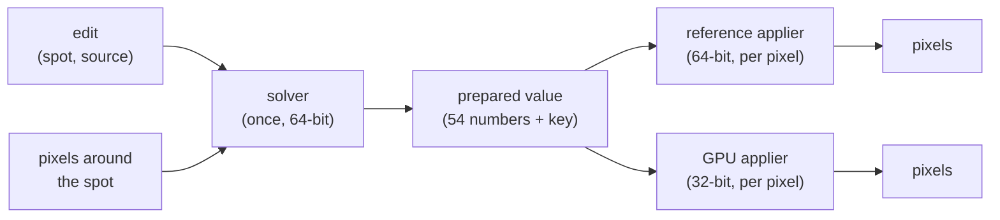

# Chapter 5 · Solve Once, Apply Many

*Split a computation by how often its inputs change; do the rare, hard part once and carefully, and leave the hot
loop a simple formula.*

**★★** We believe any good solution to this problem has this shape.

## Intent

Keep the innermost loop small, fast and the same everywhere it runs. Compute the part that depends on rarely
changing inputs once, when they change, and hand the loop a small prepared value to apply to every element.

## Also known as

Hoisting; loop-invariant code motion; partial evaluation; staging; precomputation; plan and execute.

## Motivation

In the running example a user removes a dust spot with the **heal** tool. Heal copies a disc of pixels from a
clean area (the source) onto the spot (the target), then corrects the copy so that its edge, the seam, matches the
brightness and colour around the target. The correction is a smooth function over the disc. It is computed from
the pixels on rings just outside the two discs, so it is a property of the spot, not of any pixel inside it.

A first version computes everything for each pixel. Three things go wrong.

1. **The same answer is computed thousands of times.** chromobench reads the rings at 32 angles and three radii,
   in both discs and three colour channels: 576 samples. A spot of radius 40 pixels has about 5,000 pixels, so a
   per-pixel solve computes 5,000 copies of one answer.
2. **Two engines disagree.** The editor has a slow reference engine that computes in 64-bit floating point and a
   fast engine on the GPU (the graphics processor) that computes in 32-bit. If each solves for itself, the two
   correction functions differ slightly, and because the correction multiplies the copied pixels through an
   exponential, small differences grow.
3. **Hard code lands in the hardest place.** The solve needs loops over rings, sums over frequencies and care near
   zero. Written as a shader (the small program a GPU runs once per pixel), it is hard to test and hard to read.

Other systems have the same shape. A database that plans a query for every row it scans does the rare work at
the frequent rate; prepared statements stop that. A game engine computes each bone of a skeleton as a matrix once
per frame and applies it to thousands of vertices, not once per vertex.

## Problem

**How do you keep a per-element loop simple and fast when part of what it computes depends only on inputs that
change far less often than the elements?**

## Forces

- **Speed against simplicity.** Moving work out of the loop makes it faster, and adds a stage, a prepared value
  and a place to keep it.
- **Precision against throughput.** The rare part can afford 64-bit arithmetic and a careful algorithm; the loop
  runs millions of times, often on a processor that is fast only in 32-bit.
- **One implementation against several engines.** A solver that runs once can be shared by every engine; a loop
  that runs on a GPU and on a CPU must be written twice.
- **Reuse against freshness.** A prepared value saves work only while its inputs stay the same; a value kept after
  they change is a wrong answer that looks right.
- **Early binding against late binding.** Fix a value too late and every element repeats the work; fix it too
  early and every change of the value rebuilds something large, such as a compiled program.
- **Locality against transfer.** The rare part often runs on another processor; getting data there costs time.

## Solution

**Therefore: list the binding times of the computation, the moments at which each of its inputs can change, from
slowest to fastest (for example: per installation, per document, per edit, per frame, per element), and split the
work along them. Compute each part at the slowest rate its inputs allow, in one plain, careful function that every
implementation shares, and have it return a small prepared value with a key made from everything it read. Pass that
value to the loop as data, never baked into code, so that a new value never forces the loop to be rebuilt. Keep the
loop a fixed formula that applies the prepared value to each element. When the loop produces data instead of
consuming it, turn the split around: combine near the data into a few partial results, and finish carefully where
precision is cheap.**

## Applicability

Use it when:

- an inner loop runs many times more often than some of its inputs change;
- two or more implementations must agree, and the complicated part is not per element;
- the loop runs on a constrained processor (a GPU, a database's row executor).

Do not use it when:

- the prepared value would be as large as the data, one entry per element; that is a cache (Chapter 9);
- the inputs change as often as the loop runs, so nothing is invariant;
- moving the rare part costs more than it saves; measure the transfer;
- the loop's work is already trivial.

In a web service, the solver is the query planner, the prepared value is the plan, the applier is the executor that
runs per row, and the key is the query text with its schema version.

## Structure

| Participant | Responsibility |
| --- | --- |
| **Binding-time list** | the times at which each input can change, and which part of the work belongs to each |
| **Solver** | the rare part: reads the slow inputs, runs a careful algorithm, returns a prepared value |
| **Prepared value** | small and plain (numbers, a matrix, a table), with a key made from everything the solver read |
| **Store** | keeps prepared values by key for as long as their binding time lasts |
| **Applier** | the loop: a fixed formula applying the prepared value to each element; one per implementation |
| **Finisher** | the reverse direction: combines partial results from the loop with care |

## Collaborations

1. A change arrives (an edit, a new frame); the keys of the prepared values that depend on it change.
2. For each key, the store returns the prepared value, or calls the solver and keeps its result.
3. Each implementation passes the prepared value to its applier as data; the applier runs over every element.
4. For reductions, the applier writes one partial result per block, and the finisher combines them.



Read it left to right: per-edit inputs meet once in the solver; right of the prepared value everything runs per
pixel, and only there do the engines differ.

## Sketch

```text
-- binding times, slowest first; compute each value at the slowest time at which all its inputs are known
--   installation  per install or data update   (constant tables)
--   document      per opened document
--   edit          per change to the document   (a spot's position)
--   frame         per screen update            (the visible region)
--   element       per pixel, row or vertex

value Stage: name, version,
             solve(slowInputs) → payload,               -- rare, careful, may be slow
             formula(payload, element) → result         -- per element, fixed, cheap
value Prepared: key, payload                            -- payload is data, never code

store: map from key to Prepared

-- the solver side: shared by every implementation
prepare(stage, slowInputs) → Prepared:
  key ← hash(stage.name, stage.version, slowInputs)    -- everything solve reads; for large inputs, their hashes
  if key not in store: store[key] ← Prepared(key, stage.solve(slowInputs))
  return store[key]

-- the applier side: one per implementation, same formula
apply(stage, prepared, elements) → results:
  for each e in elements: results[e] ← stage.formula(prepared.payload, e)

-- the reverse direction: many elements in, a few numbers out
total(elements, blockSize) → number:
  partials ← for each block of blockSize elements: plain sum, fast and low precision
  return pairwiseSum(partials)                         -- careful, high precision, few numbers

pairwiseSum(xs) → number:                              -- worst-case rounding error grows with log |xs|
  if |xs| ≤ 8: return xs[0] + … + xs[|xs| − 1]
  return pairwiseSum(first half of xs) + pairwiseSum(second half of xs)

-- in use: a seam correction for one repaired spot
seam ← prepare(seamStage, (spot, pixels on the rings around target and source))   -- once per edit
for engine in (reference, fast):
  engine.apply(seamStage, seam, pixels inside the spot)                         -- once per pixel
```

## Implementation notes

1. **Write the binding times into the design.** chromobench's editing design (still a proposal) names four times
   at which code may run: *build* (once, while a value such as a layout is built), *compile* (per frame, while the
   document is turned into a graph of operations), *interaction* (per state change or gesture) and *pixel*, where
   no user-written function may run at all: every per-pixel computation is a catalogued operation with a reference
   and a GPU implementation. A named time lets a reviewer ask "why is this computed here?"
2. **Share the solver, duplicate only the formula.** chromobench's `healCoefficients` runs in 64-bit in the shared
   core package. The GPU engine copies small windows around the spot (radius plus 4 pixels) from GPU memory back to
   main memory, calls the same function, and sends the result to the GPU. In the code's words, "both engines share
   every number that is not per pixel"; its film stages share their helpers the same way. Agreement between the
   engines then depends on the per-pixel formula alone.
3. **Prefer a closed form in the solver.** The seam correction uses the exact solution on a disc, a sum of sines
   and cosines up to frequency 8 (54 numbers per spot), not an iteration, so it cannot depend on tiles, order or
   engine.
4. **Fold, do not only hoist.** chromobench models how film responds to light as three weighted sums over 81
   wavelengths, 243 multiply-adds per pixel. The light's spectrum depends only on the colour's hue and saturation,
   so the sums are folded into a per-film table over those two coordinates; per pixel it is now one lookup times
   the brightness. The table is built once per film per session; the parent volume's
   [Tabulated Preview, Exact Export](../06-tabulated-preview-exact-export.md) treats its interpolation error.
5. **Key the prepared value by everything it read.** chromobench's table keys hash the arrays the builder actually
   reads, so "a data-pack update changes the key without anyone bumping a version". A key that leaves out an input
   is a stale value waiting to happen.
6. **Pass values as data, not as code.** Editor lab (the teaching editor) wrote layer parameters into its GPU
   program as constants, so every slider movement compiled a new program, 79 ms each. Its textbook's fix passes
   them in a parameter block, compiling once per combination of layer *kinds*; chromobench passes each GPU pass's
   numbers in a 128-byte block. Code is bound per structure, values per edit.
7. **Memoise for the binding time you named, not a shorter one.** A debt in chromobench: heal coefficients are
   kept only for one call of the GPU heal step. The next render, or another export tile the spot touches, copies
   the windows back (waiting for the GPU) and solves again: bound per call instead of per edit. The fix is to key
   the coefficients by the spot and the content of the windows it read.
8. **Turn it around for reductions.** For a mean over a box, chromobench's GPU sums each block of 16 × 16 pixels in
   32-bit and writes one partial sum per block; the host adds the partials pairwise in 64-bit. The device does the
   many, the host does the few, carefully.
9. **State the error of every table.** Editor lab tabulates the sRGB curve (the standard curve between stored
   pixel values and light intensity) in 4,097 entries at start-up and reads the nearest one; its curves layer
   rebuilds a 1,024-entry table only when its parameters change. (Its exposure layer still calls a power function
   per pixel: a per-edit table not made.) A nearest-entry lookup is off by up to half a step times the slope.
10. **Keep the unhoisted version as the oracle** (Chapter 1): comparing it with the fast one on random inputs
    catches a key that misses an input.

## Variations

- **Tabulation.** The prepared value is a table of the whole function over a grid of inputs: one lookup for any
  amount of arithmetic, at the price of memory and a stated, tested error.
- **Specialisation.** The prepared value is code (a compiled regular expression, a generated GPU program): the
  fastest loop, but each new value costs a compile. Specialise on structure, pass values as data.
- **Memoisation on first use.** No explicit stage: the store solves on a miss. Easy to retrofit; the first element
  after a change pays.
- **Solve where the data is.** The GPU solves each spot itself: no copying, no waiting, but a second solver in
  32-bit that needs its own agreement test.

## Consequences

- \+ The hot loop is short, fixed and easy to port; it is the only code that differs between implementations.
- \+ The hard part runs once, in the most comfortable place, at whatever precision it needs.
- \+ New stages grow piecemeal: a new operation adds a solver and a formula without touching the others.
- − More parts: a prepared value, its key, a store, and a data layout both sides must agree on (chromobench packs
  22 groups of four numbers per spot; Chapter 2).
- − An incomplete key gives a stale answer that looks correct.
- − Crossing between processors can cost more than it saves.

What makes the result habitable is that each piece of code runs at one rate and says so: a reader who opens the
loop finds only per-element work, and one who opens the solver finds everything that happens per edit.

## Known uses

- **Compilers** such as GCC and LLVM move loop-invariant computations out of loops and fold constants.
- **Partial evaluation** specialises a program to the inputs known early (Futamura, 1971; Jones, Gomard and
  Sestoft, *Partial Evaluation and Automatic Program Generation*, 1993).
- **SQL prepared statements** parse and plan once and execute with new parameters.
- **FFTW** plans a Fourier transform for a given size once and executes the plan many times.
- **Skeletal animation** computes one matrix per bone per frame and applies it per vertex on the GPU.
- **Regular-expression libraries** compile a pattern once (`re.compile` in Python).
- **NumPy** sums floating-point arrays with pairwise summation, the finishing step of note 8.
- **chromobench** (heal coefficients, film helpers, the folded film table, GPU sums) and **Editor lab** (sRGB and
  curve tables).

## Related chapters

- [Chapter 1 · One Contract, Several Engines](01-one-contract-several-engines.md): the shared solver keeps the
  engines' disagreement down to the per-pixel formula.
- [Chapter 2 · One Declaration, Many Readers](02-one-declaration-many-readers.md): declare the prepared value's
  layout once, for both sides.
- [Chapter 9 · Keep What Is Dear](09-keep-what-is-dear.md): where prepared values live, and which to drop.
- [Chapter 6 · Work in Small Slices](06-work-in-small-slices.md): hoist first, then slice what is left.
- Parent volume: [Tabulated Preview, Exact Export](../06-tabulated-preview-exact-export.md).
- GoF: **Flyweight** (the prepared value is shared intrinsic state; each element brings its extrinsic state).

## Exercises

1. An online shop prices each line of an order: it loads the tax rules for the customer's region, finds the rule
   for the product category, and applies it. Write down the binding time of each input (per deployment, per
   customer, per order, per line). Which work moves where, what is the prepared value, and what is its key?
2. Find a loop in your own code that recomputes something whose inputs do not change inside it. Name its binding
   time and the forces that kept it there. Then find a value fixed at start-up that users need to change later.
3. A function f on [0, 1] is replaced by a table of 4,096 steps read at the nearest entry. Where f's slope is
   12.92, what is the largest error, in units of 1/255? Write a short program that measures it for the sRGB curve
   (f(x) = 12.92·x for x ≤ 0.0031308, else 1.055·x^(1/2.4) − 0.055) and compare with your estimate.
4. Spots are applied in order, and each reads the image as the earlier spots left it. Design the key under which
   a spot's coefficients can be kept across renders (note 7). It must change when an earlier spot moves onto this
   spot's source, and must not change when a later spot moves. Test your design on three overlapping spots drawn on
   paper.
