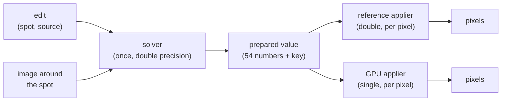

# Chapter 5 · Solve Once, Apply Many

*Split a computation by how often its inputs change; do the rare, hard part once and carefully, and leave the hot
loop a simple formula.*

**★★** We believe every good solution to this problem has this shape.

## Intent

Keep the innermost loop small, fast and the same everywhere it runs. Compute the part that depends only on rarely
changing inputs once, when they change, and hand the loop a small prepared value (coefficients, a matrix, a table)
that it applies to every element.

## Also known as

Hoisting; loop-invariant code motion; partial evaluation; staging; precomputation; plan and execute; prepare and
apply.

## Motivation

In the running example a user removes a dust spot with the **heal** tool. Heal copies a disc of pixels from a
clean source area onto the spot and then corrects the copy so that its edge (the seam) matches the brightness and
colour around the target. The correction is a smooth function over the disc, found from the pixels on rings just
outside the two discs: a property of the spot, not of any pixel inside it.

A first version computes everything for each pixel. Four things go wrong.

1. **The same answer is computed thousands of times.** chromobench samples the rings at 32 angles and three radii,
   in two images and three colour channels: 576 interpolated samples. A spot of radius 40 pixels has about 5,000
   pixels; solving per pixel computes 5,000 copies of one answer.
2. **Two engines disagree.** The editor has a slow double-precision reference engine and a fast GPU engine in
   single precision. If each solves for itself, they solve differently, and the correction enters the picture
   through an exponential, so small differences in it grow.
3. **Hard code lands in the hardest place.** The solve needs loops over rings, sums over harmonics and care near
   zero. Written as a GPU shader it is hard to test and hard to read.
4. **Binding too early fails too.** Editor lab (the teaching editor) went the other way in its GPU probe: it wrote
   each layer's parameters into the shader source as constants. Every slider movement became a new program to
   compile, 79 ms each. A value that changes per edit had been fixed at the time the program is built.

Other systems have the same shape. A database that parses and plans a query for every row it scans does the rare
work at the frequent rate; prepared statements exist to stop that. A game engine computes each bone's matrix once
per frame and applies it to thousands of vertices; computing it per vertex would be the naive version.

## Problem

**How do you keep a per-element loop simple and fast when part of what it computes depends only on inputs that
change far less often than the elements?**

## Forces

- **Speed against simplicity.** Moving work out of the loop makes it faster, and adds a stage, a prepared value
  and a place to keep it.
- **Precision against throughput.** The rare part can afford double precision and a careful algorithm; the loop
  runs millions of times, often on a processor that has only single precision.
- **One implementation against several engines.** A solver that runs once can be shared by every engine; a loop
  that runs on a GPU and on a CPU must be written twice.
- **Reuse against freshness.** A prepared value saves work only while its inputs stay the same; a value kept after
  they change is a wrong answer that looks right.
- **Early binding against late binding.** Fix a value too late and every element repeats it; fix it too early and
  every change of the value rebuilds something large, like a compiled program.
- **Locality against transfer.** The rare part often runs elsewhere (the host, another thread); getting data there
  costs time.

## Solution

**Therefore: write down the binding times of the computation, the moments at which each of its inputs can change
(once per installation, per document, per edit, per frame, per element), and split the work along them. Compute
each part at the slowest rate its inputs allow, in a plain, careful function that every engine shares, and let it
produce a small prepared value with a key made from everything it read. Pass that value to the loop as data, never
as code, so that a new value never forces the loop to be rebuilt. Keep the loop a fixed formula that only applies
the prepared value to the element. When the loop produces data instead of consuming it, turn the split around:
reduce near the data to a few partial results, and finish carefully where precision is cheap.**

## Applicability

Use it when:

- an inner loop runs many times more often than some of its inputs change;
- two or more engines must agree, and the part they disagree on most is the complicated, non-per-element part;
- the loop runs on a constrained processor (a GPU, a vector unit, a database's row executor);
- the rare part needs an algorithm (a solve, a transform) that would be awkward inside the loop.

Do not use it when:

- the prepared value would be as large as the data, one entry per element; that is a cache (Chapter 9), not a
  hoist;
- the inputs change as often as the loop runs, so nothing is invariant;
- moving the rare part costs more than it saves: a round trip from the GPU to the host to compute ten numbers that
  the GPU could compute itself in a microsecond is a loss; measure it;
- the loop's work is already trivial.

## Structure

| Participant | Responsibility |
| --- | --- |
| **Binding-time map** | names the times at which each input can change, and which part of the work belongs to each |
| **Solver** | the rare part: reads the slow inputs, runs a careful algorithm, returns a prepared value |
| **Prepared value** | small and plain (numbers, a matrix, a table), with a key made from everything the solver read |
| **Store** | keeps prepared values by key for as long as their binding time lasts |
| **Applier** | the loop: a fixed formula applying the prepared value to each element; one per engine |
| **Finisher** | the reverse direction: combines partial results from the loop with care |

## Collaborations

1. A change arrives (a new document, an edit, a new frame). The binding-time map says which prepared values it
   invalidates; their keys change.
2. For each needed key, the store returns the prepared value or calls the solver, which reads only slow inputs.
3. Each engine passes the prepared value to its applier as data (arguments, a uniform buffer, a table).
4. The applier runs the formula over every element.
5. For reductions, the applier writes one partial result per block, and the finisher combines them.



Read it from left to right: inputs that change per edit meet once in the solver; everything to the right of the
prepared value runs per pixel, and the two engines differ only there.

## Sketch

```text
-- binding times, from slowest to fastest
--   data      per installation or data update   (reference tables, model constants)
--   document  per opened document
--   edit      per change to the document        (a spot's position, a layer's parameters)
--   frame     per render                        (region, scale)
--   element   per pixel, per row, per vertex

value Prepared: key, payload                 -- small and plain; payload is data, not code

-- the solver: rare, careful, shared by every engine
solve(stage, slowInputs) → Prepared:
  key ← hash(stage.name, stage.version, slowInputs)   -- everything it reads, nothing it does not
  return store.get(key) or store.put(key, Prepared(key, stage.solve(slowInputs)))

-- the applier: one fixed formula per engine, applied per element
apply(stage, prepared, elements) → results:
  for each e in elements: results[e] ← stage.formula(prepared.payload, e)

-- the reverse direction: many elements in, a few numbers out
reduce(elements, blockSize) → number:
  partials ← for each block of blockSize elements: sum in fast, low precision near the data
  return pairwiseSum(partials)               -- careful, high precision, where it is cheap

pairwiseSum(xs) → number:
  if |xs| ≤ 8: return plain sum of xs
  return pairwiseSum(first half of xs) + pairwiseSum(second half of xs)

-- in use: a seam correction for one repaired spot
seam ← solve(seamStage, (spot, pixels on rings around target and source))   -- once per edit
for engine in (reference, fast):
  engine.apply(seamStage, seam, pixels inside spot)   -- once per pixel, the same numbers
```

## Implementation notes

1. **Write the binding times down, in the design.** chromobench's editing design (CHB-035, §31, status
   "proposed") fixes four: *build* (once, while a value is built), *compile* (per frame, while the document is
   compiled into an operation graph), *interaction* (per state change or gesture) and *pixel*. At pixel time no
   user-supplied function may run: every per-pixel computation is a catalogued operation with a reference and a GPU
   implementation. (Editor lab's "code" layers run user code per pixel, which that rule excludes.) Named times let
   a reviewer ask "why is this here?"
2. **Share the solver, duplicate only the formula.** chromobench's `healCoefficients` lives in the core package
   and runs in double precision. The GPU engine renders small windows around the spot (radius plus 4 pixels),
   reads them back, calls the same function, and uploads the result. In the source's own words, "both engines share
   every number that is not per pixel". The film stages work the same way: helpers named `*At(ctx, args)` compute
   each film binding (camera matrix, film table, curves) once, and both engines' adapters call them. Parity
   between the engines then depends on the per-pixel formula alone.
3. **Prefer a closed form in the solver.** Instead of an iterative solve over the disc, the seam correction uses
   the disc's exact solution as a Fourier series (harmonics 0 to 8, damped against ringing): 18 coefficients per
   channel, 54 numbers per spot. Being closed form, it does not depend on tiles, evaluation order or engine.
4. **Fold, do not only hoist.** A film responds to a light spectrum through three inner products over 81
   wavelengths: 243 multiply-adds per pixel. The spectrum depends only on the colour's chromaticity, so chromobench
   folds the products into a per-film table over two coordinates. Per pixel it is now
   `raw = brightness · table(u, v)`, with the gamut compression baked in. The table is built once per film per
   session, and the interpolation error it introduces is handled by the parent volume's
   [Tabulated Preview, Exact Export](../06-tabulated-preview-exact-export.md).
5. **Key the prepared value by everything it read.** chromobench's table keys hash the arrays the builder actually
   consumes, so "a data-pack update changes the key without anyone bumping a version". The table's size and domain
   are always in the key. A key that leaves out an input is a stale value waiting to happen.
6. **Pass values as data, not as code.** Editor lab's probe compiled a shader per parameter change (79 ms) because
   the parameters were constants in the source; its textbook's fix is a uniform buffer, so the shader is compiled
   once per combination of layer *kinds*. chromobench's film passes pack each pass's matrix, scales and table sizes
   into a 128-byte uniform block; the pipeline is chosen by entry point alone. Code is bound per structure, values
   per edit.
7. **Memoise for the binding time you named, not a shorter one.** This is a debt in chromobench. The heal
   coefficients are memoised only for one call of the GPU heal step. The next render of the same spots, or another
   export tile that the same spot touches, reads the windows back again and solves again. The answer is correct;
   the solve is bound per call instead of per edit, and each solve pays a readback, which waits for the GPU to
   finish. The fix is to key the coefficients by the spot and the content of the windows it read, and keep them.
8. **Turn it around for reductions.** chromobench's measurements (mean, minimum, maximum in a box) sum each
   16 × 16 block of pixels on the GPU in single precision, write one partial per block, and sum the partials on the
   host pairwise in double precision; the kernel's comment says this keeps the single-precision error "near log2(n)
   roundings". The device does the many; the host does the few, carefully.
9. **Tables for curves and transfer functions, with a stated error.** Editor lab builds the sRGB transfer (the
   curve between stored values and linear light) as two tables of 4,097 entries when the engine loads, and reads
   the nearest entry without interpolation. Its curves layer has a `prep` hook: a 1,024-entry table rebuilt only
   when the layer's parameters change. Its exposure layer still calls a power function per pixel when gamma is not
   1: a per-edit table that was not made. State the worst error of any lookup (for nearest entry, half a step times
   the curve's slope).
10. **Keep the unhoisted version as the oracle.** The slow per-element version is the reference for the fast one
    (Chapter 1); comparing them on random inputs catches a key that misses an input.

## Variations

- **Tabulation.** The prepared value is a table of the whole function over a grid of inputs, not the coefficients
  of one instance. One lookup replaces any amount of arithmetic; the price is memory and an interpolation error
  that must be stated and tested.
- **Specialisation.** The prepared value is code: a shader, a query plan, a compiled regular expression,
  generated for the slow inputs. The loop is as fast as it can be; each new value costs a compile. Specialise on
  structure (which kinds of steps), pass values as data.
- **Memoisation on first use.** No explicit stage: the loop asks for the prepared value by key and the store solves
  on a miss. Simple to add to existing code; the first element after a change pays for the solve.
- **Solve on the device.** One GPU workgroup solves per spot, and the result never leaves the device. No readback
  and no stall; the solver is now written twice and runs in single precision, so it needs its own parity test.

## Consequences

- \+ The hot loop is short, fixed and easy to port; it is the only code that differs between engines.
- \+ The hard part runs once, in the most comfortable place, at whatever precision it needs.
- \+ Binding times become part of the design, so a reviewer can see why a value is computed where it is.
- \+ New stages grow piecemeal: a new operation adds a solver and a formula without touching the others.
- − There are more parts: a prepared value, its key, a store, and an interface between solver and loop whose
  layout both sides must agree on (chromobench packs 22 four-number records per spot; Chapter 2).
- − An incomplete key gives a stale answer that looks correct.
- − Crossing between processors has a cost that can exceed the saving.

What makes the result habitable is that each piece of code runs at one rate and says so: a reader who opens the
loop finds only per-element work, and one who opens the solver finds everything that happens per edit.

## Known uses

- **Compilers** such as GCC and LLVM move loop-invariant computations out of loops and fold constants.
- **Partial evaluation** specialises a program to the inputs known early; Futamura's projections (1971) and Jones,
  Gomard and Sestoft's *Partial Evaluation and Automatic Program Generation* (1993) are the classic sources.
  Multi-stage languages such as MetaML make the stages explicit.
- **SQL prepared statements** parse and plan once and execute many times with new parameters.
- **FFTW** separates planning a transform for a given size from executing it, and recommends reusing plans.
- **Skeletal animation** computes one matrix per bone per frame and applies it per vertex in the vertex shader.
- **Regular-expression libraries** compile a pattern once into a matcher (`re.compile` in Python).
- **NumPy** sums floating-point arrays with pairwise summation, the finishing step of note 8.
- **chromobench** (heal and clone coefficients, film bindings, the folded film table, device reductions) and
  **Editor lab** (sRGB and curve tables).

## Related chapters

- [Chapter 1 · One Contract, Several Engines](01-one-contract-several-engines.md): the shared solver is what keeps
  the engines' disagreement down to the per-pixel formula.
- [Chapter 2 · One Declaration, Many Readers](02-one-declaration-many-readers.md): declare the prepared value's
  layout once, for the host and the shader.
- [Chapter 9 · Keep What Is Dear](09-keep-what-is-dear.md): where prepared values live, and which to drop.
- [Chapter 6 · Work in Small Slices](06-work-in-small-slices.md): hoist first, then slice what is left.
- Parent volume: [Tabulated Preview, Exact Export](../06-tabulated-preview-exact-export.md) (tables with stated
  error) and [Barrier-Cut Fusion](../07-barrier-cut-fusion.md) (what the loop may fuse).
- GoF: **Flyweight** (shared intrinsic state, here the prepared value, and extrinsic state per element);
  **Interpreter** (specialisation turns an interpreted rule into a compiled one).

## Exercises

1. An online shop prices each line of an order: it loads the tax rules for the customer's region, finds the rule
   for the product category, and applies it. Write down the binding times of each input (per deployment, per
   customer, per order, per line). Which work moves where, what is the prepared value, and what is its key?
2. Find a loop in code you have written that recomputes something whose inputs do not change inside the loop.
   Name its binding time and the forces that kept it inside. Then find the opposite: a value fixed at start-up
   that users need to change while the program runs.
3. Editor lab's linear-to-sRGB table has 4,096 steps and reads the nearest entry. Estimate its worst error in
   8-bit levels near black, where the curve's slope is about 12.9. Is interpolation worth adding? What would you
   need to measure to decide?
4. Design the key under which chromobench could keep heal coefficients across renders (implementation note 7).
   Spots apply in order, and each reads the image as the earlier spots left it. What must the key include so that
   moving an earlier spot onto this one's source invalidates it, while moving a later spot, or changing an
   adjustment applied after the heal, does not?
