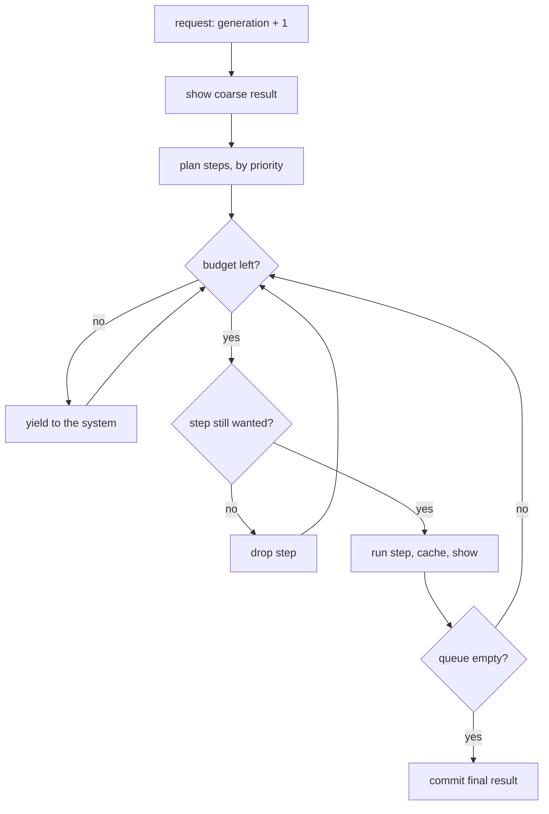

# Chapter 6 · Work in Small Slices

*Show a coarse answer at once; then do the rest in interruptible steps, most important first, each slice sized to
a time budget.*

**★** A good form among several; the Variations section names the others.

## Intent

Keep a program answering its user during work far longer than the user will wait: a cheap, coarse result at once,
then short steps run by importance for a bounded time, dropped the moment they are no longer wanted.

## Also known as

Time slicing; cooperative scheduling; progressive refinement; incremental rendering; coarse first.

## Motivation

In Editor lab (the teaching editor) computing the whole picture of its sample document, a *render*, takes about
280 ms. The screen shows a new picture 60 times a second, every 16.7 ms (one *frame*), so one render spans
seventeen frames. A first version renders the whole picture whenever a slider moves. Four things go wrong.

1. **Input freezes.** The browser runs the page's code and its input handling on one thread, and a running function
   cannot be interrupted. While the render runs, mouse events wait; the slider sticks, then jumps.
2. **Work is done for a state nobody wants.** The render started for the slider's first position runs to the end
   although the second position arrived long ago.
3. **The wrong part comes first.** The picture is computed in rows from the top left while the user looks at the
   middle.
4. **All or nothing.** Nothing appears until everything is done.

Editor lab's textbook measured the cure: dragging the lowest layer's slider, the median screen update took 259 ms
(95th percentile 287 ms) without a coarse preview, and 12.7 ms (28 ms) with one.

Other systems meet the same problem. A text editor spell-checking a 50,000-line file must not freeze typing, so
it checks visible lines first and restarts when the text changes. A garbage collector that stops the program for a
full collection causes visible pauses; incremental collectors work in small steps between the program's own.

## Problem

**How does a program stay responsive while it does work much longer than the interval in which it must answer?**

## Forces

- **Responsiveness against throughput.** Small steps let input in quickly, but each step has a fixed cost: Editor
  lab's slider drag was 22 % slower cut into 150 small squares of pixels than into 12 large ones.
- **An early answer against the right answer.** A coarse result is fast but wrong in detail, and for some
  operations (film grain, hard thresholds) wrong in kind.
- **Fixed steps against adaptive steps.** A fixed step never overruns by more than one step; a step sized from past
  timings pays its fixed costs rarely, but overruns when the work suddenly gets more expensive.
- **Fine cancellation against simple code.** Checking for cancellation inside a step needs code that can stop and
  resume; checking only between steps keeps steps simple but makes the longest step the delay.
- **Priority against completion.** Urgent work first is right; background work always postponed never finishes.

## Solution

**Therefore: when a request arrives, show a coarse result at once, computed by the same code on less data (a
smaller copy of the picture). Then cut the full work into steps, each shorter than the longest time you may keep
the user waiting, and queue them by priority: what the user is touching, then what the user can see, then what is
near it, then the rest, then saving. Run steps until the slice's time budget is spent, then give control back to
the system. Number every request with a generation; between steps, never inside one, drop any step whose
generation is no longer current, and keep the results of finished steps when they are named by their content. Size
steps from their measured cost. Make the final effect atomic: a batch job writes its result only when every step
has run, and a cancelled job leaves nothing behind.**

## Applicability

Use it when:

- the full work takes many times the interval in which the program must respond;
- the work divides into steps (blocks of pixels, rows, records, pipeline stages) that can run separately;
- new requests regularly make running work obsolete;
- a coarse or partial answer is useful to the person waiting.

Do not use it when:

- the work fits in the budget; Editor lab runs the whole refinement at once when it expects under 12 ms;
- the work can run on another thread and is only wanted whole; keep only the newest request (parent volume,
  [Latest-Wins Render Slots](../04-latest-wins-render-slots.md));
- readers must never see a mix of old and new pieces; build the new result aside and swap it in whole.

In a search engine's results page, the coarse result is the first ten hits, the steps are further index shards
searched in order of likely relevance, and a new query is a new generation.

## Structure

| Participant | Responsibility |
| --- | --- |
| **Request** | what is wanted, its generation and its priority |
| **Coarse producer** | the same computation on less data, fast enough to answer at once |
| **Planner** | cuts the full work into steps of a given size, ordered by priority |
| **Step** | one bounded unit of work with a content key; runs to completion once started |
| **Slice runner** | runs steps until the budget is spent, checks the generation between steps, then yields |
| **Step sizer** | chooses the next step size from measured cost |
| **Committer** | delivers the finished result; for batch work, commits atomically or aborts cleanly |

## Collaborations

1. A request increments the generation; the coarse producer shows a cheap version, and the planner replaces the
   queue with new steps, most important first.
2. On each frame or idle moment the slice runner runs steps while the budget lasts, dropping stale ones.
3. Each result is cached under its content key and shown; the sizer records how long the step took.
4. The runner yields. When the queue is empty, the committer marks the result final or commits the batch output.



The loop in the middle is one slice; it leaves at "yield" and returns next frame. A new request starts at the top.

## Sketch

```text
value Request: generation, target, priority
value Step: generation, key, priority, size     -- key names the step's result by its inputs

state: current ← 0, queue ← [], cache ← empty map, stepSize ← initial guess, recent ← []
-- plan(target, generation, size) → steps; run(step) → result; show(…) puts a result on screen

-- 1. a request: coarse now, the full plan at once
request(target, priority):
  current ← current + 1
  show(compute(target, detail: coarse))                    -- the same code on less data
  queue ← plan(target, current, stepSize) sorted by priority   -- replaces whatever was queued

-- 2. one slice, run once per frame or idle moment
slice(budgetMs):
  t0 ← now()
  while queue not empty and now() − t0 < budgetMs:
    step ← queue.takeFirst()
    if step.generation ≠ current: continue          -- stale: dropped between steps
    s0 ← now()
    result ← cache[step.key] if present, else run(step)   -- never interrupted once started
    cache[step.key] ← result                         -- kept: correct for its key whatever happens next
    show(step, result)
    stepSize ← nextSize(step.size, now() − s0, budgetMs)
  yieldToSystem()                                    -- let input and drawing run

-- 3. the step sizer: aim for the size that would have filled the budget
nextSize(lastSize, lastMs, budgetMs) → size:
  recent ← last three of (recent ++ [lastSize · budgetMs / lastMs])
  return median(recent)                              -- one noisy timing cannot move it

-- 4. batch work: the same loop with an atomic end
export(target, sink, cancelled):
  for band in plan(target, 0, stepSize):             -- a band: steps that together make whole output rows
    rows ← []
    for step in band:
      if cancelled(): sink.abort(); fail("cancelled")   -- abort deletes what was written
      rows ← rows ++ [run(step)]
    sink.write(rows)                                 -- memory stays bounded by one band
  sink.commit()

-- in use: a slider drag
on slider move: request(picture for the new value, priority: preview)
on each frame:  slice(budgetMs: 8)
```

## Implementation notes

1. **The longest step is the delay.** Editor lab computes its picture in square tiles of pixels. One tile through
   the whole layer stack took about 2.2 ms at 64 × 64 pixels, 7.1 ms at 128 and 24 ms at 256. A 256-pixel tile is
   longer than a frame on its own: with large steps, cut inside them or move the work to another thread.
2. **Coarse first, from the same code.** Editor lab draws its preview through the same engine from a copy at a
   quarter of the width and height, before the next frame; a preview over 12 ms makes the next copy smaller, one
   under 2.5 ms larger. Full detail starts 220 ms after the last change, at most 8 ms of tiles per frame, and
   arrived 287 ms after the drag ended in the measurement above.
3. **Coarse must really be coarse.** chromobench's slow, exact engine once needed about 4.2 s for a reduced view
   of a 1024 × 683 test image. One stage near the end (cropping and turning the picture) was not computed on the
   reduced grid of pixels, so the whole chain ran again at full size. Fixing that brought it to 1.37 s (a further
   speed-up gave 0.74 s), with identical output. A test now checks that no stage of a reduced render runs at full
   size.
4. **Cancel between steps, never inside one; keep what finished.** Editor lab replaces its queue on every edit.
   The queue holds tile positions, not states, and each step reads the current document, so no step computes an
   old state; finished tiles stay cached by content. chromobench's exact engine, on a background thread, pauses
   between stages so a cancel message can arrive; finished stages stay cached and "nothing partial is kept".
5. **Order by priority.** Editor lab computes visible tiles first, nearest the centre first. chromobench's render
   queue runs requests for the main view before background ones (thumbnails); a main-view request cancels a
   running background render, which is queued again.
6. **Fixed or adaptive steps.** GIMP sizes its drawing chunks to take 1/15 s each, from the median of the last
   three estimates (the sketch's `nextSize`). Simulated, when the cost per pixel quadruples, two chunks take 266 ms
   each before the estimate catches up; a fixed 128-pixel tile never overruns by more than 7 ms.
7. **Yield with the platform's hooks, and never poll.** chromobench runs idle tasks for at most 12 ms per idle
   period, and only those queued before it began, so a task that re-queues itself cannot loop forever. An earlier
   version re-queued its render loop from the idle hook while waiting for another thread: 10,000 runs a second.
8. **Batch work slices too, and ends atomically.** chromobench's export writes one band of tiles at a time. It
   checks for cancel before every tile; the tile in progress finishes, the partial file is deleted, and the error
   says how many tiles were done. Tile size comes from memory, not time: the largest tile whose working data fits
   in half the GPU's memory budget. For one large print that is 48 tiles of 512 pixels and about 1,650 ms in all
   (781 ms with 12 tiles of 1,024 before an exactness fix), so a cancel waits roughly 34 ms (my division).
9. **What chromobench lacks: a slicer for interactive renders.** Each render on screen is one unit: 500,000
   pixels while a slider moves, full display size when it stops. A code comment says that size is "adapted towards
   ≈30 ms", but no code adapts it. Nothing shows until a render completes, and the exact engine cancels only
   between stages, so its longest stage (about 1.5 s before the fix in note 3) was the delay. On the GPU engine
   this costs little (21 to 107 ms per render of a 4,000 × 2,674 print). On the exact engine a drag shows one
   picture per render; a progress rule (nothing shown for 250 ms: let the running render finish) keeps it from
   freezing. Slicing would mean tiles within stages, ordered by visibility, drawn as they finish.
10. **Measure what the user sees**, not how long the engine takes per update (Chapter 10).

## Variations

- **Offload instead of slice.** Run the work on another thread, so the interactive one only shows results;
  slicing then serves cancellation and order. chromobench's exact engine does this.
- **Adaptive chunks.** GIMP's rule above: few fixed costs, overruns after a change in cost.
- **Age-based cancellation.** darktable lets a run that started less than half its average run time ago finish,
  then restarts with the new settings: fewer wasted starts, a little more lag.
- **Progressive formats.** A progressive JPEG file holds a blurry full picture, then refinements: the data is
  sliced, no scheduler needed.

## Consequences

- \+ The program answers input within one step, whatever the total work.
- \+ The user sees something at once, and the most important part first.
- \+ Obsolete work stops cheaply; finished steps named by content are kept.
- \+ Batch jobs have bounded memory and leave nothing behind when cancelled.
- − Total time grows: each step has overhead, and full detail arrives later.
- − More states (coarse, refining, final), and the screen must say which one it shows.
- − A coarse result can mislead for operations that look different on less data.
- − Code must be cut at step boundaries, saving state between them.

What makes the result habitable is that the steps are ordinary functions with a key; the scheduling lives in one
loop beside them, so a new kind of work grows the program piecemeal by adding steps, not by rewriting the loop.

## Known uses

- **GIMP** draws its canvas in chunks sized to fill a fixed interval (`app/core/gimpchunkiterator.c`).
- **React**'s concurrent rendering yields to the browser between units of work, so urgent updates go first.
- **`requestIdleCallback`** (W3C) gives a page idle periods with a deadline.
- **Progressive JPEG** encodes an image as successive scans from coarse to fine.
- **darktable** runs a small preview pipeline beside the full one and cancels the full one between modules.
- **Incremental garbage collectors**, such as V8's, interleave marking with the program.
- **Editor lab** (coarse preview, 8 ms slices) and **chromobench** (tiled export with clean abort, stage-level
  cancellation, no slicer for interactive renders).

## Related chapters

- [Chapter 5 · Solve Once, Apply Many](05-solve-once-apply-many.md): make each step cheap before slicing it.
- [Chapter 7 · Estimate with Confidence](07-estimate-with-confidence.md): the step sizer is an estimator.
- [Chapter 8 · Count What You Own](08-count-what-you-own.md): memory, not time, set chromobench's export tiles.
- [Chapter 9 · Keep What Is Dear](09-keep-what-is-dear.md): finished steps live in a content-keyed cache.
- [Chapter 10 · Measure From the User's Clock](10-measure-from-the-users-clock.md): judge by what the user waits for.
- Parent volume: [Latest-Wins Render Slots](../04-latest-wins-render-slots.md).
- GoF: **Command** (a step as an object in a queue), **Iterator** (the planner hands out the next step),
  **Strategy** (fixed or adaptive sizing).

## Exercises

1. A text editor spell-checks a 50,000-line file. Design the steps, the priorities (visible lines first, then
   lines near the cursor) and the cancellation rule when the user types. What is the content key of a step's
   result, and which results survive an edit on line 10?
2. Find code you have written that runs for more than 50 ms on a thread that also handles input. Which forces kept
   it whole? Where are the natural step boundaries, and what state must survive between them?
3. Simulate `nextSize` from the sketch with a 66 ms budget and a model cost of 0.2 ms per step plus 30 ns per
   pixel, starting at 16,384 pixels. At step 10 the cost per pixel quadruples; at step 20 it returns. Print each
   step's time. How many steps overrun by more than 50 %? Then replace the median with the newest estimate alone.
4. chromobench's export takes about 34 ms per tile with 512-pixel tiles and about 20 ms per tile with 1,024-pixel
   tiles. What is the worst wait between pressing cancel and the export stopping? What decides the tile size, and
   how could cancelling be faster without smaller tiles?
