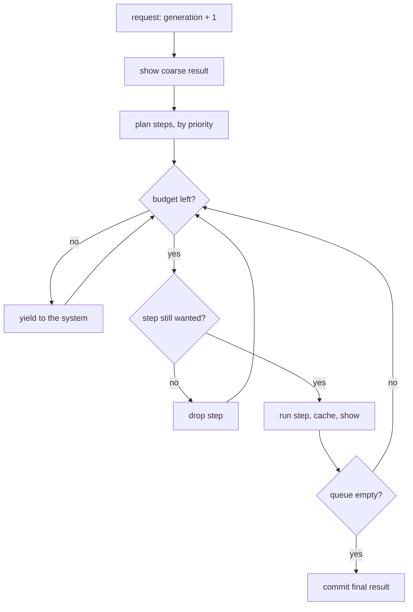

# Chapter 6 · Work in Small Slices

*Show a coarse answer at once; then do the rest in interruptible steps, most important first, each slice sized to
a time budget.*

**★** A good form among several; the Variations name the others.

## Intent

Keep a program answering its user during work far longer than the user will wait. Give a cheap, coarse result at
once; cut the full work into short steps, run them by importance for a bounded time, give control back, and drop
the rest the moment it is no longer wanted.

## Also known as

Time slicing; cooperative scheduling; progressive refinement; incremental rendering; chunked work; coarse first.

## Motivation

In Editor lab (the teaching editor) one full render of its sample document takes about 280 ms. At 60 frames a
second the screen expects a new picture every 16.7 ms, so that is seventeen frames. A first version renders the
whole picture whenever a slider moves. Four things go wrong.

1. **Input freezes.** JavaScript on the page's main thread cannot be interrupted. While the render runs, pointer
   events wait; the slider handle sticks and then jumps.
2. **Work is done for a state nobody wants.** The render started for the slider's first position runs to the end
   although the second position arrived long ago.
3. **The wrong part comes first.** Tiles are computed in rows from the top left while the person looks at the
   middle of the screen.
4. **All or nothing.** Nothing appears until everything is done. The batch version is worse: an export cancelled
   halfway leaves half a file on disk.

The textbook measured what the cure buys: scrubbing the lowest layer's slider had a median update of 259 ms and a
95th percentile of 287 ms with previews off, and 12.7 ms and 28 ms with them on.

Other systems meet the same problem. A text editor spell-checking a 50,000-line file must not freeze typing; it
checks visible lines first and restarts when the text changes. A map viewer shows blurry tiles at once and sharp
ones as they arrive. A garbage collector that stops the program for a full collection causes visible pauses;
incremental collectors mark in small steps between the program's own work.

## Problem

**How does a program stay responsive while it does work much longer than the interval in which it must answer?**

## Forces

- **Responsiveness against throughput.** Small steps let input in quickly; each step has a fixed cost. Editor lab's
  slider scrub was 22 % slower with 150 small tiles than with 12 large ones.
- **An early answer against the right answer.** A coarse result is fast but wrong in detail, and for some
  operations (grain, thresholds) wrong in kind.
- **Fixed steps against adaptive steps.** A fixed step never overruns by more than one step; a step sized from past
  timings pays its fixed costs rarely, but overruns when the work suddenly gets more expensive.
- **Cancelling against keeping.** Dropping stale work frees the machine; finished pieces may still be useful
  later.
- **Fine cancellation against simple code.** Checking for cancellation inside a step needs code that can stop and
  resume; checking only between steps keeps steps simple but makes the longest step the latency.
- **Priority against completion.** Visible work first is right; background work always postponed never finishes.

## Solution

**Therefore: when a request arrives, show a coarse result computed by the same code at a smaller size, within the
same frame. Then cut the full work into steps, each shorter than the longest time you may block, and queue them by
priority: what the user is touching, then what is visible (centre first), then what is near, then the rest, then
saving. Run steps until the slice's time budget is spent, then yield to the system. Give every request a
generation number; between steps, never inside one, drop any step whose generation is no longer current, and keep
the results of finished steps if they are named by their content. Size steps from measured cost. Make the final
effect atomic: a batch job writes its result only when every step has run, and a cancelled one leaves nothing.**

## Applicability

Use it when:

- the full work takes many times the interval in which the program must respond;
- the work divides into steps (tiles, rows, records, pipeline stages) that can run separately;
- new requests regularly make running work obsolete;
- a coarse or partial answer is useful to the person waiting.

Do not use it when:

- the work fits in the budget; Editor lab runs the whole refinement in one go when it expects it to take under
  12 ms;
- the work can move to another thread or processor and its result is only wanted whole; then a latest-wins slot
  around the whole job is simpler (parent volume, [Latest-Wins Render Slots](../04-latest-wins-render-slots.md));
- the steps share state that cannot be saved between them (a sequential solver); add cancellation points instead;
- readers must never see a mixture of old and new pieces; then build the new result aside and swap it in whole.

## Structure

| Participant | Responsibility |
| --- | --- |
| **Request** | what is wanted, its generation and its priority |
| **Coarse renderer** | the same computation at a smaller size, fast enough for one frame |
| **Planner** | cuts the full work into steps and orders them by priority |
| **Step** | one bounded unit of work with a content key; runs to completion once started |
| **Slice runner** | runs steps until the budget is spent, checks the generation between steps, then yields |
| **Step sizer** | chooses the step size or the budget from measured cost |
| **Committer** | delivers the finished result; for batch work, commits atomically or aborts cleanly |

## Collaborations

1. A request increments the generation. The coarse renderer draws a cheap version at once.
2. When the request settles (the gesture pauses), the planner replaces the queue with steps for the new
   generation, most important first.
3. On each frame or idle period the slice runner takes steps from the queue while the budget lasts. Before each
   step it checks the generation; stale steps are dropped.
4. Each step's result goes into the cache under its content key and is shown.
5. The runner yields. The step sizer updates its estimate from the steps' times.
6. When the queue is empty the committer marks the result final; a batch job commits its output.



The loop in the middle is one slice: it gives control away at "yield" and returns on the next frame. A new request
starts again at the top and makes the queued steps stale.

## Sketch

```text
value Request: generation, target, priority
value Step: generation, key, priority

state: current ← 0, queue ← [], cache, sizer

-- 1. a request: coarse now, the full plan later
request(target, priority):
  current ← current + 1
  show(render(target, size: coarse))                 -- the same code, a fraction of the pixels
  queue ← plan(target, current) sorted by priority   -- replaces whatever was queued

-- 2. one slice, run once per frame or idle period
slice(budgetMs):
  t0 ← now()
  while queue not empty and now() − t0 < budgetMs:
    step ← queue.takeFirst()
    if step.generation ≠ current: continue          -- stale: dropped between steps
    s0 ← now()
    result ← cache.get(step.key) or run(step)       -- never interrupted once started
    cache.put(step.key, result)                     -- kept: correct for its key forever
    show(step, result)
    sizer.observe(step, now() − s0)
  yieldToSystem()

-- 3. an adaptive step: the size that would have filled the interval
nextSize(lastSize, lastMs, intervalMs) → median of the last three (lastSize · intervalMs / lastMs)

-- 4. batch work: the same loop with an atomic end
export(target, sink, cancelled):
  for band in plan(target):                          -- e.g. one row of tiles
    for step in band:
      if cancelled(): sink.abort(); fail(cancelled)  -- nothing partial survives
      rows.add(run(step))
    sink.write(rows)                                 -- memory stays bounded by one band
  sink.commit()

-- in use: a slider drag
on slider move: request(view of document, priority: preview)
on each frame: slice(budgetMs: 8)
```

## Implementation notes

1. **The longest step is the latency.** Editor lab's textbook (chapter 7) measured one tile of the whole layer
   stack at about 2.2 ms for 64-pixel tiles, 7.1 ms for 128 and 24 ms for 256. A 256-pixel tile is longer than a
   frame on its own, so with large tiles the program must either cut inside the tile or move the work to another
   thread.
2. **Coarse first, from the same code.** Editor lab draws its preview from a smaller copy of the image (level 2 of
   an image pyramid, a sixteenth of the pixels) through the same engine, in the frame of the change. Its level
   adapts: a preview that took over 12 ms makes the next one coarser, down to level 3; one under 2.5 ms makes it
   finer, up to level 1. Refinement waits until 220 ms after the last change, then runs at most 8 ms of tiles per
   frame. The price is the time to settle after the gesture: 287 ms in the measured scrub.
3. **Coarse must really be coarse.** chromobench's reference engine once needed about 4.2 s for the screen view of
   a 1024 × 683 test image. One stage (the display's crop and orientation) was not computed on the reduced grid,
   so the whole chain ran again at full resolution and was sampled afterwards. Moving that stage onto the grid
   brought it to 1.37 s, and a faster gamut step to 0.74 s, with bit-identical results. A test now checks that no
   print stage of a reduced render runs at full resolution. Test that the coarse path is coarse.
4. **Cancel between steps, never inside one; keep what finished.** Editor lab replaces its queue on every edit. Its
   queue holds tile positions, not states, and each step reads the current document, so a step cannot compute an
   old state; finished tiles stay in its content-keyed cache and are hits next time. chromobench's reference
   engine runs in a worker, yields between pipeline stages so that a cancel message can arrive, and checks the
   abort signal there; finished stages stay cached and "nothing partial is kept".
5. **Order by priority.** The textbook's order is input, the gesture's preview, visible tiles centre first, their
   neighbours, background work, persistence. Editor lab's renderer does the visible-centre part. chromobench's
   render queue runs live requests before background ones (thumbnails), and in the studio a live request aborts
   running background renders, which run again afterwards.
6. **Fixed or adaptive steps.** GIMP sizes the chunks of its projection (the composited image it displays) so that
   each takes a fixed interval, 1/15 s, using the median of the last three estimates. The textbook simulated a port
   of the rule: when the cost per pixel quadruples, two chunks take 266 ms each before the estimate catches up. A
   fixed tile never overruns by more than one tile (7 ms at 128 pixels). Choose by how suddenly your costs change.
7. **Yield with the platform's tools, and never poll.** Browsers offer `requestAnimationFrame` for per-frame work,
   `requestIdleCallback` for idle work and, where available, `scheduler.yield()`. chromobench's interface runs idle
   tasks for at most 12 ms per idle period, and only the tasks queued before the period began: a task that queues
   itself again would otherwise loop forever under a timed-out deadline. An earlier version re-queued a render pump
   from an idle callback while a worker was busy; it ran about 10,000 times a second.
8. **Batch work slices too, and ends atomically.** chromobench's export plans tiles, computes one row of tiles (a
   band) at a time, and hands each band's rows to the file encoder. It checks the cancel signal before every tile;
   the tile in flight finishes; the output is aborted, which deletes what was written, and the error says how many
   tiles were done. No export holds the whole file in memory. Its tiles are sized by memory, not time: the planner
   halves the tile until one tile with its halo, at an assumed number of bytes per pixel, fits in half the GPU
   memory budget. An exact export of a 4,000-pixel print whose spatial effects need a 64-pixel halo uses 48 tiles
   of 512 pixels and takes about 1,650 ms, against about 781 ms with 12 tiles of 1,024 before exact tiling. A
   cancel waits for one tile: roughly 34 ms on average (1,650 ms over 48 tiles).
9. **What chromobench lacks: a frame-budget slicer for interactive renders.** Each interactive render is one unit:
   a draft of a fixed 500,000 pixels during a gesture, the displayed size at rest. A source comment says drafts are
   "adapted towards ≈30 ms by the viewport", but no code adapts them. Nothing is shown until a render is complete,
   and the reference engine can be cancelled only between stages, so the longest stage is the latency (before the
   fix in note 3, one stage took about 1.5 s). On the GPU engine this costs little (a measured 21 to 107 ms per
   print preview at 4,000 × 2,674). On the CPU engine a drag shows one new picture per render; the render queue's
   progress rule (250 ms in the studio) at least keeps a starved draft running instead of aborting it, so the
   picture moves instead of freezing. Slicing it would mean splitting stages into tiles, ordering them by
   visibility, and drawing tiles as they finish.
10. **Measure what the person sees.** A benchmark that waits for each update measures the engine, not the screen's
    lag: in the textbook's case a 45 ms engine behind a 60 Hz pointer shows positions 45 to 102 ms old (Chapter 10).

## Variations

- **Offload instead of slice.** Run the work on another thread or the GPU, so the interactive thread only presents
  results. Slicing then serves cancellation and order, not the frame budget. chromobench's CPU engine works this
  way, in a worker.
- **Adaptive chunks.** GIMP's rule above: few fixed costs, overruns after a change in cost.
- **Age-based cancellation.** darktable lets a running pipeline that started less than half its average run time
  ago finish, then restarts with the new parameters; fewer wasted starts, a little more lag.
- **Progressive formats.** The data itself arrives coarse first: a progressive JPEG sends a blurry full picture and
  refines it scan by scan, so the reader slices without a scheduler.

## Consequences

- \+ The program answers input within one step, whatever the total work.
- \+ The person sees something at once and the most important part first.
- \+ Obsolete work stops cheaply, and finished steps named by content are kept for later.
- \+ Batch jobs have bounded memory and leave nothing behind when cancelled.
- − Total time grows: each step has overhead, and the final picture arrives later (the settle time).
- − The program has more states (coarse, refining, final) and must show which one is on screen; Editor lab's header
  reads "refining" with the number of tiles to go.
- − A coarse result can mislead for operations that look different at reduced size.
- − Code must be cut at step boundaries, with its state saved between them.

What makes the result habitable is that the steps are ordinary functions with a key; the scheduling lives in one
loop beside them, so a new kind of work grows the program piecemeal by adding steps, not by rewriting the loop.

## Known uses

- **GIMP** renders its projection in chunks sized to fill a fixed interval (`app/core/gimpchunkiterator.c`).
- **React**'s concurrent rendering splits rendering into units of work and yields to the browser between them, so
  urgent updates can interrupt less urgent ones.
- **`requestIdleCallback`** (W3C) gives a page idle periods with a deadline; work runs in slices that check
  `timeRemaining()`.
- **Progressive JPEG** encodes an image as successive scans from coarse to fine.
- **Web browsers** render a page incrementally as it loads, and Chromium's compositor rasterises tiles near the
  viewport first.
- **darktable** runs a small preview pipeline beside the full one and cancels the full one between modules.
- **Incremental garbage collectors**, such as V8's incremental marking, interleave marking steps with the program.
- **Editor lab** (coarse preview, 8 ms slices, generation by queue replacement) and **chromobench** (tiled export
  with clean abort, stage-level cancellation in a worker, no frame-budget slicer).

## Related chapters

- [Chapter 5 · Solve Once, Apply Many](05-solve-once-apply-many.md): make each step cheap before slicing it.
- [Chapter 7 · Estimate with Confidence](07-estimate-with-confidence.md): the step sizer is an estimator and
  should say how sure it is.
- [Chapter 8 · Count What You Own](08-count-what-you-own.md): memory, not time, set chromobench's export tiles.
- [Chapter 9 · Keep What Is Dear](09-keep-what-is-dear.md): finished steps live in a content-keyed cache.
- [Chapter 10 · Measure From the User's Clock](10-measure-from-the-users-clock.md): judge slicing by response
  time, not service time.
- Parent volume: [Latest-Wins Render Slots](../04-latest-wins-render-slots.md) (whole renders, newest wins) and
  [Reach-Declared Tiling](../08-reach-declared-tiling.md) (how tiles are cut).
- GoF: **Command** (a step as an object in a queue), **Iterator** (a chunk iterator hands out the next step),
  **Strategy** (fixed or adaptive sizing).

## Exercises

1. A text editor spell-checks a 50,000-line file. Design the steps, the priorities (visible lines first, then
   lines near the cursor) and the cancellation rule when the user types. What is the content key of a step's
   result, and which results survive an edit on line 10?
2. Find code you have written that runs for more than 50 ms on a thread that also handles input. Which of the
   forces kept it whole? Where are the natural step boundaries, and what state would have to survive between them?
3. chromobench's export takes about 34 ms per tile with 512-pixel tiles and about 20 ms per tile with 1,024-pixel
   tiles (12 tiles in 245 ms for a simpler print). For each, what is the worst wait between pressing cancel and the
   export stopping? What decides the tile size, and what would you change to make cancelling faster?
4. Sketch a frame-budget slicer for an engine whose steps are pipeline stages of up to 1.5 s. What must change in
   the stages themselves, and what can stay?
