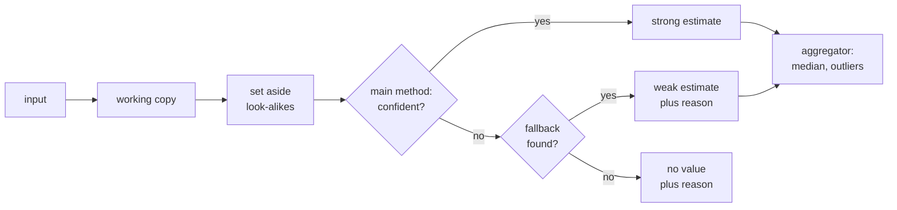

# Chapter 7 · Estimate with Confidence

*A function that guesses returns its guess, how sure it is, why, and what happens otherwise.*

**★** A good form among several; the Variations section names the others.

## Intent

Some functions do not compute an answer; they infer one from input that may not contain it. Make such a function
return a record instead of a bare value: the value, a confidence on a stated scale, a reason a person can read, and
the method that produced it, the main one or a named fallback. Then the rest of the program can treat a weak guess
differently from a strong one.

## Also known as

Honest estimator; estimate with provenance; graded result; value with diagnostics.

## Motivation

chromobench opens scans of colour negatives. To print one it must know the **film base**: how much light the film
stops where it received no exposure (the orange of a colour negative). Every colour is measured relative to it. It is
read on the **rebate**, the unexposed edge of the film outside the picture. But a scan also shows the **holder** (the
opaque carrier around the film) and the **open gate** (light passing beside the film or through its **sprocket holes**,
the perforations along its edge). A **roll** is one length of film, often thirty-six photographs, called **frames**.

The first version used a simple rule: the base is the brightest 5 % of the columns. Four things went wrong.

1. **A wrong answer looked like a right one.** On a scan that shows sprocket holes, the brightest columns are the
   holes: the light itself, not the film. On a synthetic test strip the rule misses the base by more than 0.25 D
   (**density**, D, is the base-10 logarithm of how much the film dims the light; 0.3 D is a factor of two, so 0.25 D
   is nearly one). Every colour shifts. Nothing crashes. The print is just wrong.
2. **There was no way to say "I don't know".** A scan cropped inside the picture has no film edge at all. The rule
   still returned a "base", taken from the brightest part of the picture.
3. **The caller could not choose.** The roll's base, taken over all its frames, should use the good frames and skip
   the doubtful ones. A bare number does not say which is which.
4. **The user could not repair it.** Nothing said where the base came from, so nothing invited the photographer to
   pick the film edge by hand.

The same problem appears wherever a program reads the world. An OCR engine reads a word from a blurred scan. An
encoding detector guesses whether a file is UTF-8 or Latin-1. A phone estimates its position from satellites. A
compiler, after a syntax error, guesses what was meant so it can report the next error. Each can be confidently wrong,
and each is more useful when it says how sure it is.

## Problem

**How should a function report an answer it inferred, rather than computed, so that the rest of the program can tell a
strong guess from a weak one and act on the difference?**

## Forces

- **A usable answer against an honest one.** Callers want a value at once; a guess presented as fact hides its
  failures.
- **Automatic against correctable.** Users want the program to find the answer; when it is wrong, they need to know,
  and to correct it.
- **Robust against precise.** A median ignores a few sprocket-hole pixels. A mean uses every pixel and is more precise
  when all of them are good.
- **Full resolution against bounded cost.** Measuring every pixel of a 24-megapixel image is slow, and a fact like
  "where is the film edge" is visible at 512 pixels.
- **A number against a reason.** A confidence of 0.3 tells a program what to do; it does not tell a person what went
  wrong. A reason without a number is the opposite.
- **Always answering against answering silently.** A fallback keeps the program running. A fallback taken without a
  word is the original bug again.
- **Local against global evidence.** One frame can be fooled; a roll of thirty-six knows better, if each frame says
  how sure it was.

## Solution

**Therefore: when a function infers a value from input that may not contain it, return an estimate, not a bare value:
the value (or none), a confidence on a stated scale with a stated threshold, the method that produced it, the
evidence it used, and reasons, each with a code a program can match and a message a person can read. Measure on a
bounded working copy of the input, sized for the fact and not for the file. Use robust statistics (medians,
percentiles, the median absolute deviation) so that a minority of bad samples cannot move the answer. Try the strong
method first and weaker ones after, each lowering the confidence and adding a reason. Let the caller decide what a weak
estimate means: use it, combine it with others, propose it to the user, or refuse. Never fall back in silence.**

## Applicability

Use it when:

- the input comes from the world (scans, sensors, user text, logs) and may not contain what you look for;
- the answer is chosen among candidates by a score;
- a later stage can combine several estimates, or a person can correct one;
- a wrong answer is silent: no crash, only a worse result.

Do not use it when:

- the function computes a defined result (a sum, a blend, a format conversion): a confidence on arithmetic is noise;
- the user supplied the answer: a rebate box the photographer picked is not a guess (chromobench gives it
  confidence 1 and moves on);
- the tool is exact by contract: Editor lab's magic wand selects exactly the pixels within the user's tolerance; it
  does not guess;
- nobody will ever read the confidence. Then a plain refusal is simpler.

## Structure

| Participant | Responsibility |
| --- | --- |
| **Estimator** | measures one fact from the input and returns an Estimate; "not found" is a result, not an exception |
| **Working copy** | a reduced copy of the input, sized for the fact (here 512 pixels on the long side) |
| **Robust statistics** | medians, percentiles and the median absolute deviation; separate the population from outliers |
| **Estimate** | value, confidence, method, evidence (where it looked), reasons (code, message, hint) |
| **Fallback chain** | weaker methods in order; each lowers the confidence and adds a reason |
| **Aggregator** | combines several estimates by a robust centre, checks they agree, names the ones that do not |
| **Consumer** | acts by threshold: use, propose, combine or refuse |
| **Reporter** | shows reasons in the user's words; keeps the codes for developers |

In a spam filter the same parts are: the classifier (estimator), a simpler rule list (fallback), a vote of several
filters (aggregator), and the mail client that files, flags or delivers (consumer).

## Collaborations

1. The consumer calls the estimator with the input and a threshold; the estimator reduces the input to its working
   copy.
2. It finds what can be mistaken for the answer (the holder, the open gate) and sets it aside.
3. It runs its main method and computes a confidence from the score's parts.
4. Below the threshold it tries the next method and adds a reason; if nothing works, it returns no value and a reason.
5. An aggregator takes a median of the confident estimates, measures every estimate against it, and names outliers.
6. The consumer acts; the reporter turns the reasons into a sentence for the user.



Read it left to right: every path ends in an estimate that says which way it came, and only the aggregator sees
several of them at once.

## Sketch

```text
-- the record every estimator returns
value Reason:   code, message, hint
value Estimate: value (or none), confidence in [0, 1], from, evidence, reasons: list of Reason

-- a robust spread: the median absolute deviation, scaled to match σ for normal noise
mad(xs) → (centre, spread):
  m ← median(xs)
  return (m, 1.4826 · median([|x − m| for x in xs]))

-- one estimator: a physical fact measured on a bounded working copy. Helpers, not the point here:
--   shrink (average down to a size), holder, openGate, picture (regions found in the image), thin (the least dense
--   pixels), largestCluster (the biggest group of similar colour), largestRectangle, evenness (1 = no local variation)
estimateBase(scan, threshold: 0.5) → Estimate:
  work ← shrink(scan, longSide: 512)                 -- the fact is visible at this size
  film ← pixels(work) − holder(work) − openGate(work) -- set aside what looks like the answer
  -- main method: thin, even film outside the picture
  box ← largestRectangle(largestCluster(thin(film) outside picture(work)))
  if box exists:
    confidence ← 0.5 · min(1, area(box) / 200) + 0.5 · evenness(box)
    if confidence ≥ threshold:
      return Estimate(median(scan in box), confidence, from: "edge", evidence: box, reasons: [])
  -- fallback: unexposed film inside the picture, weaker evidence, capped confidence
  blank ← largestRectangle(largestCluster(thin(film)))   -- anywhere, inside the picture too
  if blank exists:
    return Estimate(median(scan in blank), min(0.3, area(blank) / 2000), from: "blank", evidence: blank,
                    reasons: [Reason("base-from-blank", "No film edge beside the picture; read on blank film.",
                                     hint: "Pick the film edge, or use the roll's base.")])
  return Estimate(none, 0, from: "none", evidence: none, reasons: [Reason("no-base", "No thin film found.")])

-- an aggregator: many estimates make one, and the ones that disagree are named
combine(estimates, threshold: 0.5, tolerance: 0.03) → Estimate:
  have ← [e for e in estimates if e.value ≠ none]
  used ← [e for e in have if e.confidence ≥ threshold]
  reasons ← []
  if used is empty and have is not empty:
    used ← have
    reasons ← [Reason("all-weak", "No confident estimate; the median of weak ones.")]
  centre ← median([log(e.value) for e in used])       -- per colour channel, in density (log) units
  outliers ← [e for e in have if |log(e.value) − centre| > tolerance]
  if outliers not empty:
    reasons ← reasons ++ [Reason("inconsistent", "These disagree: " ++ names(outliers))]
  confidence ← count(used) / count(estimates)          -- the share of estimates that were confident
  return Estimate(exp(centre), confidence, from: "median", evidence: used, reasons)

-- the pattern in use (recipe: the settings for this picture; roll: combine over the roll's frames)
b ← estimateBase(scan)
match b.from:
  "edge":  recipe.base ← b.value
  "blank": recipe.base ← roll.base.value if roll.base.confidence ≥ 0.5 else b.value ; show(b.reasons)
  "none":  ask the user to pick the film edge ; show(b.reasons)
```

## Implementation notes

1. **Name the bug the pattern fixes.** This is the bug chromobench shipped in its first demonstration: the
   brightest-columns rule took sprocket holes or a gap in the holder for the film base. A synthetic-strip test keeps
   the old rule's failure on record (more than 0.25 D off) beside the new estimator's result (within 0.002 D, half a
   percent of light). The old rule is still the last fallback, and the notes now say when it is used.
2. **Find the look-alikes first.** The fix was not a better threshold. The estimator first removes what can pass for
   the base: the open gate (a population far brighter than any film, without the orange tint every colour negative
   has) and the holder (dark pixels connected to the border). Then it searches the film that remains. Model what
   fools you.
3. **Work on a copy sized for the fact.** The estimators work on at most 512 pixels on the long side, so their cost
   does not depend on the file's size. Boxes are mapped back rounded *inwards*, so they never reach past the region
   measured.
4. **Build the confidence from parts you can name.** Half is area (full credit at 200 working pixels, about a 14 × 14
   patch) and half evenness (local variation inside the box against the film around it). The threshold, 0.5, is the
   midpoint of the scale. Blank film inside the picture is capped at 0.3, below the threshold, so it never passes for
   an edge. These are scores, not probabilities, until calibrated against measured truth.
5. **Use statistics that a minority cannot move.** The veil (stray light the scanner adds everywhere) is the median of
   the holder; dust detection measures noise with the median absolute deviation. Means are taken only inside a region
   already shown to be even.
6. **Make every fallback say what it costs.** An earlier rebate search fell back to a bright percentile with
   confidence 0 and a warning naming the damage downstream: "densities read too high". It survives only in a test now:
   two estimators of one fact is a debt.
7. **Aggregate, then name the outliers.** The roll's base is the median of the frames whose confidence is 0.5 or more.
   Every frame is then measured against it, and the warning names those beyond 0.03 D (7 % of the light; frames of
   one film agree within about 0.01 D). On a synthetic roll of twelve frames with one base offset, exactly that frame
   is named.
8. **Confidence is not correctness.** On one strip scan the "film edge" found lay on a thin frame, and the base read
   0.08 D (20 %) too dense. A score measures how good the evidence looks, not whether it is the right evidence. The
   host now checks the rebate against frame boxes found by a second estimator, and reads the base between the frames
   when they overlap.
9. **Score each property separately, then multiply.** A dust speck's score multiplies three parts, each mapped onto
   0–1 by a smooth ramp: contrast against local noise, sharpness, and **neutrality** (dust blocks all colours
   equally; the film's own grain and the picture do not). Tests plant coloured blobs of dust's contrast: the detector must reject
   them, and a variant with neutrality switched off must accept them.
10. **Solvers are estimators too.** chromobench's iterative solver returns its answer with the **residual** (how far the
    answer is from fitting the data), the number of iterations, and why it stopped: close enough, no further progress,
    or the iteration limit. A failing test prints the residual and the reason.
11. **Keep reasons as data until the last moment.** A debt: chromobench turns its notes into strings, and the status
    line reads them back with regular expressions, so renaming one message breaks it silently. Keep codes and fields
    structured up to the reporter, and declare the codes once ([Chapter 2](02-one-declaration-many-readers.md)).

## Variations

- **Refuse below the threshold.** Return a refusal instead of a weak value. Callers have one case less; an aggregator
  loses a weak value it could have used.
- **Interval or distribution.** Return a range or a probability (a GPS fix with an accuracy radius). Better for later
  arithmetic; meaningful only if calibrated.
- **Ranked candidates.** Return the best few with their scores, as OCR engines offer alternatives. chromobench's
  guess of the film stock (the brand and type of film) warns when the top two fit within 0.025 D and asks the user to
  choose.
- **Propose, do not apply.** The estimate becomes a pending edit that the user accepts or changes. Slower for the user,
  and never silently wrong.

## Consequences

- \+ Silent wrong answers become visible, at the place where a person can act on them.
- \+ Aggregators can weight or exclude; tests can assert on the reason and the confidence, not only on the value.
- \+ The program grows piecemeal: a new look-alike check or a new fallback slots into the chain without changing a
  single caller. That is what makes the code habitable: a bug report that says "from: blank, confidence 0.28" tells the
  next programmer where to look.
- − Every caller handles three cases (strong, weak, none) instead of one.
- − Confidence scales are home-made. A number like 0.5 looks more precise than it is, and two estimators' scales are
  not comparable.
- − The fallback paths are code too, and need tests as good as the main path's.
- − Reasons can flood the user; a summarising layer is needed.

## Known uses

- **Tesseract OCR** reports a confidence for every recognised word, and its orientation detection reports a
  confidence with the angle it chose.
- **Character-encoding detectors** such as Python's `chardet` and ICU's `CharsetDetector` return the encoding together
  with a confidence.
- **Location APIs** report accuracy with every fix: Android's `Location.getAccuracy()` and iOS's
  `CLLocation.horizontalAccuracy`.
- **SExtractor** (Bertin and Arnouts, 1996) estimates the sky background of an astronomical image by iterative
  clipping around the median, and chooses between two estimators according to how crowded the field is.
- **Compilers** recover from syntax errors to report later ones, and Clang's fix-it hints are offered as suggestions,
  not applied.
- **Robust statistics**: Peter Huber, *Robust Statistics* (1981); Frank Hampel's work on the median absolute deviation
  as a scale estimate; Peter Rousseeuw and Christophe Croux, "Alternatives to the Median Absolute Deviation" (*Journal
  of the American Statistical Association*, 1993).

## Related chapters

- [Chapter 1 · One Contract, Several Engines](01-one-contract-several-engines.md) completes this one: an estimator
  needs a careful twin. chromobench's synthetic strips, with a planted base and film edge, are that twin.
- [Chapter 2 · One Declaration, Many Readers](02-one-declaration-many-readers.md) keeps reason codes in one list.
- [Chapter 5 · Solve Once, Apply Many](05-solve-once-apply-many.md): the base is estimated once per scan or roll and
  applied to every pixel.
- [Chapter 8 · Count What You Own](08-count-what-you-own.md) sizes its budget by an estimate that carries its rule.
- [Chapter 10 · Measure From the User's Clock](10-measure-from-the-users-clock.md) applies the same honesty to timings.
- GoF: **Strategy** (interchangeable estimators), **Chain of Responsibility** (the fallback chain). Woolf's **Null
  Object** is the contrast: it hides absence, where an estimate reports it.
- Parent volume: [Reference Oracle with Negative Controls](../03-reference-oracle.md), for checking an estimator
  against planted truth and keeping broken variants that must fail.

## Exercises

1. **Detect a CSV file's separator.** Design the estimate record for a function that guesses whether a file uses
   commas, semicolons or tabs. What is the main method, what is the fallback, what does the confidence consist of, and
   what reason do you show when two separators are equally likely?
2. **Find the forces in your own code.** Find a function you wrote that returns a default when it cannot find
   something (a date parser that returns today, a config reader that returns 0). Which of this chapter's forces does it
   resolve badly? Rewrite its signature to return an estimate, and list what each caller must now do.
3. **Median against mean.** Draw 100 normal samples and make 10 of them ten times larger. Compare mean and standard
   deviation with median and MAD (× 1.4826). Which pair describes the 90 good samples? At what share of outliers does
   the median fail?
4. **Aggregate a fleet.** Thirty thermometers in a building report a temperature and a confidence. Write `combine` so
   that it ignores weak readings and names those that disagree. How do you choose the tolerance, and what do you report
   when every reading is weak?
