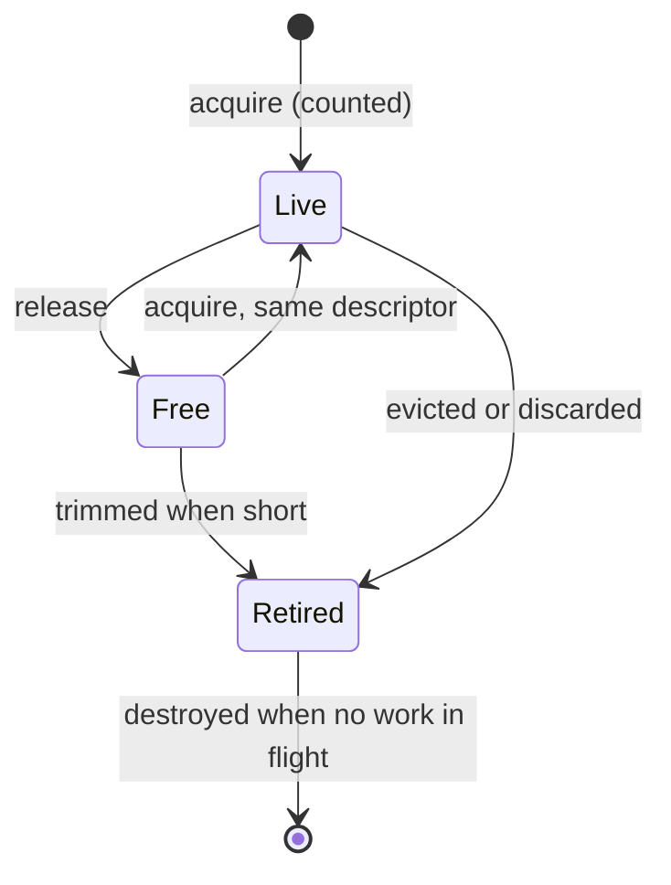

# Chapter 8 · Count What You Own

*The module that holds a scarce resource keeps its own ledger and its own recovery.*

**★★** We believe any good solution to this problem has this shape.

## Intent

When a program holds a limited resource that the platform will not account for, give one module the job of owning it.
That module counts every unit it hands out against a budget it sets itself, reuses released units, decides what is
given back first when the budget runs short, destroys a unit only when nothing still uses it, and recovers from
exhaustion by one fixed, bounded procedure.

## Also known as

Resource manager; budgeted pool; resource lifecycle manager; memory governor.

## Motivation

chromobench renders on the GPU through WebGPU. Its images live in **textures** (images stored in GPU memory) and its
temporary data in **buffers** (plain blocks of GPU memory). WebGPU has no call that reports how much memory is free.
The naive approach is to create a texture when one is needed, destroy it when done, and let the driver worry.
chromobench met four failures.

1. **Destroyed while still in use.** The film-grain effect kept one cached **texture of ones** (an image whose every
   value is 1, used as a constant input) and destroyed it whenever a different size was asked for. A 160-pixel
   thumbnail and the main viewer rendered at the same time. The thumbnail took its texture and paused while its GPU
   program was prepared; the viewer asked for its own size; the cache destroyed the thumbnail's texture; the thumbnail
   then sent its work to the GPU. The console said, again and again:
   `Destroyed texture [Texture (unlabeled 160x107 px, TextureFormat::RGBA32Float)] used in a submit.`
2. **Exhausted, with no one to blame.** With two 24-megapixel raw camera files open, renders failed with
   `E_GPU_OOM: film.camMatrix.0: 14192640 bytes do not fit the budget (525083680 of 536870912 live)`. Read it as: the
   budget is 512 MiB, 11 MiB were left, and this allocation, labelled `film.camMatrix.0`, needed 13.5 MiB. Each open
   file kept its full-size texture, 4000 × 2686 pixels of four 32-bit numbers, 164 MiB, whether it was on screen or
   not.
3. **Memory that nobody counted.** Of the 512 MiB, 160 MiB were upload buffers that had already been released. They sat
   in the buffer pool's free list, which nothing trimmed, because only the texture pool was trimmed. The grain's
   textures were made outside the budget altogether, as large as a source texture again for a full-size render.
4. **The wrong picture.** When the render of a newly opened file failed, the viewer kept showing the previous file's
   picture under the new file's name.

One fact about GPUs explains the first failure. GPU work is first *recorded* into a list of commands, then
*submitted*, and runs later. A texture destroyed between recording and submission makes the submission fail. We say
work is **in flight** from the moment it is recorded until the GPU has finished it.

Other systems meet the same problem. A database accepts a fixed number of connections; a service that leaks them stops
answering. An operating system limits open files per process. A mobile app is told to give memory back or be killed.

## Problem

**How does a program stay within a resource that the platform will not measure for it, and recover when it runs out,
without ever freeing something that is still in use?**

## Forces

- **Use everything against leave room.** A larger budget means fewer evictions, but the memory is shared with the
  system and other programs, and a program that takes too much is killed.
- **Reuse against return.** Keeping released units makes the next allocation free; kept units are memory nobody uses.
- **Free early against free safely.** Destroying at release returns memory at once, but work in flight may still read
  the unit.
- **One owner against many users.** A single ledger sees everything, but only if every allocation goes through it,
  including the one written in a hurry.
- **Recover against tell the truth.** A retry hides a passing failure; endless retries hide a real one; an old result
  left on screen hides it worst of all.
- **Simple policy against best policy.** Least-recently-used eviction is easy to reason about. Cost-aware eviction keeps
  what is expensive to remake, but pays only when costs per byte differ.

## Solution

**Therefore: give each scarce resource exactly one owner, which counts what it hands out against a budget it sets
itself. The budget comes from what the platform does report (total memory, the largest allowed allocation), by a rule
the owner states. The ledger holds the units live, the units released and kept for reuse, and the high-water mark (the
most ever live at once). Users lease a unit while they use it and pin what they need most; when an allocation does not
fit, the owner gives up released units first, then units neither pinned nor leased, least recently used first. A unit
leaves the ledger when it is let go, but is destroyed only when no work that might use it is in flight. On exhaustion
the owner lets go of everything it keeps, retries once, and otherwise fails plainly, for the right task, leaving no
stale result in view.**

## Applicability

Use it when:

- the platform cannot report or limit usage for you (GPU memory in a browser, WebAssembly memory, a database's
  connection limit, a paid API's quota);
- creating a unit is expensive enough that reuse pays;
- use and release can interleave (asynchronous work, queues, threads);
- running out is a likely event, because users open larger files than you tested with.

For a **connection pool** the shape holds with three changes. The budget counts connections, not bytes. Recovery
waits for a connection, up to a timeout, because a connection cannot be taken from a query that is running. And
retiring a connection means closing it only after its transaction ends. When several processes share one limit, each
owns a share, and a reserve is kept back for administration.

Do not use it when:

- the platform already manages the resource well: small objects under a garbage collector, the operating system's
  file cache;
- a unit lives only inside one call that frees it before returning;
- the platform already keeps the ledger and will tell you (a Vulkan driver with the memory-budget extension): read
  theirs instead of keeping a second one that drifts.

## Structure

| Participant | Responsibility |
| --- | --- |
| **Owner** | the only module that creates or destroys units |
| **Budget** | the ledger: bytes live, high-water mark, limit, and the rule that chose the limit |
| **Pools** | released units kept for reuse, keyed by descriptor (format, size, usage), on one release clock |
| **Residency and other reclaimers** | units kept between tasks, grouped by what they belong to (an open image); give units back when asked, least recently used first |
| **Leases and pins** | a lease marks a unit a task is using now; a pin marks a group needed now (on screen); both are evicted only in recovery |
| **Retirement list** | units let go while work is in flight; destroyed when it ends |
| **Recovery** | the one procedure for exhaustion |
| **Journal** | records high-water marks, evictions and recoveries |

In a connection pool: the pool is the owner, a checkout is a lease, closing after the transaction is retirement, and
a wait with a timeout is the recovery.

## Collaborations

1. A task starts inside the owner's `busy` scope, which counts work in flight.
2. The task leases the kept units it reads and acquires new ones by descriptor; a released unit with the same
   descriptor is reused at no cost.
3. If a new unit does not fit, the owner retires released units of every pool, oldest release first; then asks the
   reclaimers (groups not pinned, least recently used, nothing leased); then trims again; then refuses.
4. A unit let go while work is in flight leaves the ledger at once and joins the retirement list; it is destroyed when
   the in-flight count reaches zero.
5. The task releases its units and ends its leases; its high-water mark goes to the journal.
6. If the task failed for lack of memory, the owner lets go of everything kept, pinned and leased units included, and
   runs the task once more. A second failure becomes a plain error for that task, and the display takes down any
   picture belonging to another.



Read it as the life of one unit. It leaves the ledger when it enters Retired, and leaves the device only on the last
arrow; the gap between the two is what makes early freeing safe. A retired unit never goes back to Free.

## Sketch

```text
-- the budget: from what the platform does report, by a rule that is written down
budgetFor(platform) → (bytes, rule):
  share ← platform.totalMemory · 1/8                -- assume 4 GiB when the platform says nothing
  bytes ← clamp(min(share, platform.largestAllocation), low: 512 MiB, high: 2 GiB)
  return (bytes, "min(memory × 1/8, largest allocation) within [512 MiB, 2 GiB] = " ++ bytes)

-- the owner: the only module that creates or destroys units
owner Runtime:
  limit ; live ← 0 ; peak ← 0                         -- bytes allowed, bytes counted now, highest live has been
  free: map descriptor → list of (unit, releasedAt)   -- released units kept for reuse
  kept: Residency                                     -- units kept between tasks (below)
  retired: set of units ; waiting ← [] ; inFlight ← 0

  busy(work):                                         -- all GPU work runs inside this
    inFlight ← inFlight + 1
    try: return work()
    finally:
      inFlight ← inFlight − 1
      if inFlight = 0: destroy each unit in waiting ; waiting ← []

  retire(unit):                                       -- out of the ledger now, off the device later
    live ← live − bytes(unit) ; add unit to retired
    if inFlight = 0: destroy(unit) else waiting ← waiting ++ [unit]

  acquire(desc, label) → unit:
    if free[desc] is not empty: return take(free[desc])           -- reuse: no new bytes
    need ← bytes(desc)
    if not makeRoom(need):
      refuse("out-of-memory", label ++ ": " ++ need ++ " bytes do not fit (" ++ live ++ " of " ++ limit ++ ")")
    unit ← create(desc, label) ; live ← live + need ; peak ← max(peak, live)
    return unit

  release(unit):
    if unit in retired: return                        -- evicted while a task held it: never reused
    append (unit, clock()) to free[descriptor(unit)]

  trimFree(target):                                   -- target is a value for live, not an amount to free
    for (unit, _) in every free list, oldest releasedAt first:
      if live ≤ target: stop
      remove unit from its free list ; retire(unit)   -- retiring lowers live

  makeRoom(need):
    trimFree(limit − need)
    if live + need > limit: kept.evict(live + need − limit)
    if live + need > limit: trimFree(limit − need)
    return live + need ≤ limit

-- units kept between tasks, grouped by what they belong to (one open image)
Residency:
  items: map key → (unit, group, lastUse, leases) ; pinned: set of groups
  get(key) → unit or none ; put(key, group, unit)
  lease(key) ; unlease(key) ; pin(groups)
  evict(need, all: false) → bytes freed:
    for item in items, unpinned groups first, then least recently used group, then item:
      if freed ≥ need: stop
      if not all and (item.leases > 0 or item.group in pinned): skip
      remove item ; retire(item.unit) ; freed ← freed + bytes(item.unit)

-- a task leases what it reads, and gives back what it acquired
run(task):
  key ← task.image
  if kept.get(key) is none: kept.put(key, task.image, upload(task.image))   -- evicted earlier: upload again
  kept.lease(key)
  try:
    scratch ← acquire(task.scratchDesc, task.label)
    record work reading kept.get(key), writing scratch ; submit it
    release(scratch)
  finally: kept.unlease(key)

-- recovery: one bounded procedure, then the truth
render(task):
  try: return busy(() → run(task))
  catch out-of-memory:
    before ← live
    kept.evict(∞, all: true) ; trimFree(0)           -- pinned and leased too: retired, so work in flight stays valid
    try: return busy(() → run(task))
    catch out-of-memory:
      refuse("out-of-memory", "not enough memory for " ++ task ++ " after freeing " ++ (before − live), hint: rule)

-- the pattern in use
gpu ← Runtime(budgetFor(platform))
gpu.kept.pin(imagesOnScreen)
match gpu.render(task):
  refusal r: if task.image ≠ view.shownImage: view.takeDown() ; view.say(r.message)
  picture p: view.show(p, image: task.image)
```

## Implementation notes

1. **Every allocation goes through the owner.** The grain textures were created directly, so the device held more
   than the ledger said. Make the raw constructor reachable only from the pool.
2. **Trim every free list, not one.** This is the bug chromobench shipped: the texture pool trimmed only its own free
   lists, so 160 MiB of released upload buffers stayed in the budget for good. Now both pools share one budget and one
   release clock. Upload buffers over 16 MiB are not kept at all: reuse pays for small, frequent
   buffers; a large one kept for a rare reuse is mostly idle memory.
3. **Destroy when nothing is in flight.** The thumbnail race was fixed with `busy` and `retire`, at the cost of memory
   held a little longer.
4. **Prove a race with a test that forces the interleaving.** chromobench's first end-to-end test passed on the broken
   code, because the two renders rarely met at the right moment. The test that worked takes the 160 × 107 texture,
   asks for five other sizes, then submits work using the first; on the old code it fails with the user's message.
5. **A retired unit must never come back.** Recovery evicts leased units while their task may still hold them. When
   that task later releases one, the release must be ignored, or the next acquisition hands out a destroyed unit and
   the first bug returns. chromobench's pool does this: release looks the unit up among its live units, and an evicted
   one is no longer there. The ledger then counts such units free slightly early: the price of not failing the render.
6. **Do not hold what you can remake small.** A 160-pixel thumbnail used to keep the image's full-size texture. Now a
   render smaller than the image reads a **proxy**: the image sampled on the render's own grid, kept at the render's
   size, at most four per image (thumbnail, quick draft, screen, one spare). With the two raw files open, live textures
   fell from 328 MiB to 47 MiB and the peak from 512 MiB to about 215 MiB, the same under a forced 512 MiB budget: the
   fix was residency and trimming, not a larger budget.
7. **Write down the rule that chose the budget.** chromobench takes an eighth of the memory the browser reports, at
   most the largest allocation the GPU allows, within 512 MiB and 2 GiB (1 GiB for a software GPU, which uses the
   computer's main memory). An eighth leaves the rest for the system, the browser and other tabs; the floor is the
   budget the program already ran in. The exact figures matter less than writing the rule down where the journal
   shows it, so a report from someone's machine says what budget it ran under.
8. **Recover once, and say what was tried.** A render that cannot fit fails twice as slowly, a cost accepted on
   purpose; never loop. A debt: the pool also holds an older recovery (halve the budget and retry) that only its tests
   call. It should be removed or made the one.
9. **Fail for the right task.** The viewer remembers which image its picture belongs to. When a render of another
   image fails, it takes the picture down and shows the message; when an edit of the same image fails, it keeps the
   last picture, which is still that image.
10. **Keep high-water marks and write them down.** The journal writes a row whenever the session's highest grows by
    32 MiB (a handful of rows per session, not one per render), and one for every eviction and recovery. The
    out-of-memory bug was found there; the error alone did not say where the memory went.
11. **Choose the eviction order by what units cost.** chromobench evicts images not on screen first, least recently
    used. Everything it keeps costs an upload roughly proportional to its bytes, so a cost-aware order would be the
    same ([Chapter 9](09-keep-what-is-dear.md)).

## Variations

- **Count units, not bytes.** Connection pools count connections; some caches count entries. Simpler, and wrong when
  units differ in size.
- **Wait instead of evict.** A fixed pool makes callers wait for a unit, up to a timeout, then fail. Predictable; the
  callers must cope with waiting.
- **Let the platform signal.** Trim when the system sends a memory warning instead of keeping a budget. Uses the
  platform's knowledge; the signal comes late and is coarse.
- **Arenas.** Allocate all units of one task from a region and free the region when the task ends. No per-unit
  bookkeeping; nothing may outlive its arena.

## Consequences

- \+ Exhaustion is predictable and attributable: the error names the unit, the bytes and the ledger.
- \+ Use-after-destroy becomes a matter of one rule, kept in one place: destroy only through retirement, and never
  reuse a retired unit.
- \+ The program grows piecemeal: a new holder (the grain cache, a future cache of intermediate results) joins by
  registering as a reclaimer, and the policy stays in one place. That is what makes it habitable: "where did the
  memory go?" is answered by one module's numbers.
- − The ledger estimates what the driver really uses (alignment, internal copies); keep a margin.
- − Every allocation must go through the owner, and one bypass breaks the count silently.
- − Deferred destruction holds memory a little longer than strictly needed.
- − Recovery makes the failing path slower.

## Known uses

- **HikariCP**, a Java connection pool: a maximum pool size, a timeout for callers waiting for a connection, and a
  leak-detection threshold that reports a connection held too long.
- **PostgreSQL**'s shared buffers: buffers are pinned while in use and chosen for eviction by a clock sweep over usage
  counts; a pinned buffer is never evicted.
- **Android**'s `onTrimMemory` and **iOS**'s memory warnings ask apps to release what they can before the system ends
  them.
- **Unreal Engine**'s texture streaming pool and **Unity**'s mipmap streaming budget keep textures within a fixed
  video-memory budget by streaming detail levels in and out.
- **Vulkan Memory Allocator** reports heap budgets from the memory-budget extension; Vulkan renderers defer destroying
  a resource until the GPU signals that the work using it is done.
- **Arena allocation**: David Hanson, "Fast Allocation and Deallocation of Memory Based on Object Lifetimes"
  (*Software: Practice and Experience*, 1990); the Apache Portable Runtime's memory pools.
- Michael Kircher and Prashant Jain, *Pattern-Oriented Software Architecture, Volume 3: Patterns for Resource
  Management* (2004): Pooling, Leasing, Evictor and Resource Lifecycle Manager are this chapter's parts as patterns.

## Related chapters

- [Chapter 9 · Keep What Is Dear](09-keep-what-is-dear.md) completes this one: the owner says how much may be kept;
  Chapter 9 says what.
- [Chapter 10 · Measure From the User's Clock](10-measure-from-the-users-clock.md): high-water marks are a measurement
  like latency, and belong in the same reports.
- [Chapter 7 · Estimate with Confidence](07-estimate-with-confidence.md): the budget is itself an estimate, returned
  with the rule that produced it.
- [Chapter 6 · Work in Small Slices](06-work-in-small-slices.md): the budget, not the clock, sizes chromobench's tiles.
- **Object Pool** (not in GoF; Mark Grand, *Patterns in Java*, 1998).
- Parent volume: [Reach-Declared Tiling](../08-reach-declared-tiling.md), for computing images larger than the budget
  in bounded pieces.

## Exercises

1. **A connection pool.** A database accepts 100 connections, shared by four server processes. Give each process its
   share and keep a reserve for administration. Decide how long a checkout may last, what a caller does when the pool
   is empty, and what you log so that a leaked connection is found.
2. **Find the forces in your own code.** Pick a resource your program holds (files, sockets, timers, listeners). Who
   creates and who destroys each one, and can it be destroyed while still in use? Which force did your code resolve by
   accident?
3. **Force the interleaving, without a GPU.** Model a buffer as an object with a `destroyed` flag; `use()` throws if it
   is set. Work is a function put on a queue and run later by `submit()`. A cache keeps one buffer and destroys it when
   a different size is asked for. Write a test that takes the buffer, queues work that uses it, asks for another size,
   then calls `submit()`. Show that it throws; then add `busy` and `retire` and show that it passes.
4. **A game level.** A game has 1 GiB for the textures of the objects in a level. Decide what is pinned (the objects
   the player can see), what is leased (the textures of work already queued), and what is evicted first. What does the
   player see when the recovery fails?
