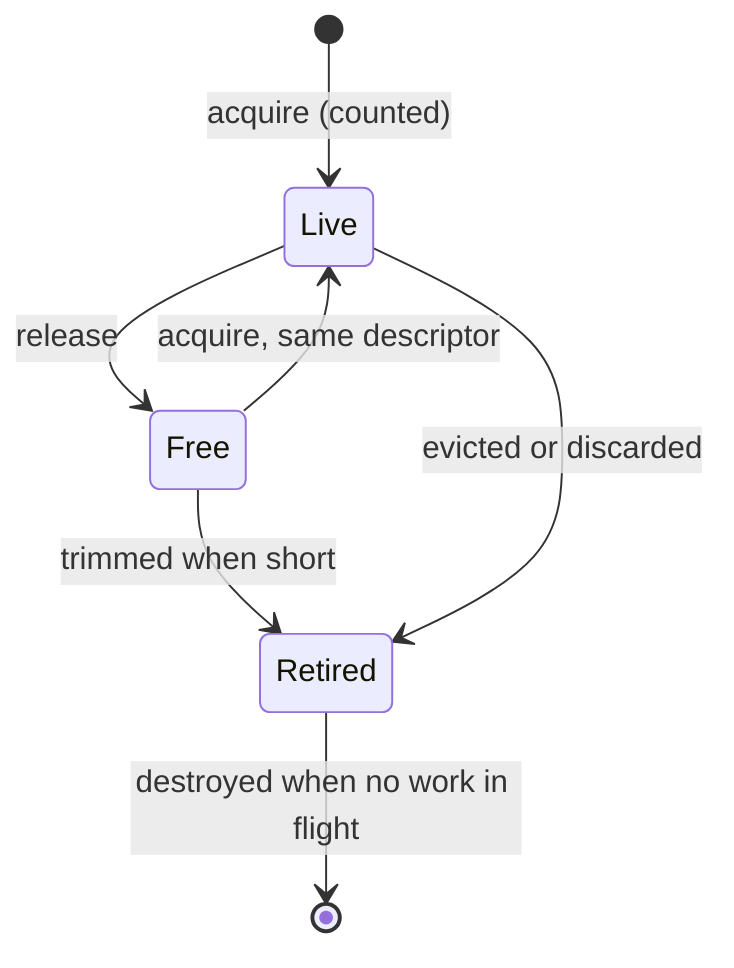

# Chapter 8 · Count What You Own

*The module that holds a scarce resource keeps its own ledger and its own recovery.*

**★★** We believe any good solution to this problem has this shape.

## Intent

When a program holds a limited resource that the platform will not account for, give one module the job of owning it.
That module counts every unit it hands out against a budget it sets itself, reuses released units, decides what is
given back first when the budget runs short, destroys a unit only when nothing still uses it, and recovers from
exhaustion by one fixed, bounded procedure.

## Also known as

Resource manager; budgeted pool; resource lifecycle manager; memory governor.

## Motivation

chromobench renders on the GPU through WebGPU. Its images live in **textures** (images stored in GPU memory) and its
temporary data in **buffers**. WebGPU has no call that reports how much memory is free. When memory runs out, an
allocation fails, or the browser resets the GPU and every texture is lost. The naive approach is to create a texture
when one is needed, destroy it when done, and let the driver worry. chromobench met four failures.

1. **Destroyed while still in use.** The film-grain code kept one cached texture of ones and destroyed it whenever a
   different size was asked for. A 160-pixel thumbnail and the viewer rendered together. The thumbnail took its
   texture and paused for a shader; the viewer asked for its size; the cache destroyed the thumbnail's texture; the
   thumbnail submitted its work. The console said, again and again:
   `Destroyed texture [Texture (unlabeled 160x107 px, TextureFormat::RGBA32Float)] used in a submit.`
2. **Exhausted, with no one to blame.** With two 24-megapixel raw files open, renders failed with
   `E_GPU_OOM: film.camMatrix.0: 14192640 bytes do not fit the budget (525083680 of 536870912 live)`, nine times in
   the main viewer and once more elsewhere. Each open file kept its full-size source texture, 4000 × 2686 pixels of four
   32-bit floats, about 164 MB, whether it was on screen or not.
3. **Memory that nobody counted.** Of the 512 MB budget, 160 MB were upload buffers that had already been released. They
   sat in the buffer pool's free list, and nothing ever trimmed it, because only the texture pool was trimmed. The
   grain textures were made outside the budget altogether: 171 MB for a 4000-pixel one that the ledger never saw.
4. **The wrong picture.** When the render of a newly opened file failed, the viewer kept showing the previous file's
   picture under the new file's name.

Other systems meet the same problem. A database accepts a fixed number of connections; a service that leaks them
stops answering. An operating system limits open files per process. A game streams textures in and out of a fixed
amount of video memory. A mobile app is told to give memory back or be killed.
Editor lab's book makes the browser's version plain (§6.3): a tab learns little or nothing about the machine's memory,
so an engine in a tab "should set a budget and measure against it".

## Problem

**How does a program stay within a resource that the platform will not measure for it, and recover when it runs out,
without ever freeing something that is still in use?**

## Forces

- **Use everything against leave room.** A larger budget means fewer evictions, but the GPU is shared with the system
  and other programs, and a tab that takes too much is killed.
- **Reuse against return.** Keeping released units makes the next allocation free; kept units are memory nobody uses.
- **Free early against free safely.** Destroying at release returns memory at once, but work already recorded may
  still read the unit.
- **One owner against many users.** A single ledger sees everything, but only if every allocation goes through it,
  including the one written in a hurry.
- **Recover against tell the truth.** A retry hides a passing failure; endless retries hide a real one; an old result
  left on screen hides it worst of all.
- **Simple policy against best policy.** Least-recently-used eviction is easy to reason about. Cost-aware eviction keeps
  what is expensive to remake, but pays only when costs per byte differ.

## Solution

**Therefore: give each scarce resource exactly one owner. Every unit is acquired from it and returned to it, and it
keeps a ledger, counted against a budget it sets from what the platform reports, by a rule it can state: units live,
units released and kept for reuse, and the high-water mark. Users hold a lease on a unit while they use it, and pin
what they need most. When an allocation does not fit, the owner frees released units first, then units neither pinned
nor leased, least recently used first, and refuses only after that. It destroys a unit only when no work that might use
it is still in flight. On exhaustion it follows one bounded recovery: let go of everything not needed for the current
task, retry once, and otherwise fail plainly, for the right task, without leaving a stale result in view.**

## Applicability

Use it when:

- the platform cannot report or limit usage for you (GPU memory in a browser, WebAssembly memory, a database's
  connection limit, a paid API's quota);
- creating a unit is expensive enough that reuse pays;
- use and release can interleave (asynchronous work, queues, threads);
- running out is a likely event, because users open larger files than you tested with.

Do not use it when:

- the platform already manages the resource well: small objects under a garbage collector, the operating system's
  file cache;
- a unit lives only inside one call that frees it before returning;
- the platform already keeps the ledger and will tell you (a Vulkan driver with the memory-budget extension): read
  theirs instead of keeping a second one that drifts.

## Structure

| Participant | Responsibility |
| --- | --- |
| **Owner** | the only module that creates or destroys units |
| **Budget** | the ledger: bytes live, peak, limit, and the rule that chose the limit |
| **Pools** | released units kept for reuse, keyed by descriptor (format, size, usage), on one release clock |
| **Residency** | units kept between tasks, grouped by what they belong to (a frame), least recently used first |
| **Lease** | marks a unit a task is using now; never evicted in normal operation |
| **Pin** | marks the groups needed now (on screen); evicted last |
| **Reclaimers** | other holders that give units back when asked |
| **Retirement list** | units let go while work is in flight; destroyed when it ends |
| **Recovery** | the one procedure for exhaustion |
| **Journal** | records peaks, evictions and recoveries |

## Collaborations

1. A task starts inside the owner's `busy` scope, which counts work in flight and opens a high-water window.
2. The task acquires a unit by descriptor. A released unit with the same descriptor is reused at no cost.
3. If a new unit does not fit, the owner trims released units of every pool, oldest release first; then asks the
   reclaimers (groups not pinned, least recently used, nothing leased); then trims again; then refuses.
4. A unit let go while work is in flight leaves the ledger at once and joins the retirement list; it is destroyed when
   the in-flight count reaches zero.
5. The task ends; its high-water mark goes to the journal.
6. If the task failed for lack of memory, the owner lets go of everything, pinned and leased units included (safe,
   because they are retired), and runs the task once more. A second failure becomes a plain error for that task, and
   the display takes down any picture belonging to another.



Read it as the life of one unit. It leaves the ledger when it enters Retired, and leaves the device only on the last
arrow; the gap between the two is what makes early freeing safe.

## Sketch

```text
-- the budget, chosen by a stated rule from what the platform reports
budgetFor(platform) → (bytes, rule):
  share ← platform.memory · 1/8                         -- assumed 4 GiB when not reported
  bytes ← clamp(min(share, platform.largestBuffer), floor: 512 MiB, cap: 2 GiB)
  return (bytes, "min(memory × 1/8, largest buffer) within [512 MiB, 2 GiB] = " ++ bytes)

-- the owner: the only module that creates or destroys units
owner Runtime:
  limit, live, peak ; free: map descriptor → list of (unit, releasedAt)
  kept: Residency ; inFlight ← 0 ; retired ← []

  busy(work):                                           -- all GPU work runs inside this
    inFlight ← inFlight + 1
    try: return work()
    finally:
      inFlight ← inFlight − 1
      if inFlight = 0: destroy every unit in retired ; retired ← []

  retire(unit): if inFlight = 0: destroy(unit) else retired ← retired ++ [unit]

  acquire(desc, label) → unit:
    if free[desc] is not empty: return take(free[desc])            -- reuse: no new bytes
    need ← bytes(desc)
    if not makeRoom(need):
      refuse("out-of-memory", label ++ ": " ++ need ++ " bytes do not fit (" ++ live ++ " of " ++ limit ++ ")")
    unit ← create(desc, label) ; live ← live + need ; peak ← max(peak, live)
    return unit

  release(unit): append (unit, clock()) to free[descriptor(unit)]

  makeRoom(need):
    trimFree(limit − need)                              -- every pool, oldest release first, retired not destroyed
    if live + need > limit: kept.evict(live + need − limit)        -- not pinned, not leased, oldest first
    if live + need > limit: trimFree(limit − need)
    return live + need ≤ limit

-- recovery: one bounded procedure, then the truth
render(task):
  try: return busy(() → run(task))
  catch out-of-memory:
    freed ← kept.evict(all, includingPinnedAndLeased) + trimFree(0)
    try: return busy(() → run(task))
    catch out-of-memory as e:
      refuse("out-of-memory", "not enough memory for " ++ task ++ " after freeing " ++ freed, hint: rule)

-- the pattern in use
gpu ← Runtime(budgetFor(adapter))
gpu.kept.pin(framesOnScreen)
match render(task):
  refusal r: if task.frame ≠ view.shownFrame: view.takeDown() ; view.say(r.message)
  picture p: view.show(p, frame: task.frame)
```

## Implementation notes

1. **Every allocation goes through the owner, every one.** The grain textures were created directly, outside the
   budget, so the device held more than the ledger said. A ledger with one bypass is wrong without saying so. Make the
   raw constructor reachable only from the pool, and look for direct calls in review.
2. **Trim every free list, not one.** This is the bug chromobench shipped: the texture pool trimmed only its own free
   lists, so 160 MB of released upload buffers stayed in the shared budget for good. Now both pools share one budget
   and one release clock, and the oldest release goes first, whatever the pool. Upload buffers over 16 MiB are no
   longer kept at all: reuse only where it pays.
3. **Destroy when nothing is in flight.** The thumbnail race was fixed with `busy` and `retire`: GPU work runs inside a
   counted scope, and what is let go meanwhile is destroyed when the count reaches zero. WebGPU allows destroying a
   texture after the work using it is submitted, not before, and recording can pause between the two.
4. **Prove a race with a test that forces the interleaving.** chromobench's first end-to-end test for the race passed on
   the broken code: the two renders rarely met at the right moment. The test that worked takes the 160 × 107 texture
   inside `busy`, asks for five other sizes, then submits work using the first. On the old code it fails with the
   user's message byte for byte.
5. **Leases and pins are different promises.** A lease says "a task is using this between taking it and submitting";
   a pin says "the user is looking at this". Normal eviction skips both. Recovery takes both, which is safe only
   because let-go units are retired, not destroyed. The ledger then counts them free slightly early: the price of not
   failing the render.
6. **Do not hold what you can remake small.** A thumbnail of 160 pixels used to keep the frame's full-size texture.
   Now a render smaller than its region reads a **proxy**: the source sampled on the render's own grid, computed with
   the shader's 32-bit arithmetic so that not one sample differs from reading the full texture. At most four proxies
   are kept per frame. With the two raw files open, live textures fell from 328 MB to 47 MB and the peak from 512 MB
   to about 215 MB, without errors; the same peak under a forced 512 MB budget showed that residency and trimming, not
   the larger budget, made the fix.
7. **State the rule that chose the budget.** The budget is an eighth of the device memory the browser reports (4 GiB
   assumed when it reports none), at most the adapter's largest buffer, within 512 MiB and 2 GiB (1 GiB for a software
   adapter). The rule's text goes into the journal. The first version read the *device's* largest buffer, which
   chromobench itself had capped at 1 GiB, and got half the intended budget: read the platform's figure, not your own
   request echoed back.
8. **Recover once, and say what was tried.** When the ledger refuses, chromobench's render lets go of everything not
   needed and retries once; a second failure says how much it freed and what the budget rule was. A render that cannot
   fit therefore fails twice as slowly, a cost accepted on purpose. Never loop. A debt: the pool also has an older,
   driver-level recovery (catch the driver's out-of-memory error, trim, halve the budget, retry once), but only its
   tests call it; a real driver error is today only reported to the journal. A recovery nobody calls should be wired
   in or deleted.
9. **Fail for the right task.** The viewer remembers which frame its picture belongs to. When a render of another frame
   fails, it takes the picture down and shows the message; when an edit of the same frame fails, it keeps that frame's
   last picture, because it is still that picture. Editor lab's book (§8.9) adds the other half: keep CPU copies,
   since the device can be lost and "the cache must be able to start empty".
10. **Keep high-water marks and write them down.** Each render watches its own peak, and the journal records it, a row
    whenever the session's highest grows by 32 MB, every eviction and every recovery. The out-of-memory bug was found
    in such a journal while another bug was being reproduced; the error alone did not say where the memory went.
11. **Choose the eviction order by what units cost.** chromobench evicts frames not on screen first, least recently
    used. Cost-aware eviction was deferred: everything it keeps costs an upload roughly proportional to its bytes, so a
    cost-aware order equals LRU. That is [Chapter 9](09-keep-what-is-dear.md)'s question; the order lives in one
    function so the answer can change there.

## Variations

- **Count units, not bytes.** Connection pools count connections; darktable counts cache lines (Editor lab's book,
  §6.3). Simpler, and wrong when units differ in size.
- **Wait instead of evict.** A fixed pool makes callers wait for a unit, up to a timeout, then fail. Predictable; the
  callers must cope with waiting.
- **Let the platform signal.** Trim when the system sends a memory warning instead of keeping a budget. Uses the
  platform's knowledge; the signal comes late and is coarse.
- **Arenas.** Allocate all units of one task from a region and free the region when the task ends. No per-unit
  bookkeeping; nothing may outlive its arena.

## Consequences

- \+ Exhaustion is predictable and attributable: the error names the unit, the bytes and the ledger.
- \+ Use-after-destroy disappears as a class once every destruction goes through retirement.
- \+ The program grows piecemeal: a new holder (the grain cache, a future cache of intermediate results) joins by
  registering a reclaimer, and the policy stays in one place. That is what makes it habitable: "where did the memory
  go?" is answered by one module's numbers.
- − The ledger estimates what the driver really uses (alignment, internal copies); keep a margin.
- − Every allocation must go through the owner, and one bypass breaks the count silently.
- − Deferred destruction holds memory a little longer than strictly needed.
- − Recovery makes the failing path slower.

## Known uses

- **HikariCP**, a Java connection pool: a maximum pool size, a timeout for callers waiting for a connection, and a
  leak-detection threshold that reports a connection held too long.
- **PostgreSQL**'s shared buffers: buffers are pinned while in use and chosen for eviction by a clock sweep over usage
  counts; a pinned buffer is never evicted.
- **Android**'s `onTrimMemory` and **iOS**'s memory warnings ask apps to release what they can before the system ends
  them.
- **Unreal Engine**'s texture streaming pool and **Unity**'s mipmap streaming budget keep textures within a fixed
  video-memory budget by streaming detail levels in and out.
- **Vulkan Memory Allocator** reports heap budgets from the memory-budget extension; Vulkan renderers defer destroying
  a resource until the GPU signals that the frames using it are done.
- **Arena allocation**: David Hanson, "Fast Allocation and Deallocation of Memory Based on Object Lifetimes"
  (*Software: Practice and Experience*, 1990); the Apache Portable Runtime's memory pools.
- Michael Kircher and Prashant Jain, *Pattern-Oriented Software Architecture, Volume 3: Patterns for Resource
  Management* (2004): Pooling, Leasing, Evictor and Resource Lifecycle Manager are this chapter's parts as patterns.

## Related chapters

- [Chapter 9 · Keep What Is Dear](09-keep-what-is-dear.md) completes this one: the owner says how much may be kept;
  Chapter 9 says what.
- [Chapter 10 · Measure From the User's Clock](10-measure-from-the-users-clock.md): high-water marks are a measurement
  like latency, and belong in the same reports.
- [Chapter 7 · Estimate with Confidence](07-estimate-with-confidence.md): the budget is itself an estimate, returned
  with the rule that produced it.
- [Chapter 6 · Work in Small Slices](06-work-in-small-slices.md): the budget, not the clock, sizes chromobench's tiles.
- **Object Pool** (not in GoF; Mark Grand, *Patterns in Java*, 1998). chromobench's "proxy", a reduced stand-in for
  the source, is a cousin of GoF's virtual **Proxy**.
- Parent volume: [Reach-Declared Tiling](../08-reach-declared-tiling.md), for computing images larger than the budget
  in bounded pieces.

## Exercises

1. **A connection pool.** A database accepts 100 connections shared by four server processes. Set each process's
   budget, decide how long a lease may last, and write the recovery when the pool is empty. What do you log so that a
   leak is found?
2. **Find the forces in your own code.** Pick a resource your program holds (files, sockets, timers, listeners). Who
   creates and who destroys each one, and can it be destroyed while still in use? Which force did your code resolve by
   accident?
3. **Force the interleaving.** A cache keeps one buffer and destroys it when a different size is asked for. Write a
   test that takes the buffer, asks for another size, then uses the first. Show it fails, then add `busy` and `retire`
   and show it passes.
4. **A game level.** A game has 1 GiB for textures. Decide what is pinned (visible now), leased (in a draw call being
   recorded), and evicted first. What does the player see when the recovery fails?
