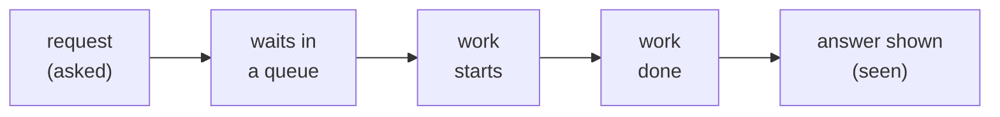

# Chapter 10 · Measure From the User's Clock

*Time each action from when the person asked to when they saw the answer, keep the whole distribution, and let the
build fail when it grows.*

**★★** We believe any good solution to this problem has this shape.

## Intent

Define a program's speed as response time: from the moment a person makes a request to the moment its result is
visible, summarised by percentiles over many requests. Make each such measurement a test with a stated limit, run on
fixed machines as part of the build, so that a regression fails at the change that caused it.

## Also known as

Latency budgets; performance gates; benchmarks as tests; service-level objectives.

## Motivation

In an image editor, moving a slider changes a setting and the picture follows. The screen is redrawn 60 times a
second, so one **frame** lasts 16.7 ms. The rendering engine runs in a background thread (a **worker**) or on the
graphics processor (**GPU**), and a first measurement times the engine's render function. Four things go wrong.

1. **The test watched the wrong clock.** chromobench has a test that drags a slider and fails if the window freezes:
   it records gaps between frames and allows at most 1,000 ms. With the engine in a worker the window never froze, so
   the test passed while each render of a small synthetic test image took over 4,000 ms. The test was changed to wait
   for a picture, and the slowness was noted for later; once found, the fix took a slider step from 4,200 ms to
   740 ms.
2. **The GPU said "done" before it started.** The call that launches a GPU program returns as soon as the work is
   queued. A timer around it measures how fast work is queued, not how fast it runs.
3. **A slowdown no test would have caught.** When chromobench's exports were made exact where the image is cut into
   pieces, a 4000-pixel export went from about 780 ms to about 1,650 ms. It was seen only because the engineer ran a
   benchmark by hand before and after; the benchmark is skipped unless asked for and has no limit. This slowdown was
   accepted on purpose; had it been an accident, nothing would have failed.
4. **The average hid the stalls.** Editor lab's textbook gives a drag of fifty-seven updates at 5 ms and three at
   200 ms. The mean is 14.8 ms, inside a frame; the person saw three long stalls.

Every interactive or serving system has this problem. A web server's load tester that waits for each response
undercounts exactly the slow periods; a game's average frame rate hides the hitches players notice; a compiler's
build time creeps up one commit at a time.

## Problem

**How do you know whether a program is fast enough for the people using it, and find out on the day it stops being
so?**

## Forces

- **The program's clock against the user's clock.** Timing a function is easy and repeatable; the person also waits
  for queues, other threads, other devices and the screen.
- **One number against a distribution.** A mean is easy to compare; the stalls people remember live in the tail.
- **Realism against repeatability.** Real devices and sessions are what matter; fixed machines and scripted
  scenarios give numbers that can be compared from day to day.
- **Seeing inside against disturbing.** Fine-grained timers show where time goes, but reading them can slow the work.
- **Strict gates against noisy machines.** A tight limit catches small regressions; noise makes it flaky, and flaky
  tests get relaxed or skipped.
- **Warm against cold.** Caches make the hundredth action fast; a new user meets the first.

## Solution

**Therefore: for each action people care about, name the event that starts it (the click, the keystroke, the
request) and the event that ends it (the screen or the response that shows the answer), and take both times from one
clock, starting when the request was made, or should have been made, not when work began. Drive scripted scenarios
at the user's pace, repeat them, report cold and warm separately, and summarise each by percentiles (p50, p95, p99)
over all samples, with the spread between repeats. Give each scenario a limit stated as a requirement; run the
scenarios on fixed machines as part of the build; fail the build when a percentile passes its limit or grows past the
noise against a stored baseline. Keep every run with its environment so two can be compared later.**

The **p-th percentile** of a list of times is the value that p % of them do not exceed. p50 is the median, the
typical case; p95 is exceeded by one sample in twenty, the slow case people notice.

## Applicability

Use it when the program is interactive or serves requests; when work crosses threads, devices or queues, so that a
function's duration is not what anyone waits for; and when two engines or settings must be compared.

Do not use it for batch work judged by throughput (gate total time and rate instead); do not gate where no machine
can be held fixed (plot trends per commit and let a person judge); and do not start before someone has written down
what "fast enough" means.

## Structure

| Participant | Responsibility |
| --- | --- |
| **Requirement** | an event, a measure and a limit: "slider step, p95, 50 ms" |
| **Scenario** | a scripted sequence of user actions on a copy of the state, at the user's pace |
| **Clock** | one monotonic time source (it never jumps backwards) for every start and end |
| **Probe** | stamps each request when it was asked and when its answer became visible |
| **Summary** | percentiles over pooled samples, spread between repeats, cold and warm apart |
| **Gate** | compares a summary with its limit and its baseline; passes or fails the build |

In a web service the requirement might be "checkout, p99, 300 ms", the scenario a replayed log of real traffic, and
the probe the load tester, which stamps each request at its scheduled time and stops at the last byte of the reply.

## Collaborations

1. At each scheduled time the scenario issues an action and the probe stamps it, even if the program is still busy.
2. When an answer becomes visible, the probe stamps the end for that request and for any older ones it replaced.
3. After the repeats, the summary pools the samples into percentiles; the gate compares them with the requirement
   and the baseline.



Read it left to right as one request's life. A timer inside the function measures only C to D, the **service time**.
The person waits from A to E, the **response time**. This pattern measures A to E.

## Sketch

```text
-- helpers named for what they do: start, copy, waitUntil, waitUntilIdle, median, range, record, environment
-- clock.now(): a monotonic time in ms

value Requirement: { scenario, measure, limitMs, noiseMs }      -- measure ∈ { "p50", "p95", "p99" }

-- the probe: start when the user asked, stop when the answer is visible
probe Probe(clock):
  asked ← {} ; samples ← []                     -- asked: request id → time asked, in id order
  ask(id, at):  asked[id] ← at                   -- 'at' is the scheduled time, not the start of work
  shown(id):                                     -- the program reports the newest request each answer includes
    for each p in asked with p ≤ id:             -- that answer also covers every older request
      samples ← samples ++ [clock.now() − asked[p]] ; remove p from asked

-- one scenario, open loop: actions arrive on the user's schedule, not the program's
run(scenario, machine, repeats) → Summary:
  runs ← []
  for r in 1..repeats:
    probe ← Probe(clock)
    app ← start(copy(scenario.state), machine, onShown: id → probe.shown(id))
    cold ← app.timeToFirstAnswer() ; t0 ← clock.now()
    for (i, action) in scenario.actions:
      at ← t0 + i · scenario.intervalMs
      waitUntil(at) ; probe.ask(action.id, at) ; app.apply(action)   -- never wait for the last answer
    waitUntilIdle(app)
    if probe.asked ≠ {}: return refuse(unanswered, "requests never shown", where: scenario)
    runs ← runs ++ [{ cold, samples: probe.samples }]
  return summarise(runs)

-- percentiles over all samples pooled; never average the percentiles of runs
summarise(runs) → Summary:
  all ← concat(r.samples for r in runs)
  return { p50: q(all, 0.50), p95: q(all, 0.95), p99: q(all, 0.99), max: max(all),
           spread: range(q(r.samples, 0.95) for r in runs),        -- largest minus smallest
           cold: median(r.cold for r in runs) }

q(xs, p) → Number: return sorted(xs)[min(length(xs) − 1, floor(p · length(xs)))]

-- the gate: part of the build
gate(req, s, baseline) → pass | refuse:
  if s[req.measure] > req.limitMs:
    return refuse(overLimit, req.measure ++ " above its limit", where: req.scenario)
  margin ← max(req.noiseMs, 2 · s.spread)
  if baseline ≠ none and s[req.measure] − baseline[req.measure] > margin:
    return refuse(regression, "slower than the baseline by more than the noise", where: req.scenario)
  return pass

-- in use
req ← Requirement{ scenario: "drag a slider", measure: "p95", limitMs: 50, noiseMs: 3 }
s ← run(scenarios["drag a slider"], machine: "lab laptop", repeats: 5)
record(s, environment())
gate(req, s, baseline: lastRecorded("drag a slider", "lab laptop"))
```

## Implementation notes

1. **Start the clock when the user asked.** chromobench times each render from when the engine starts it to when the
   pixels are back, leaving out the wait behind an earlier render and the drawing. The numbers go to a debug log.
   Editor lab's benchmark starts its timer after the change has been applied. Both measure the engine, which is
   useful, but not what a person waits.

2. **Service time is not response time: drive at the user's pace.** A **closed-loop** driver issues the next request
   only after the last answer. When the program falls behind, the driver slows with it, so slow periods get fewer
   samples than people live through: **coordinated omission**. Editor lab's benchmark is closed loop. For an engine
   needing 45 ms per update while the pointer moves every 16.7 ms, it reports 45 ms, but the screen shows a position
   45 to 102 ms old, 74 ms on average. An **open-loop** driver issues requests on a fixed schedule and times each
   from when it should have been sent.

3. **Gate more than one clock.** chromobench's freeze test is right to gate gaps between frames, but a worker keeps
   those small whatever the engine does. A second gate, slider to picture, would have failed at 4,200 ms instead of
   leaving the slowness for someone to notice.

4. **Time asynchronous devices to completion.** chromobench measures GPU work from submitting it to the GPU's signal
   that it has finished, and its benchmark waits until results are read back. A debt shows the cost of measuring
   carelessly: per-step GPU timings go into a log that nothing reads, yet each timed step waits for its reading before
   the next starts. The project's records hold no measurement of what that wait costs.

5. **Pool samples, repeat, report the spread.** Editor lab's benchmark reports the mean of each repeat's p95. That is
   not the p95 of anything; pool the samples and take the percentile once. Its textbook gives the same render at
   332 ms and 317 ms with nothing changed: a difference smaller than that spread is not a result.

6. **Keep caches from flattering you.** A cache keyed by content ([Chapter 9](09-keep-what-is-dear.md)) answers a
   repeated request for nothing. chromobench's export benchmark changes one setting slightly every round so every
   round misses, and discards two warm-up rounds. Editor lab gives each run a fresh copy of document and cache.

7. **A timing that is not a check catches nothing.** chromobench's benchmark prints numbers and asserts nothing; its
   own comment calls it "a timing, not a check". Editor lab's textbook says scenarios should fail the build, but in
   the program the limit is a column on screen. Both projects measure a great deal; neither fails a build on time to
   picture.

8. **Noisy machines need loose limits, interleaved comparisons and, best, a fixed machine.** chromobench's limits are
   deliberately loose for a busy build machine. While the 4,200 ms render was investigated, single timings varied by a
   factor of two, and only runs alternating old and new code could be compared.

9. **Modelled devices are questions, not answers.** Editor lab models slower devices by multiplying measured time by
   1.8, 3.5 or 5, as if every operation slowed alike; calibrate each factor on a real device.

10. **State requirements as numbers from perception.** Editor lab's textbook asks for each preview update within one
    frame at p95, and the full picture within 250 ms of letting go. The web's Interaction to Next Paint calls 200 ms
    good, but for clicks; a drag is a stream of events that each want the next frame.

## Variations

- **Closed-loop benchmark.** Measures service time. Right for comparing two engines on equal work; wrong for saying
  what a person sees once the program is slower than its input.
- **Field measurement.** Record response times from real users, as browsers' Core Web Vitals do. Realistic but not
  repeatable, and not available before release; it complements the gate.
- **Count work instead of time.** Gate on counts that do not vary between runs: pieces of image computed, stages
  run, bytes copied. Editor lab reports pieces computed per scenario; chromobench's slow reference engine counts
  stages and pixels.
  Counts can be gated exactly but miss slowdowns inside one unit of work.

## Consequences

- \+ A regression fails at the change that caused it, while the cause is fresh.
- \+ The numbers describe what people experience, queues and tail included.
- \+ The code stays habitable: a hot path can be changed with confidence, and the program can grow piecemeal without
  slowly getting worse.
- − It needs fixed machines, time in every build, and someone to own the baselines.
- − Open-loop drivers and end-of-answer probes are harder to write than a timer around a call.
- − Noisy gates get loosened until they catch nothing; percentiles need many samples (a p99 of forty is the maximum).

## Known uses

- **Gil Tene**, "How NOT to Measure Latency" (talks from 2013 on), named coordinated omission; his **HdrHistogram**
  records latency distributions compactly, and **wrk2** sends requests at a constant rate and times each from when it
  should have been sent.
- **Jeffrey Dean and Luiz André Barroso**, "The Tail at Scale" (*CACM* 56(2), 2013): why high percentiles dominate
  in systems built from many parts.
- **Chrome's RAIL model** sets time budgets per kind of interaction; **Interaction to Next Paint** (a Core Web Vital
  since 2024) measures from input to the next painted frame.
- **Google's *Site Reliability Engineering*** (O'Reilly, 2016) states service-level objectives as latency percentiles.
- **rustc-perf** benchmarks the Rust compiler on every merge and tracks instruction counts, which vary less than time.

## Related chapters

- [Chapter 1](01-one-contract-several-engines.md): two engines behind one contract are compared by the same scenarios.
- [Chapter 6](06-work-in-small-slices.md): slicing makes a frame budget reachable; this chapter checks it was reached.
- [Chapter 9](09-keep-what-is-dear.md): eviction policies are chosen by these measurements.
- [Chapter 7](07-estimate-with-confidence.md): a percentile of few samples is an estimate.
- GoF: the probe **Observes** requests and answers; a recorded session is a list of **Commands**.
- Parent volume: [Latest-Wins Render Slots](../04-latest-wins-render-slots.md) is the queue whose waiting this chapter
  counts; [Reference Oracle with Negative Controls](../03-reference-oracle.md) is the correctness half of the build.

## Exercises

1. **Summaries.** Forty updates take 5 ms and two take 200 ms. Compute the mean, p50, p95 and p99 with `q` from the
   sketch. Why does p95 miss the stalls here when it caught them in the Motivation?
2. **Coordinated omission in code.** A fake server handles one request at a time in 1 ms, but from t = 50 s to
   t = 52 s it is stalled. Simulate 100 s on a clock you advance yourself. (a) Closed loop: send each request 10 ms
   after the last was sent, but never before the last was answered. (b) Open loop: send one every 10 ms regardless,
   queue them, and time each from its scheduled send. Report count, p50, p99 and maximum for both; explain.
3. **Your own forces.** In a program you have written that waits for something (a network call, a file, a query),
   find where you would start and stop a timer. What does the person wait for that your timer leaves out?
4. **A gate.** Five repeats give p95 values of 41, 44, 39, 47 and 42 ms; the requirement is 50 ms and the noise
   allowance 3 ms. Write the gate. Would a later run at 49 ms fail against this baseline? Should it?
