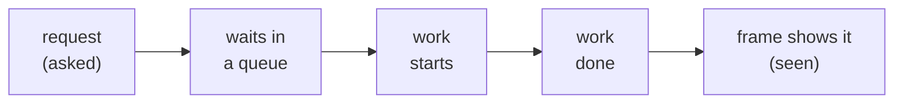

# Chapter 10 · Measure From the User's Clock

*Time each action from when the person asked to when they saw the answer, keep the whole distribution, and let the
build fail when it grows.*

★★ close to invariant: we believe any good solution to this problem has this shape.

## Intent

Define a program's speed as response time: from the moment a person makes a request to the moment its result is
visible, summarised by percentiles over many requests. Make each such measurement a test with a stated limit, run on
fixed machines as part of the build, so that a regression fails at the change that caused it.

## Also known as

Latency budgets; performance gates; benchmarks as tests; service-level objectives.

## Motivation

An image editor's slider changes a parameter and the picture follows. The engine runs in a background thread (a
**worker**) or on the GPU, and a first measurement times the engine's render function. Four things go wrong.

1. **The test watched the wrong clock.** chromobench has a test that drags a slider with the mouse and fails if the
   window freezes: it records gaps between animation frames and allows at most a second. With the reference engine in
   a worker the window never froze, so the test passed while a screen render of a synthetic 1024 × 683 negative took
   4.1 to 4.3 seconds. What failed was a symptom: no preview ever appeared during the drag. The test was changed to
   hold the mouse still until a preview showed, and the slowness was recorded for later. The causes, found later, were
   a framing step that sent a preview back to full resolution and a slow colour-gamut search; the fixes took a slider
   step from 4.2 s to 0.74 s.
2. **The GPU said "done" before it started.** A GPU **dispatch**, the call that launches a GPU program, returns as
   soon as the work is queued. A timer around it measures how fast work is queued, not how fast it runs.
3. **A slowdown no gate would have seen.** When chromobench's tiled export was made exact at tile borders, a
   4000-pixel export with local dodging and burning went from about 781 ms to about 1650 ms. The engineer saw it only
   by running a benchmark by hand before and after. The benchmark is skipped unless asked for and has no limit. Here
   the slowdown was a trade accepted on purpose; had it been an accident, nothing would have failed.
4. **The average hid the stalls.** Editor lab's textbook gives a slider drag of fifty-seven updates at 5 ms and three
   at 200 ms. The mean is 14.8 ms, under a 16.7 ms frame; the person saw three long stalls. The 95th percentile is
   200 ms.

Every interactive or serving system has this problem. A web server's load generator that waits for each response
before sending the next undercounts exactly the slow periods. A game's average frame rate hides the hitches players
notice. A compiler's build time creeps up one commit at a time, each too small to see.

## Problem

**How do you know whether a program is fast enough for the people using it, and find out on the day it stops being
so?**

## Forces

- **The program's clock against the user's clock.** Timing a function is easy and repeatable; the person also waits
  for queues, threads, the GPU and the screen.
- **One number against a distribution.** A mean is easy to compare; the stalls people remember live in the tail.
- **Realism against repeatability.** Real devices and real sessions are what matter; fixed machines and scripted
  scenarios give numbers that can be compared from day to day.
- **Seeing inside against disturbing.** Fine timers show where time goes, but reading them can stall the work, and
  browsers coarsen clocks on purpose.
- **Strict gates against noisy machines.** A tight limit catches small regressions; noise makes it flaky, and flaky
  tests get relaxed or skipped.
- **Warm against cold.** Caches make the hundredth action fast; a new user meets the first.

## Solution

**Therefore: for each action people care about, name the event that starts it (the input, the click, the request)
and the event that ends it (the frame that shows the answer), and take both times from one clock, starting when the
request was made, or should have been made, not when work began. Drive scripted scenarios on a copy of the state at
the user's pace, repeat them, report cold and warm separately, and summarise each as percentiles (p50, p95, p99) over
all samples, with the spread between repeats. Give each scenario a limit stated as a requirement; run the scenarios on
fixed machines as part of the build; fail the build when a percentile passes its limit or grows past the noise
against a stored baseline. Keep every run with its environment so two can be compared later.**

## Applicability

Use it when the program is interactive or serves requests; when work crosses threads, devices or queues, so that a
function's duration is not what anyone waits for; and when engines or settings must be compared
([Chapter 1](01-one-contract-several-engines.md)).

Do not use it for batch work judged by throughput (measure total time and rate, though the build can still fail on
them); do not gate where the machine cannot be held fixed (publish trends and let a person judge); and do not start
before someone has written down what "fast enough" means, because then the harness measures the wrong thing.

## Structure

| Participant | Responsibility |
| --- | --- |
| **Requirement** | an event, a measure and a limit: "slider step, p95, 50 ms" |
| **Scenario** | a scripted sequence of user actions on a copy of the state, at the user's pace |
| **Clock** | one monotonic time source for every start and end |
| **Probe** | stamps each request when it was asked and when its answer became visible |
| **Recorder** | keeps every sample with the run's environment |
| **Summary** | percentiles over pooled samples, spread between repeats, cold and warm apart |
| **Gate** | compares a summary with its limit and its baseline; passes or fails the build |

## Collaborations

1. The runner starts the program on a copy of the scenario's state, on a named machine.
2. At each scheduled time the scenario issues an action and the probe stamps it, even if the program is still busy.
3. When a frame shows an answer, the probe stamps the end for that request and for any older ones it replaced.
4. After the repeats, the summary pools the samples into percentiles and records the spread.
5. The gate compares the summary with the requirement and the baseline, and the build passes or fails.



Read it left to right as one request's life. A timer inside the function measures only C to D, the **service time**.
The person waits from A to E, the **response time**. This pattern measures A to E.

## Sketch

```text
value Requirement: { scenario, measure, limitMs, noiseMs }

-- the probe: start when the user asked, stop when the answer is visible
probe Probe(clock):
  asked ← {} ; samples ← []
  ask(id, at):   asked[id] ← at                      -- 'at' is the scheduled time, not the start of work
  shown(id):     for each pending p asked no later than id:   -- a newer answer covers older requests
                   samples ← samples ++ [clock.now() − asked[p]] ; remove asked[p]

-- one scenario, open loop: actions arrive on the user's schedule
run(scenario, machine, repeats) → Summary:
  runs ← []
  for r in 1..repeats:
    app ← start(copy(scenario.state), machine)
    cold ← timeToFirstAnswer(app)
    p ← Probe(clock) ; t0 ← clock.now()
    for (i, action) in scenario.actions:
      at ← t0 + i · scenario.intervalMs
      waitUntil(at) ; p.ask(action.id, at) ; app.apply(action)    -- never wait for the last answer
    waitUntilIdle(app)
    runs ← runs ++ [{ cold, samples: p.samples }]
  return summarise(runs)

-- percentiles over all samples; never average percentiles
summarise(runs) → Summary:
  all ← concat(r.samples for r in runs)
  return { p50: q(all, 0.50), p95: q(all, 0.95), p99: q(all, 0.99), max: max(all),
           spread: range(q(r.samples, 0.95) for r in runs),
           cold: median(r.cold for r in runs) }

q(xs, p) → Number: return sorted(xs)[min(length(xs) − 1, floor(p · length(xs)))]

-- the gate: part of the build
gate(req, s, baseline) → pass | refuse:
  if s[req.measure] > req.limitMs:
    return refuse(overLimit, "p95 above its limit", where: req.scenario)
  margin ← max(req.noiseMs, 2 · s.spread)
  if baseline ≠ none and s[req.measure] − baseline[req.measure] > margin:
    return refuse(regression, "slower than the baseline by more than the noise", where: req.scenario)
  return pass

-- in use
req ← Requirement{ scenario: "drag exposure", measure: "p95", limitMs: 50, noiseMs: 3 }
s ← run(scenarios["drag exposure"], machine: "lab laptop", repeats: 5)
record(s, environment())
gate(req, s, baseline: lastRecorded("drag exposure", "lab laptop"))
```

## Implementation notes

1. **Start the clock when the user asked.** chromobench's render bridge times from the start of a render to its
   result read back. The time a request waits behind a render in flight, and the time to paint, are outside it.
   These times go to a debug journal; the status bar shows a count of renders, not times. Editor lab's bench starts
   its timer after the change has been applied. Both measure the engine, which is useful, but not what a person waits.

2. **Service time is not response time: drive at the user's pace.** Editor lab's bench is **closed loop**: it issues
   the next update only after the last has finished. Its textbook works through an engine needing 45 ms per update
   under pointer events every 16.7 ms: the bench reports 45 ms, while the screen shows a position 45 to 102 ms old,
   74 ms on average. An **open-loop** driver issues events on a fixed schedule and times each from when it should have
   been sent. When newer input replaces older, the older request's wait ends when a later answer shows.

3. **Gate more than one clock.** chromobench's responsiveness test gates frame gaps (the window stays alive), and
   rightly so; but a worker keeps those small whatever the engine does. A second gate, slider to picture, would have
   failed at 4.2 s instead of leaving it to someone to notice a missing preview.

4. **Time asynchronous devices to completion.** chromobench's GPU timer measures from submitting the work to the
   queue's "submitted work done" signal, and its benchmark waits until results are read back. Where the GPU offers
   **timestamp queries**, timestamps it writes itself, Chrome rounds them to 100 µs, coarser than many single
   dispatches. Stalling between passes to time each gives proportions only. A debt: the wall-clock method has no
   caller, and the per-pass timestamps go into a log that nothing reads, while each timed pass waits for its readings
   before the next is encoded. The project's records hold no measurement of what that wait costs.

5. **Pool samples; repeat; report the spread.** Editor lab's bench averages the p95 of each repeat; a mean of
   percentiles is not a percentile of anything. Its textbook reports the same cold render at 332 ms and 317 ms with
   nothing changed, and a preview p95 of 28 ms in one run and 17 ms in another. A difference smaller than the spread
   is not a result. Note too that p99 of forty samples is simply the largest.

6. **Keep caches from flattering you.** A content-keyed cache ([Chapter 9](09-keep-what-is-dear.md)) answers a
   repeated request for nothing. chromobench's export benchmark changes one setting slightly in every round so that
   every round misses, discards two warm-up rounds, and reports the median of eight. Editor lab runs each scenario on
   a copy of the document with a fresh cache and reports the cold render apart.

7. **A timing that is not a check catches nothing.** chromobench's benchmark is skipped unless an environment
   variable is set, prints its numbers and asserts nothing; its own comment calls it "a timing, not a check". Editor
   lab's textbook says scenarios should fail the build, but in the program the gate is a column in the bench view and
   the test scripts print numbers. Both projects measure a great deal; neither fails a build on time to picture.

8. **Noisy machines: generous limits, interleaved comparisons, a fixed machine.** chromobench's responsiveness limits
   are deliberately loose for a loaded build machine. During the 4.2 s investigation the machine's load average was
   about 20; single timings varied by a factor of two, and only runs alternating between the old and new code were
   comparable. A dedicated machine and a baseline with a noise margin make tighter gates possible.

9. **Modelled devices are questions, not answers.** Editor lab's slower profiles multiply measured time by 1.8, 3.5
   or 5 and apply a smaller cache for real. That assumes every operation slows by the same factor. Calibrate a factor
   by running the same scenario on the real device.

10. **State requirements as numbers from perception.** Editor lab's textbook asks for a preview update within one
    frame (16.7 ms at 60 Hz) at p95, and the full-resolution picture within 250 ms of the end of a gesture. The web's
    Interaction to Next Paint calls 200 ms good, but for clicks; a drag is a stream of events that each want the next
    frame.

11. **Measurements that steer the program are service times.** chromobench sizes each preview so that, at the
    measured pixels per millisecond, it takes about 150 ms; its render queue also lets a slow preview finish if the
    view has shown nothing for 250 ms. The second rule is on the user's clock (time since anything was seen); it is
    what lets a slow engine show something while the hand keeps moving.

## Variations

- **Closed-loop benchmark.** Waits for each answer: measures service time. Right for comparing engines on equal
  work; wrong for saying what a person sees once the engine is slower than the input.
- **Field measurement.** Record response times from real users' sessions, as browsers' Core Web Vitals do.
  Realistic, but not repeatable and not available before release; it complements the gate.
- **Trend instead of gate.** Plot every run per commit and let a person judge. For machines too noisy to gate; it
  relies on someone looking.
- **Count work instead of time.** Gate on deterministic counts: tiles computed, stages run, bytes copied. Editor lab
  reports tiles computed per scenario and chromobench's reference engine counts stages and pixels. Counts do not
  vary between runs, so they can be gated exactly; they miss slowdowns inside one unit of work.

## Consequences

- \+ A regression fails at the change that caused it, while the cause is fresh.
- \+ The numbers describe what people experience, including queues and the tail.
- \+ Arguments about speed become measurements anyone can repeat.
- \+ The code stays habitable: a change to a hot path can be made with confidence, and the program can grow piecemeal
  without slowly getting worse.
- − It needs fixed machines, time in every build, and someone to own the baselines.
- − Open-loop drivers and end-of-frame probes are harder to write than a timer around a call.
- − Noisy gates get loosened until they catch nothing; tight ones get skipped.
- − Percentiles need many samples; a p99 of forty is just the maximum.

## Known uses

- **Gil Tene**, "How NOT to Measure Latency" (talks from 2013 on), named **coordinated omission**; his **HdrHistogram**
  records latency distributions with bounded error, and his **wrk2** sends requests at a constant rate and times each
  from when it should have been sent.
- **Jeffrey Dean and Luiz André Barroso**, "The Tail at Scale" (*Communications of the ACM* 56(2), 2013): why high
  percentiles dominate the experience of systems built from many parts.
- **Chrome's RAIL model** sets time budgets per kind of interaction (response, animation, idle, load).
- **Interaction to Next Paint**, a Core Web Vital since 2024, measures from input to the next painted frame and
  reports a high percentile of a page's interactions.
- **Google's *Site Reliability Engineering*** (O'Reilly, 2016) states service-level objectives as percentiles of
  latency.
- **rustc-perf** benchmarks the Rust compiler on every merge and tracks instruction counts as well as time, because
  counts are stable enough to compare.

## Related chapters

- [Chapter 1, One Contract, Several Engines](01-one-contract-several-engines.md): two engines behind one contract are
  compared by running the same scenarios.
- [Chapter 6, Work in Small Slices](06-work-in-small-slices.md): slicing is what makes a frame budget reachable; this
  chapter checks that it was reached.
- [Chapter 9, Keep What Is Dear](09-keep-what-is-dear.md): eviction policies are chosen by these measurements, and
  caches must not be allowed to flatter them.
- [Chapter 7, Estimate with Confidence](07-estimate-with-confidence.md): a percentile from few samples is an estimate
  and should say how sure it is.
- GoF: the probe is an **Observer** of requests and frames; a recorded session replayed by the bench is a list of
  **Commands**.
- Parent volume: [Latest-Wins Render Slots](../04-latest-wins-render-slots.md) is the queue whose waiting this chapter
  counts; [Reference Oracle with Negative Controls](../03-reference-oracle.md) is the correctness half of the same
  build.

## Exercises

1. **Summaries.** Forty updates take 5 ms and two take 200 ms. Compute the mean, p50, p95 and p99 with `q` from the
   sketch. Why does p95 miss the stalls here when it caught them in the Motivation?
2. **A web service.** A server answers in 1 ms, except that it pauses for 2 s once every 100 s. A load tester sends
   100 requests a second. Compute p99 as a closed-loop tester reports it and as an open-loop tester reports it.
3. **Your own forces.** In a program you have written that waits for something (a network call, a file, a query),
   find where you would start and stop a timer. What does the person wait for that your timer leaves out?
4. **A gate.** Five repeats of a scenario give p95 values of 41, 44, 39, 47 and 42 ms; the requirement is 50 ms.
   Write the gate. Would a later run at 49 ms fail against this baseline? Should it?
