# Session 02: "The same afternoon again, with the new version"

*Played by a Sonnet agent as Manfred. App: main `3703d0a`, `http://localhost:4650/`, headless Chromium 1440x900, no WebGPU (CPU engine, "Compatibility mode"). Files: `DSC_8559.NEF` and `raw010.dng`. Everything below was measured on the CPU engine.*

## Opening the app

The top bar with the strange checkboxes is gone. There is one row of menus (File, Edit, Frame, View …) and one row of tabs. The grey field says "No photos yet: File ▸ Open Files… (Ctrl+O), or drop them here", and at the bottom "ready: open photos or negatives". That is what I would have wanted last time. The little pill at the bottom left still says "Compatibility mode: slower (no WebGPU)"; I do not know what WebGPU is, but at least it no longer sounds like an error.

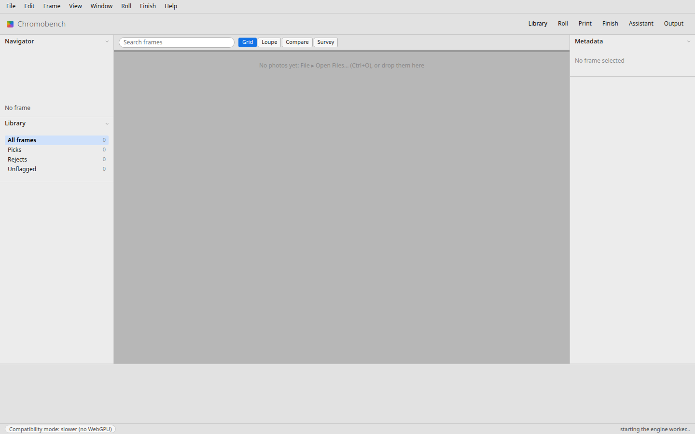
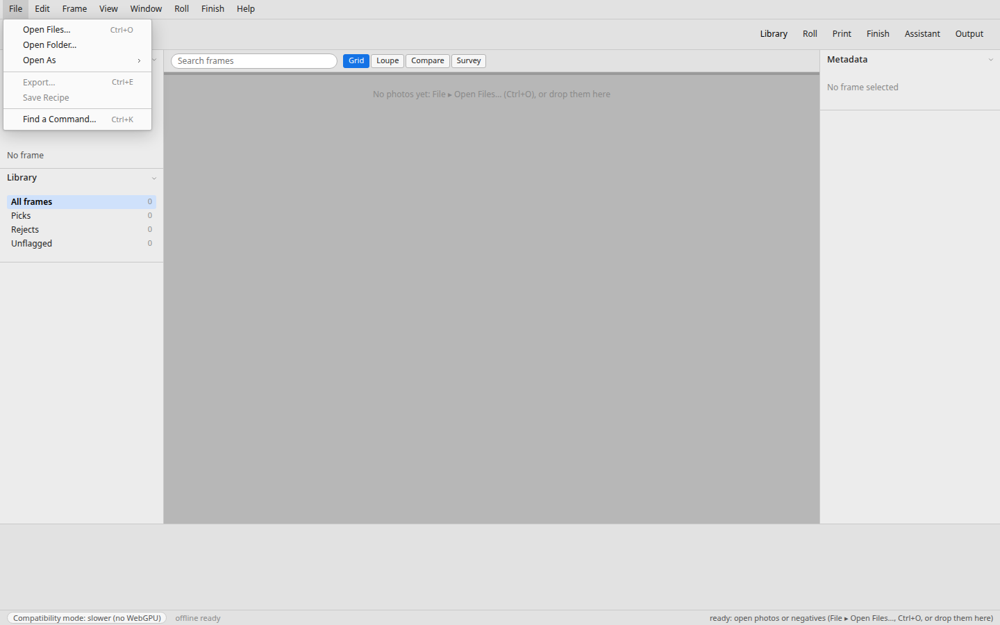

## My truck, first try

I open `DSC_8559.NEF` through the file input and touch nothing. It comes out as a normal, positive photo: red truck, blue sky. A pill at the bottom says "Photo", and "Nikon D750 photo, 24 MP". No negative, no strange text. The first time on a fresh browser it took a long time though: 17 s until it said "opened", about 29 s until the picture was drawn, with nothing but "opening DSC_8559.NEF…" to look at. On later tries 6 to 10 s. The window never froze (the longest hiccup was 0.2 s; last time 2.9 s).

> **Developer commentary (F1, F4).** Fixed. Decode now reports "Nikon D750 photo" and goes to the photo path by itself. rAF stalls on this open: 150, 117, 133, 200 ms (session 01: 460, 780, 2900 ms). Timeline: opening 1.5 s, opened 17.6 s, rendered 1 at ~29 s (cold profile, first visit, service-worker caching running); warm: opened 6-8 s, rendered 10-12 s.

## Opening it again, then the library

Same file again: a small message "DSC_8559.NEF is already open (as a photo)". No more hanging "opening…". I close the browser and open it again: my picture is still in the strip at the bottom, marked "not open". I click it: a box "Where is DSC_8559.NEF? The library keeps DSC_8559.NEF and its recipe, but the browser needs the file again to show it." with "Remove from library", "Not now", "Locate DSC_8559.NEF…". In this test browser Locate does not open a file window (the tester's browser has no file access; I was told to expect that), so I opened the file through the other door and my recipe was still there.

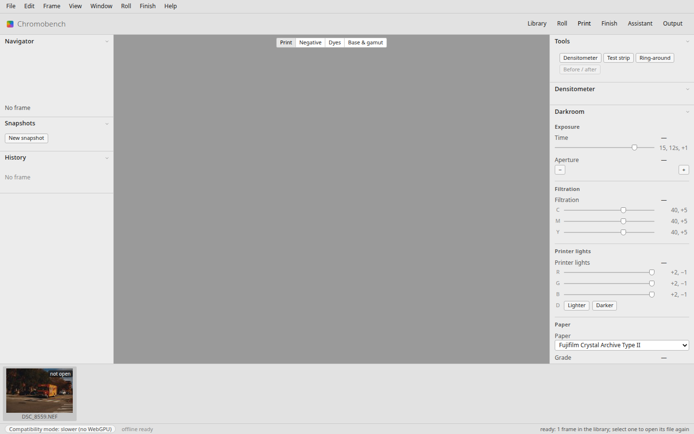
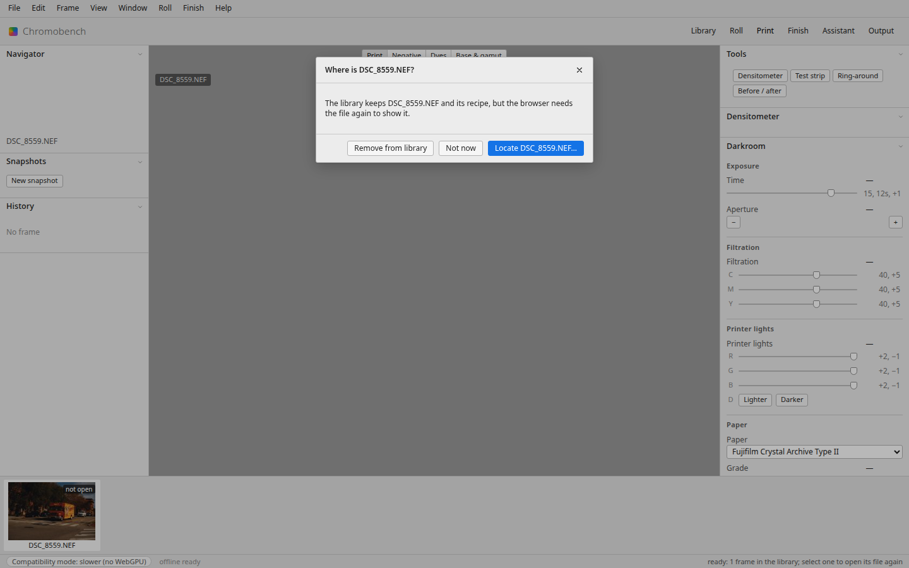

## Truck as a negative and back

I pick File ▸ Open As ▸ Open as Negatives and open the truck: a box asks "DSC_8559.NEF is open as a photo. Re-open it as a negative? What you did to it as a photo is kept: re-opening it as a photo brings it back." I say yes: the truck is now inverted, blue and white, as it should be for a negative. And next to "Negative" at the bottom there is a button: **"Looks like a photo: re-open as photo?"** with the explanation "no film edge found, it may be a photo, not a negative". I click it, a message says "Re-opening DSC_8559.NEF as a photo…", and six seconds later "DSC_8559.NEF is open as a photo now (its saved recipe as a photo)". Everything is back, no reload. The Frame menu also has Re-open as Photo / as Negative / Remove from Library, and a right-click on a thumbnail gives the program's own menu.

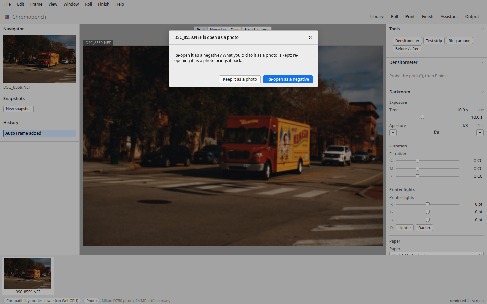
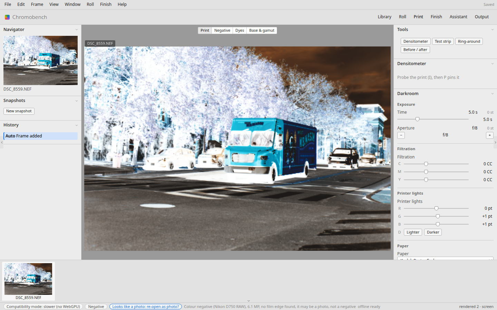

One trap I fell into: the "Open As" choice **stays** after I close the browser. I had left it on "Negatives", and the next day my plain re-open of the truck came out inverted until I clicked the hint button. There is a tick in the menu, but nobody looks there.

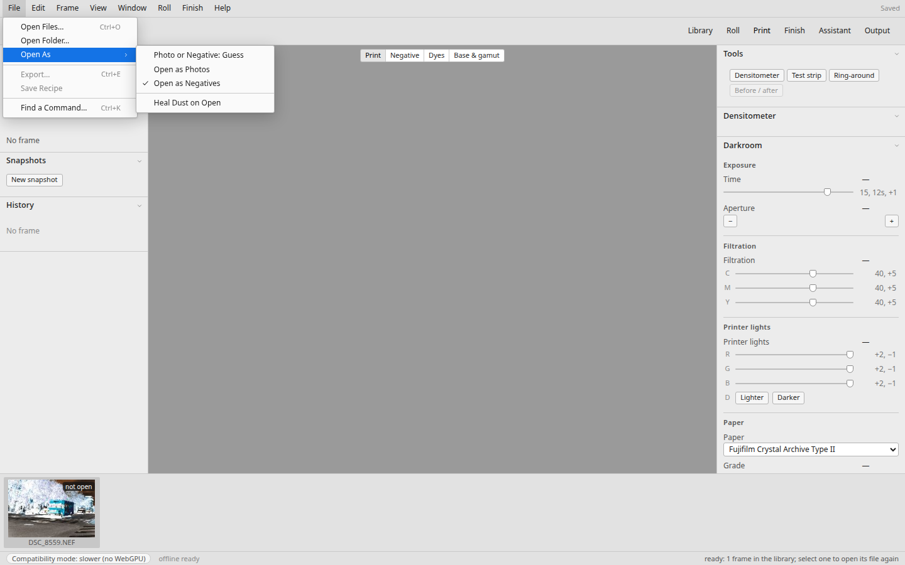

> **Developer commentary (F3, F6, F15).** All three fixed: the re-open dialog, the pill (`Looks like a photo…`) and Frame ▸ Re-open as … work in both directions without clearing storage. Re-open as negative took 6.6 s, back via pill ~6 s, no stalls. The Open As mode is persisted and applied silently when a "not open" frame is relinked (S02-N2).

## The slider

I drag the Time slider a little. A rough picture appears after a third of a second, the window keeps moving with my mouse, and the final picture is there about three seconds after I let go. The history says "Time 10.0 → 20.0 s (+1 st)": 20, not 20.16. Undo and redo (Ctrl+Z / Ctrl+Shift+Z) are instant; the Edit menu shows "Undo Time" / "Redo Time". With the other picture selected, Ctrl+Z says "Undo Time (on raw010.dng · 3/3)", so it tells me where it went.

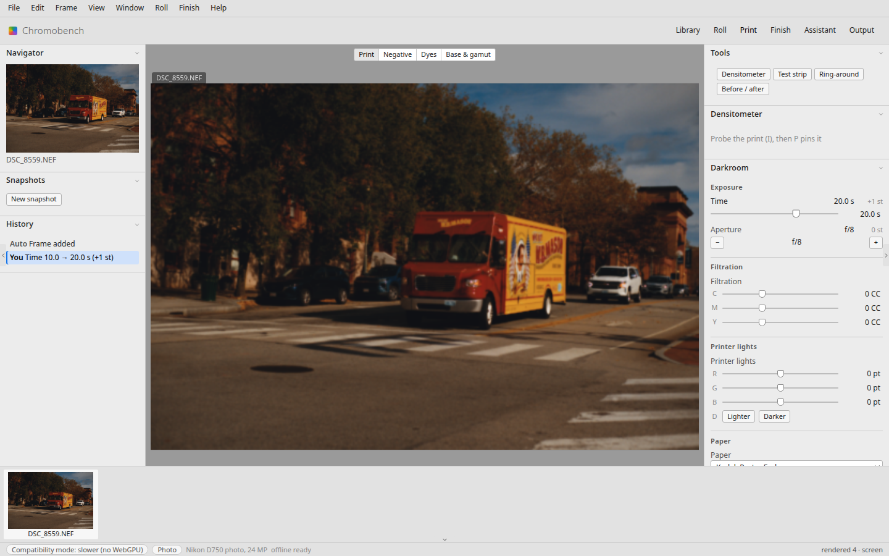

> **Developer commentary (F4, F12, F13).** Drag of 20 moves, 30 ms apart = 1.06 s; statuses: `rendered 2 · draft` at 340 ms, `rendered 3 · draft` at 697 ms, `rendered 4 · screen` at 3947 ms; **stalls: none above 100 ms**. Session 01: 12 s drag, six stalls of 1.65-2.43 s. The Edit menu label has no frame name (the toast does).

## Typing a time

- `15`: 15.0 s.
- `0`: "Time can't go below 0.1 s: set to 0.1 s".
- `-5`: from 0.1 s it is relative, so the same message again.
- `abc`: stays in the box, red, with "Time: “abc” is not a value. Type a time: 15, 12s or 7,5. A sign changes it: +1/3 st, −2 (seconds)".
- `1000`: "Time can be at most 600 s: set to 600 s".
- `12s`: 12.0 s. `7,5`: 7.5 s. Empty: "Time: the box is empty. Type a time: 15, 12s or 7,5. A sign changes it: +1/3 st, −2 (seconds)".

When I click elsewhere the red box goes back to the last good value. Now the messages talk to me.

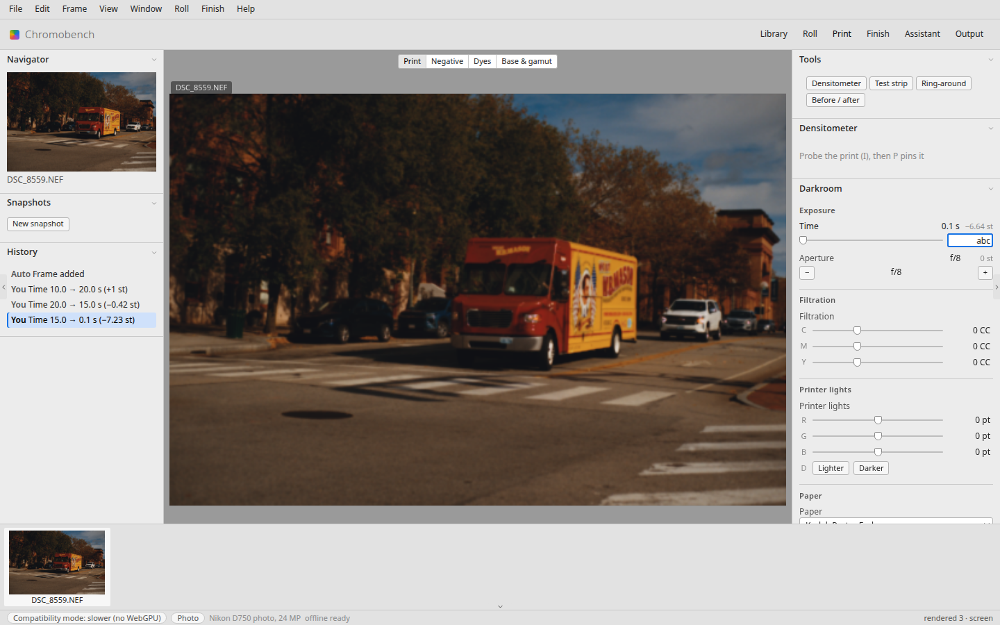

### But the picture never changed

While typing I looked at the truck: the same at 0.1 s and at 600 s. I measured the brightness of the picture area on screenshots: identical (56.68) at 10, 20, 0.1, 30 and 600 s. The "Lighter" button works (60.97, 65.52, 70.31 after three clicks). So **on my truck photo the Time box and slider do nothing visible**. In the first session I thought the picture got lighter; it probably did not.

> **Developer commentary (S02-N1).** Time on a digital-RAW frame has no visible effect; printer lights do. Probably the photo path normalises exposure at print. If by design, the Time/Aperture rows should say so or be disabled for photos. Aperture and filtration were not tested. `scripts/s10-does-time-matter.mjs`.

## The strip of three

`raw010.dng` opens in 2.6 s: "Colour negative (DNG), 6.2 MP, film edge found", "opened raw010.dng (3 frames)", and the strip at the bottom has three pictures `raw010.dng · 1/3, 2/3, 3/3`, each a positive. Last time I got one long orange strip after eight seconds of frozen window. Now each frame has its own time (2.23, 2.5, 2.81 s) and sensible colours (a blue-grey window with a shadow, flowers on a pavement, a fence with a sign). But: they are **sideways** (the sign and the graffiti lie on their side), frame 1 looks hazy and bluish, and the pictures are visibly blocky, big squares, not like film.

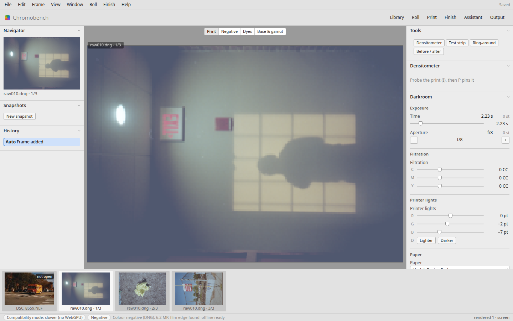
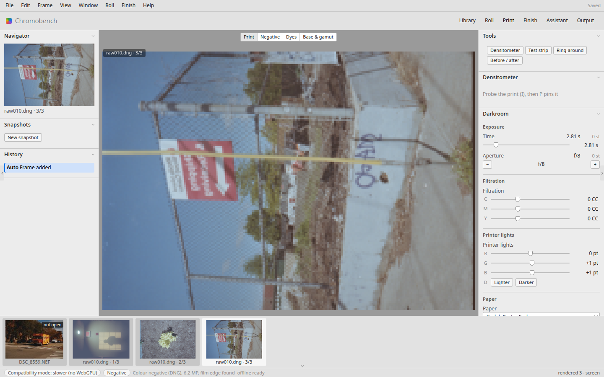

The old mistake: I choose Open As ▸ Open as Photos and open the strip. Orange again, but now with the button "Looks like a negative: re-open as negative?" and the text "DNG photo, 6.2 MP". One click, 1.6 s, "raw010.dng is open as a negative now (its saved recipe as a negative)", and I have the three frames again.

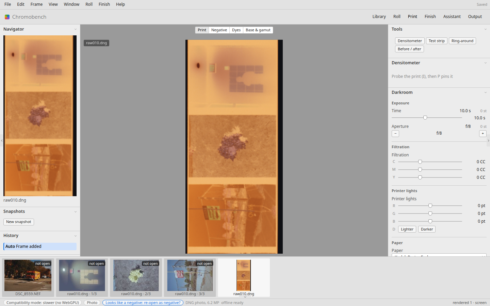
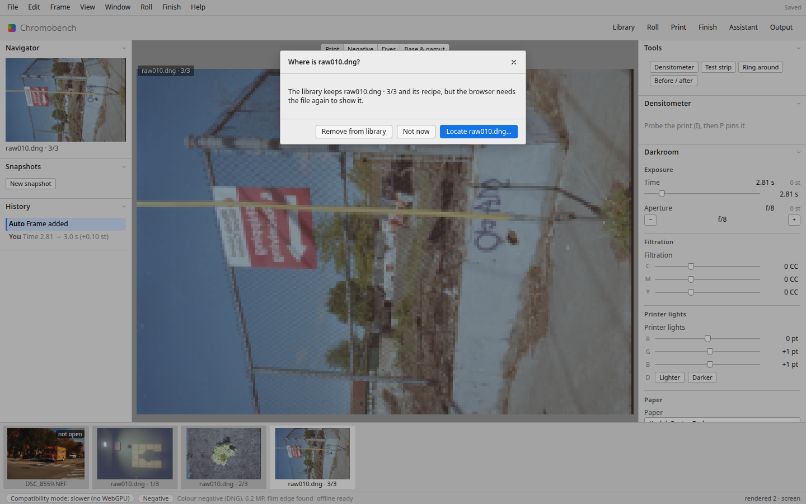

> **Developer commentary (F16, F1, F3).** Strip: stalls none; time 2.6 s (session 01: 7.8 s, 6.7 s stall). After the fix a "Where is raw010.dng?" dialog opened on its own (it also does after Frame ▸ Remove from Library, which selects the next not-open frame): S02-N5. No rotate command in the Frame menu (S02-N4).

## Words, sharpness, clutter

Paper and film names are real names now ("Kodak Portra Endura", no code words). Hovering gives darkroom language: "Exposure time under the enlarger. Longer prints darker; ⅓ stop is about 26 % more time." Left over: hovering the little engine pill shows "reference · CPU f64 (worker) (no WebGPU: E_EVAL: no GPU adapter) · 512 px"; the photo note says "via LibRaw … camera matrix from adobe"; tabs "Dyes", "Base & gamut"; and for a digital photo the panel still offers "Film stock", "Scanner" and "Viewing light".

The pictures are still soft. The tooltip says "working image 512×342" and zoom just magnifies into blocks.

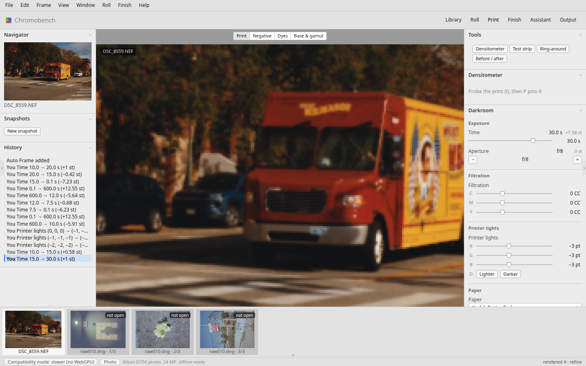

Chrome: one bar of menus, one of tabs, "Chromobench" once, Undo/Redo only in Edit. The empty state talks about photos. With nothing selected the right-hand panel shows odd leftovers ("15, 12s, +1", "40, +5") next to sliders that look live (S02-N3). I never saw the unexplained "Commands" box.

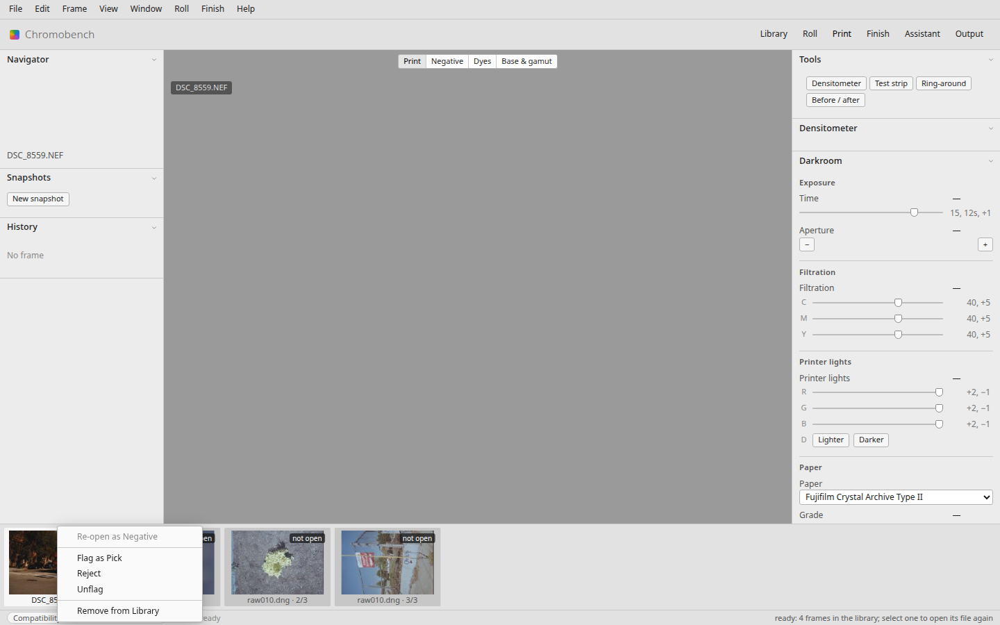

## What I would tell the developer

1. **Time does nothing on my photos.** It is the first control I touch in a darkroom program. Either make it do something or tell me why it is grey.
2. **Sharpen the picture.** Even with the freeze gone, 512 px and blocks make me think my photo is out of focus. I need a real 100 % view (and the same for the film strips, which look like mosaics).
3. **The strip frames come out sideways and the first one hazy.** Turn them upright by themselves, or give me a rotate button.
4. **Do not keep "Open As" for tomorrow.** Go back to "Guess" after each open, or show the mode next to the Photo/Negative pill. The "Looks like a …?" button is excellent: keep it and make it more visible.
5. **First open is slow and silent (29 s).** Show progress while a RAW is read.
6. **Quiet the dialogs:** "Where is …?" should not pop up again by itself after I fixed or removed something.
7. A few leftover words: the engine pill (E_EVAL, f64), "Dyes", "Base & gamut", and film/scanner controls on a digital photo.

## Before / after

Verdicts: fixed / partly / not fixed / new problem. Timings are CPU engine, headless.

| Finding | Session 01 (before) | Now (after) | Verdict | Evidence |
|---|---|---|---|---|
| F1 RAW opens as a negative | Inverted truck; "photo" checkbox fixes only later opens | Opens as a positive "Photo" with no action | **fixed** | `shots/03-nef-opened.png`; pill "Photo", "Nikon D750 photo, 24 MP"; 17.6 s cold / 6-8 s warm |
| F2 re-open stuck on "opening…" | Silent no-op, status stuck > 2 min | Toast "DSC_8559.NEF is already open (as a photo)", status "was already open" | **fixed** | UI log; `shots/06-reopen-same.png` |
| F3 mode sticks to the hash | Orange negative on Print tab, only `?fresh` helps | Re-open dialog + hint pill + Frame ▸ Re-open as…; works both ways, no reload | **fixed** | `shots/08`, `09`, `11`, `27`; toast "…is open as a photo now (its saved recipe as a photo)" |
| F4 UI freezes while rendering | Drag 12 s, stalls 1.65-2.4 s; open stall 2.9 s / 6.7 s | Draft in 0.34 s, final 2.9 s after release, 0 stalls > 100 ms in drags; worst stall in the whole session 517 ms (typing 1000) | **fixed** (on CPU; GPU not tested) | probe `[340,"draft"],[697,"draft"],[3947,"screen"]`, stalls `[]` |
| F5 library lost on reload | "No frames yet" after reload | Library, thumbnails and recipes survive reload and relaunch; thumbnail "not open"; click gives "Where is …?" | **fixed** (Locate with a real file handle not testable headless) | `shots/04`, `12`, `13`; dialog text above |
| F6 no remove / re-open / context menu | Chrome's image menu only | Right-click app menu, Frame ▸ Remove from Library / Re-open as…; toast "Removed DSC_8559.NEF: open the file again to get it back, with its recipe" | **fixed** | `shots/24`, `31`, `32` |
| F7 developer errors in toasts | `E_ARG_RANGE: print.enlarger.time_s = 0 …` | "Time can't go below 0.1 s: set to 0.1 s"; "Time can be at most 600 s: set to 600 s" | **fixed** | UI log; `shots/15-typed-0.png` |
| F8 typed-value surprises | `-5` relative with no hint; red border leaked; refused not clamped | Clamped and said; hint "A sign changes it: +1/3 st, −2" in toasts and tooltip; red box reverts on blur. `-5` is still relative. Leak across frames not re-checked | **partly** (mostly fixed) | `shots/15-typed-abc.png`, `16-after-typing.png` |
| F9 jargon | Status line, W_ notes, raw ids, heavy tooltips | Paper/film names clean, tooltips in darkroom words; still in the engine tooltip (`CPU f64 … E_EVAL`), LibRaw/camera matrix note, "Dyes", "Base & gamut", film/scanner on photos | **partly** | tooltip text in Step 9 of the diary |
| F10 soft 512 px preview | Looks out of focus | Same: "working image 512×342", zoom shows blocks | **not fixed** (expected on CPU) | `shots/30-zoomed-in.png` |
| F11 chrome clutter | Three bars, name x3, Undo/Redo x2, "open a negative" | One menu bar, one tab bar, name once, Undo/Redo in Edit only, "No photos yet: File ▸ Open Files…". Still a tab bar and menu bar with the same words (Library/Roll/Finish); odd panel text with no frame | **fixed** (small leftovers: S02-N3) | `shots/01-empty.png`, `04-relaunch-library.png` |
| F12 undo global across frames | Edit menu says just "Undo Time" | Toast "Undo Time (on raw010.dng · 3/3)"; menu label still "Undo Time" | **partly** | `shots/23`; UI log |
| F13 20.16 s steps | 20.16 s (+1.01 st) | 20.0 s (+1 st), 15.0 s, 30.0 s | **fixed** | History "Time 10.0 → 20.0 s (+1 st)" |
| F14 unexplained "Commands" dialog | Seen once | Not seen in any run (typing `abc`, empty, etc. included) | **not reproduced** | UI logs of all runs |
| F15 no hint on wrong mode | None | Pill "Looks like a photo: re-open as photo?" / "Looks like a negative: re-open as negative?" with plain reason | **fixed** | `shots/09`, `25` |
| F16 strip is one frame | One long orange strip | Three frames `raw010.dng · 1/3 … 3/3`, each a positive with its own time (2.23 / 2.5 / 2.81 s), 2.6 s, no stall. Frames sideways, blocky, frame 1 hazy | **fixed** (print quality: S02-N4) | `shots/20`, `22-strip-frame-3.png` |

### New findings

| ID | Severity | Summary | Repro | Evidence |
|---|---|---|---|---|
| S02-N1 | major | Time (enlarger time) has no visible effect on a digital photo; Lighter does | Open the NEF, type 0.1 s, 600 s, 10 s: picture identical (mean grey 56.68 each); Lighter x3: 60.97, 65.52, 70.31 | `scripts/s10-does-time-matter.mjs`, `shots/17-lighter-x3.png` |
| S02-N2 | minor | "Open As" mode persists across restarts and is applied silently when a library frame is relinked | Pick Open as Negatives, close; next day open the photo: inverted until the pill is clicked | `shots/09a`, `09b` |
| S02-N3 | minor | With no frame selected the Darkroom panel shows odd text ("15, 12s, +1", "40, +5", "+2, −1") and live-looking sliders | Relaunch with a library, select nothing | `shots/04-relaunch-library.png` |
| S02-N4 | minor | Strip frames show sideways, blocky (big pixels) and frame 1 is hazy/bluish; no rotate command | Open `raw010.dng`, look at frames 1-3 | `shots/20`, `22-strip-frame-3.png`, `24-frame-menu.png` |
| S02-N5 | minor | "Where is …?" opens by itself after Remove from Library or after a fix (it selects the next not-open frame) | Frame ▸ Remove from Library with other not-open frames present | UI log `{"kind":"dialog","text":"Where is raw010.dng?"}`; `shots/32-after-remove-click.png` |
| S02-N6 | minor | First open on a cold profile is 29 s to the picture with only "opening …" shown (warm: 6-12 s) | Fresh profile, open the NEF | probe `[2185,"opening…"],[18548,"opened…"],[30567,"rendered 1 · screen"]` |
| S02-N7 | note | Film stock, Scanner and Viewing light (negative-only ideas) are shown for a digital photo | Open the NEF, read the Darkroom panel | Step 9 select dump |

**Not tested:** the optional Mac GPU run; "Locate…" with a real file handle; Aperture/Filtration effect on photos; switching photo while rendering; export.
