# Session 03: "I print like in my darkroom"

*Played by a Sonnet agent as Manfred. App: main `15bd6df`, `http://localhost:4650/`, headless Chromium 1440x900, no WebGPU (CPU engine, "Compatibility mode"). Files: `DSC_8559.NEF`, `DSC_8536/8541.NEF`, `raw010.dng`, `2025-08-09_raw000.dng` and its Negative Lab Pro positive. Every timing is the CPU engine; load averages are in the diary.*

## The empty app and the first picture

Nothing has been opened, and the right-hand panel says "Select a photo to print it." Last time it showed odd numbers and sliders that looked alive; that is gone. I open my truck photo (`DSC_8559.NEF`) on a fresh browser: the picture is there after about 6 seconds (three runs: 5.9, 9.4 and 6.2 s; last time 29 s). While I wait I see a grey frame with the file name, a little spinner in the corner and a blank thumbnail; the text only says "opening DSC_8559.NEF…". It is quick enough that I do not worry any more, but it still does not tell me what it is doing.

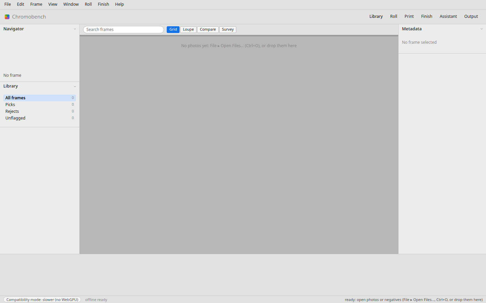
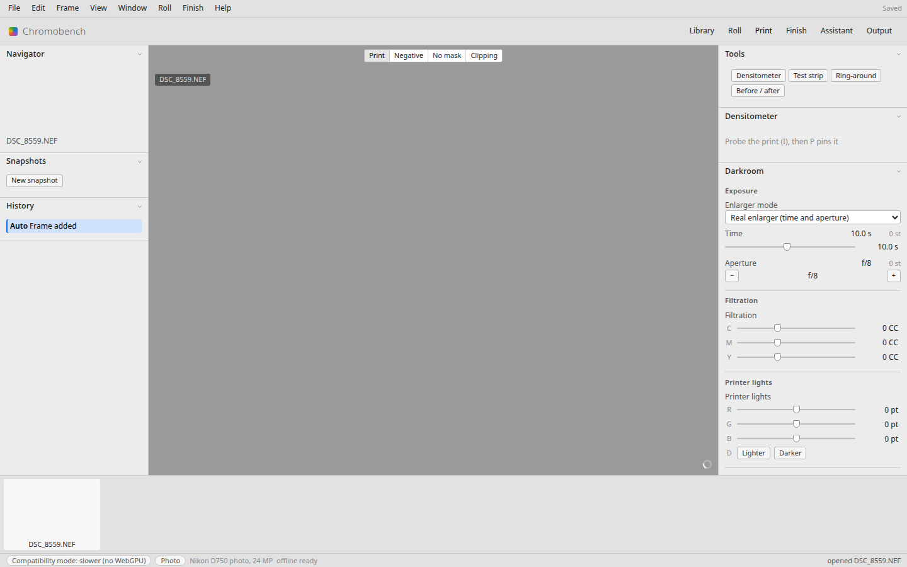

For this photo the panel offers Enlarger mode, Time, Aperture, Filtration, Printer lights, Paper, Grade, Preflash, Film stock and Viewing light. The scanner row is gone, and under the film stock a line says "A photo prints as if the scene had been shot on this film. The viewing light is the light the print is seen under." That I understand.

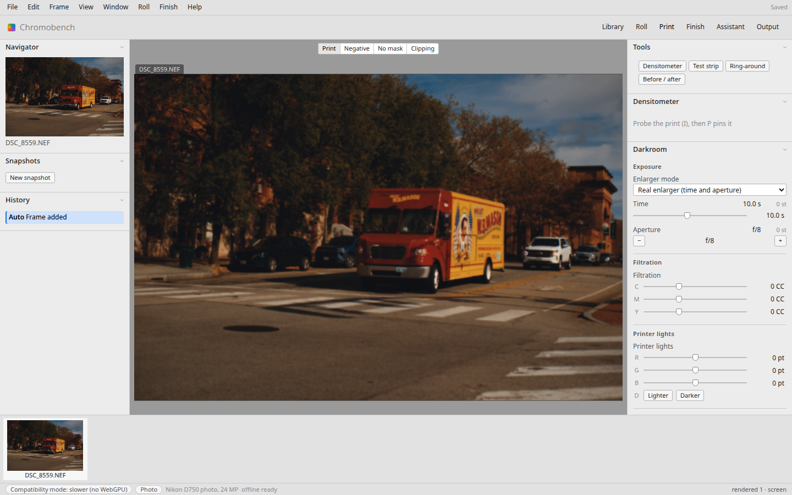

The truck itself comes out dark and brown at 10.0 s f/8 (the average brightness is 57 of 255 for a daylight street). The tungsten room also got exactly 10.0 s f/8. It looks like a fixed starting value, not an estimate; I need two-thirds of a stop more light to like it.

> **Developer commentary (F19, F22, F23, S03-N8).** Cold open of DSC_8559.NEF to "rendered 1": 11.4, 7.7, 5.9, 9.4, 6.2 s (load 6.7, 6.0, 4.7, 4.2, 3.7); median of the last three 6.2 s, of all five 7.7 s. "opened" at 2.5-6.1 s. Worst stall during open: 367 ms. Warm opens ranged 5.5 to 20 s later in the session at load 1-3 (no reason found). Auto first print: Time 10.0 s, f/8 for both NEFs (`apps/studio/src/host/first-print.ts` should be checked). `scripts/s01-…`, `s01b-…`.

## Printing like in the darkroom

**Test strip.** I click Tools ▸ Test strip. Five bands appear across the picture with seconds on them: 6.3, 7.94, 10.0, 12.6 and 15.87 s, a third of a stop apart. The left bands are light and the right bands dark, so shorter is lighter, as in my darkroom. I click the fourth band and the time becomes 12.6 s.

> **Developer commentary (F17).** Each band is exactly the plain print at that time over the same columns (mean RGB identical to a decimal, `s02e-strip-vs-plain.mjs`): 6.3 s 74.7/56.6/42.7; 7.94 s 51.5/40.4/32.3; 10.0 s 40.8/31.5/27.1; 12.6 s 50.6/37.3/30.2; 15.87 s 30.8/28.7/28.4. (The band means do not fall in order because each band covers a different part of the picture.)

**Time.** I type 6.3, 10, 12.6, 15.87 and 30 s. The whole picture goes from very light to nearly black: brightness 97.6, 56.8, 42.2, 31.9, 18.3. Last time it was 56.68 at every time. I drag the slider: a rough picture right away, the final one about two seconds after I let go, and the window never freezes.

**Aperture.** One click on "+" gives f/9 and the picture gets lighter (56.8 to 75.9); two clicks f/10, lighter again (96.0); back down it gets darker, f/7.1 is darker than f/8 (41.9). A smaller opening gives less light on the paper, so a lighter print: correct.

**Lighter and Darker.** Lighter changes the time, not the lights: 10.0 s, 7.94 s, 6.3 s (a third of a stop each), brightness 41.9, 56.3, 74.8. Darker goes back, and past, to 12.6 s (31.6). The printer lights stay at 0 points. That is what I would expect in the darkroom.

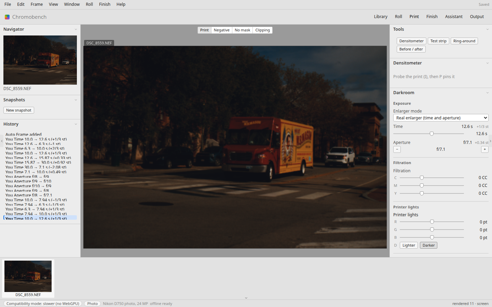

**Filtration.** I add yellow: 20 CC makes the picture blue (blue-to-red ratio from 0.67 to 1.09), 40 CC much bluer. More yellow means less yellow in the print, as in my head. Magenta 20 CC makes it green, cyan 20 CC makes it red: all in the right direction. It is a strong step though; 20 CC is what I would use only for a real colour cast. The help text says it plainly: "More yellow makes the print bluer, more magenta makes it greener."

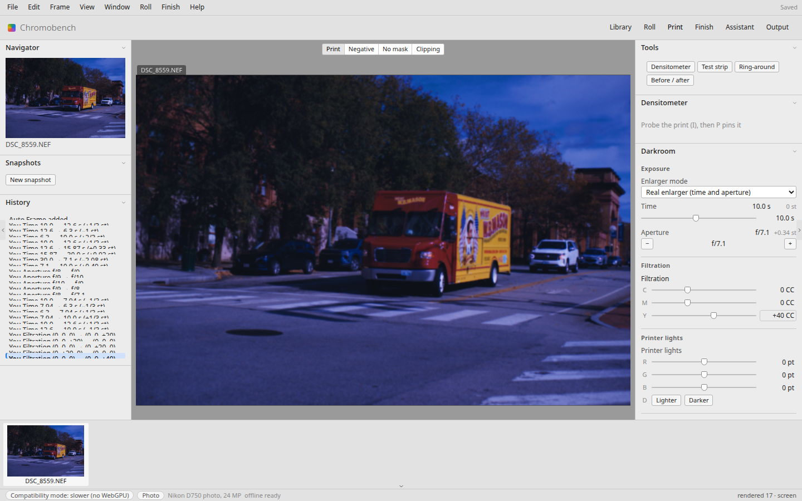

**Undo.** Edit ▸ Undo says "Undo Aperture", then the next; six undos all worked. With another photo selected it says "Undo Time (on DSC_8559.NEF)" and afterwards "Redo Time (on DSC_8559.NEF)". Good. It does undo something I cannot see, since the other photo stays on screen.

> **Developer commentary (F17, F12).** Pixel checks after each action (`s02c`, `s02d`): typed times above; aperture steps f/8→f/9→f/10; Lighter ×2 → Time 7.94 s, 6.3 s; filtration Y+20 B/R 0.673→1.094, Y+40 →1.826, M+20 G/avg(R,B) 0.948→1.324, C+20 R 49.8→83.5. 20 CC = 0.20 D = ×1.58, which matches the numbers. History formats a button step as "(+1/3 st)" but a typed step as "(+0.33 st)". After about 20 entries the History panel rows overlap (visible in `shots/09-yellow-40.png`).

## Typing in the Time box

`15` gives 15 s. `0` and `1000` are clamped and told ("Time can't go below 0.1 s: set to 0.1 s", "Time can be at most 600 s: set to 600 s"). A bare `-5` is not guessed: "Time: “-5” — to change the time, add a unit (−5 s or −1/3 st); to set it, type 5". `-5 s` from 15 s gives 10 s, `+1/3 st` from 0.1 s gives 0.13 s. `abc` and the empty box stay red with "Type a time: 15, 12s or 7,5 sets it. To change it, add a unit: +1/3 st, −2 s". `12s` and `7,5` work. Clicking elsewhere puts back the last good value. So now it is clear: a plain number is a time, a sign with a unit is a change.

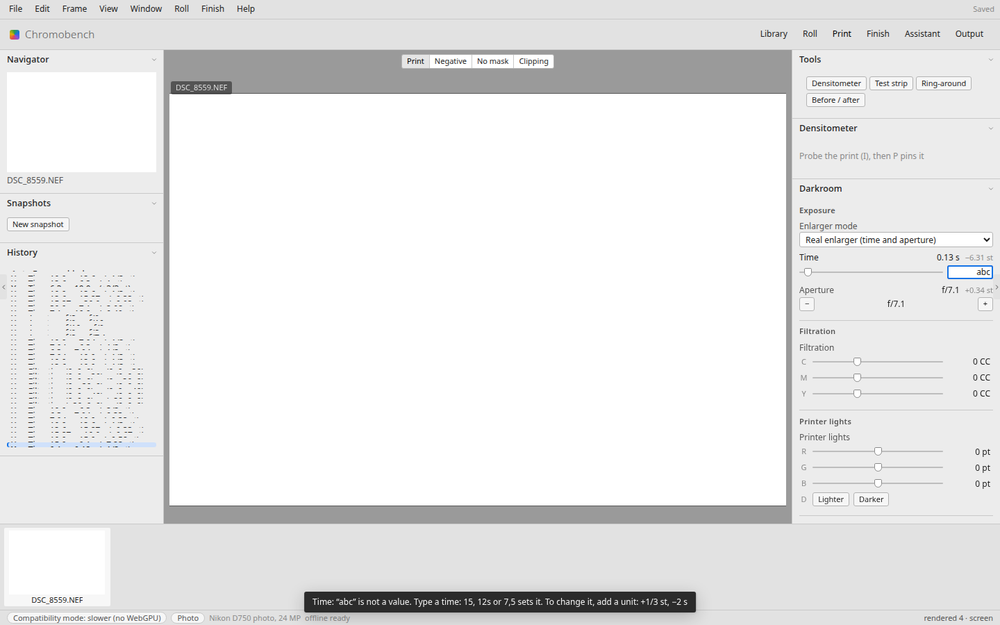

## Layouts

View ▸ Layout… opens a little box with Classic, Darkroom, Simple, Lab, Tiny, Roll, Finish and Looks. Simple is three steps: Pick, Print, Save. A photo I had made in Classic (real mode) shows its Time in Simple and Lighter ×3 takes it from 10 s to 5 s; the picture gets lighter each time. A new photo opened in Simple is printed in "normalised" mode: Lighter lightens it with the printer lights (−4, then −8 points) and no time is touched. In Simple the row "Time 10.0 s, 0 st" is still there for that photo but never moves, and two rows are both called "Printer lights" (Warmer/Cooler and Greener/More magenta).

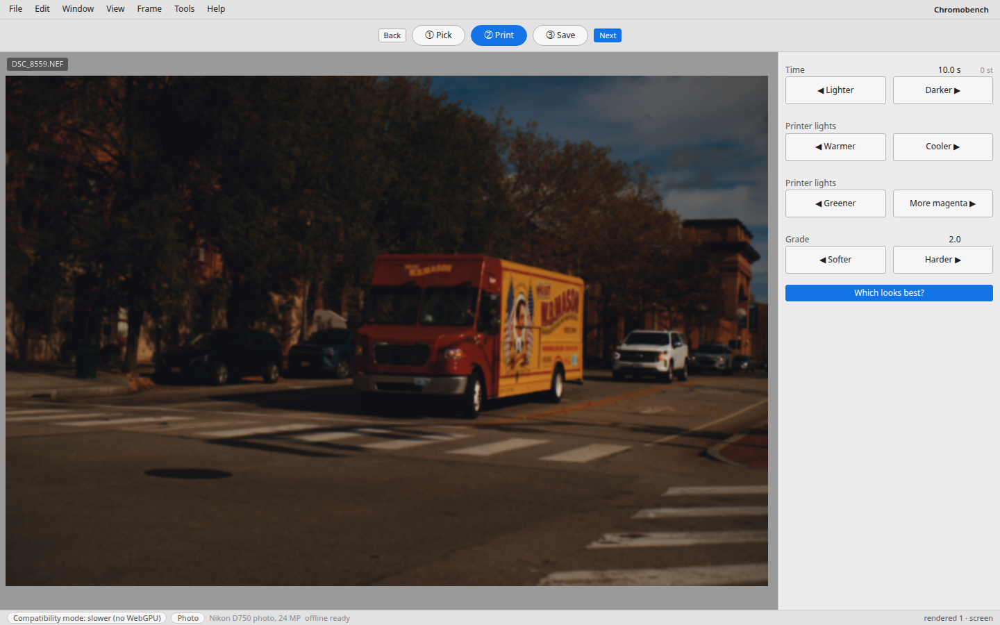
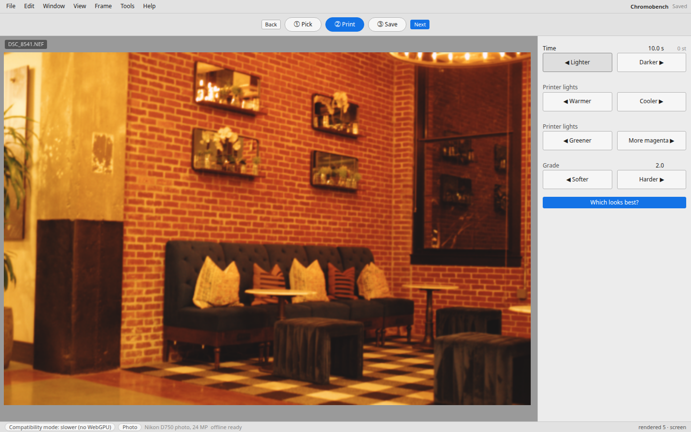

Back in Classic that second photo says "Normalised (grey card at the aim)", with a sentence: "the grey card prints at the aim whatever the time, so Time and Aperture are hidden. Make the print lighter or darker with the printer lights." There is a selector for the mode; switching to "Real enlarger" shows Time 10.0 s and the picture does not jump (it is the same to the last digit), and back.

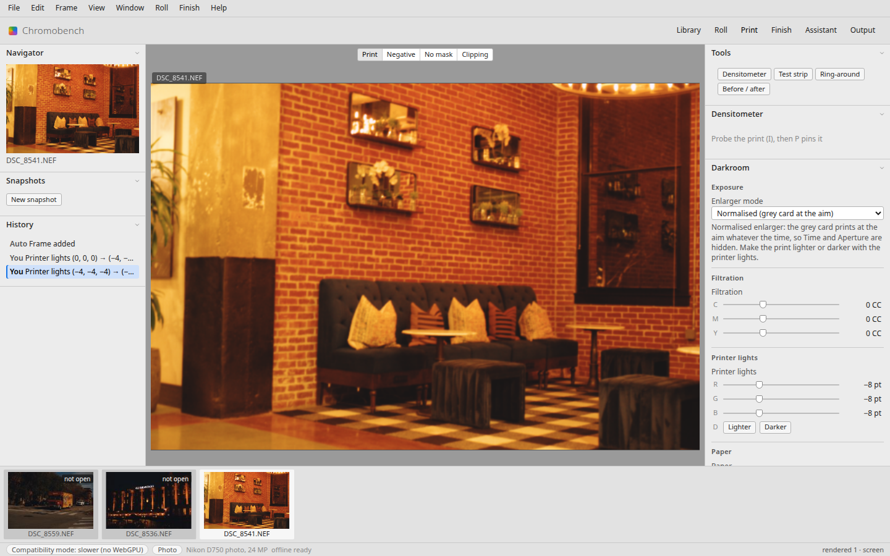

One annoyance: switching layout closed my open photos ("not open"); I had to open the file again.

> **Developer commentary (S03-N1, S03-N2).** After the layout switch the library frames read "not open" ("ready: 2 frames in the library; select one to open its file again"); in a real browser with file handles this may relink on its own, not testable headless. Simple has no Time input (only a label); `s04i-simple-time-row.mjs`. Mode-switch picture identical (RGB 142.2/74.9/33.8).

## Last week's work (old library)

I start the app with last week's browser profile and straight away have the new version: the tabs say "Print / Negative / No mask / Clipping" (not "Dyes" and "Base & gamut"), no reload needed. Four pictures in the library, all marked "not open". I click DSC_8541 (the room with the brick wall): "Where is DSC_8541.NEF? The library keeps DSC_8541.NEF and its recipe, but the browser needs the file again to show it." In this test browser the Locate button does not open a file window, so I open the file the other way; it looks exactly like the thumbnail.

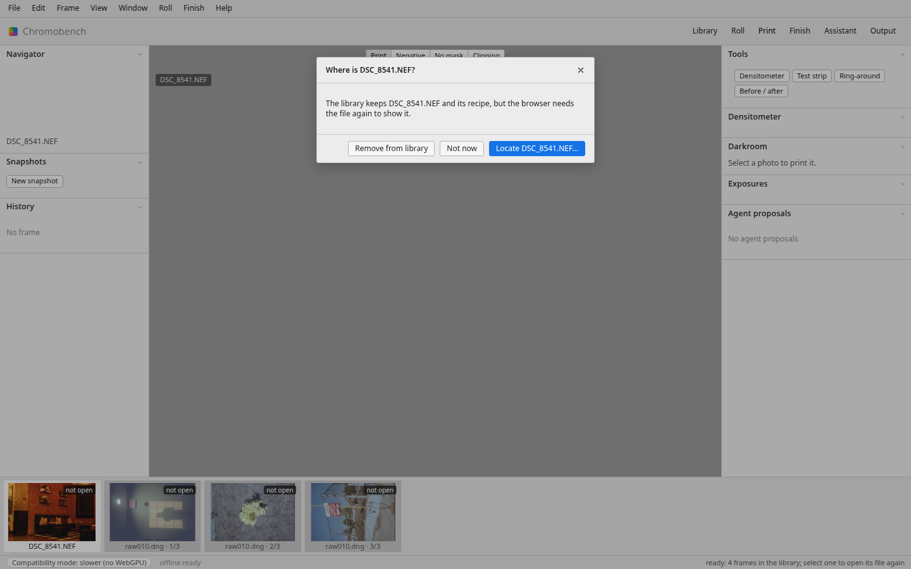
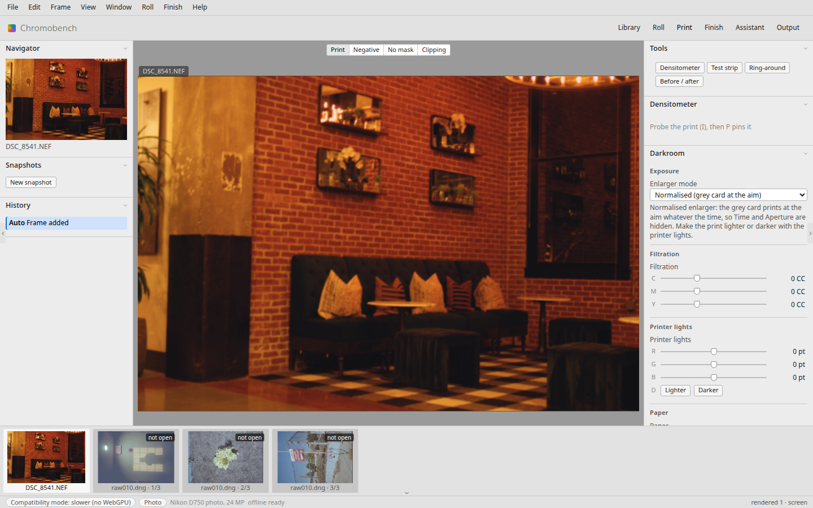

I want it darker through the time, as in the darkroom. There is no Time: the panel says "Normalised enlarger: the grey card prints at the aim whatever the time, so Time and Aperture are hidden. Make the print lighter or darker with the printer lights." I find the Enlarger mode selector and pick "Real enlarger": Time 10.0 s appears, the picture is unchanged, and typing 15 s then 20 s makes it darker (brightness 59.5, 39.8, 29.8). The old frames work, and the app tells me why a control is missing.

The strip raw010 (frame 2/3 clicked): opening the file brings all three frames back and selects frame 1. This old frame has Time 2.23 s and changes with the time (2.23, 4, 8 s: 121, 56, 24). But frame 1 is still lying on its side as I saved it last week, and the History got a line "Auto view.frame.crop {"h":143,"w"…".

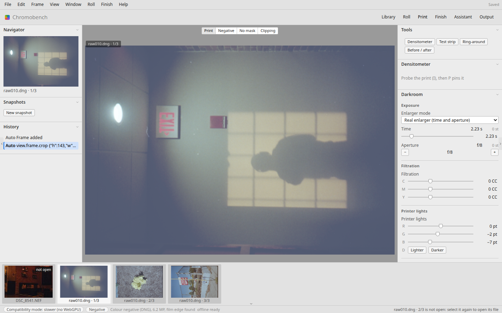

A "Where is …?" box stayed on top of everything after I opened the file the other way, and I had to click "Not now".

> **Developer commentary (F17 old recipes, S03-N3, S03-N4).** Old DSC_8541 relink took 16.4 s (load 1.0); old raw010 3.1 s. `page.waitForEvent('filechooser')` never fired from "Locate …" within 15 s (`s04e-where-is.mjs`), so the answer was `#file`; the stale modal blocked clicks until dismissed (`s05c`).

## The trap with "Open As"

I choose File ▸ Open As ▸ Open as Negatives. A blue marker appears in the bottom bar: "Opening as negatives" (click it to let the studio guess again). I close the browser and start again: the menu is back on "Photo or Negative: Guess" and the marker is gone, so my next open is a photo (Nikon D750 photo, 24 MP). There is a separate item "Keep This Choice After Restart"; with it ticked the marker is still there after the restart and the same NEF opens as a negative with a clear message: "DSC_8541.NEF opened as a negative (File ▸ Open As); your library had it as a photo: Frame ▸ Re-open as Photo brings that back." That is honest and I can see it.

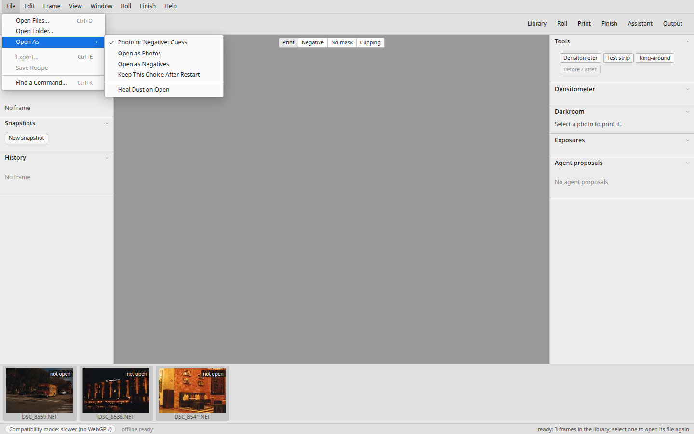
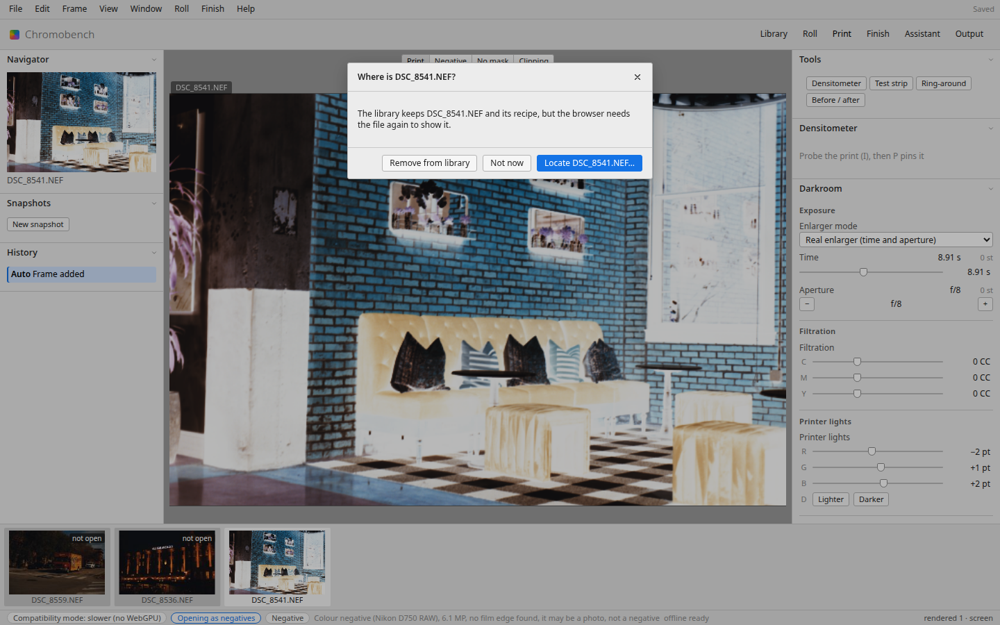

## Removing a frame

Frame ▸ Remove from Library (or right-click on the thumbnail, which gives the program's own menu) says "Removed DSC_8559.NEF: open the file again to get it back, with its recipe", and no question box pops up afterwards.

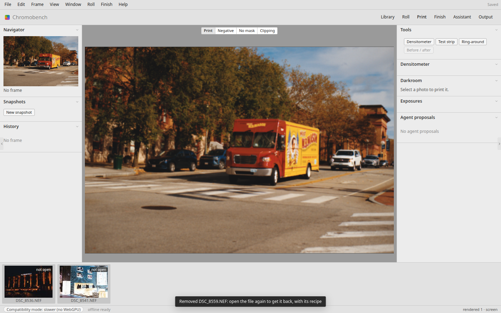

## The strip raw010.dng

Three frames, each the right way up now (the window, the shadow, the sign "Shipping & Receiving" all readable), each with its own time (2.23, 2.81, 3.15 s). They are smoother than the big blocks of last time, but soft. Frame 1 is still the hazy one: in numbers it is not bluer than the others (blue-to-red 1.058 against 1.050 and 1.081, the darkest 1 % about the same), but it is much flatter (sharpness measure 0.66 against 4.8 and 2.7), probably the lamp. Frame ▸ Rotate Right turns a frame, Edit shows "Undo Rotate Right", and Ctrl+Z puts it back. For zooming there is only Zoom In / Out / Fit, no "100 %", and each step takes about ten seconds before the picture settles on this computer; it stays soft.

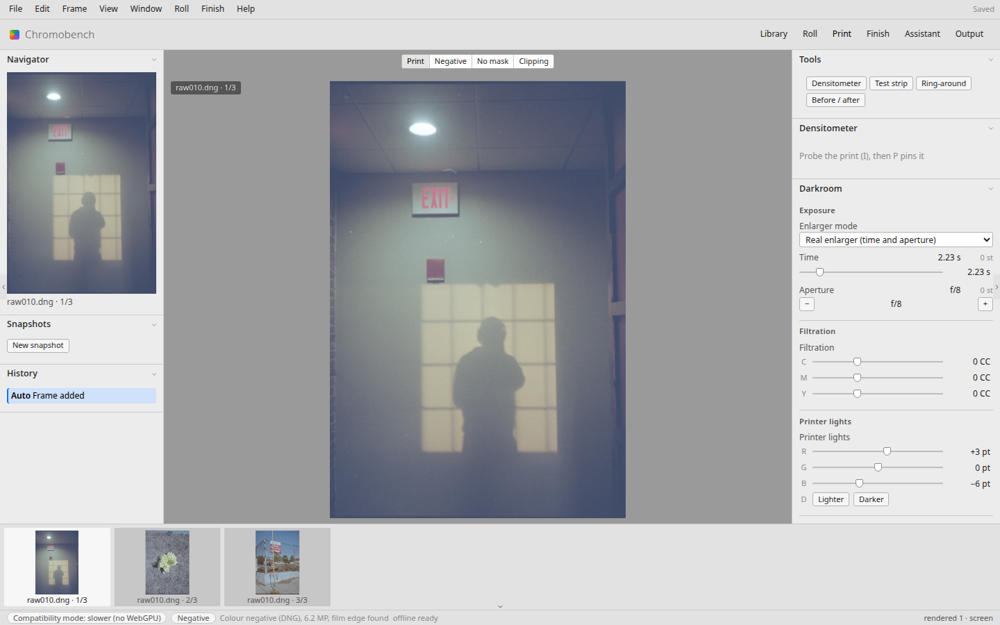
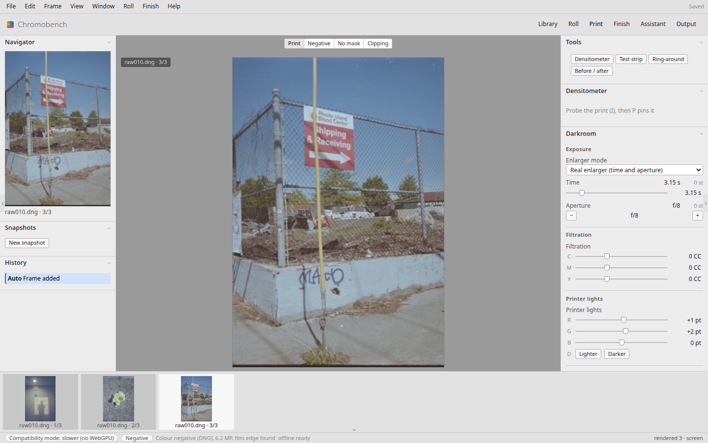
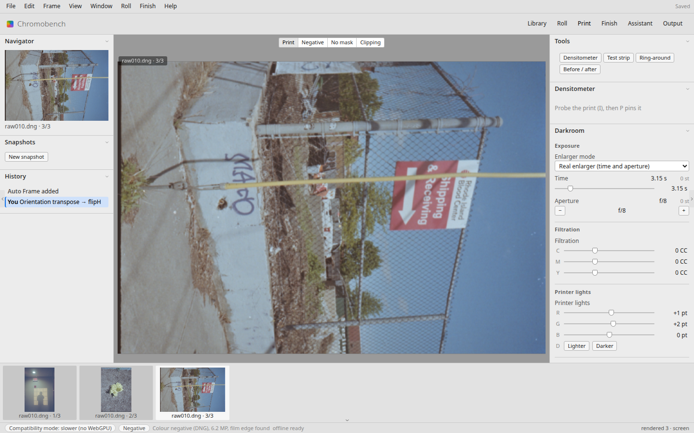

> **Developer commentary (F16, F20).** Per frame: mean RGB, darkest 1 % (r,g,b) and gradient: f1 130.2/133.1/137.8, (64,77,105), 0.66; f2 134.6/137.4/141.3, (74,72,79), 4.8; f3 134.4/139.4/145.2, (76,65,57), 2.66 (`scripts/analyze.py`). Working image 290×640 per frame, strip 705×1557. Open 2.4/4.9/2.7 s, first picture 3.6/6.3/4.1 s (load 0.6). History for Rotate shows "Orientation transpose → flipH" (raw token).

## The Epson strip and Negative Lab Pro

`2025-08-09_raw000.dng` opens in about 4 s into three frames. Frame 2 is the one Negative Lab Pro made into `…-positive.tif`. Out of the box all three frames are on their side; Frame ▸ Rotate Left makes frame 2 upright (so the "make strips upright" works for raw010 but not for this scan). Side by side, the same size, chromobench on the left and Negative Lab Pro on the right:

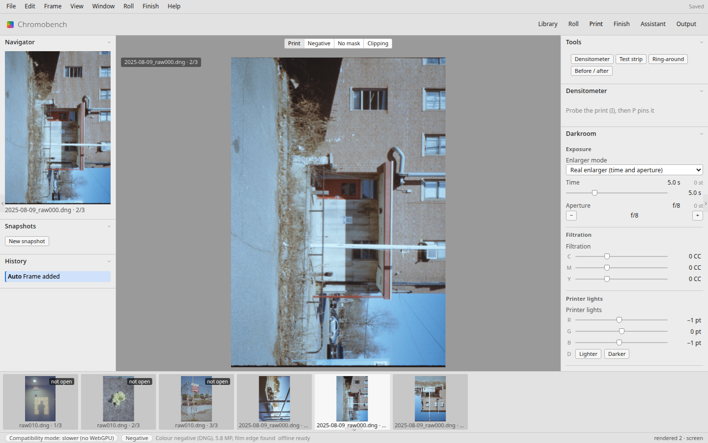
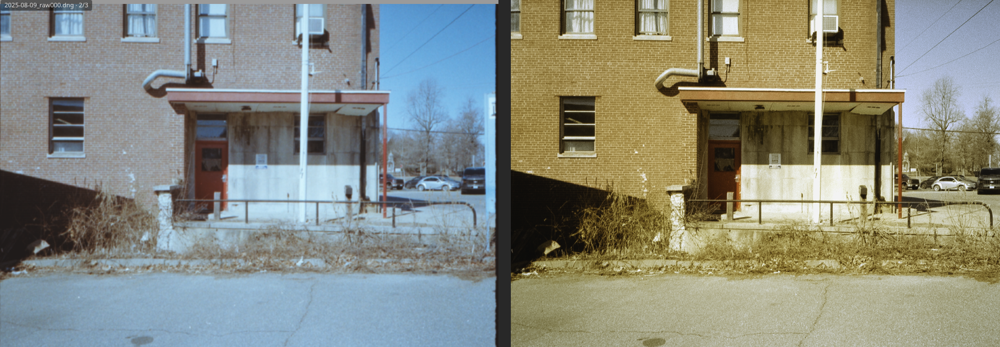

Honestly: chromobench is cool and a little flat: a blue sky, blue-grey concrete, brick that looks dull and pinkish. Negative Lab Pro is warm and golden, with deeper blacks and brighter whites, and much more colour (brick strongly orange-brown). I do not know which one is closest to the real wall, but concrete in winter sun should not be blue. In chromobench the whole frame is shown with a thin dark film edge on the right, NLP is cropped tighter. NLP shows grain, chromobench is smooth (it is only a 640 pixel preview here, so I cannot say anything about grain yet).

> **Developer commentary (S03-N5, S03-N7).** Same-size stats: chromobench mean RGB 126.2/141.3/153.3 (B/R 1.214), luma std 41.2, darkest 1 % 29.4, brightest 1 % 214.7, saturation 0.205, 3×3 high-pass std 1.77; NLP 148.0/138.9/103.4 (B/R 0.698), std 51.9, 13.3, 241.3, 0.373, 5.46. Frame 2 time 5.0 s, lights R −1, G 0, B −1. The TIFF was shown without colour management (16-bit ProPhoto → sRGB by Pillow), so the NLP side is approximate. Strip: 3 frames along y (confidence 1.00), base 0.08 0.37 0.69 D.

## Words and sharpness

The hover texts have improved a lot: "Exposure time under the enlarger. Longer prints darker; ⅓ stop is about 26 % more time.", "One stop down halves the light.", and for the little "Compatibility mode: slower (no WebGPU)" marker: "The prints are computed on the processor, which is slower: this browser offers no graphics card to compute on. Pictures are previewed smaller." Technical words are still there but on a second line: "Technical: reference · CPU f64 (…) (no WebGPU: E_EVAL: no GPU adapter) · 640 px", and in the picture notes "W_NO_OPEN_GATE", "W_NO_SURROUND", "scan.flare". I would not understand those, but I no longer have to read them. The History says "Orientation transpose → flipV" and the status says "rendered 7 · refine"; neither means anything to me. One tooltip has a typo ("The picture no orange mask and no film edge").

The picture is still soft on this machine: the preview is 640 pixels wide (it was 512) and when I zoom in it is a magnified smooth picture, no detail appears.

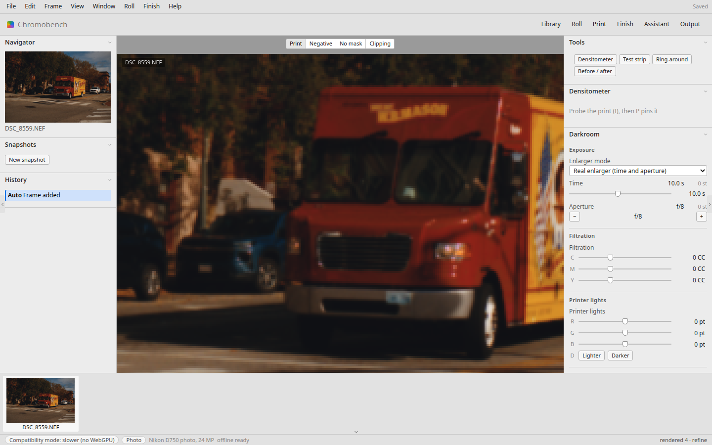

> **Developer commentary (F9, F10).** Tooltip strings from `scripts/s10a-words-sharpness.mjs`. Sharpness (gradient, picture area): fit 2.17, zoom 1/2/3 → 1.86/1.62/1.10 on a clean run; "refine" passes about 10 s each. No 1:1 command in View (Fit Ctrl+0, Zoom In Ctrl+=, Zoom Out Ctrl+-).

## What I would tell the developer

1. **The darkroom controls work now, and I can print like at the enlarger.** Test strip in seconds, time, aperture, Lighter by a third of a stop, filtration in the right direction. This was the main point and it is good. Keep going: start the time from an estimate (all my photos open at 10.0 s f/8, the truck dark) and make the first filtration step finer than 20 CC.
2. **The first print from my Epson scan is blue and flat compared with Negative Lab Pro,** and the frames come out sideways. Colour of the first print is what I judge first. A reference test "same frame as the NLP positive" would settle it.
3. **Make the picture sharp.** 640 pixels and a blurry zoom are still a problem when I judge a frame; give me a "100 %" and tell me what the program is doing during the ten-second wait after each zoom step.
4. **Quiet the leftover dialogs and layouts:** the "Where is …?" box stays when I open the file another way, switching layout closes my photos, and Simple shows a Time row that never moves.
5. **Say it in words:** History ("Orientation transpose → flipV", "Auto view.frame.crop {…}"), status ("rendered 7 · refine") and the second "Technical:" lines.
6. **Make Undo take me to the frame it undoes,** or show it; today it changes a picture I am not looking at.
7. **Let the history list scroll properly:** after about twenty steps the lines pile up on top of each other.

## Before / after

Verdicts: fixed / partly / not fixed / new problem. CPU engine, headless; load average in the diary.

| Finding | Session 02 (before) | Now (after) | Verdict | Evidence |
|---|---|---|---|---|
| F8 typed values | `-5` relative with no hint; bad entries stay in box | Plain number is absolute; `-5` refused with "add a unit (−5 s or −1/3 st); to set it, type 5"; `-5 s`, `+1/3 st` work; bad box reverts on blur; hints in tooltip and toasts | **fixed** (red border across frames not re-checked) | UI log in diary step 3; `shots/12-typed-abc.png`, `12b-typed-minus5.png` |
| F9 jargon | Engine tooltip `CPU f64 … E_EVAL`, LibRaw note, "Dyes", "Base & gamut", film and scanner on photos | Plain sentence first, "Technical:" second; tabs Print/Negative/No mask/Clipping; scanner hidden; leftovers: `E_EVAL`, `W_NO_*`, `scan.flare` in Technical lines, "rendered 7 · refine", "Orientation transpose → flipV", "Auto view.frame.crop {…}", typo "The picture no orange mask" | **partly** | Tooltips in diary step 10; `shots/86-as-negative-pill.png` |
| F10 soft 512 px preview | Blocks when zoomed; working image 512×342 | Working image 640 px (640×428 for the NEF), smooth zoom, still soft; no 1:1 command; refine pass about 10 s per zoom step | **partly** | Gradient fit 2.17, zoom 1.86/1.62/1.10; `shots/76-nef-print-zoom-3.png` |
| F12 undo global, label without frame | "Undo Time" in menu | "Undo Time (on DSC_8559.NEF)" in the Edit menu and toast; "Redo Time (on …)" | **fixed** (undo does not select that frame) | `shots/80-edit-menu-other-frame.png`; toast text |
| F17 Time/Aperture inert | Same picture at 0.1-600 s (luma 56.68) | Real enlarger by default in Classic; test strip bands differ and equal the plain print at that time; Time 6.3/10/12.6/15.87/30 s → luma 97.6/56.8/42.2/31.9/18.3; aperture ⅓ stop steps; Lighter/Darker = ⅓ stop of time; Simple/normalised hides Time with a sentence; mode switch does not jump the picture | **fixed** (minor leftovers S03-N2, S03-N8) | diary step 2; `shots/04`, `05`, `08`, `20` |
| F18 Open As persists silently | Next day's photo came out inverted | Resets to Guess after restart; blue "Opening as negatives" marker when set; "Keep This Choice After Restart"; relink as negative gets a toast with the way back | **fixed** (Locate relink untestable headless) | `shots/30`, `35`, `36`; toast text step 6 |
| F19 Darkroom panel with no frame | "15, 12s, +1" and live-looking sliders | "Select a photo to print it." | **fixed** | `shots/22-old-library-first-load.png` |
| F20 strip frames sideways, blocky, hazy, no rotate | Sideways, blocks, frame 1 hazy and bluish | raw010 frames upright and smoother; Frame ▸ Rotate Left/Right with undo; frame 1 flat (gradient 0.66 vs 4.8/2.7) but not bluer (B/R 1.058 vs 1.050/1.081); Epson strip frames still sideways; old frames keep old orientation | **partly** | `shots/50`, `51`, `60`, `61`; diary step 8 |
| F21 "Where is …?" after Remove | Dialog opened by itself | Toast "Removed DSC_8559.NEF: open the file again to get it back, with its recipe"; no dialog | **fixed** | UI log; `shots/41`, `43` |
| F22 29 s cold first open | 29 s, only "opening …" | 5.9 / 9.4 / 6.2 s (median 6.2 s; all five runs median 7.7 s); spinner and placeholder, still no progress text | **fixed** (time); feedback still thin | probe `opening 1950, opened 5000, rendered 9419`; `shots/02` |
| F23 film-scanner and viewing-light controls on a photo | Film stock, Scanner, Viewing light shown | Scanner row hidden; Film stock and Viewing light kept with a one-line explanation | **fixed** | `shots/03-nef-opened.png` text |
| F1 RAW opens as negative | fixed | Opens as "Photo", "Nikon D750 photo, 24 MP" | still fixed | `shots/03` |
| F2 re-open stuck | fixed | Toast "DSC_8559.NEF is already open (as a photo)" | still fixed | UI log |
| F3 mode stuck to hash | fixed | Re-open as Negative: "Re-opening … as a negative…", pill "Looks like a photo", back "…open as a photo now (its saved recipe as a photo)" | still fixed | `shots/86` |
| F4 UI freezes | fixed | Worst stall 367 ms (open); drags and renders none above 100 ms | still fixed | probe |
| F5 library lost | fixed | Library and thumbnails survive restart (fresh and old-library) | still fixed | `shots/22`, `32` |
| F6 no remove / menu | fixed | Frame menu and right-click menu | still fixed | `shots/40`, `42` |
| F7 developer errors in toasts | fixed | Plain messages | still fixed | step 3 |
| F11 chrome clutter | fixed | One menu bar, one tab bar; "Print" appears twice (top nav and view tab) | still fixed (minor) | `shots/01` |
| F13 odd time steps | fixed | ⅓ stop steps (10.0 → 7.94 → 6.3 s); typed steps log as "+0.33 st" | still fixed | History |
| F15 hint on wrong mode | fixed | "Looks like a photo: re-open as photo?" with plain reason (typo) | still fixed | `shots/86` |
| F16 strip as one frame | fixed | 3 frames for raw010 and for the Epson strip | still fixed | `shots/50`, `60` |

### New findings

| ID | Severity | Summary | Repro | Evidence |
|---|---|---|---|---|
| S03-N1 | minor | View ▸ Layout switch closes open frames ("not open"), needs the file again | Open a NEF, View ▸ Layout… ▸ Simple | status "ready: 2 frames in the library; select one to open its file again"; `s04f` |
| S03-N2 | minor | Simple shows a read-only "Time 10.0 s / 0 st" on a normalised frame that never changes while Lighter works; two rows both titled "Printer lights" | Open a new photo in Simple, ② Print | `shots/19b-simple-new-frame-lighter.png`; `s04i` |
| S03-N3 | minor | The "Where is …?" dialog stays over the app when the file is opened through File ▸ Open; it blocks all clicks until "Not now" | Click a not-open frame, then open the file by File ▸ Open Files… | `shots/36-relink-with-kept-negatives.png`; modal intercepted clicks in `s05c`, `s06b` |
| S03-N4 | note | "Locate …" gave no file chooser in headless Chromium within 15 s | Click Locate in "Where is …?" | `s04e-where-is.mjs` (no `filechooser` event) |
| S03-N5 | minor | Frames of the Epson strip (`2025-08-09_raw000.dng`) come out sideways, and frame 1 and 3 thumbnails too; raw010 frames are upright; old frames keep old orientation | Open the DNG | `shots/60-scan-frame-2.png`, `28b` |
| S03-N6 | minor | First open of a NEF on a warm profile varies from 5.5 to 20 s (no reason visible) | Several opens of DSC_8559.NEF | probe: opening 1695, opened 16354, rendered 19769 ms; vs 5 s other runs |
| S03-N7 | major | First print of the Epson scan is blue and flat next to Negative Lab Pro (B/R 1.21 vs 0.70, saturation 0.21 vs 0.37, luma std 41 vs 52); needs an owner's eye | Compare frame 2 with `…-positive.tif` | `shots/62-side-by-side-chromobench-left-NLP-right.png`; stats in the report |
| S03-N8 | minor | Auto first print gives every photo 10.0 s f/8, and the daylight truck opens dark (luma 57/255) | Open DSC_8559.NEF and DSC_8541.NEF | `shots/03`; Time box 10.0 s in both |
| S03-N9 | minor | History inconsistent and raw: "+0.33 st" vs "+1/3 st"; "Orientation transpose → flipH"; "Auto view.frame.crop {"h":143,"w"…}" | Type a time; Rotate; open an old strip frame | History panel; `shots/51`, `28b` |
| S03-N10 | minor | History panel rows overlap after about 20 entries | Many edits on one frame | `shots/09-yellow-40.png`, `14-layout-dialog.png` |
| S03-N11 | minor | No 1:1 / 100 % command or zoom readout; each zoom step needs about 10 s of "refine" on the CPU and stays soft | View menu; Ctrl+= ×3 | `shots/76-nef-print-zoom-3.png` |
| S03-N12 | note | Typo in a tooltip: "The picture no orange mask and no film edge."; status words "refine" and "draft" mean nothing | Hover the "Looks like a photo" pill | `shots/86-as-negative-pill.png` |
| S03-N13 | note | Undo changes a frame that is not on screen; the label names it but the picture does not move | Edit frame A, select B, Ctrl+Z | `shots/81-after-undo-other-frame.png` |
| S03-N14 | note | A 20 CC filtration step is strong (flips a warm photo to blue); correct physically (0.20 D) but coarse for a first move | Y 20 CC on DSC_8559 | B/R 0.673 → 1.094; `shots/09` |

**Not tested:** the GPU engine (no Mac); "Locate …" with a real file handle (so a true relink of a library frame with a persistent Open As and the layout-switch relink); the red-border leak across frames; Export; chromobench's colour on the NLP frame under a colour-managed display.
