# Session 04: Manfred checks the fixes (round 2), and how his pictures first look

Tester: Sonnet 5.5 as Manfred. App: main aaefe45 at http://localhost:4650/, Compatibility mode (CPU engine, no GPU),
headless Chromium 1440x900, persistent profile `profile/fresh/`. Load average was 0.6 to 4.6 (`uptime` is in the
diary). All timings are CPU-engine worst cases. The photos and scans are private; the screenshots stay in this folder.

## 1. My own photos, the first time they open

I opened five of my pictures one after the other. Nothing was set by me: this is what the studio gives me.

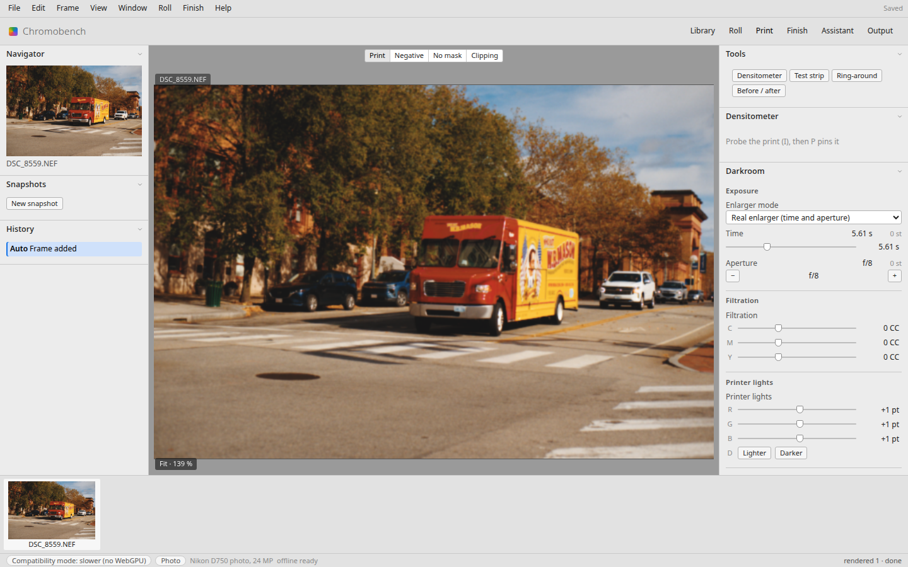

The daylight truck (DSC_8559) opens at 5.61 s, f/8. It is bright enough, the truck and the sky are right, but the
whole picture is **too orange**: the grey road is brown-yellow, the sky has a yellow tint. My camera's own JPEG of this
frame is neutral. The tungsten room (DSC_8541) opens at the same 5.61 s and is very orange; the evening street
(DSC_8536, 4.45 s), the fire truck (DSC_8655, 5.0 s) and the very high ISO night picture (DSC_8687, 5.0 s) all stay
night, which is right, and nothing is "night looks like day" any more. Last time the truck opened dark at 57/255
(F31). Now it opens at 104.

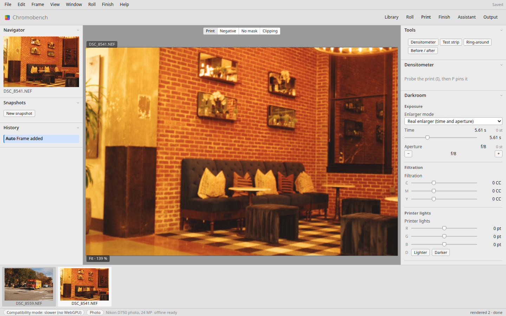 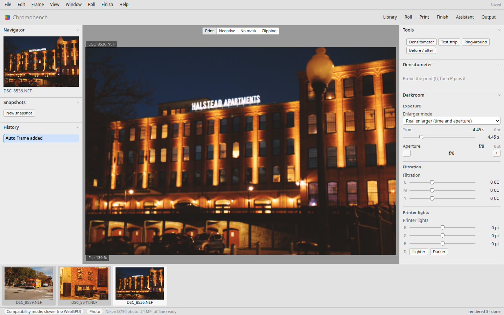

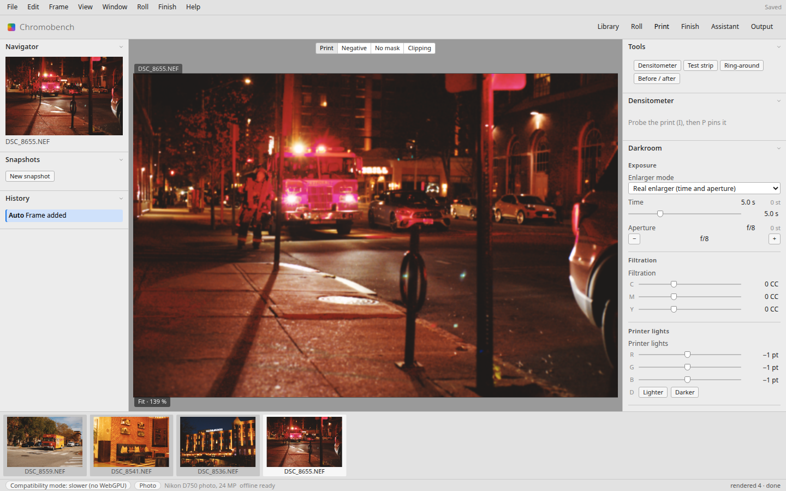 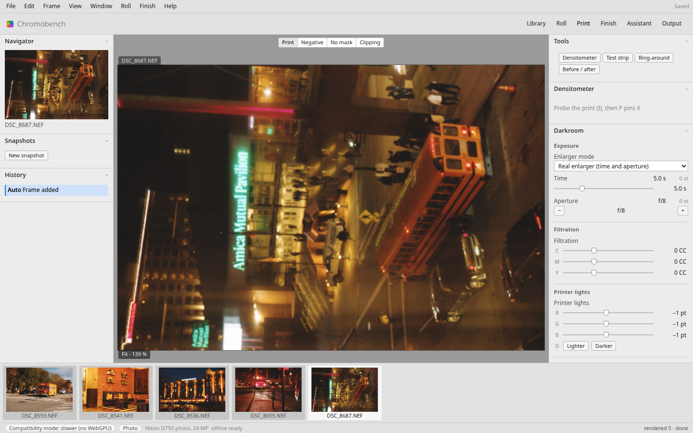

The last one, DSC_8687, I took upright (the camera says "rotate 90 clockwise"). It opens **lying on its side**, in the
big view and in the thumbnail and navigator as well. I had to find Frame, Rotate Right myself.

> **Developer commentary.** Measured on the screenshot (picture area, mean over pixels), next to the camera's own
> full-size embedded JPEG (`exiftool -b -JpgFromRaw`, downsized): 
> 
> | file | app luma | camera JPEG luma | app B/R | camera JPEG B/R |
> |---|---|---|---|---|
> | DSC_8559 | 104.3 | 112.9 | 0.635 | 0.879 |
> | DSC_8541 | 100.7 | 107.7 | 0.245 | 0.471 |
> | DSC_8536 | 61.4 | 55.7 | 0.509 | 0.855 |
> | DSC_8655 | 62.2 | 56.9 | 0.429 | 0.549 |
> | DSC_8687 | 63.7 | 64.8 | 0.461 | 0.889 |
>
> Brightness now follows the picture (F31 fixed), but the as-shot white balance comes out 25 to 48 % warmer in B/R
> than the camera's own rendering on all five. `exiftool` says DSC_8687 is `Orientation: Rotate 90 CW`; the studio shows
> the sensor orientation. The first open took 5.0 to 7.7 s; DSC_8655 took 17.4 s (load average 3, not repeated).
> Side-by-side: `shots/02-app-left-camera-jpg-right-8559.png`, `...-8687.png`, `...-8536.png`.

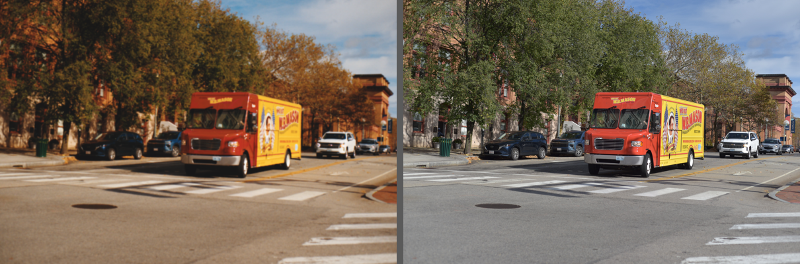

## 2. My negative strips

I opened five strips. The studio found the frames every time (3, 3, 2, 3 and 3), and the note under the picture now
says where the film base was read ("film base read between the frames" / "on the film edge"). Good: that is a plain
sentence I understand.

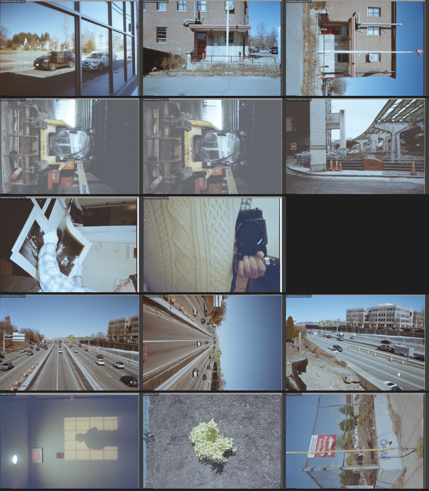

The frames that open **right way up** are the ones I shot sideways-on (landscape); the frames I shot upright
(portrait) open lying on their side. Count: raw000 2 of 3, raw004 1 of 3, raw007 0 of 2, raw013 2 of 3. For raw010
I cannot tell for sure (no positive that matches; see the developer note): frame 1 looks upright. For six frames I used
Frame, Rotate Left, and all six stood up right away:

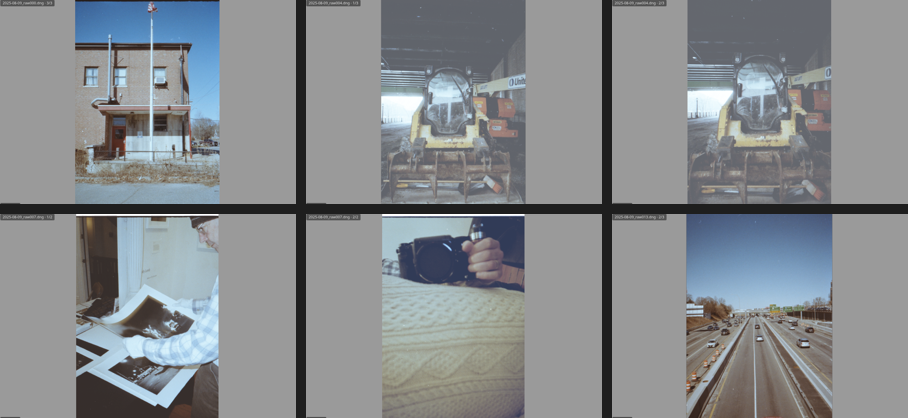

Rotate works and the History says "You Rotated left". But I have to do it by hand for about half of my frames.

Then I put one frame of each strip next to what Negative Lab Pro made of it (its picture converted from ProPhoto RGB
to sRGB, so that both are judged on the same screen). Left is the studio, right is Negative Lab Pro:

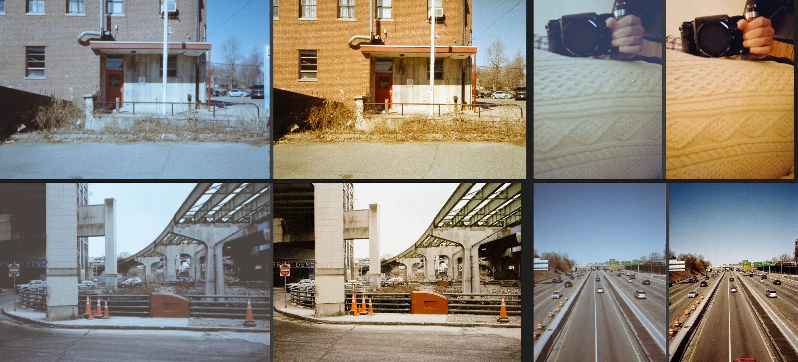

The studio's first print is **cool and flat**: blue-grey sky and shadows, little colour. Negative Lab Pro is warm and
full of colour, with deeper blacks. I like the warm one for the brick wall; the highway (raw013) is the closest. The
crop is a bit different: the studio shows slightly more at the edges (aspect 1.50 against 1.38 to 1.41), which is fine.
I would start from NLP's look and take the studio's as a grey, undeveloped start.

> **Developer commentary.** Same frame, same size, both colour-managed (`scripts/s02c-compare.py`):
>
> | frame | app luma / B/R / saturation / p5 / p95 | NLP luma / B/R / saturation / p5 / p95 |
> |---|---|---|
> | raw000 f2 | 138.6 / 1.21 / 0.205 / 46.5 / 194.4 | 153.8 / 0.614 / 0.460 / 36.0 / 223.3 |
> | raw004 f3 | 128.5 / 1.09 / 0.134 / 66.8 / 229.6 | 137.7 / 0.766 / 0.344 / 14.5 / 240.5 |
> | raw007 f2 (rotated) | 137.1 / 1.03 / 0.153 / 59.2 / 188.5 | 139.1 / 0.492 / 0.521 / 18.2 / 204.7 |
> | raw013 f2 (rotated) | 127.9 / 1.14 / 0.247 / 71.8 / 183.2 | 120.8 / 0.947 / 0.400 / 31.4 / 205.3 |
>
> This is F30 unchanged: the studio is 0.3 to 0.6 higher in B/R, about half the saturation, with lifted blacks (p5 47 to
> 72 against 15 to 36). The plan said not to change the default aim, so this is as expected; the comparison script
> and numbers for the owner are in the CHB-031 diary, not retested here. Orientation: the frame that opens sideways is
> a portrait frame on a vertical strip each time (raw000 f3, raw004 f1 and f2, raw007 f1 and f2, raw013 f2); landscape
> frames are upright. The `raw010-positive.tif` shows a street with a car and a lamp post, which is none of the three
> frames of `photos/raw010.dng`, so raw010 has no reference.

## 3. Switching the layout

I opened two photos and a strip (5 frames), then went through View, Layout: Classic, Darkroom, Simple, Lab, Tiny,
Roll, Finish, Looks (the dialog lists eight; "Lab" and "Tiny" are the two I had not used). In every layout the frames
stayed open and the picture was drawn at once. The old "select one to open its file again" never appeared. The
Simple screen even says "layout: Three steps · 5 frames open".

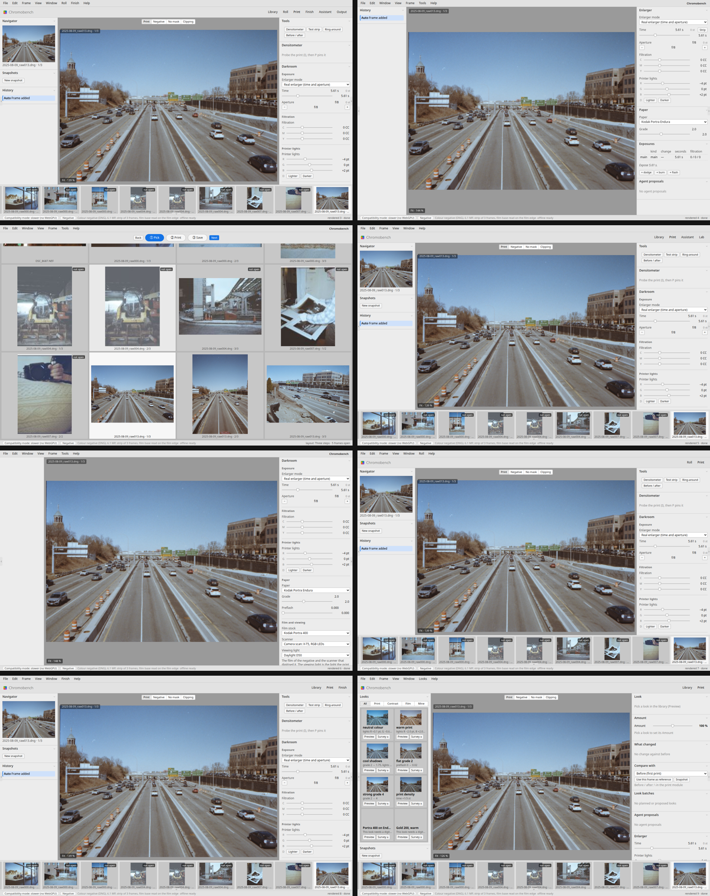

I changed the Time to 14 s in Classic, went to Darkroom, and pressed Undo in the Edit menu: the Time went back to
5.61 s and a toast said "Undo Time". So the history survives the switch.

In Simple, step 2 "Print", I now see rows named **Time** (with "0 st", Lighter, Darker) for a photo in the real
enlarger, and **Brightness**, Warmth, Tint, Grade when I first set the Classic enlarger to "Normalised". No more read-only
"Time 10.0 s", no more two rows called "Printer lights". Each button moves the picture:

| Simple row (normalised) | luma | B/R |
|---|---|---|
| start | 52.2 | 0.633 |
| Lighter | 52.2 to 67.9 | 0.633 to 0.597 |
| Warmer | 67.9 to 67.1 | 0.597 to 0.539 |
| More magenta | 67.1 to 63.4 | green share 0.925 to 0.846 |
| Harder | 63.4 to 61.1 | |

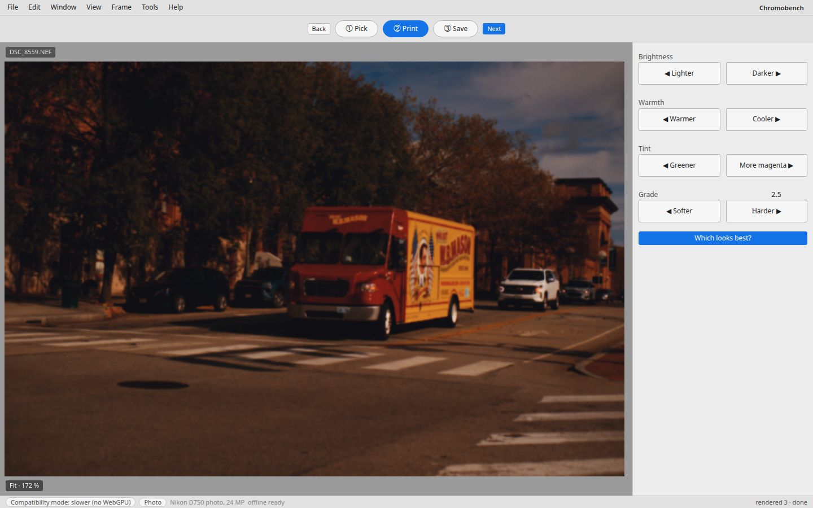

> **Developer commentary.** Layout switch: 8 layouts, `dialog left open after pick: 0` (the dialog closes itself),
> status after Simple "layout: Three steps · 5 frames open". Undo after the switch, Edit menu text "Undo Time
> Ctrl+Z || Redo Ctrl+Shift+Z"; ui log `{"kind":"toast","text":"Undo Time"}`. The same buttons in real mode move
> luma 105.3 to 127.9 (Lighter). One oddity: switching a photo from Real to Normalised darkens it from luma 105 to 52 at
> once (the grey-card aim in normalised mode is darker than the real first print), so a person who flips the mode to try
> it sees a much darker picture.

## 4. The "Where is …?" box and Undo on another photo

After a reload the library frames say "not open". I clicked DSC_8559: "Where is DSC_8559.NEF?" with "Remove from
library", "Not now", "Locate DSC_8559.NEF…". Then I opened the same file through the open command. The box **went away
by itself** when the picture appeared (6.6 s on the CPU engine), and the picture was there. Last time it stayed on top
and blocked my clicks.

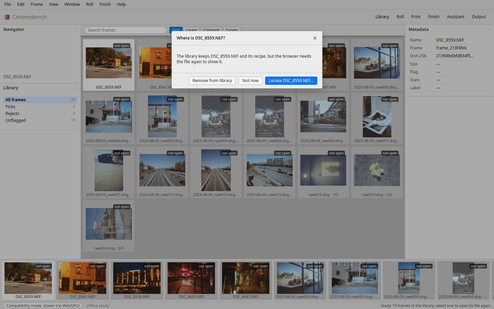

One thing I could not do like a person: while the box is open, the File menu does not react to the mouse (the box
covers the whole window), and Ctrl+O opened no file chooser in my test browser. I opened the file through the same
file input File, Open uses. A person would press "Not now" first, so no harm, but he cannot start File, Open while the box is up.

Then I edited photo A (Time 14 s), clicked photo B and pressed Undo. The studio **jumped back to photo A**, and I could
see its Time return and the History row greyed. A toast said "Undo Time (on DSC_8559.NEF)". Last time the picture
changing was not the one on screen. I understand now what I undid.

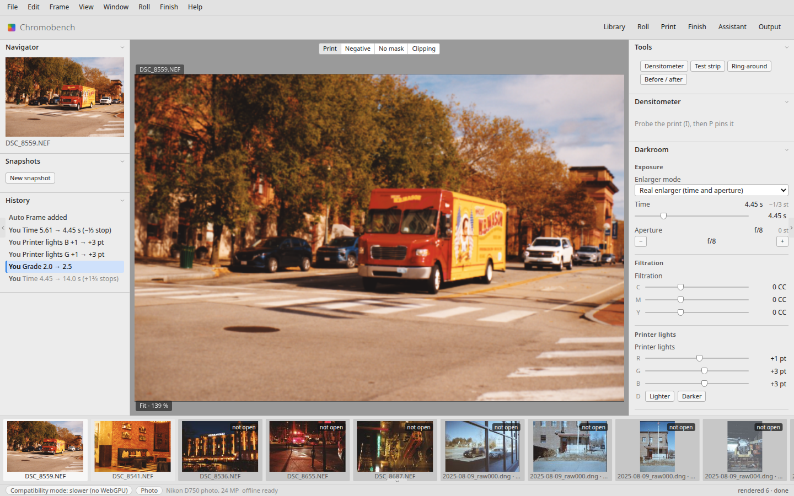

## 5. Words, History and zoom

I made 36 edits on one photo: Lighter and Darker clicks, rotate and flip, aperture steps, typed Times (7, 9,5, 12, 6).
The History shows them as plain sentences: "You Time 5.61 → 2.23 s (−1⅓ stops)", "You Rotated right", "You Flipped
left to right", "You Aperture f/8 → f/10 (−⅔ stop)". It joined the many clicks into 14 rows. The rows do not overlap, and
the list scrolls (the panel is 260 px high, the content 311 px).

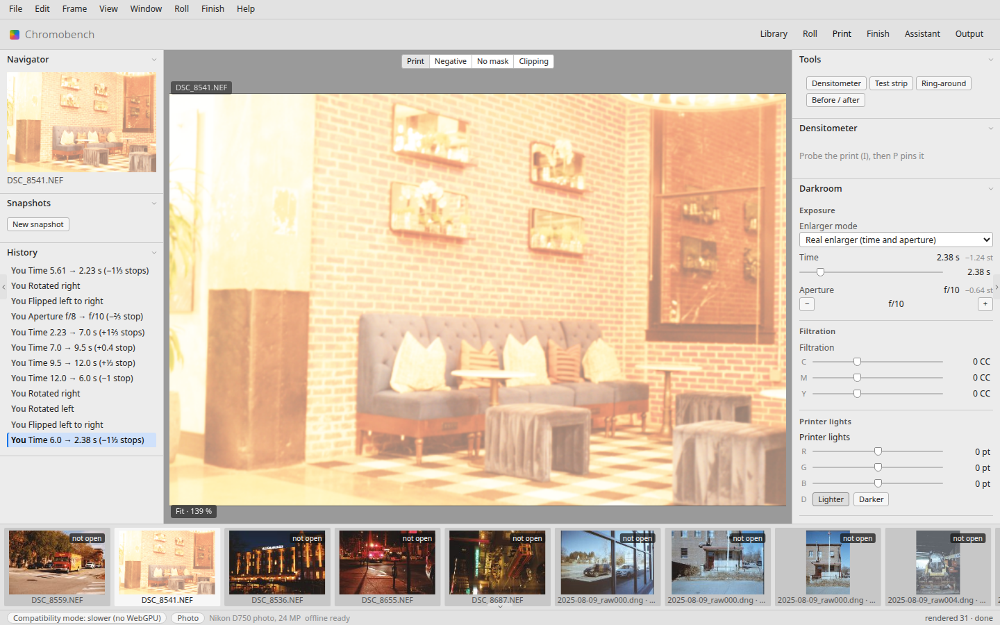

Small things: "(+0.4 stop)" sits next to "(+⅓ stop)" and "(+1⅔ stops)" (two ways to say it), every row starts with "You", the
"Rotated left" row sits before the Time row although the Lighter clicks came first, and a long row ("You Enlarger mode
Real enlarger (…") is cut with dots. The status line while it worked said "rendered 12 · quick preview" and at the end
"rendered 31 · done": plain words. After a zoom: "rendered 2 · done, full detail".

The View menu now lists "Actual Pixels (1:1)  Ctrl+Alt+0", "Fit in Window  Ctrl+0", "Zoom In", "Zoom Out", and the corner readout shows
"Fit · 139 %" and then "100 %". But when I chose 1:1 the picture became a **small stamp in the middle of the grey**
(640 px wide on a 6000 px photo), with "full detail" after 0.3 s. It is not "my photo at its real pixels"; it is a small copy shown at 100 %.
I cannot check focus with that.

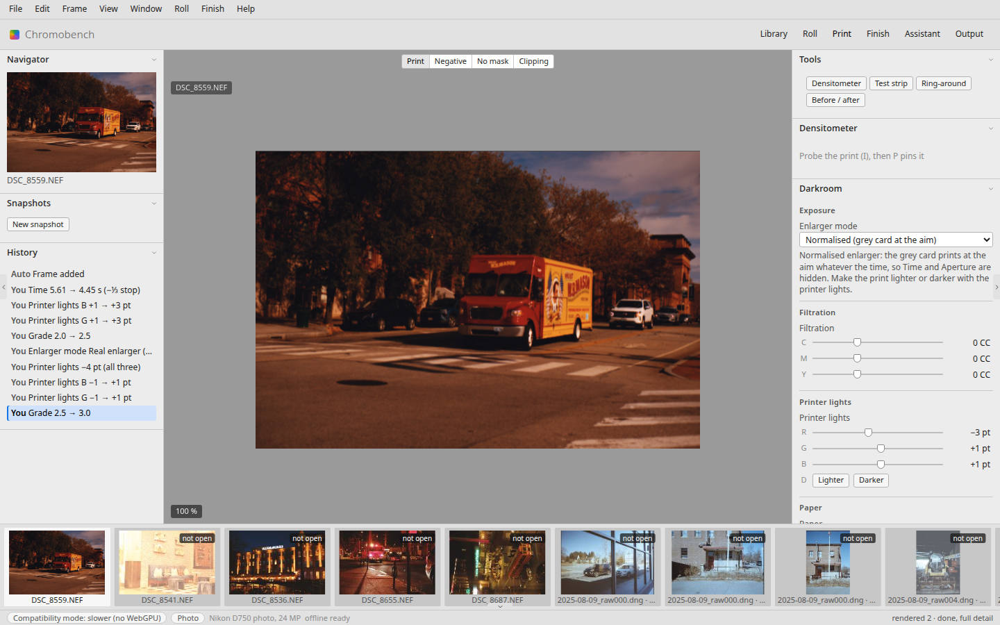

The darkroom layout with no photo selected shows one line, "Select a photo to print it.", under the heading "Enlarger".
No empty Exposures box.

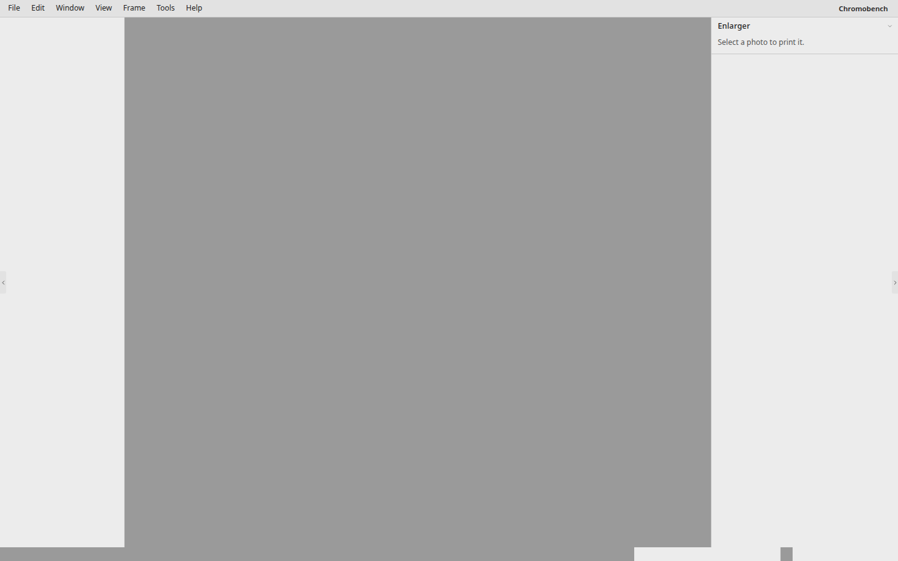

> **Developer commentary.** History: `rows 14, overlaps 0, scrollable true, scrollH 311, clientH 260`. The test-run status
> words, sampled every 80 ms: "quick preview" while rendering, "done" at the end. The technical line under a strip
> keeps `W_NO_OPEN_GATE`, `scan.flare` inside "Technical:" only; I found no tooltip with the old typo on raw013. The
> 1:1 stamp: the working image is 640 px (`working image 294×640` for the strip), so 100 % of it is small. This is
> the known CPU-engine limit (CHB-029 item 6); on a GPU the 1:1 would need a full-resolution tile.

## 6. Did the Time still change the picture (F17)?

On DSC_8559, in the real enlarger: the test strip shows seconds (6.3, 7.94, 10.0, 12.6, 15.87 s). Typing Time 6.3, 10, 20 gives
luma 100.0, 55.6 and 22.8 (B/R 0.480, 0.454, 0.751): it still gets darker with time. (This recipe had other settings from
my earlier tests: grade 3.0, lights −3/+1/+1.)

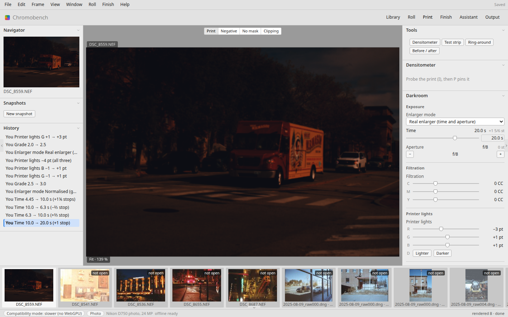

## What I would tell the developer

1. The colour of my photos is too warm. Brightness is right now, but the daylight truck looks as if it had a filter on.
   Compare with the JPEG my camera made: it is neutral. Let the studio start from something closer to the camera's
   own picture, or tell me why it is warm.
2. Photos taken upright (DSC_8687) open on their side. I took it upright. Read the camera's orientation.
3. About half of my strip frames (the upright ones) open sideways, and I have to rotate each by hand. One click for the
   whole strip, or find which way is up from the frame's shape.
4. The first print of a scan is cool and flat next to Negative Lab Pro. Both are legitimate, but I would start from the warmer
   look. (Known, owner's decision.)
5. 1:1 should show my real pixels. Now it shows a small copy of the picture in the middle of the grey. Even if soft on this
   machine, it should fill the window.
6. While the "Where is …?" box is open I cannot reach the File menu with the mouse. Let me use it, or say "close this first".
7. History: use one way to write stops (⅓ everywhere), drop the "You", and keep the order in which I did things.

## First impressions (table)

| photo / scan | automatic Time | luma | B/R | upright? | Manfred's verdict |
|---|---|---|---|---|---|
| DSC_8559 daylight truck | 5.61 s, f/8 | 104.3 | 0.635 | yes | bright enough, too orange (camera JPEG B/R 0.88) |
| DSC_8541 tungsten interior | 5.61 s | 100.7 | 0.245 | yes | right brightness, warm is right but overdone (camera 0.47) |
| DSC_8536 evening street | 4.45 s | 61.4 | 0.509 | yes | night stays night, pleasant, orange (camera 0.86) |
| DSC_8655 night, fire truck | 5.0 s | 62.2 | 0.429 | yes | night stays night, red cast strong but believable (camera 0.55) |
| DSC_8687 night, ISO 8000 | 5.0 s | 63.7 | 0.461 | **no, sideways** | dark and orange; rotate by hand |
| raw000 strip (3 frames) | f1 3.15 s, f2 5.0 s, f3 4.45 s | 134 to 139 | 1.17 to 1.26 | 2 of 3 | cool, flat, a bit hazy; frame 3 sideways |
| raw004 strip (3) | not logged (same range) | 128 to 130 | 1.06 to 1.09 | 1 of 3 | very flat and grey-blue, frames 1 and 2 sideways |
| raw007 strip (2) | not logged | 137 (f2) | 1.04 to 1.12 | 0 of 2 | cool; both sideways |
| raw013 strip (3) | not logged | 128 (f2) | 1.14 to 1.15 | 2 of 3 | blue sky OK, frame 2 sideways |
| raw010.dng (3) | not logged | 120 to 131 | 1.09 to 1.15 | frame 1 yes, 2 and 3 not sure | very soft and low contrast; no reference |

The luma and B/R of the NEFs are the means of the picture area at first open; for scans they are the first-open
screenshot analysis (`s02a-strip.mjs`), frame by frame in `diary.md` step 3.

## Before and after

| finding | session 03 (before) | now (after) | verdict | evidence |
|---|---|---|---|---|
| F24 layout switch closes frames | frames closed ("select one to open") | 8 layouts, all 5 frames stay open and drawn; Undo after the switch works | fixed | `shots/42-layouts-sheet.png`, "5 frames open" |
| F25 Simple rows | read-only "Time 10.0 s", two "Printer lights" | Real: Time, Warmth, Tint, Grade; Normalised: Brightness, Warmth, Tint, Grade; all move the picture | fixed | `shots/48-simple-normalised.png`, luma 52.2 to 67.9 |
| F26 "Where is" stays after File, Open | modal stays, blocks clicks | closes by itself when the frame is open (6.6 s) | fixed | `shots/60-where-is.png`; menu not reachable behind the box (S04-N4) |
| F28 strip frames sideways | raw000 frames sideways | landscape frames upright, portrait frames sideways: 5 of 11 upright; Rotate Left fixes all six I tried | partly | `shots/21-all-strips-as-opened.png`, `shots/34-after-rotate-left.png` |
| F31 no first print for photos | truck opens dark, luma 57 | Time per photo (4.45 to 5.61 s), luma 61 to 104, night stays night; but 25 to 48 % warmer than the camera | fixed (brightness); colour is a new problem (S04-N2) | `shots/01-first-*.png` |
| F32 raw History | "+0.33 st", "transpose → flipH", JSON | "Time 5.61 → 2.23 s (−1⅓ stops)", "Rotated right", "Flipped left to right"; leftovers: "+0.4 stop", "You" | fixed (minor leftovers) | `shots/70-history-many.png` |
| F33 History rows overlap | overlap after about 20 | 14 rows after 36 edits, 0 overlaps, scrolls | fixed | geometry in diary step 5 |
| F34 no 1:1, no readout | no command, no readout | View ▸ Actual Pixels (1:1) Ctrl+Alt+0, readout "Fit · 139 %" / "100 %"; but 1:1 shows a 640 px stamp | partly (S04-N3) | `shots/73-actual-pixels.png` |
| F35 words | "refine", "draft", tooltip typo | "quick preview", "done, full detail"; codes only in "Technical:"; typo not found | fixed | status samples, `s05c-tooltip.mjs` |
| F36 Undo on another frame | changes a picture not shown | jumps to that frame, toast "Undo Time (on DSC_8559.NEF)" | fixed | `shots/63-after-undo-other-frame.png` |
| F17 Time changes the picture | fixed in S03 | luma 100.0 / 55.6 / 22.8 at 6.3 / 10 / 20 s | still fixed | `shots/81-time-*.png` |

## Findings (new in session 04)

| ID | severity | summary | repro | evidence |
|---|---|---|---|---|
| S04-N1 | major | A photo with EXIF "Rotate 90 CW" (DSC_8687) opens on its side in the picture, thumbnail and navigator | open DSC_8687.NEF | `shots/01-first-8687.png`; exiftool `Orientation: Rotate 90 CW` |
| S04-N2 | major | The first print of a photo is far warmer than the camera's own JPEG (B/R 0.25 to 0.63 against 0.47 to 0.89); the "as-shot" white balance is not what the camera rendered | open any of the five NEFs | table in section 1, `shots/02-app-left-camera-jpg-right-*.png` |
| S04-N3 | minor | Actual Pixels (1:1) shows the 640 px working image as a small stamp at "100 %", "full detail" after 0.3 s | View ▸ Actual Pixels on DSC_8559 | `shots/73-actual-pixels.png` |
| S04-N4 | minor | With "Where is …?" open the File menu does not respond to the mouse and Ctrl+O gives no chooser (headless test) | click a not-open frame, click File | diary step 4 |
| S04-N5 | minor | Portrait frames on a strip open sideways (5 of 11 frames upright over 4 strips); F28 only half fixed | open the strips | `shots/21-all-strips-as-opened.png` |
| S04-N6 | minor | History: "+0.4 stop" mixed with ⅓ units, "You" on every row, merged Time row placed after later rotate rows, long row truncated | 36 edits on DSC_8541 | `shots/70-history-many.png` |
| S04-N7 | note | Switching a photo from Real to Normalised darkens it from luma 105 to 52 | DSC_8559, Enlarger mode dropdown | `shots/49-classic-normalised.png` |
| F30 | major | (known) strip first print cool/flat next to NLP: B/R 1.03 to 1.21 against 0.49 to 0.95 | table in section 2 | `shots/51-side-by-side-all.png` |

Not tested: Locate with real file handles (F27, headless), a 1:1 on a GPU, the strip first-print numbers for the owner
(in the CHB-031 diary), Time values of the scans other than raw000.
