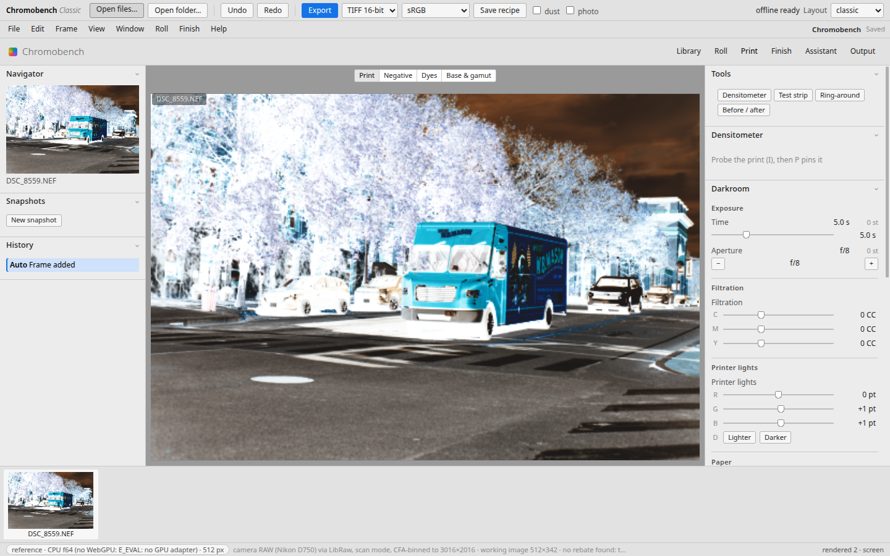
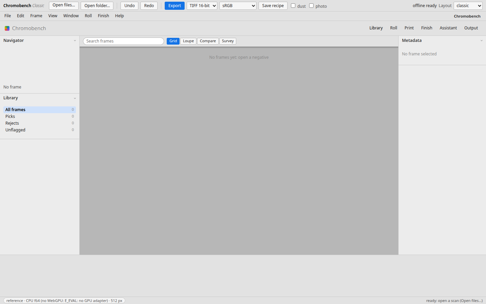
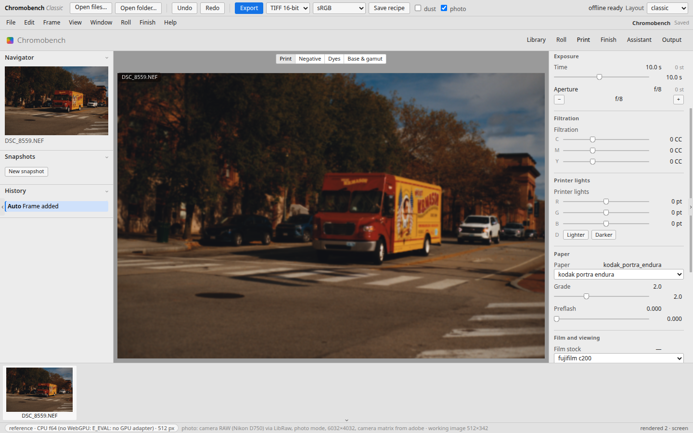
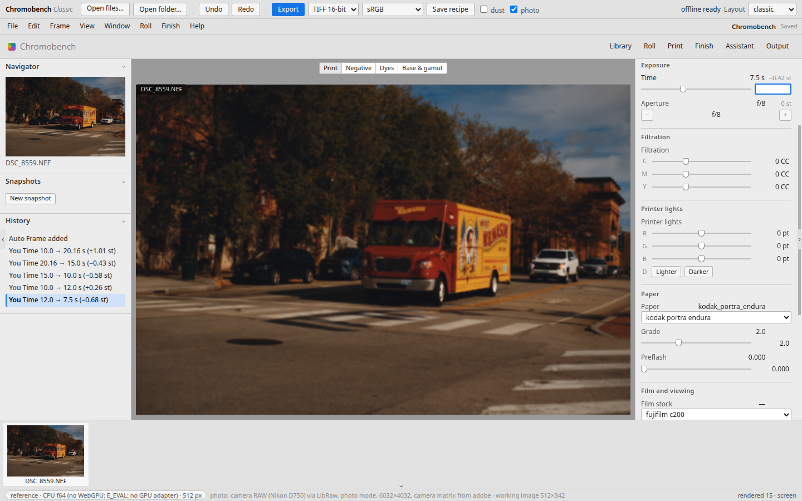
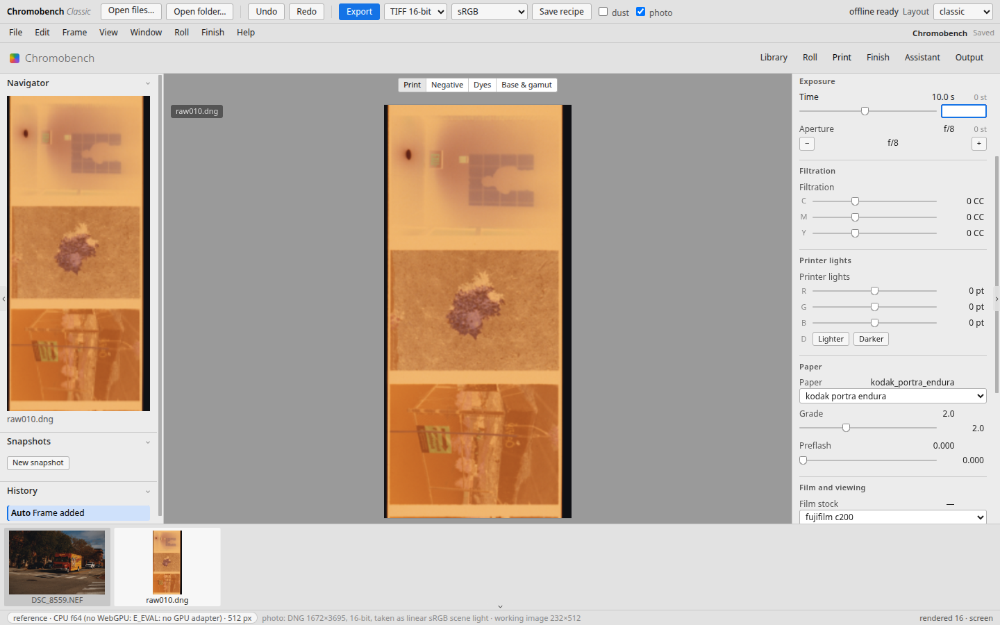
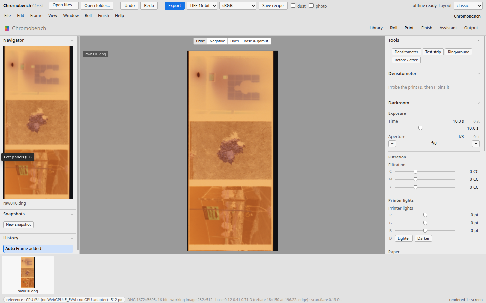

# Session 01: "Let's put in yesterday's pictures"

*Played by the orchestrator agent, 2026-11-12, 13:13–13:30. App: `apps/studio` built from `main` (`0b381c6`),
served at `http://localhost:4600`, Chromium via Playwright at 1440×900, **no WebGPU** (CPU reference engine). Files:
`DSC_8559.NEF` (daylight street, delivery truck) and `raw010.dng` (a colour negative strip).*

## The empty app

I open the page. There's a lot of chrome before there's anything to look at: a row of buttons, a menu
bar, then another bar with Library / Roll / Print / Finish / Assistant / Output, and "Chromobench" three times.
In the middle a grey field says **"No frames yet: open a negative"**. I don't have a negative, I have my Nikon
pictures. At the bottom: "reference · CPU f64 (no WebGPU: E_EVAL: no GPU adapter) · 512 px". I don't know what
any of that means, and it sounds like an error.

Up top there are two little checkboxes, **"dust"** and **"photo"**. I ignore them; who reads checkboxes before
opening a picture?

## My truck picture comes out as a negative

"Open files…", and I pick `DSC_8559.NEF`, the delivery truck in the sun. For a long while nothing moves. I
can't even tell whether it's working. Then a picture appears, **and it's a negative**: white trees, a cyan
truck, a brown sky. Underneath, a long line about "scan mode", "no rebate found", "no open gate in view", "the
base was read on blank film". It's not a scan, it's my camera!

> **Developer commentary.** Without the `photo` checkbox the file goes through `decodeScan`
> (`apps/studio/src/host/engines.ts:238`): a camera RAW is treated as a camera *scan of a negative*,
> CFA-binned to 3016×2016, then shrunk to a 512×342 working image. The screenshot tool timed out (5 s) during the
> open, so the main thread was blocked. → **F1**, **F9**.

## Ticking "photo" doesn't help

So that's what "photo" is for. I tick it. Nothing changes. I open the picture again, and now the bottom-right
corner says **"opening DSC_8559.NEF…"** and keeps saying it. Two minutes later it still says it. Is it
frozen? No, I can click things; it just never finishes.

> **Developer commentary.** The checkbox only affects later opens. The re-open is deduplicated by content hash
> (`packages/studio-kit/src/bridge/frames.ts:69` returns the existing frame), and for a single file the status
> line is never replaced (`apps/studio/src/main.ts:254`; only multi-file opens write "opened N files").
> No console error. → **F2**.

## Reload, and everything is gone

What do you do when a program hangs? You restart it. I reload the page: **my picture is gone**. The library says
0 frames, and the "photo" box is unticked again.

This time I tick "photo" first and open the truck again. About seven seconds later it's there and it's a
**positive**, with a warm, slightly dark, filmic look (Fuji C200 on Portra Endura, it says on the right). Nice
colours. But it looks **soft, as if I'd missed focus**. I know I didn't; it's a 1/3200 s at f/3.2.

> **Developer commentary.** The library does not persist, only the per-hash recipes do → **F5**. Opening as a photo:
> about 7 s to the first picture with main-thread stalls of 0.46, 0.78 and **2.9 s**. The softness: the
> working image is 512×342, drawn at ~890 px → **F10**. The paper select shows the raw id `kodak_portra_endura`
> above the label "kodak portra endura" → **F9**.

## Making it a bit lighter: the window freezes

In the darkroom I'd give it a longer time. There's "Time 10.0 s" with a slider. I drag it a little to the right,
and **the whole window freezes**. The slider stutters behind my mouse; it takes **twelve seconds** to move it two
centimetres. When it settles, the picture is lighter and the history says "You Time 10.0 → 20.16 s (+1.01 st)".
20.16 seconds? I'd have set 20.

> **Developer commentary.** 20 mouse moves 30 ms apart → six previews, each blocking the main thread for 1.65–2.43 s
> (CPU reference engine at 512 px, on the main thread). Previews aren't coalesced or cancelled while one is
> running. One history entry for the whole drag (good). The ⅙-stop slider step gives 20.16 s → **F4**, **F13**.

Undo (Ctrl+Z) takes me back to 10 s, the Undo button again says "Nothing to undo yet" (fair), Redo brings back
20.16. That all works; it's just slow.

## Typing a time

I'd rather type it. I click the "10.0 s" box:
- `15`, Enter: 15 s, but the window was stuck for **eleven seconds** after Enter.
- `0`, Enter: nothing happens to the box; a message flashes by that I couldn't read in time.
- `-5`, Enter: **10 s**?! I wanted to see what happens with nonsense, and it took 5 seconds *off*.
- `abc`, Enter: "abc" stays in the box, framed in red. Nothing else.
- `1000`, Enter: back to 10.0 s, another message flashes by.
- `12s`: 12 s. `7,5` (with the comma): 7.5 s. Good, it understands me.

> **Developer commentary.** The flashing messages were toasts, captured afterwards from the shell's UI log
> (`window.chromobench.rt.chrome.log`): `E_ARG_RANGE: print.enlarger.time_s = 0 is outside the allowed range
> [0.1, 600] (s).`, the same for 1000 → **F7**. The slider spans 2–60 s, the contract 0.1–600 s. `-5` is a
> *relative* entry by design (`parseEntry`, `packages/studio-kit/src/kit/args.ts`: a leading sign moves from the
> current value), with no hint in the UI → **F8**. Toasts last 2.6 s; agents now install a probe that records them
> (`scripts/01-install-probe.js`).

## My negative strip comes out orange, twice

Now the old negative. "photo" is still ticked from the truck, and I forget. `raw010.dng` opens as a long orange
strip of three pictures. Of course: it's a negative and I said "photo". There's no warning such as "this looks
like a negative".

How do I take it out again? I right-click the thumbnail and get the **browser's own menu**: "Save image as…,
Copy image, Inspect". Nothing from the program. The File menu has "Save the Print" and "Find a Command…". There's
no Remove, and no Open either.

> **Developer commentary.** Right-click shows Chrome's native image menu (invisible to screenshots; it stayed
> open in the window). No frame removal anywhere → **F6**. The Time box on this frame still had the red
> "bad entry" border from the other frame's `abc`/empty entry → **F8**.

While I'm looking, I press Ctrl+Z out of habit, and a message says **"Undo Time (on DSC_8559.NEF)"**: it undid
something on the *other* picture. At least it told me.

So, reload again (the library is empty again), "photo" is unticked now, open the strip. It thinks for about **eight
seconds, with the window frozen for nearly seven of them**, and then shows… **the same orange strip**. The line at
the bottom now talks about "base 0.12 0.41 0.71 D", "rebate", "flare": it *did* treat it as a negative. But the
print is still orange. I give up for today.

> **Developer commentary.** The edit log saved in IndexedDB under the file's hash was resumed: its recipe says
> `kind: "digital-raw"`, `source.decode.mode: "photo"` (from the mistaken first open), while this decode ran in
> scan mode. Nothing reconciles the decode mode with the resumed recipe, so the scan-conditioned negative is
> rendered as a scene photo. Only `?fresh` (in-memory store) or clearing site data gets out of it →
> **F3** (blocker). The 6.7 s stall: DNG decode plus scan conditioning run on the main thread (LibRaw is in a
> worker, but the DNG path isn't) → **F4**. The strip of three frames shows as one frame → **F16**.

## What I would tell the developer

1. **Know what I'm opening.** My camera files are photos; my strip is a negative. Guess it, show me the guess,
   and let me change it later on the picture itself, not with a checkbox before opening.
2. **Never get stuck.** Opening a file again must do something (or say "already open"), and a wrong choice
   must be fixable without restarting. Today one wrong click ruined that negative for good.
3. **Don't freeze while I drag.** Two seconds per step makes the sliders unusable. I'd rather see a rough
   picture immediately and a sharp one a moment later.
4. **Keep my pictures** when I close or reload, like Lightroom does.
5. **Show me sharp pictures**, or let me zoom to 100 %. Right now everything looks out of focus.
6. **Talk to me in photographer words.** No "E_ARG_RANGE", no "CPU f64", no "rebate blank". Tell me
   "Time must be between 0.1 and 600 seconds".
7. Small things: undo that says which picture it touched (good, keep it); round times; a right-click menu on
   pictures.

## Findings

See the merged list: [02-findings.md](02-findings.md). This session found F1–F16.
