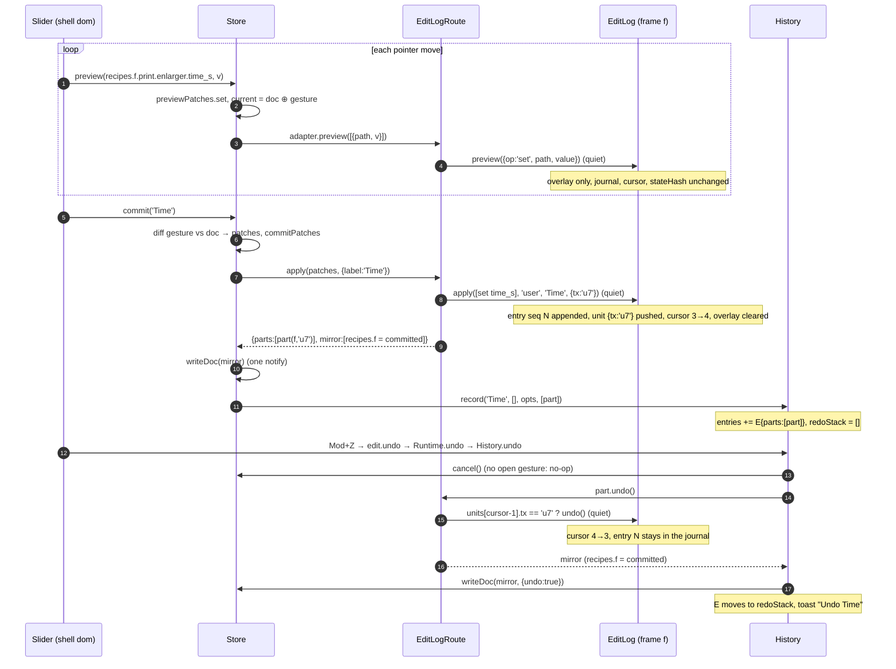
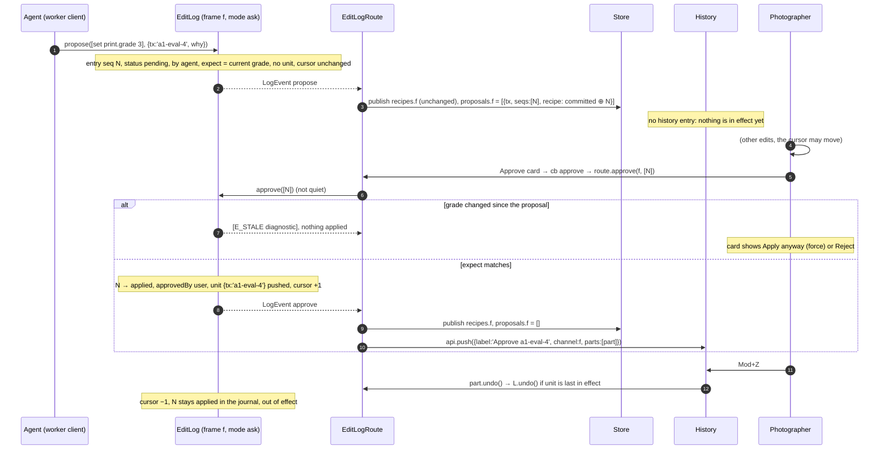
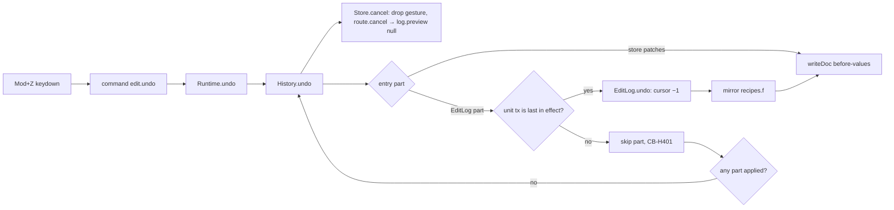

# Undo and history across the layers

This document describes how the studio records edits and how it reverses them. Four modules take part.
Each section defines its terms before it uses them. All paths are relative to the repository root; line
numbers were checked against the tree on 2026-11-12.

## 1. Definitions

**Recipe.** The complete parameter set of one frame (`FrameRecipe`, `packages/contract/src/recipe.ts`).
The physics graph is compiled from it.

**Mutation.** One requested change to a recipe: `set` a path, `exposure.add`, `exposure.remove`,
`mask.set`, or `frame.add` (`packages/contract/src/mutations.ts:9`).

**Author.** Who caused an entry: `'user'`, `'agent'` or `'auto'` (`packages/contract/src/mutations.ts:22`).
`'auto'` is ingest's `frame.add` and the automatic first print.

**Logged mutation (entry).** A mutation as stored in a frame's journal: `seq` (per frame, from 1), `by`,
`tx`, optional `batch`, `ts`, `status` (`'applied' | 'pending' | 'rejected'`), optional `why` and
`approvedBy: 'user'` (`packages/contract/src/mutations.ts:24-38`).

**Journal.** The array `EditLogData.entries`. It is append-only; entries are never deleted
(`packages/contract/src/editlog.ts:30-31`).

**Undo unit.** A group of entries that undo and redo together: `{ tx, seqs, label }`
(`packages/contract/src/editlog.ts:13-17`). One gesture, one transaction or one approval produces one unit.

**Cursor.** The number of units in effect. `units[0..cursor)` are in effect; `units[cursor..]` form the
redo tail (`packages/contract/src/editlog.ts:33-35`).

**Edit log (EditLog).** The per-frame object that holds the initial recipe, the journal, the units and the
cursor (`packages/contract/src/editlog.ts:100`). There is one EditLog per open frame.

**Committed state.** The initial recipe with every in-effect entry applied in order
(`EditLog.committed`, `packages/contract/src/editlog.ts:175-182`). Its hash is `stateHash`
(`:192-194`).

**Preview (log level).** A transient list of mutations that `EditLog.state` applies on top of the committed
state. It is never journalled and never hashed (`EditLog.preview`, `packages/contract/src/editlog.ts:371-377`).
Each log has exactly one preview slot.

**Transaction id (tx).** A string that names the unit an entry belongs to. In studio-kit it is shared across
frames when one action touches several frames.

**Batch.** A cross-frame grouping recorded on each entry as `LoggedMutation.batch` (contract 0.3). It lets
`approve` and `reject` act on "every pending entry of batch X" (`EntrySelector`,
`packages/contract/src/editlog.ts:67`).

**Proposal.** One or more pending entries written by the agent. A proposal changes nothing until approved.

**Store.** The shell's single state tree (`packages/shell/src/core/store.ts`). Paths fall into tiers:
*document* (undoable), *view* (never undone) and *route* (owned by an adapter).

**Gesture layer (store preview).** `Store.previewPatches`: values written by `store.preview()` that readers
see but the document does not yet contain (`packages/shell/src/core/store.ts:269-280`).

**Commit (store).** `store.commit(label)` turns the gesture layer into one transaction
(`packages/shell/src/core/store.ts:282-295`). **Cancel** drops it (`:297-305`).

**Store transaction.** `store.tx(label, fn)` or `commitPatches`: a set of patches written at once, recorded as
one history entry (`packages/shell/src/core/store.ts:216-265`).

**Route.** A store prefix whose writes go to an adapter instead of the document. `recipes` is a route; its
adapter is `EditLogRoute` (`packages/studio-kit/src/bridge/editlog-route.ts:59`).

**Mirror.** The values an adapter asks the store to write as the projection of its own state
(for `recipes.<f>`: the log's committed recipe).

**History part.** An undo/redo pair supplied by an adapter. `undo()` returns mirror values to write, or
`false` when the part no longer applies (`packages/shell/src/core/history.ts:18-27`).

**History entry (global undo step).** One element of the shell's global stack: the store's own patches plus
zero or more parts (`packages/shell/src/core/history.ts:29-40`).

**Channel.** An optional frame id on a history entry. Undo toasts use it to say where the undo happened.

## 2. Which layer owns what

| Layer | File | Owns | Does not own |
|---|---|---|---|
| (a) Contract edit log | `packages/contract/src/editlog.ts` | journal, units, cursor, the one preview slot, agent mode, `why()` provenance | anything cross-frame; the global order of steps |
| (b) EditLog route | `packages/studio-kit/src/bridge/editlog-route.ts` | the mapping store path → recipe field; one history part per unit; bursts; cross-frame batches; publishing `recipes.<f>` and `proposals.<f>` | recipe state (it reads the logs) |
| (c) Shell store + History | `packages/shell/src/core/store.ts`, `packages/shell/src/core/history.ts` | gesture previews, transactions, the global undo/redo stacks, coalescing, Mod+Z | recipe contents (they are routed) |
| (d) History view model | `packages/studio-kit/src/model/history.ts` | read-only views of one log: unit groups, pending groups, "why" rows, darkroom wording | no state; it never writes a log |

Layer (d) is a pure function library over one `EditLog`. It does not implement global undo across frames.
Global undo across frames is the shell History (c), fed with parts by the route (b).

The routed prefix is excluded from the store's document snapshot (`packages/shell/src/core/store/snapshot.ts:6-37`).
The EditLogs are therefore the only persistent record of recipe edits; the shell's history is session-only.

## 3. Mechanism, layer by layer

### 3.1 The edit log (contract)

The recipe of a frame is the fold of its in-effect units. Every operation below changes the journal, the
units or the cursor, and then emits a `LogEvent` (`packages/contract/src/editlog.ts:49-57`).

- `apply(ms, by, label, {tx, batch})` (`:253-263`) validates every mutation against `committed`. On any
  failure it throws and appends nothing. On success it appends one `applied` entry per mutation, clears the
  preview overlay, and pushes one unit. `by: 'agent'` is refused with `E_READONLY` (`:254`).
- `pushUnit` (`:237-242`) truncates `units` to `cursor` before pushing. The redo tail is dropped from the
  unit list; its entries stay in the journal.
- `propose(ms, {tx, why, label, batch})` (`:266-286`) is the only entry point for agent mutations.
  In mode `read-only` it throws `E_READONLY`. Each `set` receives an `expect` field: the value the path had
  when proposed (`:272`). In mode `ask` the entries are appended as `pending` and no unit is pushed
  (`:276-280`). In mode `auto` they are appended as `applied` and pushed as one unit (`:281-285`).
- `approve(selector, {force})` (`:296-333`) re-validates the selected pending entries in `seq` order. For a
  `set` whose current value differs from `expect` it returns an `E_STALE` diagnostic and applies nothing
  (`:307-314`), unless `force` is true. On success it flips the entries to `applied`, sets
  `approvedBy: 'user'` (`:325-328`) and pushes one unit whose `tx` is the proposal's `tx` (`:329-330`).
- `reject(selector)` (`:342-349`) flips pending entries to `rejected`. It pushes no unit.
- `undo()` / `redo()` (`:351-365`) move the cursor by one. They never touch the journal.
- `preview(m | m[] | null)` (`:371-377`) validates the overlay against `committed`, stores it and emits a
  `preview` event. `stateHash` ignores it.

An undone approval does not return its entries to `pending`. They remain `applied` in the journal and fall
out of effect because the cursor moved.

### 3.2 The EditLog route (studio-kit)

`EditLogRoute` is the store adapter for the prefix `recipes`. Its file header lists the mapping
(`packages/studio-kit/src/bridge/editlog-route.ts:1-16`).

Projection. When a frame is added, the route publishes `recipes.<f>` = `log.committed` and
`proposals.<f>` = the pending groups, each with the recipe it would produce (`:78-120`). It subscribes to
the log. `onLog` (`:124-131`) ignores `preview` and `mode` events and every event raised while the route
itself is calling the log (the `quiet` counter, `:65`, `:132-139`). For any other event it republishes. For
`apply` and `approve` events it also pushes a history entry with one part (`:127-130`). This is how
changes that did not originate in a store transaction (agent in `auto` mode, a direct `log.approve`) reach
the global undo stack.

Previews. `preview(writes)` (`:178-195`) maps each store path to its recipe field (`recipePathOf`,
`:41-57`) and calls `log.preview({op:'set', …})` quietly. `cancel()` (`:196-199`) clears the log preview of
every frame it previewed.

Commit. `apply(patches, {label, opts})` (`:227-261`) groups patches by frame, converts them to mutations
(`mutationsFor`, `:202-225`), validates every frame before applying any (`:236-242`), then calls
`log.apply(ms, 'user', label, {tx})` per frame under one shared `tx` (`:243`, `:253`). It returns one part per
changed frame and the mirror values. A commit with no effective change returns a part whose undo and redo
return `false` (`:259`).

Parts. `part(e, tx, label)` (`:142-169`) closes over the frame's log. Its `undo` succeeds only if the unit
with this `tx` is the last unit in effect (`log.units[log.cursor-1].tx === tx`); its `redo` succeeds only if
it is the next unit (`:151`, `:160`). Otherwise it returns `false` and counts a skip. It also returns `false`
when the frame was removed or re-opened (`:145`).

Bursts. `step(store, clock, path, value, label)` (`:264-275`) is used by the arg editors for arrow keys, wheel
and nudge buttons (`packages/studio-kit/src/dom/arg.ts:78`). It previews immediately and commits once after
`BURST_MS` = 800 ms without another step (`:27`). `endBurst()` (`:277-283`) commits early; every command entry
point of the route calls it first.

Command entry points.
- `applyMutations(frame, ms, label)` (`:290-295`): structural edits; one unit; the log event pushes the entry.
- `applyBatch(entries, label, {by, tx, batch, detail})` (`:302-329`): validates every frame, applies one unit
  per frame under one `tx`, stamps every entry with `batch` (default: the `tx`), and pushes **one** history
  entry holding all parts. The channel is the frame id for one frame and `null` for several (`:326`).
- `approve(frame, seqs, force)` (`:330-335`): calls `log.approve` without `quiet`, so the `approve` event
  pushes the history entry through `onLog`.
- `approveBatch(items, label, {force})` (`:341-363`): approves each frame quietly, collects refused frames,
  and pushes one entry for the frames that succeeded.
- `jump(frame, target)` (`:368-374`): moves one frame's cursor with repeated `log.undo()`/`log.redo()`. It
  pushes nothing onto the global stack.

### 3.3 The shell store and History

Gesture layer. `store.preview(path, v)` writes `previewPatches`, recomputes `current`, informs the route's
adapter, and notifies readers (`packages/shell/src/core/store.ts:269-277`). `store.commit(label)` diffs the
layer against the document and calls `commitPatches` (`:537-550`). `store.cancel()` clears the layer and calls
`adapter.cancel()` for each route touched (`:552-560`).

Transactions. `commitPatches` (`:487-520`) splits patches into plain and routed ones. Each route adapter's
`apply` runs first; if it throws, the whole transaction is aborted, any gesture is cancelled and a
`TxRefused` is reported (`:500-509`). Routed patches that came back with parts are not stored as patches;
the parts carry their undo (`:510-515`). All writes land in one `writeDoc` (`:518`), and one
`history.record` call files the entry (`:519`).

A transaction that overlaps an open gesture cancels the gesture first (`:478-483`). This prevents a later
release from overwriting the transaction.

History. `History.record` (`packages/shell/src/core/history.ts:83-122`) appends an entry and clears the redo
stack. With a `coalesce` key, a record within `coalesceMs` (default 1500 ms, `:72`) of the previous entry
with the same key merges into it: patches keep the first `before`, parts accumulate (`:88-103`).
`History.push` (`:125-142`) appends an entry made only of parts; the route reaches it through
`RouteApi.push` (`packages/shell/src/core/store/routes.ts:74-76`).

`History.undo()` (`packages/shell/src/core/history.ts:210-237`) first cancels the gesture layer. It pops the
newest entry, inverts its patches, and calls each part's `undo()` in reverse order. A part that returns
`false` is skipped. If nothing in the entry applied, the entry is discarded and the next one is tried
(`:230`). Otherwise the collected writes go through one `writeDoc` with `{undo: true}` and the entry moves to
the redo stack. `redo()` is symmetric (`:238-262`).

Mod+Z. The built-in keymap binds `Mod+Z` to `edit.undo` and `Mod+Shift+Z` to `edit.redo`
(`packages/shell/src/app/assemble.ts:22-23`). The command calls `Runtime.undo()`
(`packages/shell/src/app/builtins.ts:43-49`), which calls `History.undo()` and shows a toast naming the
entry and its channel (`packages/shell/src/app/runtime.ts:404-408`). Studio-kit reports a skipped part as
the info diagnostic `CB-H401` (`packages/studio-kit/src/studio.ts:116`).

### 3.4 The history view model (studio-kit)

`packages/studio-kit/src/model/history.ts` reads one log and produces display data:

- `historyGroups(log, lookup)` (`:82-106`): every unit, in order, with author, timestamp, darkroom-worded
  changes, `inEffect` (`index < cursor`) and `approved`. The History panel renders it
  (`packages/studio-kit/src/dom/panels.ts:45`); a click runs `history.jump`
  (`packages/studio-kit/src/cb.ts:345-349`), which is `EditLogRoute.jump`.
- `pendingGroups(log, lookup)` (`:109-119`): pending entries grouped by `tx`, with `why` and `batch`. The
  route uses it to build `proposals.<f>` (`packages/studio-kit/src/bridge/editlog-route.ts:107`).
- `whyRows` (`:130-150`): the "Why is X?" rows from `EditLog.why()` plus pending proposals on that path.
- `describe` (`:49-79`): one line per mutation in the photographer's units.
- `moveCursor` (`:122-125`): no caller in `src`; it is used only by `packages/studio-kit/test/model.test.ts:65` and
  duplicates `EditLogRoute.jump`. (A `rejectedEntries` view with no caller was removed in CHB-032.)

## 4. Worked sequences

The examples use one frame `f` with an EditLog whose cursor is 3, and a slider bound to
`recipes.f.print.enlarger.time_s`.

### 4.1 A slider drag, release, then Mod+Z

The slider's pointer handler calls `b.preview(v)` on every move and `b.commit(label)` on release
(`packages/shell/src/dom/forms/basic.ts:351-367`). The binding forwards to `store.preview` and
`store.commit` (`packages/shell/src/dom/mount.ts:186-195`).

State after each step:

| Step | EditLog f | Store | History |
|---|---|---|---|
| during the drag | journal unchanged, cursor 3, overlay = `[set time_s v]` | `previewPatches` holds the path; `doc.recipes.f` unchanged | unchanged |
| after release | entry N `applied`, unit `u7`, cursor 4, overlay null | `doc.recipes.f` = new committed recipe | one new entry with one part |
| after Mod+Z | cursor 3; entry N still `applied` in the journal, out of effect | `doc.recipes.f` = old committed recipe | entry on the redo stack |

Escape during the drag runs `b.cancel()` → `store.cancel()` → `EditLogRoute.cancel()` → `log.preview(null)`.
Nothing is journalled. Test: `packages/studio-kit/test/bridge.test.ts:32` ("a 120-move drag is one EditLog
unit and one undo step; Esc logs nothing").

Keyboard nudges through the arg editors do not commit per key. `EditLogRoute.step` keeps one burst open and
commits one unit after 800 ms of inactivity (`packages/studio-kit/test/bridge.test.ts:57`).

### 4.2 A multi-frame look applied as one batch

The looks kit plans per-frame mutations and commits them with
`route.applyBatch(entries, p.label, {tx: p.id, batch: p.id, detail: p.why})`
(`commit` in `packages/studio-kit/kits/looks/src/model.ts:162`). For three frames `a`, `b`, `c`:

1. `applyBatch` validates all three recipes first (`editlog-route.ts:305-312`). A refusal throws before any log
   changes.
2. For each frame it calls `log.apply(ms, 'user', label, {tx: p.id, batch: p.id})` quietly. Each log gains one
   unit with `tx = p.id`; every entry carries `batch = p.id`.
3. It publishes each frame's mirror and pushes **one** history entry with three parts and `channel: null`
   (`editlog-route.ts:324-327`).

One Mod+Z calls the three parts' `undo()` in reverse order (c, b, a). Each moves its own log's cursor back by
one. If the photographer had already moved frame `b` back in its History panel, `b`'s part returns `false`,
the other two are undone, and `CB-H401` is reported. Tests: `packages/studio-kit/test/looks/kit.test.ts:51`
("one batch, one undo step for every frame") and `packages/shell/test/core/store-ext.test.ts:156` ("a roll
balance: one entry holding many units, undone by one undo"). The roll kit uses the same entry point with
`by: 'auto'` for the first print (`packages/studio-kit/kits/roll/src/kit.ts:131-135`).

### 4.3 An agent proposal approved later

The agent never holds an EditLog. The agent worker's client replays the session's proposals on the real logs
with `f.log.propose(ms, {tx, why, label})` (`packages/agent/src/worker/client.ts:187`). The browser console
helper `studio.propose` does the same (`packages/studio-kit/src/studio.ts:220-225`). The frame is in mode
`ask` (the default, `packages/contract/src/editlog.ts:116`).

The approval card's command is in `packages/studio-kit/src/cb.ts:599-612`. A stale result is written to
`ui.approvals.<tx>.stale` and reported as `CB-H410`. The chat session approves through the same log call
(`packages/agent/src/chat/session.ts:526`); the route's `onLog` pushes the history entry in that case too.

Variants:
- Mode `auto`: `propose` applies at once and emits `apply`; `onLog` pushes an entry labelled `Agent <tx>`
  (`packages/studio-kit/src/bridge/editlog-route.ts:377-382`).
- Mode `read-only`: `propose` throws `E_READONLY`; the agent client reports a `CONFLICT` warning
  (`packages/agent/src/worker/client.ts:186-192`).
- An agent look batch across frames: `approveBatch` approves each frame and pushes one entry for all
  approved frames; refused frames are returned for an Apply anyway / Skip choice
  (the `looks.batch.approve` command, `packages/studio-kit/kits/looks/src/commands.ts:113-124`).
- Reject: `log.reject` marks entries `rejected`; no unit, no history entry.

## 5. How Mod+Z travels, summarised

Three rules follow from the code:

1. The shell history decides the order of undo across frames and across non-recipe state (flags, keywords,
   selection-independent document data). The edit logs decide what one frame's recipe is.
2. A per-frame cursor move that did not come from the shell (History panel jump, agent auto-apply undone by
   no one) is detected by the `tx` guard in each part, not by bookkeeping in the shell.
3. Previews never reach the journal. Only `apply`, `propose` and `approve` append or change entries.

## 6. Tests that pin the behaviour

| Behaviour | Test |
|---|---|
| preview, one apply, undo restores the state hash; redo | `packages/contract/test/recipe-editlog.test.ts:83` |
| ask mode: pending, approve, `why` records approval | `packages/contract/test/recipe-editlog.test.ts:101` |
| read-only refuses, auto applies; agent cannot use `apply` | `packages/contract/test/recipe-editlog.test.ts:115-124` |
| law: undo restores the hash | `packages/contract/test/recipe-editlog.test.ts:128` |
| multi-mutation preview | `packages/contract/test/recipe-editlog.test.ts:337` |
| `batch` recorded; approve/reject by batch | `packages/contract/test/recipe-editlog.test.ts:354` |
| store: preview then commit is one undo step; view tier not undoable; coalescing | `packages/shell/test/core/core.test.ts:60`, `:84`, `:116`, `:132` |
| store: gesture cancelled by an overlapping tx; refusal aborts; route previews; one entry many units; skipped parts | `packages/shell/test/core/store-ext.test.ts:24`, `:132`, `:147`, `:156`, `:168` |
| route: drag = one unit, Esc logs nothing | `packages/studio-kit/test/bridge.test.ts:32` |
| route: keyboard burst = one unit | `packages/studio-kit/test/bridge.test.ts:57` |
| Mod+Z walks flag, time, keyword, approved agent change newest first | `packages/studio-kit/test/bridge.test.ts:106` |
| CB-H401 after a History-panel jump | `packages/studio-kit/test/bridge.test.ts:130` |
| proposals published, log untouched; stale flow with Apply anyway | `packages/studio-kit/test/bridge.test.ts:151`, `:189` |
| look batch = one undo step | `packages/studio-kit/test/looks/kit.test.ts:51`, `:123` |
| roll first print and approval = one undo each | `packages/studio-kit/test/roll/kit.test.ts:35`, `:179` |
| agent: photographer undoes an applied step; next context reports it | `packages/agent/test/chat.test.ts:227` |

## 7. Observations for the clean-up

- `moveCursor` (`packages/studio-kit/src/model/history.ts:122-125`) duplicates `EditLogRoute.jump`
  (`packages/studio-kit/src/bridge/editlog-route.ts:368-374`) and has no caller outside tests.
- The store's named preview layers (`Store.layer`, `namedLayer` in `packages/shell/src/core/store/layers.ts:19`) are described in
  the store header as "agent proposals", but the studio does not use them. Proposals are published as data
  under `proposals.<f>` and shown by rendering the folded recipe.
- An undone approval leaves its entries `applied` in the journal. A reader of `entries` must combine
  `status` with the unit list and cursor (`inEffect()`) to know whether an entry is in effect.
