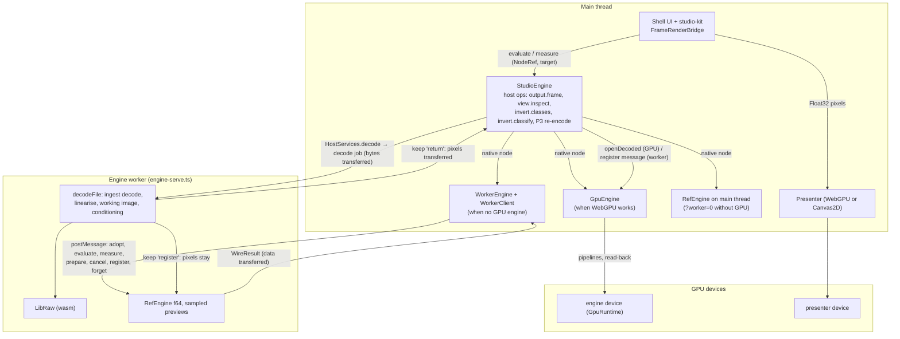
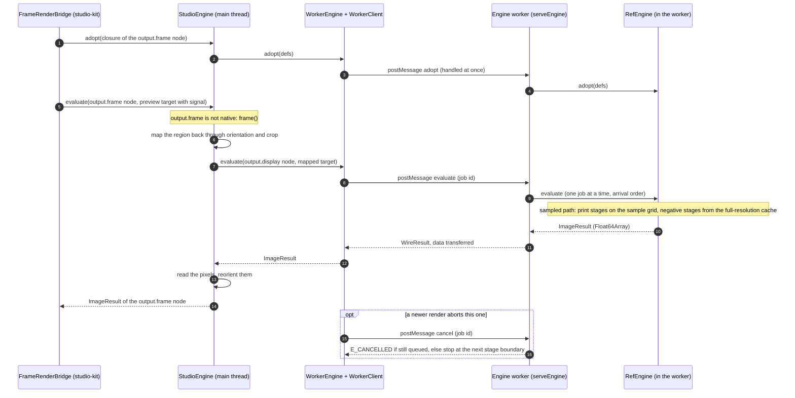

# Which engine computes what

This document describes the components that turn a recipe into pixels in `apps/studio`. It defines the
terms first, then describes each component, then the selection logic, then where each op family runs.
Paths are relative to the repository root. Line numbers were checked on 2026-11-12, after CHB-032 split
`packages/gpu/src/engine-gpu.ts` into that file plus `packages/gpu/src/engine/*.ts`.

## 1. Definitions

**Op.** A named graph operation from the contract registry, for example `print.expose` or
`output.display` (`packages/contract/src/registry.ts:207`, `allOps`). An op is an *Image* op (it produces
pixels) or a *Value* op (it produces a measurement record).

**Node.** One application of an op to inputs and arguments. A node's id is a content hash of its op,
inputs and arguments. A *closure* is a node together with every node it depends on.

**Graph.** The container that interns nodes (`Graph`, `packages/contract/src/graph.ts`). `compile` turns a
recipe into a graph whose last node is `output.frame` (`packages/contract/src/graph.ts:316`).

**Engine.** Any object that implements the contract interface `Engine`
(`packages/contract/src/engine.ts:126-140`): `capabilities()`, `open(source)`, `adopt(defs)`,
`evaluate(node, target)` for Image nodes, `measure(node, spec)` for Value nodes, `prepare(tableKeys)`,
optional `plan()`, and `dispose()`. The contract rules are in the header (`:5-12`); in particular an op not
listed in `capabilities().ops` must throw `E_NOT_IMPLEMENTED` (`:11`). `EngineId` is
`'mock' | 'reference' | 'gpu'` (`:19`).

**Evaluation target.** `{ scale, region?, precision, signal? }` (`packages/contract/src/engine.ts:42-50`).
`precision` is `'preview'` or `'export'`. `signal` cancels.

**Physics engine.** An engine that computes film and paper physics. There are two: `RefEngine` and
`GpuEngine`. `MockEngine` implements the same interface with simplified formulas.

**Host op.** An op that `StudioEngine` computes itself, on the main thread, from the physics engine's
results: `output.frame`, `view.inspect`, `invert.classes`, `invert.classify`
(`HOST_OPS`, `apps/studio/src/host/studio-engine.ts:82`).

**Native node.** A node whose whole closure uses only ops the physics engine lists. `StudioEngine` sends
native nodes straight to the physics engine (`apps/studio/src/host/studio-engine.ts:286-294`).

**Decode.** Reading file bytes into linear RGB: TIFF, PNG, DNG and camera RAW (LibRaw) through
`packages/ingest`. **Working image.** The decoded image area-averaged to a target long side.
**Conditioning.** The scan analysis done on open for a negative: film layout, rebate box, veil, base,
strip detection, optional dust healing (`apps/studio/src/host/decode.ts:73-121`). Decode, working image and
conditioning are not graph ops; they are host functions.

**Engine worker.** A dedicated Web Worker that runs decode and conditioning, and also hosts `RefEngine` when
there is no GPU engine (`apps/studio/src/host/engine-worker.ts`, job loop in
`apps/studio/src/host/engine-serve.ts`).

**Main thread.** The browser thread that runs the UI, the shell, `StudioEngine` and, when present,
`GpuEngine`'s command submission.

## 2. The components

### 2.1 RefEngine (packages/core)

`RefEngine` (`packages/core/src/engine-ref.ts:144`) computes every op of core's `IMAGE_OPS` and `VALUE_OPS`
in f64 on the CPU (`REFERENCE_OPS`, `:140`). It is exact and slow. Full-resolution node images are cached per
node id; previews and regions are nearest-sampled from them (file header, `:1-4`).

With `sampled: true` a preview evaluates the print side of the chain on the sample grid instead of at full
resolution. The ops that may run on the grid are `GRID_OPS` (`:63-67`): `print.*`, the pointwise masks,
`view.*` and `output.display`. The negative's stages (`scan.*`, `invert.*`, capture and film) still run once at
full resolution and stay cached. The sampled path is taken for `precision: 'preview'` when the output grid is smaller than the node's full size
(`:408-414`).

`open()` reads TIFF only (`:184`). The studio never calls it; it registers decoded pixels with
`openDecoded(info, data)` (`:214`) and drops them with `forgetSource(sha)` (`:228`). An op outside its set
throws `E_NOT_IMPLEMENTED` (`:262`).

### 2.2 GpuEngine (packages/gpu)

`GpuEngine` (`packages/gpu/src/engine-gpu.ts`) implements the interface on WebGPU. Pointwise chains are lowered
to programs of one WGSL kernel; spatial and multi-input ops are materialised barriers; `measure()` runs GPU
reductions (file header, `packages/gpu/src/engine-gpu.ts:1-6`). The physics constants and tables come from
core (`CorePhysics`); the GPU applies them.

`GPU_OPS` lists the ops it implements (`packages/gpu/src/engine/defs.ts:8-16`; re-exported from
`packages/gpu/src/engine-gpu.ts:40`). `capabilities().ops` is exactly that list
(`packages/gpu/src/engine-gpu.ts:125`), and `check()` throws `E_NOT_IMPLEMENTED` for any other op
(`packages/gpu/src/engine-gpu.ts:265-268`).

Compared with the full registry, `GPU_OPS` lacks:

| Missing on GPU | RefEngine has it | Effect in the studio |
|---|---|---|
| `invert.classes`, `invert.classify` | yes | computed by `StudioEngine` (host op) |
| `output.frame`, `view.inspect` | no | computed by `StudioEngine` (host op) for both engines |
| `print.preflash` | yes | a recipe with `print.preflash > 0` (`packages/contract/src/graph.ts:304`) fails with `E_NOT_IMPLEMENTED` on GPU |
| `darkroom.lightsToFiltration` | yes | the DSL helper fails with `E_NOT_IMPLEMENTED` on GPU |
| `finishing.clarity`, `finishing.hue` | no | a recipe with clarity ≠ 0 (`packages/contract/src/graph.ts:313`) fails on both physics engines |
| `darkroom.testStrip`, `darkroom.ringAround`, `darkroom.contactSheet` | no | not evaluated as nodes by the studio; test strips are composed by studio-kit from several print nodes |
| `scan.baseClass`, `scan.checkDust`, `scan.conditioning`, `scan.flatField`, `scan.heal`, `scan.noise`, `scan.rankStocks`, `scan.rebate`, `scan.specks` | no | the studio does this work at decode time in ingest (`apps/studio/src/host/decode.ts`) and in the roll physics service (`apps/studio/src/host/engines.ts:106-129`) |
| `source.info`, `output.encode` | no | source info comes from decode; encoding is `packages/output` (`apps/studio/src/host/export.ts:1-7`) |

The list was computed by comparing `allOps({ includeInternal: true })` with `GPU_OPS` and with
`Object.keys(IMAGE_OPS)` + `Object.keys(VALUE_OPS)` of `packages/core/src/ops/ops.ts`.

`GpuEngine.open()` reads TIFF only (`packages/gpu/src/engine-gpu.ts:167`); the studio uses
`openDecoded()` (`:197`) and `forgetSource()` (`:209`). `plan()` returns a tile plan for exports (`:233`).

Table builds use the order GPU → worker pool → main thread (`backendOrder`,
`packages/gpu/src/device.ts:45-56`). The worker pool exists only when `opts.workers > 0`
(`packages/gpu/src/engine-gpu.ts:94`); the studio creates the engine with `{ data, cacheLimit: 24 }`
(`apps/studio/src/host/engines.ts:165`), so the studio has no table worker pool.

### 2.3 MockEngine (packages/engine-mock)

`MockEngine` (`packages/engine-mock/src/engine-mock.ts:19`) implements every registry op with deterministic,
simplified f64 formulas that move in the same direction as the physics but are not the physics
(`packages/engine-mock/src/ops.ts:1-3`). It decodes with ingest's synchronous `openSourceSync`
(`packages/engine-mock/src/engine-mock.ts:39-45`) on the main thread. It is a test double and a fallback for
UI work; `?engine=mock` uses it with no wrapper, no worker and no conditioning
(`apps/studio/src/main.ts:138`).

### 2.4 StudioEngine (apps/studio/src/host/studio-engine.ts)

`StudioEngine` implements `Engine` around one primary engine (`:191-210`). It is the engine every studio
component sees. It adds three things.

1. **Host ops.** `capabilities().ops` is the union of the primary's ops and `HOST_OPS` (`:212-215`).
   `evaluate()` (`:296-317`) sends a native node to the primary. Otherwise it switches on the node's own op:
   - `output.frame` → `frame()` (`:339-358`): evaluates the input with the region mapped back through crop
     and orientation, then reorients the pixels; with `angle_deg ≠ 0` → `straightened()` (`:364-384`), which
     evaluates the footprint at full resolution and resamples with the contract's `straighten`.
   - `view.inspect` → `inspect()` (`:386-392`): evaluates the input and maps it to display RGB
     (`inspectPixels`, `:160-184`).
   - `output.display` with `space: 'display-p3'` → evaluates an sRGB twin node and re-encodes it with
     `srgbToP3` (`:302-308`).
   - `invert.classes` → `classes()` (`:395-410`): evaluates `invert.dyes` and its `scan.density` input, then
     calls the injected per-pixel classifier (core's `classify`, injected at
     `apps/studio/src/host/engines.ts:213`).
   - anything else → `E_NOT_IMPLEMENTED` naming the missing ops (`:315-316`).
   `measure()` (`:319-335`) does the same for `invert.classify`, which counts class fractions on an
   analysis-size classification (about 0.25 MP).
2. **Decode on open.** `openAs(source, as, ask)` (`:227-253`) calls the injected `HostServices.decode`,
   decodes a second time if the pixel guess disagrees with the first mode, forgets the previous decode of the
   same file if its kind changed, and registers the result with the primary (`host.register`, `:247`).
3. **Notes.** `notes` keeps, per source, the decode notes, rebate, flare, base, guess and strip frames
   (`:202`, `:250-251`) that `main.ts` uses to build the first recipe.

A host op always runs on the main thread, in JavaScript, on pixels read back from the primary
(`await r.read()`). When the primary is `WorkerEngine`, those pixels were transferred from the worker.

### 2.5 The engine worker and WorkerEngine

The worker entry is five lines (`apps/studio/src/host/engine-worker.ts:1-5`); it calls `serveEngine` on its
global scope. `serveEngine` (`apps/studio/src/host/engine-serve.ts:40-174`) handles these messages
(protocol: `apps/studio/src/host/worker-protocol.ts:63-77`):

| Message | Reply | Work |
|---|---|---|
| `init` | caps or null | creates the LibRaw decoder; with `engine: 'reference'` loads the packs and creates `RefEngine` with a macrotask `yield` and `sampled` (`engine-serve.ts:59-72`) |
| `decode` | `WireDecoded` | `decodeFile` (decode, linearise, working image, conditioning). `keep: 'register'` keeps the pixels in the worker; `keep: 'return'` transfers them back (`:73-84`) |
| `register` | none | `RefEngine.openDecoded` with the kept pixels (`:145-151`) |
| `forget` | none | `RefEngine.forgetSource` (`:152-154`) |
| `adopt` | none | `RefEngine.adopt` (`:137-144`) |
| `evaluate` / `measure` / `prepare` | result | runs on `RefEngine`; image data is transferred (`:85-113`) |
| `cancel` | `E_CANCELLED` for a queued job | drops a queued job or aborts a running one at the next stage boundary (`:155-163`) |
| `dispose` | none | disposes the engine, clears the queue (`:164-168`) |

Jobs run one at a time in arrival order; `adopt`, `register`, `forget` and `cancel` are handled immediately
(`:7-10`, `:134-173`).

On the main thread, `WorkerClient` (`apps/studio/src/host/worker-engine.ts:24-89`) posts jobs and matches
replies; an aborted `AbortSignal` posts `cancel` (`:56-61`). `WorkerEngine` (`:92-155`) is an `Engine` with
`id: 'reference'` that forwards `adopt`, `evaluate`, `measure`, `prepare` to the worker. Its `open()` rejects:
files enter through `HostServices.decode` (`:106-109`).

Camera RAW decoding uses LibRaw. In the engine worker the decoder runs inside that worker
(`engine-serve.ts:60-63`). With `?worker=0` it runs in a separate LibRaw module worker started on first use
(`apps/studio/src/host/engines.ts:76-86`).

## 3. Selection and wiring

`startEngine()` in `apps/studio/src/main.ts:136-160` reads the query string:

| Query | Result |
|---|---|
| `?engine=mock` | `new MockEngine()`; `engines.ts` is not loaded (`main.ts:138`) |
| `?engine=gpu` | `createHostEngine({ want: 'gpu' })`; throws if WebGPU is unavailable (`engines.ts:177`) |
| `?engine=reference` | `createHostEngine({ want: 'reference' })`; GPU is not tried |
| none or `?engine=auto` | `createHostEngine({ want: 'auto' })` |
| `?worker=0` | no engine worker; decode and `RefEngine` on the main thread (`main.ts:144`) |
| `?long=N` | GPU working-image long side (default 4000; 0 = file size; `engines.ts:71`) |
| `?refLong=N` | reference working-image long side (default 512; `engines.ts:72`, `:195`) |

If `startEngine` throws, the page reports the error with links to `?engine=reference` and `?engine=mock`
(`main.ts:175-180`).

`createHostEngine` (`apps/studio/src/host/engines.ts:152-225`) proceeds in this order:

1. Load the data packs (`:155`).
2. Unless `want === 'reference'`: `GpuEngine.create`. If `capabilities().available` is true, it becomes the
   primary; otherwise the reason is kept and the engine disposed (`:162-178`).
3. Unless `worker === false`: start the engine worker (`:180`). `init` with `engine: 'none'` when a GPU
   primary exists, `engine: 'reference'` otherwise. Without a GPU primary, a `WorkerEngine` becomes the
   primary (`:181-191`). A worker that fails to start is terminated and the client set to null.
4. If there is still no primary: `new RefEngine({ data, sampled: true, … })` on the main thread (`:193`).
5. For a reference primary, the working long side becomes `refLong` and the label records "CPU f64",
   "(worker)" and the GPU failure reason (`:194-197`).
6. Build `HostServices` (`:201-216`): `decode` goes to the worker (`keep: 'register'` for `WorkerEngine`,
   `'return'` for GPU) or to `decodeFile` on the main thread; `register` posts `register` to the worker or
   calls `openDecoded` with the returned pixels; `classify` is core's classifier.
7. Wrap the primary: `new StudioEngine(primary, host, label)` (`:217`).

The resulting configurations are:

| Configuration | Primary | Decode + conditioning | Physics | Host ops |
|---|---|---|---|---|
| auto/gpu, WebGPU works | `GpuEngine` | engine worker (`keep: 'return'`) | main thread → GPU device | main thread |
| auto, no WebGPU | `WorkerEngine` → `RefEngine` | engine worker (`keep: 'register'`) | engine worker, f64 | main thread |
| reference | `WorkerEngine` → `RefEngine` | engine worker | engine worker, f64 | main thread |
| `?worker=0`, WebGPU works | `GpuEngine` | main thread (LibRaw in its own worker) | GPU device | main thread |
| `?worker=0`, no WebGPU or reference | `RefEngine` | main thread | main thread, f64 | main thread |
| mock | `MockEngine` (no wrapper) | main thread, `openSourceSync`, no conditioning | main thread, mock formulas | none needed: the mock implements every op |

The viewer's presenter requests its own WebGPU device (`presentDevice`,
`apps/studio/src/present/host-presenter.ts:21-30`; called at `apps/studio/src/main.ts:201`). It is not the
GPU engine's device: the engine creates its own runtime (`engines.ts:165` passes no `runtime`). The render
bridge reads every result to CPU memory (`packages/studio-kit/src/bridge/render-bridge.ts:226`) before the
presenter uploads it.

## 4. Where each op family is computed

The table lists the default configuration with WebGPU (column GPU) and without it (column Reference). "SE"
means `StudioEngine` on the main thread.

| Op family | GPU configuration | Reference configuration | Mock |
|---|---|---|---|
| File decode, linearise, working image, conditioning, guess, strips, dust (not ops) | engine worker | engine worker | main thread, `openSourceSync`, no conditioning |
| `source.open`, `source.pattern`, `source.xyz` | GpuEngine (GPU) | RefEngine (worker) | MockEngine |
| `scan.flare`, `scan.density`, `invert.dyes` | GpuEngine | RefEngine | MockEngine |
| Forward film path: `capture.expose`, `film.couple`, `film.halation`, `film.develop`, `film.grain` | GpuEngine | RefEngine | MockEngine |
| Printing: `print.expose`, `print.lights`, `print.develop`, `print.combine`, `print.densityMask` | GpuEngine | RefEngine | MockEngine |
| `print.preflash` | not available: `E_NOT_IMPLEMENTED` | RefEngine | MockEngine |
| Masks: `mask.*` | GpuEngine | RefEngine | MockEngine |
| Viewing: `view.reflect`, `view.flare`, `view.adapt`; `retouch.heal` | GpuEngine | RefEngine | MockEngine |
| `output.display`, every output space | GpuEngine (native for all spaces) | RefEngine | MockEngine |
| `output.frame` (crop, straighten, orientation) | SE, on GPU pixels read back | SE, on pixels transferred from the worker | MockEngine |
| `view.inspect` (Negative, Dyes, Base views) | SE | SE | MockEngine |
| `invert.classes`, `invert.classify` | SE, core's classifier per pixel | RefEngine (native) | MockEngine |
| `measure.stats`, `measure.histogram`, `measure.patches`, `measure.densitometer` | GpuEngine reductions | RefEngine | MockEngine |
| `darkroom.lightsToFiltration` | not available | RefEngine | MockEngine |
| `finishing.clarity`, `finishing.hue` | not available | not available | MockEngine |
| Roll analysis (layout, roll base, noise, classes, stock ranking) — not ops | main thread, `HostRollPhysics` (`engines.ts:106-129`) | same | not provided |
| First print (integrate to grey) | main thread: `engine.evaluate` + core arithmetic (`apps/studio/src/host/first-print.ts:59-67`) | same | — |
| Export encoding (TIFF/PNG, ICC) | main thread, `packages/output` on tiles evaluated by the engine (`apps/studio/src/host/export.ts`) | same | same |

A node whose closure mixes native ops and host ops is split by `StudioEngine`: the host op evaluates its
input through `StudioEngine.evaluate` again, which reaches the native sub-closure. For example, the display
chain ends in `output.frame` over `output.display`; `output.display` and everything below it are native, so
one physics evaluation is followed by one host reorientation.

If an op that is neither native nor a host op appears in the closure, and the node at the top is not one of the
four switch cases, `StudioEngine.evaluate` throws `E_NOT_IMPLEMENTED` with the list of missing ops
(`apps/studio/src/host/studio-engine.ts:315-316`). If such an op sits under `output.frame`, `frame()` recurses
into the input and the error surfaces from that inner call.

## 5. Worked sequence: one slider render on each configuration

The diagram shows the reference configuration, where every boundary is crossed: the main thread, the worker
message channel and the worker's job queue. The GPU configuration replaces the three right-hand participants
with `GpuEngine` on the main thread.

GPU configuration. The render bridge compiles the recipe, adopts the closure into `StudioEngine`
(`adopt` forwards to `GpuEngine`), and evaluates the `output.frame` node at a preview scale. The top node is
not native, so `frame()` maps the region through orientation and crop and evaluates the `output.display`
node. That node is native: `GpuEngine.evaluate` runs the lowered chain on the engine device. `frame()` reads
the pixels back and reorients them on the main thread. The bridge reads the result and hands it to the
presenter.

Reference configuration. The same compile and adopt; `adopt` posts an `adopt` message. `frame()` evaluates
the `output.display` node through `WorkerEngine`, which posts `evaluate` with the target. In the worker,
`RefEngine` takes the sampled path for a preview, computing the print stages on the sample grid over cached
full-resolution negative stages. The result's `Float64Array` is transferred to the main thread. `frame()`
reorients it. A newer render aborts the previous signal; `WorkerClient` posts `cancel`, and the worker stops
at the next stage boundary.

Opening a file. `StudioEngine.openAs` calls `HostServices.decode`, which posts a `decode` job with the file
bytes transferred. The worker decodes and conditions. For GPU the working image is transferred back and passed
to `GpuEngine.openDecoded`. For the reference engine the pixels stay in the worker, and `register` makes them
`RefEngine`'s source. In both cases `StudioEngine` keeps the notes, and `main.ts` builds the first recipe from
them (`apps/studio/src/main.ts:152-156`).

## 6. Tests

| Behaviour | Test |
|---|---|
| `output.frame` straightened crop and orientations equal the mock engine | `apps/studio/test/host.test.ts:67`, `:82` |
| `view.inspect` renders every inspection view | `apps/studio/test/host.test.ts:104` |
| P3 re-encode | `apps/studio/test/host.test.ts:120` |
| a node the engine cannot compute names the missing ops | `apps/studio/test/host.test.ts:132` |
| decode and condition in the worker; worker RefEngine equals main-thread pixels | `apps/studio/test/worker-engine.test.ts:54` |
| cancellation in the worker | `apps/studio/test/worker-engine.test.ts:82` |
| re-open as photo: forget and register | `apps/studio/test/worker-engine.test.ts:97` |
| decode-only mode for the GPU engine | `apps/studio/test/worker-engine.test.ts:114` |

## 7. Three consequences that the source states only in passing

- **The P3 re-encode does not run in the studio.** `HostServices.nativeSpaces` names the output spaces the
  primary encodes itself; unset means all of them (`apps/studio/src/host/studio-engine.ts:77-78`). The studio
  leaves it unset (`apps/studio/src/host/engines.ts:215`), and `output.display` is in `GPU_OPS` and in
  `REFERENCE_OPS`. Every `output.display` node is therefore native, and the branch at `studio-engine.ts:302-308`
  runs only for a primary that lacks `output.display` or a host that sets `nativeSpaces`. (Before CHB-032 the
  header and the field's comment still said the GPU encodes sRGB only; CHB-011 removed that limit.)
- **`invert.classes` and `invert.classify` are host ops only on the GPU.** On the reference engine they are
  native (Section 4).
- **Conformance runs each engine's own op list.** `packages/contract/src/engine.ts:2-3` says the three engines
  "all pass the conformance suite generated from the registry". The suite runs over `capabilities().ops`
  (`:23`), and the GPU and reference lists are subsets of the registry (Section 2.2). That comment is in the
  contract package, which CHB-032 does not edit.

The boundary check that confines physics imports to the host file names `engines.ts`, `decode.ts` and
`engine-serve.ts` (`tools/scripts/check-boundaries.ts:18`); `engine-worker.ts` imports only `engine-serve.ts`.
