# Experience report: P9-01, Manfred on "Darkroom first" and "Classic"

Session: CHB-037 phase P9. Synthetic material only (`.playwright-mcp/p9-synthetic/`). Headless Chromium with the
WebGPU engine on SwiftShader (software). **Every time below is a SwiftShader time**; on my real graphics card it
should be much faster. The detail is in the [diary](diary.md).

## S1: a negative to a finished print, all on one screen ("Darkroom first")

The screen is calm: my photo list on the left, the print in the middle, the enlarger on the right. I opened the
landscape negative and got a print straight away. It was **blue**: the white house was lilac, the sky purple,
the hills almost black, and the orange film edge on the left came out as a black stripe down the side.

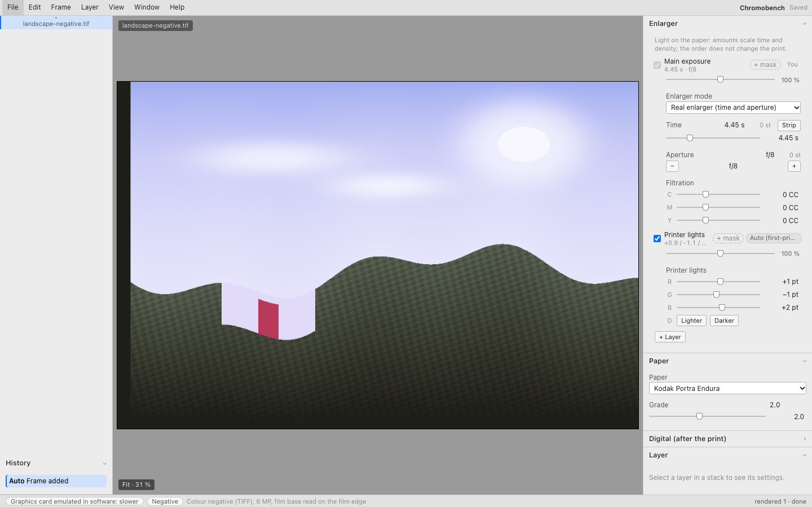

> **Developer commentary.** The document records the film edge ("rebate") along the *bottom* of the frame
> (`{x:94, y:1864, w:2900, h:128}`), where this negative is bright foreground, not on the left where the real
> edge is. `geometry.crop` is null. So the base was read in the wrong place, and the real edge stays in the print
> and in the export (3000×2000). The synthetic negative's uniform bottom rows may have invited this. Related to
> F30. The film strip on the left shows only the file names: each thumbnail canvas is 183×**2** px, with one
> frame and with five (K4 is **not** fixed in this build).

Lighter and Darker work like on my enlarger: they change the time, and the print follows in under a second. The
time slider is very touchy: a short push took me from 5.6 to 23 seconds. Typing is better. `7,5` gave 7.5 s.
`abc` turned the box red and told me how to type a time. `0` became 0.1 s and `1000` became 600 s, each with a
polite note. Nothing broke.

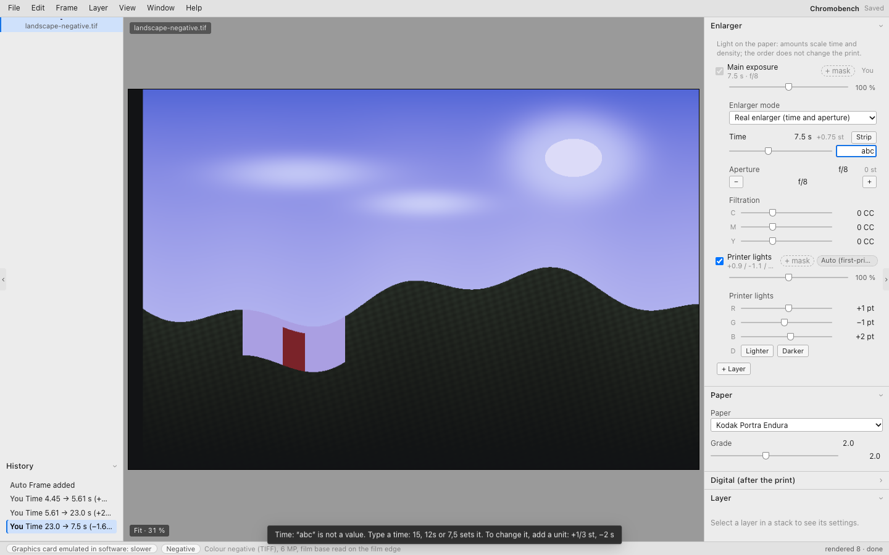

For the colour I did what I do on a dichroic head: the print is too blue, so I take yellow out. The yellow slider
is coarse too: a small push was −43 CC and the print went brown and muddy. I pressed Undo three times, one too
many, and Redo once. It was instant, and each step told me what it undid. Typing the filtration (−25 Y, +5 M) got
me a nearly neutral print. I did not know whether to use the filtration or the printer lights below it: both
change the colour.

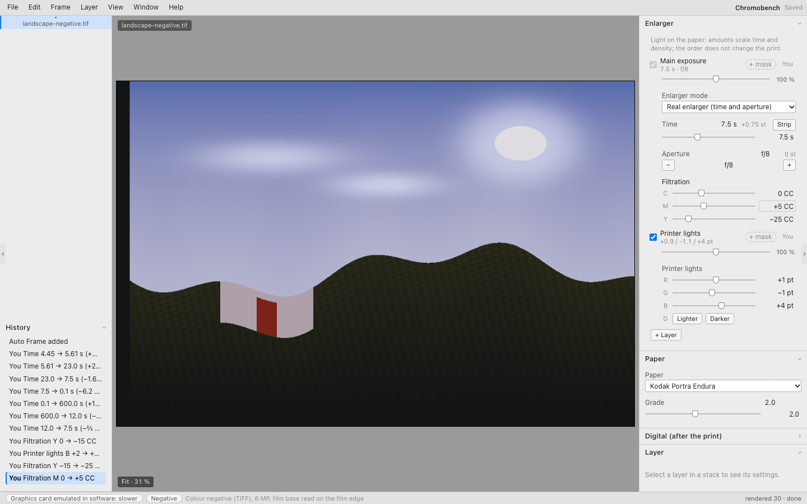

**Burning the sky.** I found it in two places: Layer ▸ Add to Darkroom ▸ Burn, or the small "+ Layer" in the
enlarger. A new burn darkens the whole print until you give it a shape. The shapes (Linear, Radial, Brush …) are
far down the right column, and I had to scroll for them. Then a drag from the top of the sky to the horizon gave
me a graduated burn, like moving a card. That is good. Dodging the foreground the same way worked on the second
try. The first drag did nothing, and the dodge lightened everything.

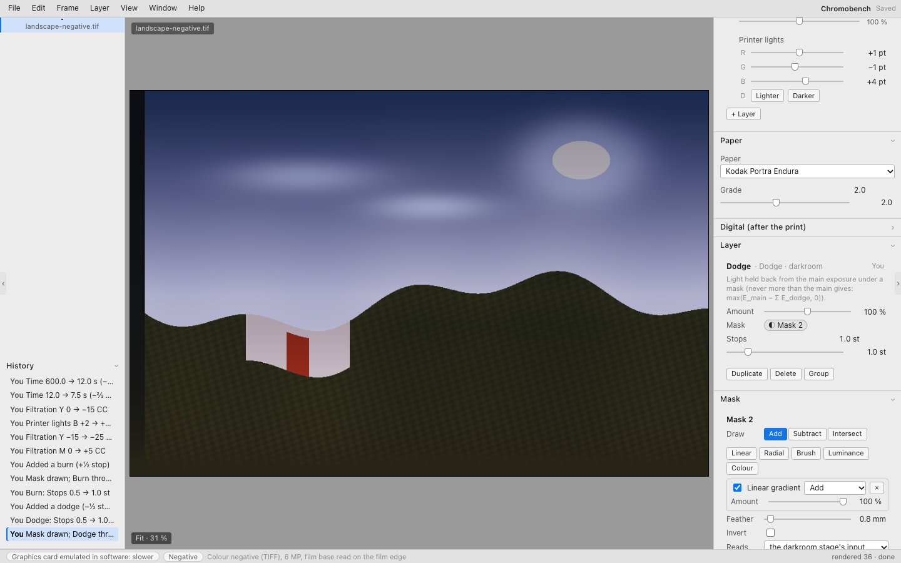

Grade 2.5 gave a bit more snap. In "Digital (after the print)" I added a curve and pulled an S, like in
Lightroom; the curve has a histogram behind it. Fine.

Then a nasty surprise: I clicked on the grey area above the picture, just to get out of a number box, and the app
**put a mask on my curve**. The gradient tool from the dodge was still switched on, and now the curve was the
selected layer. I only noticed because Edit ▸ Undo said "Undo Mask Curve (linear gradient)".

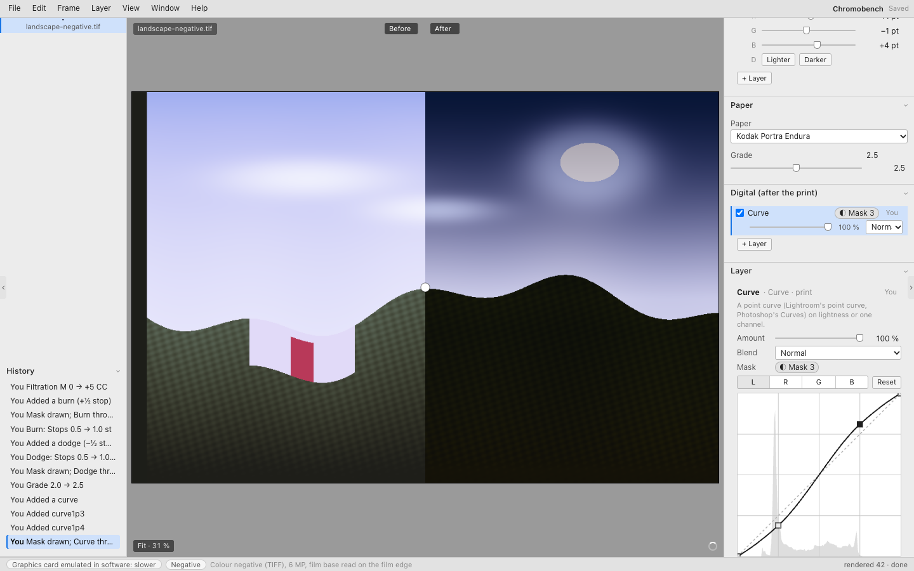

> **Developer commentary.** The mask tool stays armed after a gesture, and the crosshair cursor is the only sign.
> Any click on the viewport canvas, even outside the print, adds a gradient mask to the *selected* layer. Escape
> disarms it. History: "Mask drawn; Curve through a mask".

Before/after with `\` is a split with a handle, and "Before" is the first print. Good.

**Crop and dust are not on this screen.** "Find a Command" knows nothing about "crop" or "spot". "dust" only
finds "Heal Dust on Open". To cut off that film edge I would have to change the whole layout.

**Export** offers TIFF 16-bit, PNG 16 or 8, and four colour spaces. There is no JPEG for e-mail and no size.

> **Developer commentary.** In headless Chromium the save dialog (`showSaveFilePicker`) aborts, so the button
> ends in "export cancelled" after 0.3 s. This is a test-harness limit, like F27. The same pipeline into memory
> (`chromobench.exportPng('srgb','tiff16')`, measurement only) took 25.9 s for 3000×2000 16-bit on SwiftShader;
> the worst stall was 317 ms.

## S2: the same job in Classic

View ▸ Layout… shows eight buttons and no explanation, and "Darkroom first" is cut off. Classic opened on a
Library grid with my print still there and all my work kept (F24 fixed). Then I needed four module switches:

1. **Print**, the darkroom again, with something the darkroom screen lacks: a **ring-around**. Seven little
   prints, one per colour. I clicked "+Y" and the cast was gone. That is how I learned colour printing. The
   Exposures list also says in plain words what I would do at the enlarger: "Expose 7.5 s, hold back Mask 2 for
   3.75 s; burn Mask 1 7.5 s."
2. **Edit**: the print layers on the left; curve, HSL and colour grading on the right, like Lightroom. Soft
   Light on the colour grading made the hills pitch black. I could not select two layers to group them
   (shift-click does nothing), so ⌘G made a group of one ("1 entries"). Dragging the HSL into the group worked.
3. **Finish**: crop with handles on the picture (the film edge is gone), and spot healing with one click. I
   first clicked the "Crop & straighten" title, thinking it was a button, and the panel folded away.
4. **Output** is empty: "No photos yet" although my photo is open, "Export … come with CHB-011", and only
   "Save PNG". I had to go back to File ▸ Export anyway.

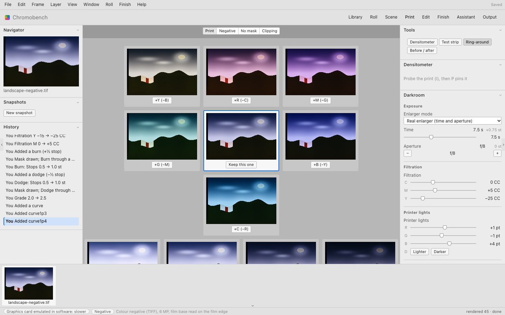
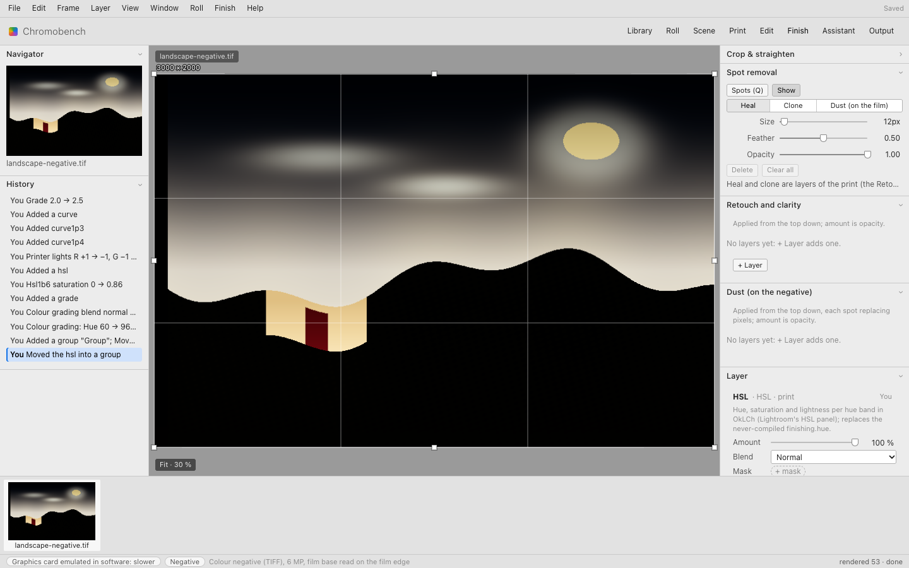
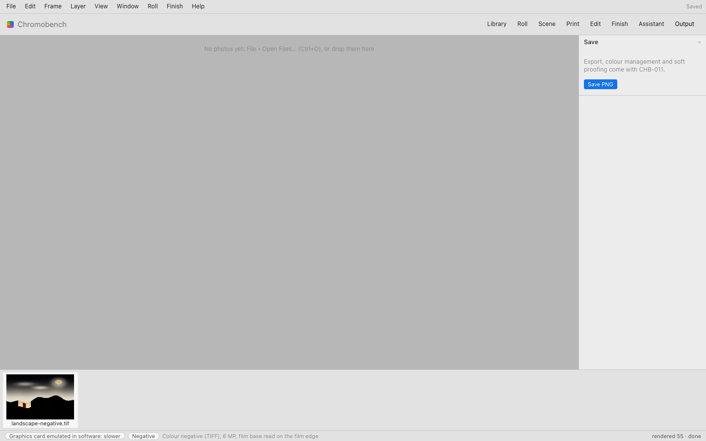

I did not get lost, because the modules have the same names as in Lightroom. But the right-hand "Layer" panel
kept showing the layer from the other module (the curve while I was printing, the HSL while I was cropping), and
"Edit", "Roll" and "Finish" are both menus and modules.

## S3: a roll

I stayed in Classic because it has a Roll module. The four frames opened together in 3.5 s, but frames 3 and 4
came out almost white. **"New roll from open frames" gave a red message, "That setting does not exist for this
picture", every time**, so "Analyse" and "First print…" refused too. I removed the landscape from the library and
tried again: same.

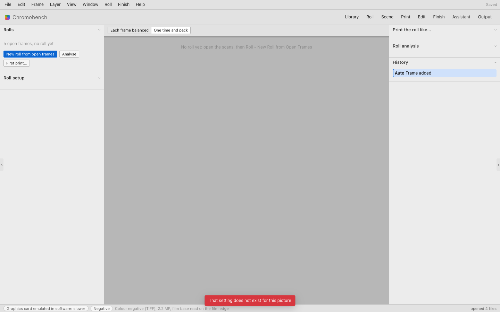

> **Developer commentary.** Toast detail: `E_PATH: roll.rolls.roll-1: no "roll" in the root`. The roll kit writes
> `t.$set(['roll','rolls',id], …)` (`packages/studio-kit/kits/roll/src/kit.ts:146`), but this layout's store has
> no `roll` root.

So I printed frame 3 by hand (Darker four times, 12.6 → 31.75 s) and looked for Lightroom's Sync. I found Frame ▸
"Apply Print Settings to Selection". I shift-clicked frame 4 and applied, and **my frame 3 was overwritten with
frame 4's settings**. The source is whichever frame I clicked last, and nothing tells me that. With ⌘-click on
frames 1, 2 and 4 it happened again: all four frames got frame 4's time and colour, so frames 1 and 2 went
purple. The good news: **one Undo took the whole change back on all frames**, and Redo put it back.

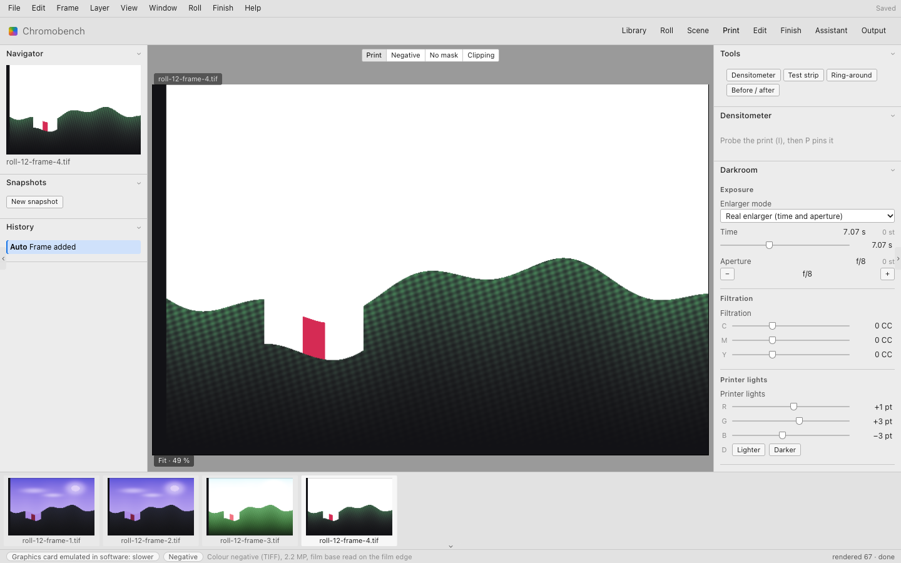

(Copy/Paste/Sync Settings are known to be missing from these two layouts in this build, K1. The P9 agent says a
Settings menu was added after this build.)

## S4: a camera file

In Darkroom first, the camera DNG did not show. It said "The picture could not be computed (a problem with the
graphics card)", and **the previous frame's picture stayed on screen under the new name**: a camera photo with a
film edge. I reloaded the page. My library was still there (F5 fixed). I opened the DNG again, and it came as a
photo through the film in 3.7 s (F1 fixed), a little pink-violet.

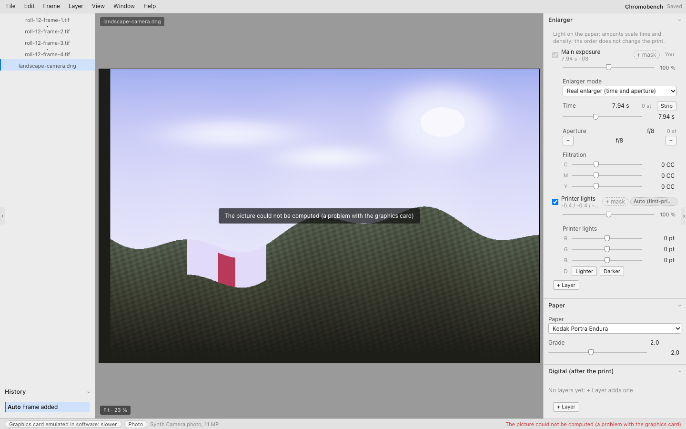

> **Developer commentary.** `E_GPU_OOM: source.83df6e52: 170624000 bytes do not fit the budget (532662224 of
> 536870912 live)`: the 512 MiB budget was full with five or six frames open at the 4000 px working size. Frames
> not on screen are not evicted. Measured on SwiftShader; not checked on a real GPU.

Darkroom first has **nothing "before the film"**: no exposure, no white balance, no film stock on that screen,
and ⌘K "white balance" finds nothing. Classic's Scene module has "Scene (before the film)" with a "+ Layer" list
(Exposure, Curve, Levels, HSL, Vibrance, Colour grading, Channel mixer, Vignette). Exposure worked, but I found
**no white balance**. The document holds a 5500 K daylight setting that I could not reach.

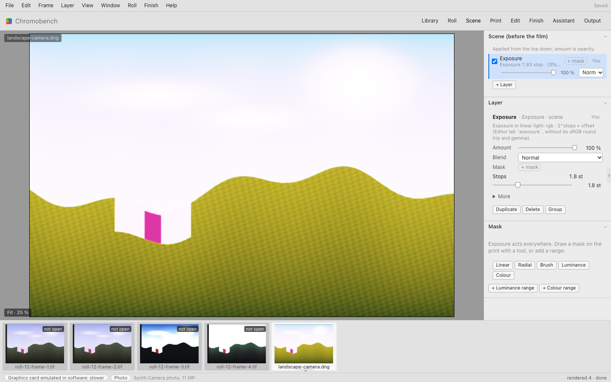

## S5: which screen, and which one for a new install

**Every day** I would rather sit at Darkroom first. It is one screen, like my darkroom: the print in the middle,
the enlarger beside it, burns and dodges as lines under the main exposure, and Lighter/Darker right there. For
S1 I never had to look for a module. But I cannot finish a print on it: there is no crop, no dust, no
ring-around or test-strip panel, nothing for a camera file before the film, and the film strip shows only names,
which is useless for a roll.

**Classic** makes me click through four modules, opens on the Library, and its Output is empty. But everything
I needed for S1, S2 and S4 is somewhere in it: ring-around, crop, spots, the Scene stage. For a new computer I
would set it up with Classic, because a beginner must be able to get to the end.

| | Darkroom first | Classic |
|---|---|---|
| S1 print (time, colour, burn/dodge, grade) | easiest: all on one screen | same controls, one module (Print), plus ring-around and test strip |
| S1 digital layers | collapsed palette, fine for one curve | Edit module, more room |
| Crop / dust | **missing** | Finish module, works |
| Export | File ▸ Export (no JPEG) | the same; the Output module is a stub |
| S3 roll | strip shows names only (K4) | Roll module broken (E_PATH); Apply-to-selection takes the wrong source |
| S4 camera file | **no scene/exposure/white balance** | Scene module: exposure yes, white balance no |
| Getting lost | never | a little (Layer panel follows the old selection; menus and modules share names) |

## What I would tell the developer

1. Let me make a roll. "New roll" fails every time, and "Apply Print Settings" copies from the frame I clicked
   last, so it wiped the frame I had just made right.
2. Put crop, straighten and dust on the darkroom screen. A print is not done with a film edge down the side.
3. Do not leave a drawing tool switched on: a click to leave a box put a mask on a different layer.
4. Give me white balance before the film, on both screens. Darkroom first has nothing at all for camera files.
5. Find the film edge where it is. Mine was on the left, the app looked at the bottom, and the first print came
   out blue with a black stripe.
6. When a picture cannot be computed, do not show me the previous photo under the new name. Free the memory of
   photos I am not looking at.
7. Show the pictures in the darkroom film strip, give Output a real export (JPEG too), and take the formulas out
   of the layer descriptions.

## Findings

| ID | Severity | Summary | Repro | Evidence |
|---|---|---|---|---|
| P9-8 | blocker | Roll module cannot make a roll: "That setting does not exist for this picture"; Analyse and First print then refuse | Classic ▸ Roll ▸ New roll from open frames (4 roll-12 frames open) | shots/50; detail `E_PATH: roll.rolls.roll-1: no "roll" in the root` |
| P9-9 | major | "Apply Print Settings to Selection" copies from the last-clicked frame (shift- or ⌘-click moves the primary), silently overwriting the corrected frame; copies everything incl. colour; no confirmation; selection hardly visible | Fix frame 3, shift-click frame 4, Frame ▸ Apply | shots/55, 57; frame 3 31.75 → 7.07 s |
| P9-1 | major | A mask tool stays armed; a later click anywhere on the canvas silently adds a gradient mask to whatever layer is selected | Dodge ▸ Linear ▸ drag; add a Curve; click the grey canvas | shots/25; History "Mask drawn; Curve through a mask" |
| P9-3 | major | Film edge detected on the wrong side (bottom); the real edge stays in print and export; base read there; first print blue (related F30) | Open landscape-negative.tif | shots/03; doc `rebate.y=1864`; export 3000×2000 |
| P9-5 | major | Darkroom first has no crop, straighten or spot removal; ⌘K "crop"/"spot" find nothing | Darkroom first, ⌘K | shots/27 |
| P9-12 | major | No white-balance control before the film; Darkroom first has no scene stage at all | Open the DNG; look in Darkroom first and Classic ▸ Scene | shots/61, 64; doc `scene.medium.whiteBalance` 5500 K |
| P9-11 | major | E_GPU_OOM after ~6 frames: the new photo is not computed and the previous picture stays on screen under the new name; only a reload helps | Open 6 frames, then the DNG (SwiftShader) | shots/59; `532662224 of 536870912 live` |
| P9-10 | major | Classic Output module is a stub: "No photos yet" with a photo open, "come with CHB-011", Save PNG only | Classic ▸ Output | shots/48 |
| P9-4 | major | K4 not fixed: darkroom film-strip thumbnails are 183×2 px (1 and 5 frames); only names show | Darkroom first, open files | shots/03, 59; DOM measurement |
| P9-6 | minor | Sliders coarse: 60 px Time = 2 stops; 40 px Filtration Y = −43 CC | Drag Time / Y | shots/05, 07 |
| P9-7 | minor | Developer text in the UI: Dodge "max(E_main − Σ E_dodge, 0)", HSL "OkLCh … never-compiled finishing.hue", Colour grading formula, Exposure "2^stops + offset (Editor lab …)", mask "Reads: … the scan cut", Metadata SHA-256 / frame id (F9 partly reproduced) | Select those layers | shots/21, 37, 64 |
| P9-13 | minor | Layers cannot be multi-selected; ⌘G groups one layer ("1 entries") | Shift-click two layers, ⌘G | shots/41 |
| P9-14 | minor | Export has no JPEG and no size; (harness: headless save picker aborts → "export cancelled", like F27) | File ▸ Export… | shots/28 |
| P9-15 | minor | Layout dialog: eight layouts with no explanation; "Darkroom first" label clipped | View ▸ Layout… | shots/31 |
| P9-16 | minor | First prints of a roll's denser frames come out nearly white (frame 3 needed 12.6 → 31.75 s) | Open roll-12-frame-1..4 | shots/49, 54 |
| P9-2 | minor | First Linear drag right after adding a Dodge did nothing (second worked); not reproduced | Add Dodge, click Linear at once, drag | shots/19 vs 21 |
| P9-17 | note | Panel titles look like buttons; clicking "Crop & straighten" folds the panel; Classic's Layer panel shows a layer from another module; Edit/Roll/Finish are both menus and modules | Classic ▸ Finish | shots/43 |
| P9-18 | note | Ring-around "+Y (−B)" is named in filtration but moves the printer lights (R −2, G −2, B +4 pt) | Print ▸ Ring-around ▸ +Y | shots/35 |
| K2 | known | "Added curve1p3", "Added a hsl", "Hsl1b6 saturation 0 → 0.86", "Added a grade", "Moved the hsl into a group", "Added a group "Retouch"" for a spot | n/a | shots/24, 47 |
| K1 | known | No Copy/Paste/Sync Settings in Classic or Darkroom first (fixed after this build per the P9 agent) | n/a | n/a |
| F7, F8 | fixed | Typed values: plain messages, clamping (0 → 0.1 s, 1000 → 600 s), `7,5` and `12s` accepted | Time value box | shots/06 |
| F1, F5, F24 | fixed | DNG opens as a photo; the library survives a reload; a layout switch keeps the open photos | n/a | shots/60, 61, 32 |

Worst main-thread stall in the session: 483 ms (around the `\` before/after toggle); most actions had none.
Renders: 0.2–1 s for time changes, 2–6 s to "done" for filtration, curve and wheel changes, and 8 s after a crop
(SwiftShader).

## Recommended default arrangement

**Manfred:** "I'd work in Darkroom first, because it feels like my enlarger. But I'd give a new computer Classic:
with it I can get from the negative to a cropped, spotted print, and a camera file has its scene settings."

**Developer's reasons:** a new install has to carry a first-time user through the whole job, and today only
**Classic** does that. Darkroom first has no crop, spot or scene stage, no ring-around or test-strip panel, and its
film strip is broken (P9-4, P9-5, P9-12). Make **Classic the default for now**, opening a file into Print rather
than Library, and fix its Output stub (P9-10) and the roll path (P9-8, P9-9), which affect both arrangements.
Make Darkroom first the default once it has a Finish palette (crop, straighten, spots), a "before the film"
palette for camera files, the ring-around and test strip next to the enlarger, a working film strip, and a tool
that does not stay armed (P9-1). It is the better everyday screen for the person this is built for.
